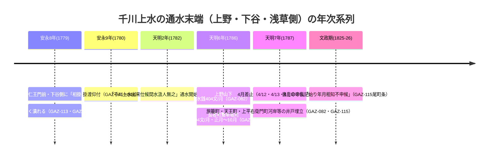

# 2026-11-20（第215回）・御府内備考残冊走査の完結と千川水銭・浅草側千川末端・赤坂白堀樋の追加調査

第215回は第214回に続く御府内備考（NDL次世代デジタルライブラリーのくずし字OCR fulltext）の残冊スイープを完結させる回とした。新規採番3件（[GAZ-114](sources/gazetteers/GAZ-114.md)・[GAZ-115](sources/gazetteers/GAZ-115.md)・[GAZ-116](sources/gazetteers/GAZ-116.md)）＋[GOV-291](sources/gov/GOV-291.md)追記＋対照表・橋名調査の追記。**引用文言はすべてくずし字OCR由来で原画像照合を要する（確認/観察/推定/仮説の区別は各ファイル・READMEに併記）。**

## 御府内備考所蔵冊の走査完了宣言（第215回時点）

第203回から続けてきたNDL所蔵冊（lab book/2553660〜2553704相当）のfulltext走査について、未着手だった①巻21-23（下谷之一〜三・2553670）②巻13-15（浅草之一〜三・2553667）③巻67-69（赤坂之一〜三・2553682）を本回で走査し、**所蔵全冊の走査が完了した**（陰性冊を含む対応表は下記）。

| 冊（NDL ID） | 巻・区域 | 対象河川文言の有無 |
|---|---|---|
| 2553660 | 目録 | — |
| 2553661-2553666 | 巻1-12（本郷・神田・小石川側） | 陰性（関口=人名・雑司ヶ谷=菩提寺・水上=水上町等の誤判定のみ） |
| 2553667 | **巻13-15（浅草之一〜三）** | **有＝千川上水末端文言群・藍染川（浅草）・石神井用水（[GAZ-115](sources/gazetteers/GAZ-115.md)）** |
| 2553668-2553669 | 巻16-20 | 陰性 |
| 2553670 | **巻21-23（下谷之一〜三）** | **有＝千川上水之樋＋水銭204文・埋堀（[GAZ-114](sources/gazetteers/GAZ-114.md)）** |
| 2553671 | 巻24-28（下谷之四・根津・谷中） | 有（第214回GAZ-113＝藍染川総説・千川家橋負担・北巴之橋等） |
| 2553672-2553681 | 巻29-66（牛込・市谷・四谷ほか） | 有（第212-213回処理済み・桜川・万年石樋等） |
| 2553682 | **巻67-69（赤坂之一〜三）** | **有＝白堀通樋請負人・赤坂川・桜川・弁慶堀（[GAZ-116](sources/gazetteers/GAZ-116.md)）** |
| 2553683-2553684 | 青山渋谷・麻布 | 有（第214回までに処理・渋谷川等） |
| 2553685-2553686 | 巻79-83 | 陰性 |

## 千川上水の通水末端（上野・下谷・浅草側）の年次系列（Mermaid）

- 本回の増分＝**水銭204文/月の第2数値**（[GAZ-114](sources/gazetteers/GAZ-114.md)下谷長者町繋車坂町条・天明6年正月〜10月・押切帳面）が[GAZ-082](sources/gazetteers/GAZ-082.md)上野山下条404文と並び、**末端側の複数町が月額を異にして水銭を差し出していた**観察。天明6年正月〜10月の支払期間が天明7年4月差止の直前にあたる点も時系列の補強。
- **4月12日（旅籠町壱丁目代地・茅町・尾町）と「四月中」（上平右衛門町河岸側）・4月13日（活字版GAZ-082の旅籠町）の表記併存**＝差止日の一次書上の表記層の揺れ（断定せず併記）。

## 大塚地名論の対校表（第214回課題⑥の整理）

[GAZ-034](sources/gazetteers/GAZ-034.md)第214回追記の江戸期集成側の大塚地名論を説ごとに整理する（併記であっていずれかの確定ではない）：

| 説 | 内容 | 出典層 |
|---|---|---|
| 東西2塚 | 「江戸志」所引＝東西に2つの塚があったとする系統 | GAZ-083（小石川志料1826・先行一次）＋GAZ-034（集成本文） |
| 一里塚説 | 千住街道の一里塚とする説 | GAZ-034 |
| 太田道灌七ヶ所物見塚（狼煙）説 | 道灌が七ヶ所に物見塚を置き狼煙を上げたとする説＋**これに懐疑的な按語** | GAZ-034（按語つき） |
| 森川鉾太郎屋敷塚 | 改撰江戸志の土人説＝森川鉾太郎の屋敷塚 | GAZ-034（改撰江戸志所引） |
| 巣鴨不動堂説 | 別当・黒高山通去院（巣鴨不動堂）関連説 | GAZ-034＋第53回BLOG群（出典本文の確認済み） |

## 千川家の系譜メモ（第214回課題④の整理・結論保留）

- [GAZ-113](sources/gazetteers/GAZ-113.md)の人名群（**茂是〔茂兵衛候補〕・茂兵衛・重助**）は[GOV-210](sources/gov/GOV-210.md)/[GOV-211](sources/gov/GOV-211.md)/[GOV-212](sources/gov/GOV-212.md)（嘉永3年遠山書付・由緒書）の橋負担の記述と対応するが、**重助の系譜上の位置（元祖太兵衛・徳兵衛・金七・善蔵・宇兵衛・三左衛門・平吉の代名群のどこに入るか）は本資料群からは確定できない**＝「重助」の新出候補の位置づけは保留し、[docs/千川上水請負人の変遷.md]（実在せず）を新設せず、対照表系とGAZ-113のqualifierで対応する判断を維持する。

## 北巴之橋×合染橋の対校（第214回課題⑤・観察のみ）

- [GAZ-113](sources/gazetteers/GAZ-113.md)三崎町条「**北巴之橋**」＝三崎町⇔千駄木坂下町の藍染川（幅9尺）石橋・両岸組合出銀・寸法不明（OCR判読対立の併記）と、[GOV-240](sources/gov/GOV-240.md)/[GAZ-033](sources/gazetteers/GAZ-033.md)の「**合染橋（藍染橋候補）**」＝千駄木坂下町の谷戸川石橋（長2間・巾8尺）は、**同一の谷戸川＝藍染川区間（千駄木坂下町〜三崎町境）に架かる石橋**で、**同一橋である可能性は排除できないが、寸法・負担構造（片側町持か両岸組合か）の文言が異なるため断定せず併記**（対校観察）。両者の関係の確定には原画像の逐字照合が必要。

## 監視系の記録（2026-11-20時点）

1. **news6クエリ**（谷端川/弦巻川/水窪川/千川上水/神田川 下水道/雑司ヶ谷 幹線・recency 30日）＝全件陰性（阪神・谷端選手・水窪ダム・米沢等の誤判定を除外、環七インフラツアーの都プレス2026-11-02は既知・[GOV-149](sources/gov/GOV-149.md)記録済み）。
2. **日経クロステック2記事**（2026-10-28「排水強化進む都市、東京は地下河川　水害対策限定の地方債で資金調達も」・2026-11-02「都市の排水強化が加速、東京都は地下河川具体化へ」・同一内容の2版）＝有料・リード＋図説のみ確認＝**水害対策限定地方債（レジリエンス債）の財源層の報道側記録として[GOV-291](sources/gov/GOV-291.md)に追記**（第214回の「登録保留」を解消）。
3. **東京新聞2026-09-30**〈論戦 都議会〉代表質問「豪雨災害対策　30年ごろ目標に地下河川整備　都、方針明かす」＝公明党・加藤雅之議員の代表質問への答弁で**都が地下河川整備を2030年ごろ目標に推進する方針**＝[GOV-149](sources/gov/GOV-149.md)の2030年頃系列の答弁側一次報道＝同じく[GOV-291](sources/gov/GOV-291.md)追記。
4. **kanzyou7.com WHAT'S NEW**＝2026/11/20更新（既知・軽微）。
5. **musashi.repo.nii.ac.jp・nabunken 113630**＝http 000で不通継続（要因不明・次回再試行）。
6. **都建設局 kasenseibikeikaku（河川整備計画頁）**＝403継続（curl・UA変えても同様。決定版「神田川流域河川整備計画」の公表監視は継続）。
7. **環境局根据地図blog「気になる生活ナビ」**［神田川・環状七号線地下調節池の見学予約と場所］＝新しい第三者解説ページ（目新しい事実なし・登録せず本ノートに軽微記録のみ）。
8. **調節池広域整備検討委託（その2）開札**＝2026-12-02予定＝まだ未来のため**次回（第216回以降）へ順送り**。

## 次回の課題

1. **開札2026-12-02（環七調節池広域整備検討その2）の結果確認**。
2. GAZ-114〜116の**原画像照合**（特に「大明六年」＝天明6年・條帰属〔長者町繋車坂町・茅町壱丁目・尾町〕・「日音院」・服部屋清右衛門の条割付）。NDLの画像ビューアでの逐字確認。
3. **御府内備考が完了した**ため、次の写本集成の候補（『新編武蔵風土記稿』大系版以外の_unused巻の再読、または江戸名所図会の橋梁部分の未収録モデルの確認）。
4. 千川家「重助」の系譜位置の資料探索（嘉永3年以降の名前の照合）。
5. 北巴之橋×合染橋の原画像対照（三崎町条・千駄木坂下町条の逐字）。

## データ整合

- 本回の新規採番：**GAZ-114・GAZ-115・GAZ-116**（3件・いずれもOCR全文確認）＋GOV-291追記（新規採番なし）。
- INDEX items: **1,347 → 1,350**（地誌・行政史料 113 → 116件）。
- 対照表：新規6行（白堀通樋請負人・桜川〔赤坂〕／赤坂川・弁慶堀・藍染川〔浅草〕・埋堀・太刀洗川〔赤坂〕）＋千川上水行・石神井川行・万年石樋行の追記。
- 橋名調査：第215回追補（白堀通樋請負人・元赤坂町の土橋・石橋群・石橋の変遷・千川上水之樋・新堀の数條の橋）。
