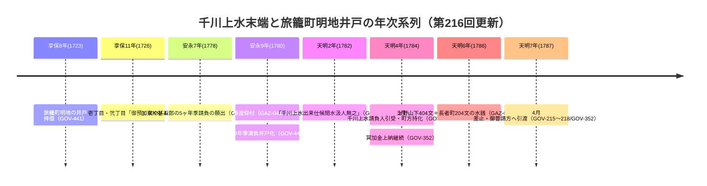
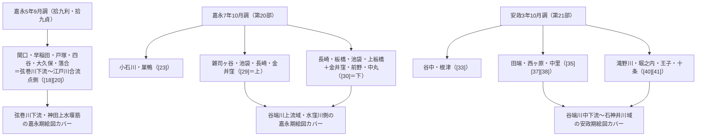

# 2026-11-20（第216回）・旅籠町明地の井戸チェーン対校・沿革図書絵図分冊の表紙掃引・今村1916震度分布の同定

第216回は『御府内往還其外沿革図書 十四』（天保15年調・2571704）の新規精読、『御府内場末往還其外沿革圖書』の嘉永〜安政期絵図分冊群の表紙文言掃引（[GAZ-012](sources/gazetteers/GAZ-012.md)追記）、今村明恒『震災予防調査会報告』第77号（1916・974335）の震度分布論文の3系統の調査とした。新規採番2件（[GOV-441](sources/gov/GOV-441.md)・[PAP-095](sources/papers/PAP-095.md)）＋[GAZ-012](sources/gazetteers/GAZ-012.md)追記＋[地名対照表](地名・河川名対照表.md)「神田淵」行新設。**引用文言はすべてOCR由来で原画像照合を要する（確認/観察/推定/仮説の区別は各ファイル・READMEに併記）。**

## ① 神田旅籠町明地の井戸の通時チェーン（GOV-352×GOV-441の独立対校）

[GOV-441](sources/gov/GOV-441.md)（十四・外神田湯島天神下下谷辺）の旅籠町明地の沿革書上に、**享保8年（1723）9月の拝借から天明4年（1784）5月の千川上水請負人引受・「町方持」化までの井戸の通時チェーン**が現れた。[GOV-352](sources/gov/GOV-352.md)（書上帳第40冊の昌平橋外堀井戸の伺書）との対校は次の通り。

| 項目 | GOV-352（伺書・天明7年時点の申立） | GOV-441（十四・沿革書上） |
|---|---|---|
| 請負開始 | **安永7戌年（1778）**・5ヶ年季 | **安永九子年（1780）5月**・「年季清負」（年数の文言なし） |
| 請負人 | 深川永堀丁「**加東や**」甚五郎 | 深川永堀町「**加藤屋**」甚五郎 |
| 冥加金 | 30両/年 | 「冥加金上納」（額の文言なし） |
| 千川上水側への移行 | 牧野大隅守勤役中に千川上水請負人共へ**無年限預置**・天明4辰年ゟ上納 | 天明四辰年5月 千川上水請負人が「引請」・井戸が「**町方持**」化 |
| 前史 | （伺書の対象外） | **享保8卯年9月 拝借 → 享保11午年2月 壱丁目・弐丁目「御預」** |

年次・表記は対立するが、**昌平橋外＝神田旅籠町側の明地際の井戸（堀井戸）の請負替わりの記録として独立の史料系で内容が噛み合う**（同一井戸かの断定は保留。年次差は伺書の願出時点と沿革書上の書き分けの差か、請負替わりの別局面かは原画像照合まで決めない）。**天明4年5月の月次はrepo初出**で、千川上水の末端年次チェーン（安永9掛渡→天明2通水→天明4.5＝新→天明6水銭404文＋204文→天明7.4差止）に1点挿入される。

同じ地所群に雑司ヶ谷村百姓平次郎の拝借地（神田冨松町＝佐久間町四丁目河岸の替地）の文言（明和4年5月拝借→北之方の「**町方薪置場**」化→明和5年5月東之方2ヶ所召上→板倉佐渡守中屋敷下げ）があり、[GOV-347](sources/gov/GOV-347.md)（市谷）・[GOV-358](sources/gov/GOV-358.md)（浅草）に続く**平次郎文言の第3例＝神田側用例**として記録した。「地震出来」の崩壊文言候補（拝領町屋の被害）も字面のみ記録（年次比定は保留）。

## ② 御府内場末往還其外沿革圖書の嘉永〜安政期絵図分冊群の表紙掃引（GAZ-012追記）

シリーズ（全45分冊相当）のうち第160回追記で「残る未精査巻」としていた群（9370095〜9370106断片群・2587262・2587265）の表紙文言を本回で掃引し、次の構造が表紙レベルで裏付いた（詳細は[GAZ-012](sources/gazetteers/GAZ-012.md)第216回追記）。

- **拾九利・拾九貞の嘉永5年9月調絵図が「四枚之内」の分冊構造**で、本文書上冊（[17]→[GAZ-080](sources/gazetteers/GAZ-080.md)・[19]→[GOV-366](sources/gov/GOV-366.md)）と絵図側分冊（[18]2587262＝関口・早稲田・戸塚＝弦巻川下流側、[20]9370095＝四谷・大久保・落合側）が対で伝わる。
- **貮拾貞（嘉永7年10月調）が「上」（[29]＝雑司ヶ谷・池袋・長崎・金井窪側）に加えて「下」（[30]9370098＝長崎・下板橋宿・池袋・上板橋＋金井窪・前野・中丸）の分冊を持つ**＝谷端川上流域（金井窪・前野・中丸）の村絵図の絵図側分冊の所在。
- **第21部貮拾壱の安政3年10月調絵図分冊群が「元亨利貞×上下」の体系**で、[33]（谷中・根津）・[35]（**田端・西ヶ原**）・[37]/[38]（田端・中里・尾久・船方）・[40]（**滝野川・堀之内・王子**）・[41]（**滝野川・王子・十条**）まで収録域を確認＝**谷端川中下流から石神井川域の東縁まで village-by-village の嘉永〜安政期絵図カバレッジが揃っている**。

本文OCRはいずれも高度崩壊で水路文言の採用は不可。**絵図図葉そのものの読図（水路・池・橋の描き込みの確認＝[地図一覧](地図一覧.md)の対象）が次段**。対象外・陰性：[6]9370094（品川・蛇窪）・[43]9370106（浅草田原町）・2587250（金杉・尾久＝第165回陰性と整合）・2587253（今戸・山谷＝第159回陰性と整合）。9370101は書誌APIが500で要再確認。

## ③ 今村明恒1916「東京大阪兩市街地ニ於ケル震度ノ分布」（PAP-095）

[974335](https://lab.ndl.go.jp/dl/book/974335)（『震災予防調査会報告』第77号・大正5年）。震度大区域の列挙「**神田淵ノ跡(小石川大下水、江戶川尻ヨリ舊小川町…)」**は、**蟹川系旧河谷（江戸川＝神田川下流と小石川大下水〔＝谷端川下流部の歴史的呼称〕に挟まれた低湿地帯）を軟弱地盤＝震度大区域として土地構造から同定した1916年の学術本文**。[BOOK-167](sources/books/BOOK-167.md)（東京市史稿変災編第1の「関谷博士調査」引用）と文言が同型で、**BOOK-167の文言の出所側（または同系出所）であることの対校**がついた（両者の引用関係は未確認のまま）。

- 震度中区域に根津湯島ノ東・白山下・江戶川筋・牛込堀端・赤坂溜池筋（山の手側の軟弱地盤の例証）。
- 関谷博士の安政2年遺稿の要旨が引用保存される（**震原＝東亀井戸村・市川村近傍の推定、緩・激・中間の3級分類、激級に小川町・小石川・根津〜下谷**）＝[BOOK-167](sources/books/BOOK-167.md)の制限③（関谷原典への遡及未実施）に対して今村経由の内容確認が1段進んだ（原典特定ではない）。
- 安政大震の武家死者2131人のうち「**江戶川筋神田淵跡ノ九百人**」の文言（BOOK-167と同型）。
- 赤坂溜池の成因叙述（「往古江戶市中ニ分布スル用水ヲ溜メタル大池」）＝[GAZ-116](sources/gazetteers/GAZ-116.md)の溜池・赤坂川文言群の対校資料。
- [地名対照表](地名・河川名対照表.md)に「**神田淵（の跡）**」行を新設した。
- 陰性：水窪・谷端・弦巻・千川・蟹・音羽・雑司は全0件（対象域は江戸川下流〜小石川大下水・赤坂の縁辺）。

## 陰性・見送り記録

- コーパス掃引（NDL lab横断・既知lab pid 63冊分のfulltext）で蟹川・戸山落・妙正寺川・谷端川・弦巻川・水窪川・千川上水・千川用水・音羽村・新編江戸志・小石川大下水・池袋村・神田上水・人参川・茗荷谷・蟹窪の検索は既登録資料にほぼ全ヒット。新規で意味のあったものは上記3系統のみ。
- 茗荷谷ヒットの江戸期一次史料4点（公事吟味留[37]＝2589219・屋敷渡預絵図証文[119]/[155]＝2547850/2587996・屋敷書抜甲32＝2547425）：屋敷譲渡・寺一件記録で水系文言なし＝資料化見送り。
- 抱屋敷寄帳[8]（2548058）・下屋敷絵図寄帳[1]（2571903）の池袋村文言：屋敷譲渡のみで水系文言なし＝陰性。
- 豊多摩郡落合町現状調査1931（1900474）：「妙法寺川」の異表記（repo未収録）＋妙正寺川流域＝豊多摩郡最低湿地の地形記述。四河川本文脈では薄いので**対照表の妙法寺川行追記候補として次回以降に持ち越し**（資料ファイル未作成）。
- 2587265（[23]貮拾元）の「蟹」2件は出火記録のOCR崩壊文言＝陰性。

## 監視系（全件、確認済み）

- news検索6クエリ（谷端川・弦巻川・水窪川・千川上水・神田川下水道・雑司ヶ谷幹線・recency30日）＝全件陰性（谷端川＝阪神・谷端選手の誤検出、弦巻川＝moegirl誤検出、水窪川＝米沢・静岡の水窪ダム誤検出、神田川下水道＝環七地下調節池の既知記事（GOV-149既収録）、千川上水＝en.wikipedia stub、雑司ヶ谷幹線＝一般ページ）。
- [kanzyou7.com](https://kanzyou7.com/) のWHAT'S NEW＝2026/11/20「**週間工程表、シールド進捗図を更新しました**」（トップページで直接確認・前回と同型の定期更新、Earth counterpart の進捗数値の変化は確認できず）。
- musashi.repo.nii.ac.jp・nabunken（113630）はhttp不通継続。東京都建設局河川整備計画頁は403継続（神田川流域計画は令和5年3月版が最新のまま）。
- **開札2026-12-02（環七地下調節池広域整備検討その2）はまだ未来＝次回最優先のまま**。

## 次回以降の課題

1. **開札2026-12-02（環七調節池広域整備検討その2）の資料確認**（次回最優先）。
2. 本回で表紙掃引した嘉永〜安政期絵図分冊群（[28][30][35][40][41]等）の**IIIF原画像の読図**（水路・池・橋の描き込み確認＝地図一覧の対象）。
3. GOV-441・GAZ-114〜116等の原画像照合 backlog（くずし字OCRの文言確定）。
4. 9370101（500エラー）の書誌再確認。1900474（妙法寺川）の対照表行判断。
5. 神田上水留シリーズの未登録冊群（[7][9][11][12][27][28][30][31][43]等）の精査。
6. 千川家重助系譜・北巴之橋×合染橋対校（継続事項）。

## 本回の成果まとめ

- 新規採番：[GOV-441](sources/gov/GOV-441.md)（御府内往還十四・旅籠町井戸チェーン・平次郎文言第3例）、[PAP-095](sources/papers/PAP-095.md)（今村1916・震度分布）。
- 追記：[GAZ-012](sources/gazetteers/GAZ-012.md)（嘉永〜安政期絵図分冊群の表紙文言掃引）、[地名対照表](地名・河川名対照表.md)（神田淵行新設）。
- いずれもOCR由来で原画像照合が前提。断定できるところは文言の存在と年次の対立関係までとし、比定・帰属の判断は保留した。
