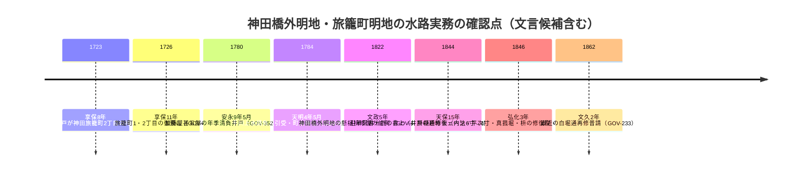

# 2026-11-20（第217回）・神田上水留未登録45冊の走査と落合町現状調査の妙法寺川異表記・井之頭池刈取帳の字三ツ柳と字池袋・水道橋外河岸の大名物揚場・神田橋外明地の真菰堀の追加調査

## 概要

第217回は**NDL次世代デジタルライブラリーの『神田上水留』（2587456〜2587516＝[n]は2587455+n）・『神田玉川上水留』（2587517〜2587546）のrepo未登録45冊のfulltext取得と走査**を主軸に、①東京市臨時市域擴張部の現状調査シリーズの落合町冊（1900474）の新規登録（**妙法寺川の異表記候補**)、②井之頭池の刈取・土留柵修復の出来形仕上帳（明治2〜3）、③水道橋外の河岸惣場と駒塚橋の慶応元年文言、④神田橋外明地の真菰堀・掛樋枡の弘化3年文言、⑤文久2白堀普請の水留一件（[35][36]）のGOV-233追記、を行った。新規採番4件（[GOV-442](sources/gov/GOV-442.md)〜[GOV-445](sources/gov/GOV-445.md)）＋追記1件（[GOV-233](sources/gov/GOV-233.md)）＋[対照表](地名・河川名対照表.md)1行新設（妙正寺川／妙法寺川行）＋[橋名調査](四河川の橋名・橋跡調査.md)第217回追補（駒塚橋の慶応元年柵修復）。

## 本回の4件の新規登録と背景

### 1. GOV-442：豊多摩郡落合町現状調査（1931・東京市臨時市域擴張部）

- [GOV-331](sources/gov/GOV-331.md)（大泉村）と同一シリーズの落合町冊。**同一の地勢章の中で「妙正寺川」6回と「妙法寺川」2回が併存**（「本町ヲ東西ニ貫流スル妙正寺川ヲ以テ南北ニ二分サル、妙法寺川ノ流域ハ豊多摩郡中ニテモ地形最モ低キ地域ニシテ卑濕平坦ナル低地ヲナス」）＝**1931年の行政調査文体レベルの「妙法寺川」表記の一次文例候補**（対照表に新行）。誤記か意図的記載かは断定しない（両岸の岡脈〔中野・野方起り〕×高阜〔目白台連る〕の地勢文言・「下水道施設ナシ」・水道栓数と水道組合加入の町政帳簿も登録）。

### 2. GOV-443：神田上水留[61]・井之頭池の刈取・土留柵修復の出来形仕上帳（明治2〜3）

- 表題「神田上水源井之頭池葭真菰其外水草苅取幷土留柵御修復御入用出来形仕上帳」。**刈取面積が「弁天社廻りゟ字三ツ柳下迄＝3,347坪（人足124人・賃銀1貫488匁）」と「字池袋ゟ水門際迄＝9,443坪（268人・3貫216匁）」の2区域**で計上され、字三ツ柳下の杭列（長9間×高3尺・杉丸太28本・唐竹90本）の修理・**在来船大破による藻刈船の新規打立（外法長2間4尺5寸・幅4尺・敷2間3尺・深1尺5寸）**・**明治3庚午9月の民部省土木司（土木正・土木少令史）の検査と清算高89両2分**・受益村名主の入用入れの実名リスト（吉祥寺村名主ほか・讃岐屋伊三郎・山崎屋三平等）を収録＝**幕府瓦解直後の神田上水の水元（井之頭池）の維持実務が明治政府に引き継がれた直後の帳簿**で、**井之頭池の内部の字名（字三ツ柳・字池袋）・弁天社廻り・水門際の位置語も初出候補**。
- [GOV-334](sources/gov/GOV-334.md)（分冊ノ一）・[GOV-335](sources/gov/GOV-335.md)（分冊ノ二）の兄弟冊で、系列の出来形側を埋める。

### 3. GOV-444：神田上水留[40]〜[42]・水道橋外掛樋并埋樋枡御普請一件（元治2丑年＝慶応元年）

- 分冊ノ一（雉子橋御門内御普請方の申渡・北屋場林田小右衛門宛）・分冊ノ二（**河岸惣場の見守番屋3間×3間・松平讃岐守物揚場拾四間・石川伊予守物揚場拾八間候補・諸色揚場・小留場竹矢来・葭張・茶屋・足代桟橋**＝幕末の水道橋外神田川河岸の土地利用の実態・全て文言候補）・分冊ノ三（古物御払の仕様注文帳＋**関口村駒塚橋上シ下モ柵御修復の附切手当（金3両3分・丑10月8日〜11月2日25日分）**の請取文言）。
- 駒塚橋の慶応元年の柵修復の行政文例（橋本体でなく柵）＝[橋名調査](四河川の橋名・橋跡調査.md)第217回追補。

### 4. GOV-445：神田上水留[12]・神田橋外弐番三番四番明地掛樋枡御修復一件（弘化3年）

- 落札58両（2番札・村田阿波守書面・元積61両3分との差引3両3分の検査文言）＝**「御組合入用」として運営**。
- **明地の掛樋の内法寸法の変化（元極6寸四方→御舂屋懸出揚の極4寸四方）**・**「真菰堀」の語（repo初出候補・長8間幅7尺の埋立・吸込口の泥留仕様）**・**枡の修復群（戸田長門守屋敷脇・長谷川又三郎屋敷前の石縁枡・真菰堀内・四番明地内＝内法2尺5寸四方の深4尺〜6尺）**・**四番明地の枡から真菰堀まで長7間4尺の「柳之根取込」**・馬駕籠相通（通行止めと再開の触）の文言・文政5年／天保13年（虎御門外の玉川上水）の前例参照＝**[GOV-441](sources/gov/GOV-441.md)（旅籠町明地の井戸チェーン・天保15年書上）の同区域の弘化3年の修復実務側の記録**で、[GOV-352](sources/gov/GOV-352.md)（昌平橋外堀井戸の伺書）の系統の明地側の構造（樋・枡・真菰堀）を具体的に記す帳簿候補。

### 5. GOV-233追記：文久2白堀普請の水留一件（[35][36]）

- [36]（水留壱件冊）＝白堀通普請中の**水留3日間（明後廿七日ゟ・朝五時ゟ・雨天は日送）の通達**の宛先リストが**大名屋敷（田安殿一橋殿御家老衆・紀伊殿尾張殿・酒井隠岐守・対馬守〔浜町蛎売町〕・出羽守・信濃守等）・講武所奉行衆・小川町講武所・神田納屋・天神下広小路組合・小石川御門外組合（筧平十郎）・諏訪町組合（細田加右衛門）・水道町名主（小石川今松）・関口水道町名主**等に及ぶ＝**白堀の水管理の通知網の帳簿候補**。
- 「**月白下（目白下OCR候補）大洗堰ゟ江戸川え水落申候**」（本冊内3回）＝**水留中の落水先＝大洗堰の分水切替の実運用の裏付け文言候補**（[GAZ-030](sources/gazetteers/GAZ-030.md)の水門条・[GAZ-048](sources/gazetteers/GAZ-048.md)の関口の瀧と対照）。
- 天神下広小路組合の返書「**水相用候者無御座候間 以来岸苅埋渡等之節 水留別段御達間不申候**」＝受益なしの組合が通達対象から外れる運用の返書側記録。水道橋通組合（年番徳永伊豫守）の文言も。
- [35]＝**服部坂下ゟ小石川牛天神下迄の白堀沿いの「橋外石段 其外堀方に相障候分取除」の通達（文久2年5月14日・役奉行）**＝白堀通の沿道の橋外石段の一次記録候補。制限②（[35][36]未精読）を解消（全て文言候補扱い）。

## 神田橋外明地（旅籠町明地）周辺の樋・枡の通時系列（本回で確認された範囲）

（※千川上水差止後も明地の掛樋・真菰堀が修復対象になっている点は、本回文言のみからは当該水路の水源の特定（神田上水・千川上水残水・玉川上水代官町土手上の仕水〔GOV-445の文言候補〕の別）ができないため、水路の帰属は断定しない。）

## 陰性・見送り

- **未登録45冊の走査で「千川／千河／谷端／弦巻／水窪」直接ヒットはほぼ0件**（『神田上水留』は江戸城内給水樋枡・水道橋・明地・井之頭池の帳簿が主体のため）。玉川冊5冊の「関村」ヒットはOCR崩れで意味薄と判断。
- 「鼠」ヒットの大半は「鼠半切」（半紙の種類）のfalse positive。「音羽」ヒットは神田音羽町のfalse positive可能性が高いが、[36]の音羽町元丁目の文言は白堀沿い町名の候補（原画像照合まで断定せず）。
- 9370101（沿革図書絵図分冊）は今回もAPI 500で書誌確認不能（第216回課題・継続）。

## 監視系（2026-11-20時点）

- **news6クエリ**（谷端川／弦巻川／水窪川／千川上水／神田川 下水道／雑司ヶ谷 幹線・recency 30日）＝**全件陰性**（谷端＝阪神谷端選手、弦巻＝moegirl・弦巻こころ、水窪＝米沢・静岡の水窪ダム等のfalse positiveのみ）。都庁プレス2026-11-02の環七地下調節池インフラツアーは第206回・第166回で既記録のため再登録せず。
- **musashi.repo.nii.ac.jp・nabunken**：直接取得は今回も不通（musashiの検索HTMLは空応答・nabunken 113630は404）。継続監視。
- **kanzyou7 WHAT'S NEW**：第216回で2026/11/20「週間工程表、シールド進捗図を更新」を確認済み（同日の並走のため本回は追加変化の確認を省略・次回確認）。
- **開札2026-12-02（環七調節池広域整備検討その2）**：まだ未来のため順送り（次回の最優先監視対象のまま）。

## 確認・観察・推定・仮説の区別（本回分）

- **確認**: 4冊の書誌（NDL lab APIの書誌・表紙OCR文言）・fulltext OCRの文言そのもの・落合町現状調査の妙正寺川／妙法寺川の併存（と読めるOCR文言）・[61]の刈取区分の文言（弁天社廻り〜字三ツ柳下・字池袋〜水門際）・[42]の駒塚橋文言の存在・[12]の落札58両／61両3分の文言。
- **観察**: 『神田上水留』の未登録冊群の性格（江戸城内給水・水道橋・明地・井之頭池の帳簿が主体で四河川直接の文言は少ない）＝repoの選別方針（四河川・千川・白堀・井之頭・水道橋周辺の文言中心）の運用はこのまま。
- **推定**: 妙法寺川表記は異表記（または誤記）として1931年に流通していた可能性／[61]の字池袋〜水門際は井之頭池の水門（[GOV-399](sources/gov/GOV-399.md)の水門）と同じ区域の可能性／[12]の「真菰堀」は上水末端の浸透・ろ過の堀の可能性。
- **仮説**: 水道橋外の大名物揚場（松平讃岐守・石川伊予守）は水道橋外の河岸が大名の物流・揚場として使われ続けた傍証（[BOOK-152](sources/books/BOOK-152.md)の揚場絵図・[GOV-288](sources/gov/GOV-288.md)の神田川揚場と対照して検討）。

## 次回の課題

1. **開札2026-12-02（環七調節池広域整備検討その2）の結果確認**（最優先）。
2. 1900474と同シリーズの現状調査冊の棚卸し（豊多摩郡43町村のうちrepo未登録の町村冊のリスト化・特に四河川域：淀橋町・中野町・野方町・高田町・滝野川町・巣鴨町ほか）。
3. [61]の受益村名主リストの原文照合（吉祥寺村をはじめとする受益村の特定）と、[GOV-170](sources/gov/GOV-170.md)（享保期の水元の受益構造）への接続。
4. [12]の文政5年分・天保13年分の本体冊の所在探索（神田上水留の同時期冊のgrep）。
5. 9370101の書誌再確認（API 500の継続）／嘉永〜安政期絵図分冊のIIIF原画像読図（不可視環境では断念候補・所有者環境で実施）。

（引用文言はすべてくずし字OCR由来で原文画像との照合を要する。確認・観察・推定・仮説の区別は本ノートの各箇所に明記した。）
