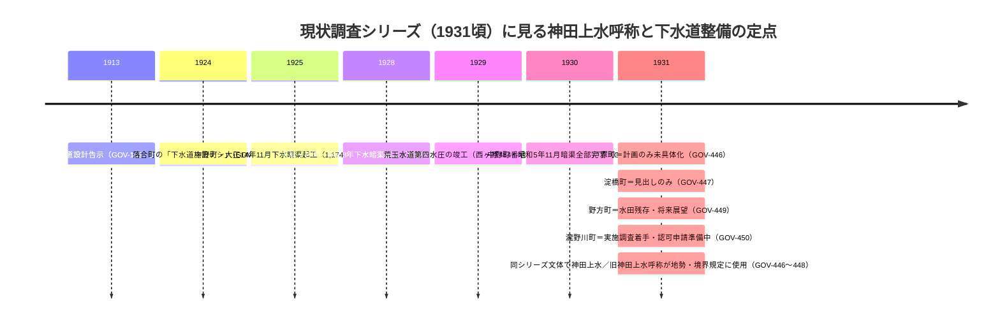

# 2026-11-20 第218回調査ノート — 現状調査シリーズ8町村冊の棚卸し

東京市臨時市域擴張部「現状調査」シリーズ（1931頃・NDL次世代デジタルライブラリー所蔵・[GOV-442](../sources/gov/GOV-442.md)落合町・[GOV-331](../sources/gov/GOV-331.md)大泉村に続く）の未登録冊の棚卸しを主眼に、8冊（戸塚・淀橋・中野・野方・澁谷・千駄ヶ谷・瀧野川・巣鴨）のfulltextを取得・掃引した。**全文言がOCR由来で要原文照合**。前回（第217回）残課題②の実施。

## 成果（新規8件 GOV-446〜453 ＋ GOV-443判読更新）

- **GOV-446**［戸塚町 1900473］: 地勢章「**神田上水ニ（挟マレ?）位置ニ在リテ**」「**神田上水沿岸ハ一般ニ卑湿ナル低地ヲナス**」＝1931年行政調査の神田上水呼称による町域規定。沿革章「**富塚村トモ書セリ**」と下戸塚・戸塚・源兵衛・諏訪の**四村名主の実在**。下水道「**未ダ何等具体化スル迄ニ至ラザル状態**」＝1931年の未整備明記。
- **GOV-447**［淀橋町 1900476］: 「**神田上水ノ流域ハ一帶ノ低地**」＋成子坂・角筈併合の確認。**「拳グベキモノナシ」文言は済生会診療所の文言で下水道ではない（掃引で見分けた・注意書きを付した）**。下水道は見出しのみ＝陰性記録。
- **GOV-448**［中野町 1900480・第218回最重要］: ①位置章「**旧神田上水ヲ隔テ淀橋町**」＝境界規定への「旧神田上水」呼称の用例（repo初出の文脈候補）、②地勢章「**青梅街道ヲ挾ンデ神田上水…吾福寺支流…東西ニ流ス**」＝善福寺川の「吾福寺支流」OCR表記候補（対照表新設行）、③最低点＝「神田上水下流」の大字本?地内**海拔88尺4寸4分**・中野駅附近133尺3寸2分、④「**總延長一、一七四米ナル暗渠**」の**大正14年計画（24,491円）→同年11月起工→昭和5年11月完了**＝中野町の下水道暗渠の一次座標群（千川上水旧水路との関係は断定せず）。
- **GOV-449**［野方町 1900481］: 「**妙正寺川ノ流域ハ尚一〓ノ水田ヲナシ**」＝1931年時点の妙正寺川（弦巻川）流域の水田残存の行政文言＋荒玉水道町村組合の展望文言。
- **GOV-450**［瀧野川町 1900492］: 下水道「**大体三排水系統**」（羽田・三河島処分場（東京市計画）／**江北処分場**）と「**本年度ヨリ実施調査ニ着手**」＝**1931年の瀧野川町下水道着手の年次**。荒玉水道第四水圧（西ヶ原484番地・大正14年4月起工→昭和4年9月竣工・1,860万円・給水区域12ヶ町）。北豊島郡役所の**西巣鴨町字池袋642番地**移転（昭和3年5月）。
- **GOV-451**［巣鴨町 1900494］: 沿革章の巣鴨地名由来「**此地石神井川ニ臨ミテ洲処面ノ名アリ、因テ転ゼシ(?)ラント云フ**」＝石神井川の洲＝「洲処面」説の1931年行政文書レベルの記録候補（対照表新設行・洲由来語群の石神井川側の例）。
- **GOV-452**［澁谷町 1900478］: 地勢章「**渋谷川、町ノ中央ヲ貫流シソノ沿岸狹長ノ低地ヲ族ミテ丘岡相對峙ス**」＋両岸の台地連続性（千駄ヶ谷〜白金〜高輪／代々幡〜自黒?〜大崎）の地勢規定。町勢図の「宇田川」地名ラベル。
- **GOV-453**［千駄ヶ谷町 1900479］: 下水道暗渠の流路文言「**代々幡町境界ニ端ヲ発シ…神宮裏参道下ヲ潜リ大字原宿及千駄ヶ谷境下ヲ通リ渋谷川ニ落ス**」＝**昭和3年起工・町費支出の下水暗渠の渋谷川放流**（既成1,237間＋本年度573間）＝渋谷川水系の下水道史の下流側定点。巻頭略図の「**千川**」ラベル候補（位置・意味は原画像照合まで断定せず）。
- **GOV-443判読更新**［神田上水留61・2587516］: 受益村入用入れリストの正確化（**今朝村**一金拾四両三分弐朱名主三郎兵衛（代?）左吉郎＝吉祥寺村一金拾四両三分壱朱＝東郡東之村?一金拾七両山崎屋三平＝三浦金吉郎＝溝口勝三郎＝讃岐屋伊三郎（五拾五両三分）＝大和屋＝雪羽屋彦七?＝（松崎／猶崎）庄右衛門…）＋**明治3年7月9日付の差出し書類2点**（左吉郎の土木司方御役所への19両2分の入れ／吉祥寺村発の14両3分2朱の入用積の書き付け・「藤（葭?）刈」）＝受益村側の遣り取りの2層の記録。受益村名の確定は原画像照合まで保留。

## 現状調査シリーズの神田上水呼称・下水道着手の通時系列（Mermaid）

## 陰性記録

- 1900481野方町：千川直接言及なし（OCR限界付記）。「石神井」はバス路線（false positive）、「面影」は練馬大根の名残りの文言（false positive）。
- 1900478/1900479：弦巻・谷端・水窪の直接言与なし。澁谷町の「宇田川」4件は地図ラベル群（江戸期の河川名宇田川そのものの文言ではない）。「鈴川」（1900476）は水道職員の氏名（false positive）。
- 1900494巣鴨町・1900492瀧野川町：谷端川直接言及なし（瀧野川町の学校一覧に「川端川?」のOCR文字列あり・判読不能につきGOV-450の制限に記録）。
- kanzyou7.com（11/20）：HTTP 200・「週間工程表、シールド進捗図を更新」＝第210回既知と同一内容（新トピックなし）。musashi.repo.nii.ac.jp：不通4回連続。nabunken：不通継続。
- news_search（谷端川・弦巻川・水窪川・千川上水・神田川下水道・雑司ヶ谷幹線×recency30）：全件陰性（阪神谷端選手・moegirl・水窪ダム等のfalse positive、都庁インフラツアーはGOV-149既登録）。

## 採番・棚卸しの記録

- 第218回の採番: **GOV-446〜453**（8点）。次回採番候補: GOV-454〜。**push前にremote INDEX.mdで重複・採番を再確認する**。
- 神田上水留シリーズ（lab 2587458〜2587516の45冊）の「明地掛樋」探索は第217回で走査済み・結論不変（新規冊の探索は陰性・2588777/2588778の「触留」2点のみ未確認・低優先）。

## 次回（第219回）への引継ぎ

1. **開札2026-12-02（環七調節池広域整備検討その2）**＝最優先で続報確認。
2. 現状調査シリーズの残り冊（豊多摩・北豊島のうち今回の8冊＋既登録冊以外に取得可能な冊）の探索続行（labのシリーズ書誌のフルリスト取り）。
3. GOV-448の暗渠1,174mの正体（千川上水旧水路か否か）: 昭和期の中野区下水道史資料（中野区史・区制史料）の探索。
4. GOV-453の渋谷川放流暗渠と現在の神宮外苑・原宿の下水道幹線の対応（渋谷区の下水道史資料）。
5. ゴミ掃引キーワード事故（英単語・キリル文字等の混入）のpush前チェックは毎回必須（本回は生成時に混入→掃除済み）。
