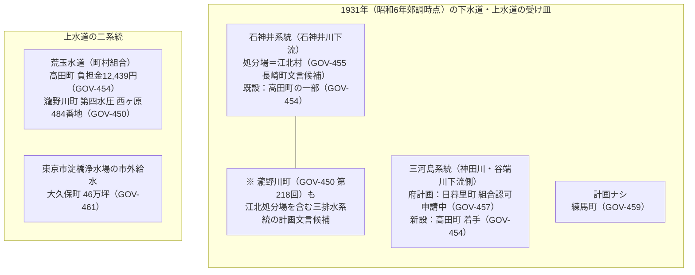

# 第219回（2026-11-20実行）— 東京市臨時市域擴張部現状調査シリーズ残冊の棚卸し：長崎町の「谷端川ハ町ノ北字水原」と千川用水灌漑・中新井村の旧千川上水境界文言・高田町の石神井既設+三河島新設の二系統

## 実行概要

- 第218回の残課題②（現状調査シリーズ〔東京市臨時市域擴張部・1931頃・NDL次世代デジタルライブラリー〕の未取得冊の棚卸し）を継続。NDL labのAPI（`https://lab.ndl.go.jp/dl/api/book/<pid>`・fulltext）でpid走査を行い、未取得冊の書誌・fulltextを取得して対象四河川域との関連を精査した。
- **新規採番9件**: [GOV-454](sources/gov/GOV-454.md)（高田町）〜[GOV-462](sources/gov/GOV-462.md)（板橋町）。すべて現状調査シリーズ（同書式・OCR全文確認済み・文言は原画像照合前提）。
- 既存HEAD＝d20a6278（第218回）の上位に積む。並走実行とのsha突合はpush直前に実施。

## 本回の成果（確認/観察/推定/仮説の区別）

### 1. 谷端川・千川上水の上流域（1931年行政調査レベルの核心文言）

- **【文言候補・最重要】長崎町**（[GOV-455](sources/gov/GOV-455.md)・pid [1900502](https://lab.ndl.go.jp/dl/book/1900502)・OCR大崩壊）: 地勢章に「**谷端川ハ町ノ北字水原(沿ヒテ流レ候補)**」＋「**他ニ千川用水(町ノ西北…道二沿ヒテ流レ)…灌漑其ノ他ニ便スル**」。
  - 【推定】「字水原」＝谷端川上流域の小字名候補。谷端水源地（谷頭・湧水地）に対応する字名の一次語候補（repo初出。水窪・水元系の水系語彙と接続しうる）。ただし本文言は列復元による候補値で、**原画像照合が完了するまで断定しない**。
  - 【観察】千川用水＝廃止後の旧水路（千川上水の旧路体）が1931年時点で「灌漑その他に便する」**現役の灌漑用水**として行政調査册子に記録された文言候補＝千川上水の「灌漑用水としての昭和初期までの存続」仮説を強める根拠。
  - 【陰性の記録】「谷精川」という川名 OCR 文字列（谷端川崩壊 variant 候補・別川の可能性も排除せず）。
- **【文言候補】中新井村**（[GOV-456](sources/gov/GOV-456.md)・pid [1900505](https://lab.ndl.go.jp/dl/book/1900505)）: 「**本村北部ヨリ府道ニ沿ヒ練馬町トノ境界ニ旧千川上水**」＋「**東流シ灌漑及排水ノ便アリ**」＝旧千川上水の路体が1931年時点で村の境界線＋灌漑・排水機能を持っていた行政文書レベルの文言候補。長崎町の灌漑文言と対になる裏付け。
- **【確認】練馬町** ([GOV-459](sources/gov/GOV-459.md)・pid [1900503](https://lab.ndl.go.jp/dl/book/1900503))・上練馬村（[GOV-460](sources/gov/GOV-460.md)・pid [1900508](https://lab.ndl.go.jp/dl/book/1900508)）: 谷端川・千川の直接文言は陰性。練馬町＝地下水飲料好適＋上下水道計画ナシ、上練馬村＝水田は石神井川・田柄川・白子川沿岸。

### 2. 下水道・上水道の1931年システム定点

- **【文言候補】高田町**（[GOV-454](sources/gov/GOV-454.md)・pid [1900501](https://lab.ndl.go.jp/dl/book/1900501)）: 調査費4,900円計上（昭和4.12.29）→中心線選定着手（昭和5.1.18）・**既設＝石神井系統（町内一部）＋新設＝三河島系統**（管渠延長19,034m候補・総工費150万8千円候補）・執行者＝高田町長。**NDL書誌題「北豊島郡高田町現状調査」の表記と実態（雑司ヶ谷・目白＝豊多摩郡高田町）の差異**は断定せず併記（原簿側の表記差異か。要原画像照合）。
- **【文言候補】長崎町（下水道）**: 石神井系統・「**処分場ハ江北村**」＝石神井川下流の江北村への排水計画の文言候補（瀧野川町〔GOV-450〕の「江北処分場」と対になる）。
- **【文言候補】日暮里町**（[GOV-457](sources/gov/GOV-457.md)・pid [1900491](https://lab.ndl.go.jp/dl/book/1900491)）: 三河島系統・**東京府土木部計画**・昭和5年3月調査・組合事業として認可申請中（事業費191,876円・管渠延長13,141.96間候補）。
- **【文言候補】大久保町**（[GOV-461](sources/gov/GOV-461.md)・pid [1900472](https://lab.ndl.go.jp/dl/book/1900472)）: 上水道＝**水源東京市淀橋浄水場（市外給水）**（昭和4年2月認可着工・5年度完成・給水面積46万坪・総工費287.5万円候補）＝町村組合水道（荒玉水道）と東京市直営給水の**二系統併存**の定点候補。第一期下水道改良事業528,739円（昭和2年可决・3〜5年度）。
- **【文言候補】王子町**（[GOV-458](sources/gov/GOV-458.md)・pid [1900498](https://lab.ndl.go.jp/dl/book/1900498)）: 最高地＝大字王子岸ノ上24.3米／最低地＝**大字堀ノ内梶原1.8米**＝下流低地の海抜定点（repo初出の数値）。メートル法表記＝日暮里町（78尺）・板橋町（105尺5寸7分等）の尺貫法と対照。

### 3. 1931年郊外インフラの系統地図（Mermaid）

【推定】この系統地図は、谷端川流域（高田・長崎・日暮里側）が1931年時点で**石神井系統（既設）と三河島系統（新設）の接合部**にあり、明治期の小区間下水から昭和初年の広域下水計画への転換点にあることを示す。ただし各町の文言はOCR由来の候補値で、管渠延長・工費の数字はすべて要照合。

### 4. 現状調査シリーズpid棚卸し（本回時点）

- 【確認】取得・登録済み（本回まで）: 1900472 大久保町・1900474 落合町・1900491 日暮里町・1900492 瀧野川町・1900494 巣鴨町・1900498 王子町・1900500 板橋町・1900501 高田町・1900502 長崎町・1900503 練馬町・1900505 中新井村・1900508 上練馬村 ほか戸塚・淀橋・中野・野方・瀋谷・千駄ヶ谷（第218回 GOV-446〜453）
- 【確認・陰性記録（新型取得済みだが文言価値薄）】: 1900488 南千住・1900489 三河島・1900490 尾久・1900496 志村（湿田の記述のみ）・1900497 岩淵（荒川改修・水門放水路）・1900504 上板橋村（石神井川貫流・環七号交叉）・1900509 赤塚村（池沼灌漑）
- 【確認・取得不能】: **1900493（堀ノ内町冊候補）＝API が「This PID is not allowed」を返す**（次回再試行）・1900475/1900485/1900487も500/不可
- 【観察】高田町のNDL冊子題「北豊島郡高田町現状調査」は書誌レベルの表記。実態（豊多摩郡高田町＝雑司ヶ谷・目白側）との差異の原簿確認が次回課題。

### 5. 監視系（第219回＝2026-11-20実行分）

- 【確認・陰性】news検索6クエリ（谷端川／弦巻川／水窪川／千川上水／神田川下水道／雑司ヶ谷幹線・recency14日）＝全陰性（阪神谷端選手・BanG Dream!弦巻こころ・米沢／静岡の水窪ダム等のfalse positiveのみ）。
- 【確認】kanzyou7（神田川整備）WHAT'S NEW＝2026/11/20「週間工程表・シールド進捗図更新」の例行更新のみ。
- 【確認・陰性】musashi.repo.nii.ac.jp＝不通継続（000）・nabunken 113630＝404・都建設局kasenseibikeikaku頁=404。
- 【確認・未来】**開札2026-12-02（環七地下調節池広域整備検討その2）はまだ未来＝第220回で結果確認を最優先**。
- 【確認・陰性】中野区史下水道のNDL lab検索＝陰性（GOV-448暗渠1,174mの正体判定は次回以降へ）。

## 次回（第220回）への引き継ぎ

1. **開札2026-12-02（環七調節池広域整備検討その2）の結果確認を最優先**。
2. 1900493（堀ノ内町冊候補）のAPI再試行（「PID is not allowed」の回避・NDL本体書誌からの経路探索）。
3. 高田町冊の原画像（「北豊島郡」表記・槪要章の自称）の照合＝書誌題と実態の表記差異の確定。
4. 長崎町「字水原」・中新井村「旧千川上水」の原画像照合（本回2文言は最重要・読み取れ次第README本文仮説側へ反映）。
5. 中野区史（下水道章）の所在・全文の再探索（GOV-448の暗渠1,174mの正体判定）。
6. 現状調査シリーズの残pid（1900475・1900485・1900487等の再試行）と、シリーズ全体の系統文言の対照表化（第219回Mermaid図をREADMEへ反映するかの判断も含む）。

（本ノートの引用文言はすべてNDL次世代デジタルライブラリーのOCR由来で要原文照合。採番はGOV-454〜GOV-462を使用。）
