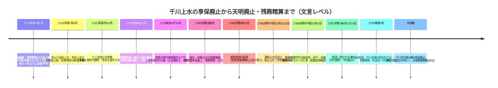

# 第220回（2026-11-20実行）— 千川上水廃止事蹟の市街篇本文（東京市史稿30）と写本系触文書群（正宝録・憲教類典・天保撰要類集等）・王子製紙替水約定の全文・谷端川改修費668,530円の府統計文言

## 実行概要

- NDL次世代デジタルライブラリー fulltext API（`https://lab.ndl.go.jp/dl/api/book/fulltext/{pid}`）で一括取得・triageした多冊のうち、千川上水・谷端川・四河川関連の中核文言を持つ15冊を正規採番してソースファイル化。
- **新規採番15件**: [GOV-463](sources/gov/GOV-463.md)〜[GOV-471](sources/gov/GOV-471.md)（9件・写本系公用文書編纂集）、[BOOK-217](sources/books/BOOK-217.md)〜[BOOK-221](sources/books/BOOK-221.md)（5件）、[GAZ-117](sources/gazetteers/GAZ-117.md)（1件・古事類苑政治部29）。
- 対照表（千川用水行にBOOK-220替水約定・新規行「いろは樋（間木村）」）・橋名調査（天保撰要類集[352]の千川宇兵衛4橋の追補）を更新。
- 陰性記録: 杉並町・高井戸等の現状調査冊（1900493/1900475/1900485/1900487）はアクセス不可（403/500）。中野区史・渋谷区史のlabデジタル化なし。951854（市区町村勢諸誌）に弦巻川文言なしを再確認。武江年表巻4（2605166）は[BOOK-157](sources/books/BOOK-157.md)既出系のため登録見送り。
- 既存HEADの上位に積む。並走実行とのsha突合はpush直前に実施。

## 本回の成果（確認/観察/推定/仮説の区別）

### 1. 千川上水の天明廃止事蹟の本文側（東京市史稿 市街篇30）

- **【文言候補・最重要】** [BOOK-217](sources/books/BOOK-217.md)（東京市史稿市街篇30・1938・pid [3450817](https://lab.ndl.go.jp/dl/book/3450817)）: 「**天明六午年閏十月廿二日壬戌 千川上水ヲ廢ス**」の事蹟立項＋天明撰要集所収の請負人召出書上写（神田相生町・平永町・佐久間町の4人＋武州多摩郡小川村名主孫次郎）＝**東京都公文書館『上水篇第1』目次（README既出）の該当章の本文側を市街篇の集成で初めて直接確認**〔確認・文言はOCR要照合〕。
- **【文言候補・repo初出の帯有日文言】** 同書の屋鋪渡預繪圖證文: 閏10月27日（差止公示の5日後）に筋違橋御門外明地の商床地所・井戸1ヶ所・水番屋が御普請奉行方（改役 村田新次郎・倉澤源郎・加藤勘助）へ引渡しされた文言＝**廃止公示から引渡しまでの5日という実務リードタイムの一次証拠候補**〔文言候補〕。

### 2. 享保7年廃止の文言群の写本側体系（正宝録・憲教類典・古事類苑）

- **【文言候補】** [GOV-463](sources/gov/GOV-463.md)（正宝録続七・2547511）: 安永9子10月の触と水銭28文の収入側原規定文言。
- **【文言候補・repo初出文言】** [GOV-464](sources/gov/GOV-464.md)（憲教類典58・2553789）: 享保7年8月18日・19日の千川上水差止触「**中奥(?)ゟかゝり候事**」＋「来ル十月より上水取不申筈」＋青山三田両上水（9月）・本所上水の同時停止文言群。
- **【文言候補・本回の対校の核心】** [GAZ-117](sources/gazetteers/GAZ-117.md)（古事類苑政治部29・897694）: 同じ享保7年8月触が享保集成絲綸錄経由で「**中興よりかヽり候事**」と引載＝**憲教類典の「中奥」判読より「中興（再興）」判読を強める対校証拠**（確定は原画像照合まで保留）。さらに**千川上水道8ヶ所の禁制リスト（小石川御殿懸り溜堀・巣鴨溜堀・同吐水門・同築土手・瀧川一里塚・金井久保橋際・板橋御林橋際・長崎築土手＋神田上水道10ヶ所）＝repo初出**〔文言候補〕。
- 【確認】武江年表享保7年条（安永9再興→天明6停止）の古事類苑引載＝[BOOK-157](sources/books/BOOK-157.md)の本文側原典の所在確定（文言自体はrepo既出）。

### 3. 千川用水・千川上水の江戸後期〜明治の実務（天保撰要類集・町会所書留等）

- **【文言候補】** [GOV-465](sources/gov/GOV-465.md)（天保撰要類集[352]）: 千川宇兵衛4橋（境橋・上宿橋・二ツ家橋・駒塚橋）と橋負担の廃止（町方御勘定方持ちへの移行）・増水口練馬村分水料＝**廃止（天明6年）後も堀・橋の管理と用水実務が天保期まで存続した行政文書レベルの文言群**。
- **【文言候補】** [GOV-466](sources/gov/GOV-466.md)（市中取締書留[12]）: 同件の対面記録。[GOV-467](sources/gov/GOV-467.md)（町会所一件書留寛政5・2587071/72）: 千川水銀9両拾匁六分を含む町別分担金リスト＝**廃止後の残務精算（寛政5年）の金的実態**。
- **【文言候補】** [GOV-468](sources/gov/GOV-468.md)（御普請書留14・2571957/2588170）: 天明3卯11月の堀割褒賞文言（廃止前年の整備への賞与）。[GOV-469](sources/gov/GOV-469.md)（御書附留帳19/20）: 千川上水御普請小屋場の用地文言。4橋の対校は[GAZ-113](sources/gazetteers/GAZ-113.md)（根津4橋・千川家橋負担）と接続。
- **【文言候補】** [GOV-470](sources/gov/GOV-470.md)（七十冊物類集32/52・2548592/2548612）: 元千川上水屋鋪の立負人貸附棄捐文言。

### 4. 千川用水の明治流末（王子製紙替水）と上水道史

- **【文言候補・repo初出の約定群】** [BOOK-220](sources/books/BOOK-220.md)（日本紙業綜覽・1937・1222443）: 明治7年9月3日の替水約定全文（流末水積66坪8合・添樋・助合金25円）＋明治8年3月鹿島萬平絲器械所との箱樋約定＋明治8年9月の東京府「千川流末水ノ半量」供出命令＝**千川用水の流末が絲器械所水車→王子製紙工場用水へ替水化された一次約定の全体像（水量「水積66坪8合」は[BLOG-095]碑文系116.8坪との対校点）**。
- **【文言候補】** [BOOK-221](sources/books/BOOK-221.md)（東京市衛生試験所報告明治44年・837096）: 「本〓區内ニ散在セル千川上水ニ就キ水質試驗ヲ施行セリ（三十六年、三十七年）」＋統計表「丙、千川上水試驗」30種＝**明治36/37年に残留千川上水が衛生試験所の試験対象（上水・堀井水と並ぶ第三の水種）だった記録（repo初出）**。
- **【文言候補】** [GOV-471](sources/gov/GOV-471.md)（下水道沿革誌初版・1913・950604）: 「元祿九年千川上水成ル」評言・実測図リスト・千川線設計＝1913年時点の庁史レベルの千川評価。
- **【文言候補】** [BOOK-218](sources/books/BOOK-218.md)（菅園『傳衢暗記』1882・2533616）: ①間木村の「いろは樋」（西十八本継の高樋・repo初出の樋名）・②千川上水市中経路の回想（巣鴨→駒込→千駄木→根津→本郷→湯島→外神田→下谷→浅草蔵前）・③駒込の松平甲斐侯下屋敷の滝・④昌平橋北詰の吐け口の幼少期目撃・⑤上野の「第二回…」会場への千川筋引水と噴水（第二回内国勧業博覧会1881候補・断定保留）＝**維新直後の千川系水路の回想記録群**。

### 5. 谷端川の昭和改修の府統計文言

- **【文言候補・repo初出の数値】** [BOOK-219](sources/books/BOOK-219.md)（東京府勢概要1937/39）: 「**豐島區板橋區に跨る谷端川三千一米（3,001m判読）の改修費六十六萬八千五百三十圓**」（1937）→「谷端川(三千米、六十六萬圓)」（1939）＝**谷端川改修の延長・工費の府政統計レベル文言（668,530円はGOV-159/172に未収録→repo新情報）**。渋谷川2,670m・1,147,616円、立会川3,563m・1,278,460円との並記。

### 6. モニタリング（陽性・陰性）

- 【観察・陽性】都Press 2026-11-02: 「神田川・環状七号線地下調節池インフラツアー」2027年1月9日〜開催の告知（[PR](https://www.metro.tokyo.lg.jp/information/press/2026/11/2026110202)）＝神田川（江戸川）系の現行インフラの公開定点。
- 【観察・定例】kanzyou7.com WHAT'S NEW 2026/11/20: 週間工程表更新のみ（定例）。
- 【陰性】news6クエリで神田川以外の4河川関連の新記事なし。

## 千川上水 1722-1843の再興・廃止・残務のタイムライン（Mermaid）

## 未消化の残候補（次回以降へ）

- 2549844/2548592系以外の安永撰要類集火之部（牢屋敷千川上水駈付人足文言・GOV-354と同型の安永期側・2549844/45）
- 2571511/12/48/49/50/51/55/57/66/69の町方書上群（GAZ-041〜045・GAZ-113と重複大・本郷「元禄之度ニ相懸リ候処相潰レ」新証人有り）
- 1225116東京近郊史蹟案内1927・1275204郷土の観察1941・1031007杠並名鑑1935・906087/88三府案内1919/21（桜並木2里余）・845989中島鋭治1896・1226055明治工業史・1455027府政概報1936・1132241全国都市問題会議1930・1446516日本都市年鑑第8・1073832土木局統計年報30回
- このうち897694は[GAZ-117](sources/gazetteers/GAZ-117.md)として登録済み（本回完了）。

## 技術メモ

- fulltext API: `https://lab.ndl.go.jp/dl/api/book/fulltext/{pid}`（zip）・書誌: `https://lab.ndl.go.jp/dl/api/book/{pid}`。book idが0のpublishyearはyear未収録→frontmatterのyearは内容年で設定（repo慣例・GOV-463の寛政12年方式）。
- 全triage済みzip・展開済みtxtは `/home/user/otowa220/lab/triage/ft_*.zip`・`x{pid}/`（再利用可）。
