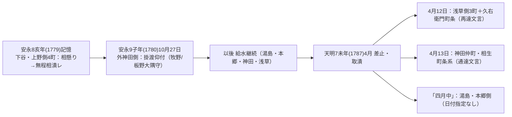

# 第221回（2026-11-20実行）— 町方書上8冊（湯島・外神田・下谷・浅草）の千川上水樋文言の全面掃引・樋区間と条帰属の前進・差止日と安永年次の対立の体系化・土木局統計年報の谷端川文言

## 実行概要

- 第220回で未消化とした2571548〜2571569系（湯嶋町方書上壱〜肆止・外神田町方書上二・四・下谷町方書上六・浅草町方書上壱之下）のうち、千川上水文言を含む**8冊を全面掃引して正規採番**した（fulltextの頁別テキストで文言の所在頁を特定済み）。
- **新規採番9件**: [GAZ-120](sources/gazetteers/GAZ-120.md)〜[GAZ-127](sources/gazetteers/GAZ-127.md)（8冊各1件）＋[GOV-472](sources/gov/GOV-472.md)（土木局統計年報第30回後編1938・谷端川文言候補）。**追記1件**: [GOV-226](sources/gov/GOV-226.md)へ東京市水道要覧抜萃（1896・中嶋鋭治・845989）の別版対校追記。
- 対照表（鳥越村領名のOCR異読群・柳原新シ橋の表記群の2行）・橋名調査（第221回追補＝湯島側下水石橋5ヶ所寸法群・柳原新シ橋際の往置樋2ヶ所・妻恋橋の石橋伝承・浅草側井戸文言）を更新。
- 陰性・監視記録: 1900493/1900475/1900485/1900487（杉並町等の現状調査冊）はlab APIが相変わらず「PID is not allowed」で本文取得不能（陰性記録のみ）。lab側のIIIF原画像endpointはSPAで本実行環境から照合不能（第210回と同結論・backlog継続）。kanzyou7（神田川・妙正寺川地下調節池）のWHAT'S NEW最新は2026/11/20「週間工程表・シールド進捗図を更新」（内容は定期更新のみ・新文書なし）。musashi.repo.nii.ac.jp・nabunken.repo.nii.ac.jp（113630）は本環境から到達不能（タイムアウト）。**開札2026-12-02（環七調節池広域整備検討その2）はまだ未来＝次回の最優先監視対象に順送り**。news横断6クエリ（谷端川・弦巻川・水窪川・千川上水・神田川下水道・雑司ヶ谷幹線・recency30）で四河川関連の新記事なし（ unrelated noise のみ。環七調節池の内見会記事1件は既知の完成状況の報道で本repoに増分なし）。

## 本回の成果（確認/観察/推定/仮説の区別）

### 1. 町方書上8冊の文言群と条帰属の前進〔文言候補・OCR由来で全件原画像照合前提〕

- **湯島側4冊（[GAZ-120](sources/gazetteers/GAZ-120.md)〜[GAZ-123](sources/gazetteers/GAZ-123.md)）**: ①湯嶋町条104間6尺（[GAZ-024](sources/gazetteers/GAZ-024.md)の刊本リストにない条の候補）、②湯島三町目条候補の80間5尺3寸5分＋18間条（刊本の町別数値リストの該当条の写本側）、③湯島五町目条の22間・湯嶋四丁目境四ツ角・中桝1ヶ所＋下水石橋2ヶ所寸法、④湯島棟梁屋鋪条の86間余（[GAZ-024](sources/gazetteers/GAZ-024.md)の86間余・中桝3ヶ所条の**条帰属が初めて「湯島棟梁屋鋪」まで絞れる**＝[GAZ-045](sources/gazetteers/GAZ-045.md)の帰属未解決問題の主要な前進）、⑤51間条（名主橋五郎条・町名不特定）、⑥湯島切通町条57間＋折曲り16間4尺5寸、⑦湯島天神門前町条の**59間（坂下往還）＋114間（坂上通り往還・小樋懸屋）＋中桝2ヶ所＋小枡2ヶ所**＝刊本にない分解文言で、湯島天神門前の給水樋体系を最も詳しく採録する条、⑧宝性院門前条11間3尺（石川主殿頭様表門通り角の中枡）。**湯島区間の給水樋・桝・小樋の体系が町方原本レベルで並び、[GAZ-024](sources/gazetteers/GAZ-024.md)・[GAZ-045](sources/gazetteers/GAZ-045.md)（御府内備考側）との条単位の対応表作成に必要な材料が揃った**〔照合までは帰属候補扱い〕。
- **神田明神下側（[GAZ-120](sources/gazetteers/GAZ-120.md)内）**: 川辺町条・御手代屋敷条の「古上水（沢）」文言（安永9再掛→無程差止→形なし）＝千川上水末端の神田明神下側でも町方記憶が残る。幸龍寺跡万隆寺跡の明暦大火後の浅草田甫移転の由緒も同條。
- **外神田側2冊（[GAZ-124](sources/gazetteers/GAZ-124.md)・[GAZ-125](sources/gazetteers/GAZ-125.md)）**: ①松永町条候補の68間余＋片町（相生町側）小樋80間余文言＝[GAZ-044](sources/gazetteers/GAZ-044.md)（御府内備考の相生町条系文言）の**町方原本側の対校成立**。「板野／牧野」「最堂／藤堂」「宗片町／片町」のOCR対立を記録。②柳原新シ橋を軸とする**新田久右衛門町壱丁目・弐丁目蔵地条の往置樋2ヶ所**（「新し橋際往置樋壱ケ所」＋「境目往長ニ樋躰壱ケ所埋伏せ」）＝**千川上水末端の樋位置の新しい座標アンカー**（昌平橋四ツ角大桝〔[GAZ-043](sources/gazetteers/GAZ-043.md)〕の下流側）。③同冊の柳原新シ橋御尋書上（享保4亥年の三ヶ町元地召上げと引き換えの新規掛直し・永代修復引受・橋見守与兵衛役三郎）＝柳原新シ橋の管理体制の書上来資料。
- **下谷側（[GAZ-126](sources/gazetteers/GAZ-126.md)）**: 上野新黒門町・上野小右衛門町・下谷常楽院門前・上野元黒門町の4町条が**「安永八亥年中千川上水相懸り候得共無程相潰レ」で揃う**＝下谷・上野側では安永9年でなく**安永8亥年**を給水開始と記憶し、差止を「御差止」でなく「相潰レ」と表現する。樋・桝の条項は出ない（[GAZ-113](sources/gazetteers/GAZ-113.md)（御府内備考・上野仁王門前条）の安永8亥年文言の原本側対照）。
- **浅草側（[GAZ-127](sources/gazetteers/GAZ-127.md)）**: ①旅籠町壱丁目代地条の井戸2ヶ所＋「**別紙絵図面ヲ以奉申上候**」（[GAZ-115](sources/gazetteers/GAZ-115.md)の旅籠町1丁目文言の原本側＋井戸位置図（所在不明）の存在記録＝**絵図面類の新たな探索対象**）、②旅籠町弐丁目代地条の井戸1ヶ所＝**[GAZ-115](sources/gazetteers/GAZ-115.md)で確認できなかった文言を原本側で解消**（GAZ-115への追記反映は次回の課題）、③茅町弐丁目条の「往還中程埋樋枡」＝浅草側でも井戸以外の桝文言、④帰属未確定条の「井戸壱ヶ所も無御座候」＝上水は通行しても井戸給水がなかった町の陰性例、⑤瓦町条（[GAZ-115](sources/gazetteers/GAZ-115.md)の尾町条との帰属対立・「瓦／尾」のOCR原字照合課題）の「始り年月有所共相知不申候」の伝聞形式文言。

### 2. 年次・差止日の対立群の体系化〔観察・文言候補の統合〕

- **【観察】** 下谷側「安永8亥年」と神田・湯島側「安永9子年（十月廿七日）」の対立は、[GAZ-113](sources/gazetteers/GAZ-113.md)（御府内備考上野側）単独だった安永8年系の文言が、町方書上原本側で**4町分**装丁された。区域差（下谷側が先行通水か）か記憶の丸めか、実際に2年がかりで通水したのかは本群だけでは判定不能〔区域差候補の検討は原画像照合と [GAZ-034](sources/gazetteers/GAZ-034.md)（白山前町条・安永8御検地→再掛渡）との接続で次回〕。
- **【観察】** 差止日の粒度は「四月十二日」（浅草側＋[GAZ-125](sources/gazetteers/GAZ-125.md)久右衛門町条）/「四月十三日」（[GAZ-041](sources/gazetteers/GAZ-041.md)神田仲町・[GAZ-124](sources/gazetteers/GAZ-124.md)）/「四月中」（湯島・本郷側）の3層が併走。**12日vs13日の対立は今回初めて**（第220回時点では「四月中」と「四月十三日」の2層）。触の日付が複数あるか、町への到達日の差かは本群では確定できない。
- **【観察】元禄期記憶の分布**: 「元禄之度之義は相分不申候」の文言が湯島・外神田側の樋条文言のほぼすべて（[GAZ-121](sources/gazetteers/GAZ-121.md)〜[GAZ-125](sources/gazetteers/GAZ-125.md)）に出て、外神田側では「元禄之度千川上水御掛渡之義相分不申候」（[GAZ-124](sources/gazetteers/GAZ-124.md)）のように**初掛文言とセット**で出る。一方 [GAZ-118](sources/gazetteers/GAZ-118.md)（本郷竹町）だけが元禄初掛を記憶し、[GAZ-119](sources/gazetteers/GAZ-119.md)の2町と本回の大多数は喪失。約130年後の書上で元禄期給水の町方記憶はほぼ失われており、竹町条の記憶（[GAZ-118](sources/gazetteers/GAZ-118.md)）が外れ値として際立つ。
- **【陰性記録】** 町方書上の取調箇條の定型項目列に「古上水（跡）」があり、「無御座候」と回答する町が多い（[GAZ-120](sources/gazetteers/GAZ-120.md)・[GAZ-122](sources/gazetteers/GAZ-122.md)等）＝書上形式自体が全町に千川上水跡の聞き取りを求めていたことが写本レベルで確認できた。

### 3. 鳥越村領名の異読群〔観察・対照表に新設〕

- [GAZ-115](sources/gazetteers/GAZ-115.md)の「速田領」と、本回の原本側OCR「坂田領」「咬田領」「挟目領」「建田領」の5読の対立＝官撰・写本の双方で原字崩壊が疑われる。茅町壱丁目条の「鳥越村桑原之里」は領名なしの里名。原字（渋谷領候補の検討も含む）は原画像照合の共有課題（対照表の新規行に集約）。

### 4. GOV-472（土木局統計年報第30回後編1938）とGOV-226追記〔文言候補〕

- [GOV-472](sources/gov/GOV-472.md): 「谷端川及惡水路兩水ハ唧筒（ポンプ）二次流…舊市内ニ合流」＝1938年の下水道統計に谷端川・悪水路系の揚水排除系統の文言候補（OCR全面崩壊で数値不読・原画像照合必須）。**「蟹川上流平野ノ一部」の文言候補は同表に大阪・神戸の語が混在するため東京の蟹川とは照合まで断定しない**（注意書きつきで所在記録のみ）。[GOV-408](sources/gov/GOV-408.md)（同シリーズ第27回・1927）との通年比較は原画像照合後。
- [GOV-226](sources/gov/GOV-226.md)追記: 東京市水道要覧抜萃（1896・中嶋鋭治）に「**灌漑水車等ノ爲メ水質ヲ損シ…玉助水ヲ受ケ纔ニ其用ヲ爲ス**」＝神田上水の水質劣化を**灌漑水車**と玉川助水への依存に帰する文言が加わる＝1893年原典→1896年抜萃の版間増補。淀橋浄水場建設中（1896-98）の改良水道構想文言で、千川の近代灌漑水車史（[BOOK-220](sources/books/BOOK-220.md)替水約定系）と水道行政側の評価文言の初めての交点。

## 古候補の評価（採番見送り・ノート記録のみ）

- **1225116（東京近郊史蹟案内1927）**: 千川上水沿革の通説再構成（保谷村上保谷新田分流・巣鴨まで五里五十五町余・安永9再興時の「本郷・湯島・下谷・浅草方面」給水）＋練馬字谷戸白山神社の板碑言及＝**二次的な観光案内書で、千川家由緒書系・[GOV-226](sources/gov/GOV-226.md)・[GOV-228](sources/gov/GOV-228.md)系統の通説の再編に留まる**ためBOOK採番見送り（[BOOK-218](sources/books/BOOK-218.md)の関連節ですでにrepoに取り込み済みの系統）。板碑の実物情報の採番可否は原物確認まで保留。
- **1226055（明治工業史1930?・王子製紙創業の千川用水文言）**: [BOOK-220](sources/books/BOOK-220.md)（日本紙業綜覈1937・替水約定全文）に一次史料レベルで包含される二次集成のため採番見送り。

## 未消化の残候補（次回以降へ）

- **原画像照合（最大の課題）**: 8冊の全文言（特に条帰属・「板野/牧野」「瓦/尾」・領名異読群・数値）の原画像照合。labのIIIFが使えないため、別ルート（NDLデジコレの刊本画像・東京都公文書館等）を探す。条境界（特に2571549の80間条・18間条の帰属、2571555のp54条の帰属）の確定。
- **旅籠町壱丁目代地の別紙絵図面**の所在探索（井戸2ヶ所の位置図）。
- 町方書上シリーズの残冊（[67]〜[88]のうち未掃引の冊＝湯嶋町方書上五以降・外神田町方書上一・三・五・下谷七以降・浅草壱之上・弐類）のfulltext掃引。
- [GAZ-115](sources/gazetteers/GAZ-115.md)へ旅籠町弐丁目代地の井戸1ヶ所の原本確認分を追記反映。
- **開札2026-12-02（環状七号線地下調節池広域整備検討その2）の入札結果確認＝次回最優先**。
- 1900493・1900475・1900485・1900487（杉並町・高井戸等の現状調査冊）の本文取得（PID制限の回避手段の検討）。
- [GAZ-024](sources/gazetteers/GAZ-024.md)・[GAZ-045](sources/gazetteers/GAZ-045.md)（御府内備考湯島区間）とGAZ-120〜123の全条対応表（刊本が未採録の条の見落とし確認）。
- 鳥越村領名の原字確定（渋谷領説の検討を含む）。

## 技術メモ

- fulltext zipの頁別ファイルは `{pid}_{頁:7桁}.txt`（`2571548_0000015.txt`＝15コマ）で、頁番号を引用に残すと再現性が高い（本回のGAZ-120〜127の形式）。
- 条帰属の方法: 各町の書上は「以上〔年月〕〔町名〕名主〔名〕」の署名で閉じるため、文言の頁と前後の署名頁の挟間で条帰属を推定できる。ただし署名自体のOCR崩れ（富島＝湯島・福島＝湯島・関島玄村屋敷・八名川町等）があるため、帰属はすべて「候補」扱いで原画像照合前提。
- lab API: fulltext zip=`https://lab.ndl.go.jp/dl/api/book/fulltext/{pid}`・書誌=`/dl/api/book/{pid}`（書誌のtitle/volumeは第NXX巻ラベル付き）。
