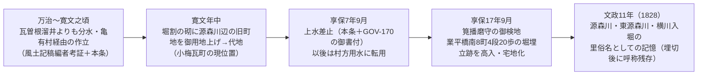

# 第223回（2026-11-20実行）— 町方書上[91]〜[154]の棚卸し＝根津千川茂兵衛請負橋群（布成橋・伊合橋・御成橋）・巣鴨御駕籠町の千川上水文言・淀橋（定橋）判読対立・小梅古上水の源森川と享保17年検地

## 実行概要

- 第221〜222回に続き町方書上シリーズの未掃引冊（[91]〜[154]帯）をNDL lab OCR全文で棚卸しし、**新文言5点を正規採番**（[GAZ-134](sources/gazetteers/GAZ-134.md)〜[GAZ-138](sources/gazetteers/GAZ-138.md)）。**追記1件**: [GAZ-035](sources/gazetteers/GAZ-035.md)（西青柳町・東青柳町条＝御府内備考巻50川条の元資料側の直接確認・「陰巻川」「厳ケ谷下水」の判読対立への第3の読み・松屋橋寸法対合）。
- 対照表（[地名・河川名対照表](地名・河川名対照表.md)）: 千川上水行・鼠ヶ谷下水行・弦巻川行・不姿見橋行・姿見ず橋行・定橋行へ第223回追記、**源森川・東源森川・横川入堀（小梅古上水＝本所白堀上水）行を新設**（白堀上水（本所）行の直後）。橋名調査（[四河川の橋名・橋跡調査](四河川の橋名・橋跡調査.md)）へ第223回追補節（布成橋・伊合橋・御成橋・根津門前石橋3・西裏下水4橋・善光寺坂板橋〔対校追記〕・イナリ橋・松屋橋〔対校追記〕・淀橋（定橋））を追加。
- 陰性・監視記録: [91]〜[100][103][105][108][110][130][131]はboilerplate（定型の「古上水（跡）所持之者は其訳可調候事」設問テンプレと「無御座候」回答）のみで新文言なし（掃引済み・陰性記録）。[143][146]は玉川上水系（四ッ谷大木戸・源流側）で本repoの四河川直接流域の対照対象外。[145]も陰性。**水窪川・弦巻川・谷端川・濯川の直接文言は本帯では0件**（西青柳町条〔GAZ-035追記〕の小川・松屋橋文言が弦巻川系の唯一の新層）。開札2026-12-02（環七調節池広域整備検討その2）はまだ未来＝次回の最優先監視対象。

## 本回の成果（確認/観察/推定/仮説の区別）

### 1. 浅草猿屋町条の千川上水「四月中」差止文言〔文言候補・GAZ-134〕

- [GAZ-134](sources/gazetteers/GAZ-134.md)（[95]浅草・[2571576](https://lab.ndl.go.jp/dl/book/2571576)・猿屋町条p13-25）: 「**千川上水之儀 始め相知不申候 天明七未年四月中 御差止メニ相成申候**」＝天明7年差止の「四月中」（日付なし）文言の浅草末端側witness。〔①「始め相知不申」＝[GAZ-133]・[GAZ-115]系の「始まりを知らない」文言の別witness、②「四月中」＝日付文言（十二日系・十三日系）と断定なく共存する粒度の変種、③同条のイナリ橋ノ下古板出・橋詰の加賀美稲荷（享保17年5月火除地召上の移転勧請）・享保17年類焼後の福富町ハマ河岸代地の両町架橋、④町名由来の二重伝承（津田須島越村・寛永7年町屋化＋越後国猿屋村の加賀美大夫説）、⑤寛永4年東叡山水吐しの堀割申伝（巾2間半・新旅籠町江懸渡・「申伝」につき史実採用は保留）〕。
- 【保留】[89]（GAZ-133側）の表紙町列に猿屋町がありながら猿屋町条に千川上水文言がないのに対し本冊[95]の猿屋町条にはある＝両冊の猿屋町条の関係（重複か条範囲の誤りか）は照合課題（GAZ-134制限④に明記・断定しない）。

### 2. 巣鴨御駕籠町条の千川上水旧水路文言＝巣鴨区間の元資料側第2 witness〔文言候補・GAZ-135〕

- [GAZ-135](sources/gazetteers/GAZ-135.md)（[144]巣鴨・[2571625](https://lab.ndl.go.jp/dl/book/2571625)・御駕籠町条p50）: 「**古上水跡且千川上水と唱 巣鴨町往還ゟ御馬蔵町生岡(=片岡候補・要照合)通り東之方 駒込富士前町通り江掛り候 右安永之頃迄有之候由**」＝**巣鴨区間の経路（巣鴨町往還→御馬蔵町・片岡候補通り東方→駒込富士前町通り）を町名・通り名で記す町方書上レベルの初の文言**。〔①[GAZ-049]（御府内備考・巣鴨仲町条「安永之頃迄」）の元資料側・隣町側の第2 witness、②「古上水跡且千川上水と唱」＝廃止後の跡地呼称の用例（古千川上水井戸〔GAZ-082〕・旧千川上水〔GOV-456〕系の層）、③同条の元禄11年（1698）4月御駕籠之者51人拝領町屋敷起立の文言＝同町の成立史の基準点、④同冊巣鴨町条の下水堀2ヶ所（幅2尺〜3尺）・横切下水（巣鴨町家裏→横町→巣鴨原町）・石橋3ヶ所＝谷端川低地（巣鴨原町方面）の下水系の復元資料候補、⑤p29/34/43/60の「古上水跡」は設問テンプレ＝陰性判別済み〕。

### 3. 根津宮永町・門前町・社地門前条の橋群＝布成橋・伊合橋の実名化と御成橋の文政5年願出〔文言候補・GAZ-136〕

- [GAZ-136](sources/gazetteers/GAZ-136.md)（[148]根津・[2571629](https://lab.ndl.go.jp/dl/book/2571629)・文政9戌年10月提出）: ①「**布成橋と唱…御公儀御普請ニ而 幅弐間渡リ弐間余有之 千川茂兵衛受負修復附来リ申候**」＝**布成橋（repo初出候補・御公儀御普請・千川茂兵衛請負）**、②「**伊合橋と唱…御武家方私共町内并根津門前町一同組合橋**」＝**伊合橋（repo初出候補・[GAZ-113]の「組合橋」と寸法・渡先・組合構造一致の同一橋候補・同定は照合まで保留）**、③板橋3ヶ所のうち御成橋（中之橋・長2間幅2間）＋南板橋（長7尺巾6尺）＝千川茂兵衛請負・東板橋＝里俗組合橋、④**御成橋の文政5午年（1822）5月中の榊原主計頭御番所への願出・見分・奉行所仰付の文言候補（repo初出）**、⑤上横町・中坂横町・鳥居横町の石橋3・西裏下水の板橋3＋石橋1・谷中善光寺坂通り板橋（幅1丈長2間＝茂兵衛）＝[GAZ-113]（第214回追補の茂兵衛文言）の元資料側の寸法を伴う対校、⑥法境星稲荷（里俗前掛稲荷・「名水之井戸」見出し・清水横町角）＝社名repo初出候補、⑦七月十二日の御成橋際〜町内中程の精霊棚草物市（朝市・起り年代不知）＝御成橋の位置アンカー。
- 【観察】水戸殿附の無名橋しか知られなかった[GAZ-113]の元資料側の条（宮永町・門前町・社地門前の3町構成のまとまった地誌御調書上）に橋名2件と寸法群が付き、根津の谷底の横町群＝下水堀の通り名構造（通りごとに石橋）が一次資料で定量記録された。横町名と下水網の一体構造は[GAZ-105]（御府内備考写本・「壱羽町裏通」等の判読対立側）との照合資料。

### 4. 柏木淀橋町条の「淀橋」＝GAZ-111「定橋」との判読対立＋「享保年中ノ頃迄ハ姿不見之橋」〔文言候補・GAZ-137〕

- [GAZ-137](sources/gazetteers/GAZ-137.md)（[147]・[2571628](https://lab.ndl.go.jp/dl/book/2571628)・柏木淀橋町条p32-40）: ①「**町名之起りハ…神田御上水江掛リ候橋ヲ淀橋ト申候故 如斯唱申候**」＝**「淀橋」（本冊OCR）vs「定橋」（[GAZ-111]御府内備考写本OCR）の判読対立が成立**（本冊側は「山城国淀水車之形」の御上意文言と一貫する支えがあるが両方ともOCR・原画像照合まで併記。橋名＝町名由来の説明構造が本冊で初めて整う＝「定橋」読みの場合の町名成立論との整合が対照課題）、②「**右橋之儀者 享保年中ノ頃迄ハ姿不見之橋ト申候由**」＝不姿見橋異名群の元資料側の整った文言（[GAZ-111]「享保之比上ハ姿不見之橋」対校・「申候由」の伝聞表現）、③「**享保年中 有徳院様中野筋御成之節 山城国淀水車之形ヲ有之由ニ而右橋ヲ淀橋ト申 御上意有之候由申伝**」＝**山城国淀の水車之形による淀橋命名の御上意譚の一次文言候補（repo初出級）**＝寛永御鷹野上意改称説（江戸名勝志系）・大猷院様御鷹野説（紫の一本）とは別系の第三の譚層、④「**神田御上水…長三十間幅四間…右御上水之儀ハ 村井之頭(=井之頭候補)地ゟ流古水ニ御座候**」＝[GAZ-111]と寸法完全一致（元資料・編纂側の対校）＋「村井之駅」vs「村井之頭」の判読対立（流路の並びの文言対立「角谷村／角笹邨」等も併記・比定は保留）、⑤家持久兵衛・先祖弥兵衛の三代の水車家史＝**「寛文年中 神田御上水助水堀分水仕 水車取立申度段相願」の元資料側原冊文言**（[GOV-390]享保4年相願説・[GOV-395]市史稿引用の対校案件の元本文確認）＋三代目弥兵衛代・享保17年3月中野筋御成の御小休所・象の御預け、⑥千駄ヶ谷条p67-68＝[GAZ-103]（丁亥書上）の元資料側＝同一内容の対校確認のみ（新採番なし）。

### 5. 小梅瓦町条の源森川群と小梅古上水＝巾五間対立・享保7年9月差止・享保17年9月検地転用〔文言候補・GAZ-138〕

- [GAZ-138](sources/gazetteers/GAZ-138.md)（[152]小梅・[2571633](https://lab.ndl.go.jp/dl/book/2571633)・小梅瓦町条p5-53・文政11子年11月・名主九兵衛）: ①「**源森川続ニ而…後 東之方は東源森川 或ハ横川入堀 共ニ申唱候処 近来入切(=埋切候補)ゟ 東北□川ト唱申候 西之方は源森川ト唱申候**」＝**源森川・東源森川・横川入堀の里俗名群（repo初出候補）**＋火之見組リストの「中之郷横川町」＝川名と町名の同文書内対応、②「**川巾五間**…**万治寛文之頃 崎玉郡八條領瓦曽根溜井**…**亀有村ゟ当領え入**…**享保七年九月 右上水相止候由 其後ハ村方用水ニ相用申候**」＝**小梅古上水（＝本所白堀上水）の町方側witness**＝「川巾五間」vs風土記稿「堀幅二間許」の巾の対立（照合まで優劣を決めない）＋「享保七年九月」＝[GOV-170]（享保撰要類集・8〜9月差止）の九月側と整合する月次witness＋受益村リストの「大畑」「須崎」＝風土記稿列挙にない追加候補、③「**業平橋南之方…反別八反四畝弐拾歩場所 上水堀埋立跡之由ニ而 享保十七子年九月 筧播磨守様 御検地 御高入ニ相成**」＝**上水堀埋立跡の検地・高入・宅地化の実務記録（repo初出級）**＝差止（享保7年9月）→堀跡の土地処分（享保17年9月）の実務チェーン、④「**寛文年中所川(=小川/横川?判読候補)御堀割之砌リ 御用地ニ被召上 当時之場所ニ而代地被下置候由**」＝源森川辺の旧町地の収用・代地移転（寛文年中堀割の対象水路の同定は保留）。
- 【観察】小梅古上水の年代系列が本条で一次資料レベルでつながった:

- 【保留】「土(=小?)上水」の見出し原字・「筧播磨守」の人物比定（享保17年関東検地の担当との結び付きは保留）・「入柱ヲ先」の表現等はすべて原画像照合前提（GAZ-138制限①〜⑥）。

### 6. 西青柳町・東青柳町条＝御府内備考巻50川条の元資料側の直接確認〔文言候補・GAZ-035第223回追記〕

- [GAZ-035](sources/gazetteers/GAZ-035.md)（[2571630](https://lab.ndl.go.jp/dl/book/2571630)・町方書上西青柳町条）: ①小川文言「**里俗に陰巻川と申来リ…水上ハ雑司ヶ谷村之内丸池と申処ゟ流出…音羽町裏通りゟ江戸川え流出…幅九尺程…流末ニ而者 厳ケ谷下水と相唱候由**」＝**「陰巻川」vs「弦卷川」〔GAZ-013刊本〕vs「巻川」〔GAZ-105写本〕、「厳ケ谷下水」vs「鼠ケ谷下水」vs「歳ケ谷下水」の判読対立にそれぞれ第3の読みが加わった**（元資料側〔町方書上そのもの〕の直接確認としては初・真の原字は原画像照合まで断定しない・丸池水上・幅9尺・音羽町裏通りの流路系は[GAZ-048][BOOK-124]と整合の重複層）、②松屋橋「**長サ九尺 幅壱間位…護国寺掛リニ而町内懸リニ者無御座候 尤人足ハ差出し申候**」＝**橋長9尺の寸法対合の第4 witness**（[GAZ-013]・[GAZ-048]と一致・護国寺掛かりの負担構造文言）、③東青柳町条の小川（水上＝巣鴨村・雑司ヶ谷村之内田場際）＝[GAZ-048]の二細流の東流の元資料側原形（重複層につき対校記録）。

## 対校・採番の整理

| 今回 | 資料 | 対校先 | 性格 |
| --- | --- | --- | --- |
| GAZ-134 | [95]浅草・猿屋町条（天明7四月中文言・イナリ橋・加賀美稲荷・寛永4堀割申伝） | GAZ-133（[89]側の猿屋町条陰性＝両冊関係の照合課題）・GAZ-115・GAZ-132・GAZ-082・GOV-358 | 新採番 |
| GAZ-135 | [144]巣鴨・御駕籠町条（古上水跡且千川上水と唱・安永之頃迄） | GAZ-049（御府内備考・巣鴨仲町条）・GAZ-075・GAZ-105・GOV-456・GAZ-082 | 新採番 |
| GAZ-136 | [148]根津3町条（布成橋・伊合橋・御成橋・石橋3・西裏下水4橋・法境星稲荷・草物市） | GAZ-113（御府内備考写本・千川茂是/茂兵衛）・GAZ-129・GAZ-034・GOV-210/211・GOV-465/466 | 新採番 |
| GAZ-137 | [147]柏木淀橋町条（淀橋/定橋・姿不見之橋・村井之頭・弥兵衛三代） | GAZ-111・GAZ-039・GAZ-097・GOV-390/395/396・BOOK-148/152/209・GAZ-030 | 新採番 |
| GAZ-138 | [152]小梅瓦町条（源森川群・小梅古上水・享保17検地・寛文堀割代地） | GAZ-093（風土記稿）・GOV-170・BOOK-157・BOOK-147 | 新採番 |
| GAZ-035追記 | 西青柳町・東青柳町条（陰巻川・厳ケ谷下水・松屋橋） | GAZ-013・GAZ-105・GAZ-048・BOOK-124 | 元資料側対校（重複層） |

## 次回（第224回）以降の引き継ぎ

- **開札2026-12-02（環七調節池広域整備検討その2）の結果確認を最優先**（現時点ではまだ未来）。
- 原画像照合backlogの累積: GAZ-134「天明七…未年」中間崩壊部・GAZ-135「生岡」・GAZ-136「布成橋」「伊合橋」「伊合」原字・GAZ-137「淀橋／定橋」「村井之頭」・GAZ-138「土(=小?)上水」「所川」等のほか、GAZ-035追記分（陰巻川・厳ケ谷下水・打旧田・鼠ヶ谷下水旧代）の原字確定。
- 採番現況: GAZ-133までの消化に対し今回GAZ-134〜138を作成＝次回新規採番はGAZ-139〜。
- 町方書上[91]〜[154]帯の残冊・国文研・中世和Viewer等の再試行（本環境から到達不能が続いているリポジトリは次回も再試行）。
