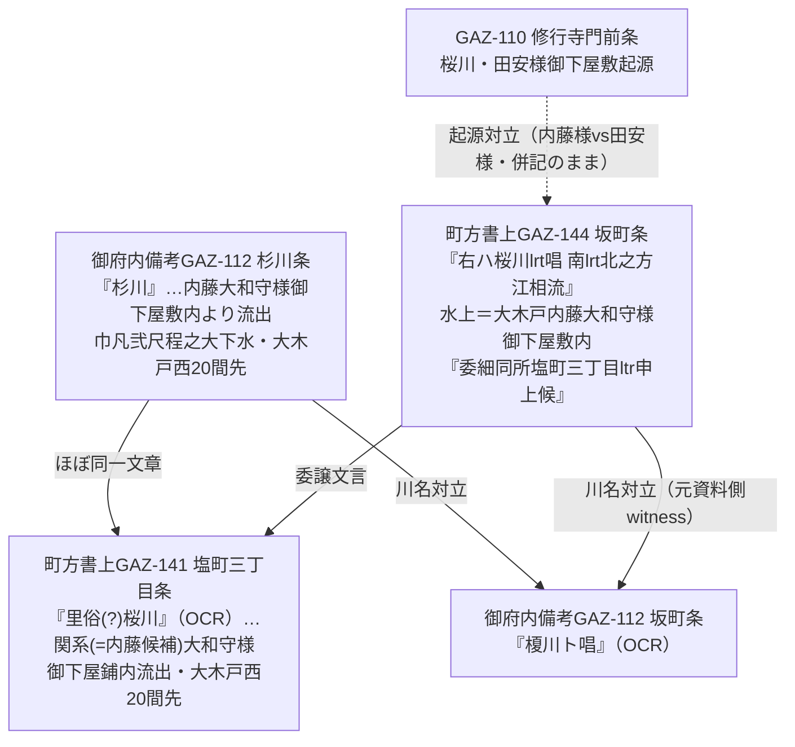
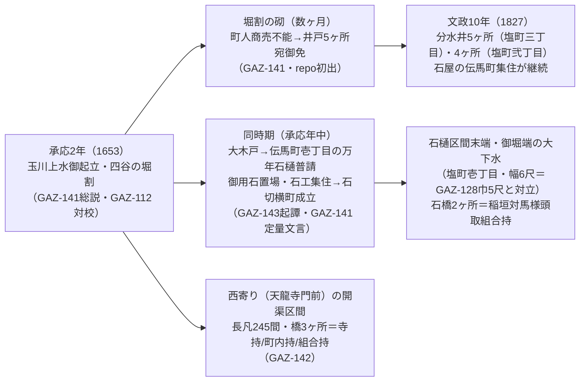

# 第224回（2026-11-20実行）— 町方書上[5][8][10][60][61][62][65]の掃引＝船河原橋どん橋・桜川杉川判読対立・石切横町起譚・津久戸前町石橋化・天龍寺玉川上水245間の追加調査

## 実行概要

- 第223回に続き町方書上シリーズ（文政10亥年の地誌御調書上帳）の未掃引冊をNDL lab OCR全文で掃引し、**新規7点を正規採番**（[GAZ-139](sources/gazetteers/GAZ-139.md)〜[GAZ-145](sources/gazetteers/GAZ-145.md)）。中心は①牛込側（[5][8][10]＝揚場町・津久戸前町・成就院門前・榎町・川田ヶ久保町・原町）の橋・大下水文言群、②四谷側（[60][61][62][65]＝伝馬町・塩町三丁目・坂町・御箪笥町・天龍寺門前）の玉川上水・万年石樋・桜川文言群。
- 対照表（[地名・河川名対照表](地名・河川名対照表.md)）: 紅葉川・柳川桃川・桜川・榎川・万年石樋の5行へ第224回追記、**どん橋・小日向冷水番所通大下水・小栗横町・石切横町・御仮屋橋岸通・夷橋・七軒寺町の7行を新設**（表末尾・新シ橋行の直後）。橋名調査（[四河川の橋名・橋跡調査](四河川の橋名・橋跡調査.md)）へ第224回追補節（船河原橋どん橋・津久戸前町石橋化年次・八幡明神前通・成就院門前・塩町壱丁目2橋・天龍寺門前3橋・坂町桜川石橋・御箪笥町石枡対校・夷橋・川田ヶ久保・原町壱丁目）を追加。
- 陰性・監視記録: [6]2571487（[5]と同一構造・差分小＝対校のみ採番なし）、[7][11][13][14][63][64][82]（川系Keyword掃引で文言不在）、[9]2571490（[GAZ-109](sources/gazetteers/GAZ-109.md)と同一内容＝対校のみ）のほか、[1][19]-[28][32]-[59][101]-[154]帯は対象外・未fetch。**水窪川・弦巻川・谷端川の直接文言は本回も0件**（本回の新層は牛込・四谷の江戸川（神田川）系・玉川上水系）。監視系はkanzyou7の2026/11/20例行更新のみ陰性、musashi.repo.nii.ac.jpとnabunken 113630のhttp 000不通継続（第214回〜）、news6クエリ陰性、NDL lab 1900493/475/485/487はAPI 500（PID is not allowed）継続。**開札2026-12-02（環七調節池広域整備検討その2）は第225回最優先**。

## 本回の成果（確認/観察/推定/仮説の区別）

### 1. 揚場町条の船河原橋＝里俗「どん橋」＋堀千之助文言〔文言候補・GAZ-139〕

- [GAZ-139](sources/gazetteers/GAZ-139.md)（[5]牛込壱・[2571486](https://lab.ndl.go.jp/dl/book/2571486)・文政10亥年）: ①揚場町条「**船河原橋と相唱候訳且(=得共候補)里俗どん橋与相唱候得共右唱之訳相知レ不申…水戸様御一手持ニ御座候**」＝**船河原橋の里俗名「どん橋」文言repo初出候補**。〔[GAZ-108](sources/gazetteers/GAZ-108.md)揚場町条の判読対立部「異澤且里路ニ先之橋」が「得共里俗どん橋与相唱」の誤読の正体候補＝御府内備考揚場町条と本冊揚場町条の同系統元資料性の傍証候補（OCR比較上の仮説・原画像照合まで断定しない）〕、②同条「両側石垣石橋共 寛永年中 **堀千之助様**御手伝に而出来仕」＝御府内備考側「堀与之助様」に対する**元資料側「千之助」の第3 witness**（千之助／与之助対立は決着保留。石橋長9尺巾1丈1尺3寸石7枚なども[GAZ-108]と一致＝対校）、③牡丹屋鋪条の**小栗横町**（小栗利右衛門様屋敷地尻由来・repo初出候補）・**材木置場願文言**（幅1間長8間・願済年月不知・repo初出候補）・柳川（幅1間）・大石橋15枚＝[GAZ-108]牡丹屋鋪条の元資料側対校、④惣物場2ヶ所（享保17年5月大岡越前守様願出）・船鴨御用・鯉取溜の江戸川水運の実務文言。

### 2. 津久戸前町条の板橋→石橋化の年次＋成就院門前「小日向冷水番所通大下水」〔文言候補・GAZ-140〕

- [GAZ-140](sources/gazetteers/GAZ-140.md)（[8]牛込四・[2571489](https://lab.ndl.go.jp/dl/book/2571489)）: ①津久戸前町条「**以前板橋ニ而有来…享保十己(=巳候補)年二月類焼致候砌 右板橋焼失致…宝暦九年壬(=卯候補)七月 御道奉行所江願出 石橋ニ掛直し…但し石橋幅七尺長さ五尺**」＝**板橋→享保10年（1725）2月類焼焼失→古板仮補理→宝暦9年（1759）7月石橋化の年次・寸法・管轄文言repo初出候補**。〔享保・宝暦期の石橋化潮流の牛込側の具体的年次datapoint。干支のOCR崩れは要原画像照合〕、②八幡明神前通石橋（長2間巾5尺・起立類焼後不弁）、③成就院門前条「**小日向冷水番所通大下水江流行 江戸川え落入申候**」＝**repo初出の川名候補**（「冷水」の正体＝玉川上水分水か神田上水系かは小日向側史料の照合課題）＋石橋長6尺巾9尺・天徳院門前条の五軒町大下水接続文言＝GAZ-108系対校。〔[GOV-373](sources/gov/GOV-373.md)（寛延川浚49町）の津久戸前町・白銀町・成就院門前クロスリンク〕。

### 3. 塩町三丁目条の玉川上水総説・井戸五ヶ所補償・桜川/杉川判読対立・紅葉川梵鐘銘〔文言候補・GAZ-141〕

- [GAZ-141](sources/gazetteers/GAZ-141.md)（[61]四谷弐・[2571542](https://lab.ndl.go.jp/dl/book/2571542)）: ①玉川上水起立承応2癸巳年総説＋村列リスト＝[GAZ-112](sources/gazetteers/GAZ-112.md)の元資料側対校、②「**御上水御堀割之砌 数月之間 町人共商売不仕候ニ付 壱ケ町左右二井戸五ケ所宛 御免被仰付候由**」＝**堀割工事の商売不能への補償としての井戸5ヶ所宛御免文言repo初出候補**（文政10年時点で現存・修復は御願の上）、③万年石樋の定量文言（幅凡6尺・地中9尺・大木戸御上水番屋→伝馬町壱丁目一円石樋・分水井5ヶ所）＝[GAZ-112]の元資料側対校、④御水番屋630坪・175年御預り・吐水門→内藤様下屋敷→千駄ヶ谷→渋谷川→古川流下＝同条対校、「一里俗(?)**桜川** 右往古之水際は…大和守様御下屋鋪内ltr流出…」＝**[GAZ-112]杉川条とほぼ同一文章で本冊OCRは「桜川」＝桜川／杉川の判読対立が両書間で成立**（原画像照合まで決めない）、⑤紅葉川の流路文言（田安様御下屋敷内→市谷谷町辺→木村町）＋**西迎寺梵鐘銘引用**（「伊ト太田道灌之臣造茲寺者也」・延徳2祀・江城西郭旧名説・貞享3丙寅銘）＝由来系譜の梵鐘側一次引用repo初出候補、⑥太田川・くだいだ橋＝[GAZ-112]対校、⑦塩町壱丁目条の大下水幅6尺＝[GAZ-128](sources/gazetteers/GAZ-128.md)巾5尺との対立＋無名石橋2ヶ所（稲垣対馬様頭取組合持）。
- 【観察】坂町の桜川（次のGAZ-144）と塩町三丁目の「里俗(?)桜川/杉川」の間に「委細ハ塩町三丁目ltr申上候」の委譲文言が往復する分業構造が元資料側で確認された:

### 4. 天龍寺門前条の玉川上水区間長245間・橋3ヶ所の維持責任区分〔文言候補・GAZ-142〕

- [GAZ-142](sources/gazetteers/GAZ-142.md)（[65]四谷陸・[2571546](https://lab.ndl.go.jp/dl/book/2571546)）: ①「**玉川御上水堀 町内に懸り候 長凡弐百四拾五間**」＝**上水堀が1町内に懸かる区間長約245間（≒440m強）の定量文言repo初出候補**、②御預り添地の文言（表門前長126間巾2間・両縁通・縁通の異変時の訴先区分＝**水面は御普請方/町奉行所・年貢地は町奉行所/御代官**）、③「**一橋三ヶ所 但天龍寺一手持石橋…長弐間半巾壱間半 同門前町内一手持板橋…長弐間壱尺三寸巾七尺五寸 武家方町方組合持石橋…巾壱間半 右何れも玉川御上水に懸渡**」＝**同一上水区間内で寺一手持・町内一手持・組合持が橋単位で書き分けられた維持責任の一次文言群**、④天龍寺由緒（牛込寺地3万6千坪→天和3年類焼→四谷で1万2,209坪余地拝領）＝[GOV-373](sources/gov/GOV-373.md)「元天龍寺前」の年代背景。

### 5. 伝馬町弐丁目条の石切横町起譚＝万年石樋普請の工程側記録〔文言候補・GAZ-143〕

- [GAZ-143](sources/gazetteers/GAZ-143.md)（[60]四谷壱・[2571541](https://lab.ndl.go.jp/dl/book/2571541)）: ①「**承応年中 玉川御上水万年石樋御起立之砌 御用石数多此辺ニ差置 日々石工相集り切立候事数月ニ及ひ候ニ付 自然ニ里俗石切横町江唱来候由**…其侭此所ニ住居定候者も有之ニ付 今以此辺石屋共数多住居仕候由**」＝**石切横町の地名が万年石樋普請（承応年中）の御用石置場・石工集住から起きた旨の一次文言（repo全体で石切横町文言は本登録が初出）**＝万年石樋（開渠→石樋化）の工程の性格（石材置場・数ヶ月の石作業・石工の残余定着）を伝える工程側記録、②御仮屋横町（寛永11戌年牛頭天王・稲荷勧請の四谷鮫河橋鎮守の祭礼旅所）・御仮屋橋岸通（巾3間・repo初出候補）・荒木横町（三軒木→荒木改字）・法蔵寺横町・天王横町＝伝馬町の小地名群の一次リスト、③伝馬町新壱・弐丁目条の川系Keyword掃引は陰性＝[GAZ-141]塩町壱丁目条「大下水元之儀は四谷伝馬町壱丁目ゟ申上候」の委譲先の情勢の制約事項として記録。

### 6. 坂町条の桜川＝榎川対立の元資料側witness・御箪笥町石枡の修復年代対立〔文言候補・GAZ-144〕

- [GAZ-144](sources/gazetteers/GAZ-144.md)（[62]四谷参・[2571543](https://lab.ndl.go.jp/dl/book/2571543)）: ①坂町条「**右ハ桜川lrt唱 南lrt北之方江相流申候 右水上 四谷大木戸 内藤大和守様御下屋敷内ltr流出候由 委細同所塩町三丁目lrt申上候**」＝**桜川の直接呼称＋塩町三丁目条への委譲文言の元資料側確認（[GAZ-112]坂町条「榎川」との川名対立の元資料側witness）**、②同石橋（長7尺巾1丈4尺5寸・尾州様御持・御屋形様御修復・「掛始年代相分不申」）＝[GAZ-112]坂町条石橋の元資料側対校、③稲垣対馬守様屋敷境の幅3尺大下水（水源＝市谷七軒町通横切下水→坂下桜川へ流落）＝元資料側対校＋水源文言、④御箪笥町条「**石枡弐ヶ所 いづれにも七尺四方程 地中ニ埋木蓋…弐拾ケ年程以前 御修復有之**」＝**[GAZ-112]「10ヶ年程前」との修復年代の対立（10年vs20年）＝寛政〜文化期の御修復の実年代を絞る対校材料候補**。
- 【観察】四谷の万年石樋とその周辺のプラクシス（工程→補償→地名→維持）が本回の3冊でつながった:

### 7. 榎町の夷橋・川田ヶ久保・原町の下水文言群〔文言候補・GAZ-145〕

- [GAZ-145](sources/gazetteers/GAZ-145.md)（[10]牛込六・[2571491](https://lab.ndl.go.jp/dl/book/2571491)）: ①榎町条「**右下水江成渡候石橋 長七尺八寸巾弐間 里俗夷橋之唱候**」＝**「夷橋」repo初出候補**（同所の板橋は地頭廉(=蓮候補)松寺持ち・破損時は町奉行所に御訴）、②天神町条の下水流出石橋（長3尺5寸巾3間5寸・町内普請）、③川田ヶ久保町条の前通下水・横町通下水（巾4尺程・堀割年代不知）・石橋（巾4尺程長2間半・**埋橋仕立**・御普請方御掛）、④原町壱丁目条「**尾張様西御門前lrt流出 …末ハ根来御組屋敷lrt中里村田甫え落江戸川へ流入…石橋壱ケ所…巾四尺五寸長弐間**」＝**[GAZ-109](sources/gazetteers/GAZ-109.md)原町壱丁目条の元資料側対校の成立**（巾4尺5寸一致・石橋長「2間」vs[GAZ-109]「1間」の対立は判読・転記いずれ由来か保留）、⑤鳳林寺門前条の「牛込御門外船河原」の永禄元午年建立文言＋**七軒寺町の由来文言**（寛永12亥年の7ヶ寺同時引移・repo初出候補）＝外堀普請に伴う寺移転の年代datapointで、町名は川田ヶ久保系下水の流路文言に既出だが由来は本登録が初出。

## 対校・採番の整理

| 今回 | 資料 | 対校先 | 性格 |
| --- | --- | --- | --- |
| GAZ-139 | [5]牛込壱・揚場町条・牡丹屋鋪条（どん橋・堀千之助・小栗横町・材木置場・柳川） | GAZ-108（揚場町条・牡丹屋鋪条＝判読対立部「異澤且里路ニ先之橋」の解決候補）・GAZ-107 | 新採番 |
| GAZ-140 | [8]牛込四・津久戸前町条・成就院門前条（石橋化年次・小日向冷水番所通大下水・五軒町大下水） | GAZ-108・GAZ-139・GOV-373（寛延川浚49町） | 新採番 |
| GAZ-141 | [61]四谷弐・塩町三丁目条（玉川上水総説・井戸五ヶ所・万年石樋定量・桜川/杉川・紅葉川梵鐘銘・太田川） | GAZ-112（ほぼ同一文章）・GAZ-110・GAZ-128（幅5尺対立）・GAZ-144 | 新採番 |
| GAZ-142 | [65]四谷陸・天龍寺門前条（区間長245間・添地訴先区分・橋3ヶ所） | GOV-373（元天龍寺前）・GAZ-141・GAZ-103 | 新採番 |
| GAZ-143 | [60]四谷壱・伝馬町弐丁目条（石切横町起譚・御仮屋橋岸通・御仮屋横町・荒木横町） | GAZ-141（万年石樋区間）・GAZ-112・GAZ-128 | 新採番 |
| GAZ-144 | [62]四谷参・坂町条・御箪笥町条（桜川・石橋尾州様御持・稲垣対馬守境下水・石枡修復年代対立） | GAZ-112（榎川対立・「10ヶ年程前」対立）・GAZ-141（委譲文言の往復）・GAZ-110（田安様対立） | 新採番（一部GAZ-112重複は対校フレーム） |
| GAZ-145 | [10]牛込六・榎町・川田ヶ久保町・原町壱丁目・鳳林寺門前条（夷橋・埋橋・元資料側対校・七軒寺町由来） | GAZ-109（元資料側対校・石橋長対立）・GAZ-108・GAZ-139（船河原） | 新採番 |
| （対校のみ） | [6]2571487（[5]と同一構造）・[9]2571490（GAZ-109と同一内容） | GAZ-139・GAZ-109 | 採番なし |

## 次回（第225回）以降の引き継ぎ

- **開札2026-12-02（環七調節池広域整備検討その2）の結果確認を最優先**。
- 原画像照合backlogの累積（本回分）: どん橋の原字（丼橋・土橋等）・桜川/杉川判読対立（[GAZ-141]p69-70・[GAZ-144]p25の原画像と[GAZ-112]）・「関系(=内藤候補)大和守」・堀千之助/堀与之助・大下水幅5尺vs6尺（[GAZ-128]/[GAZ-141]）・石枡修復10年vs20年・津久戸前町の干支崩れ（享保十「己」・宝暦九「壬」）・「小日向冷水番所」の正体・夷橋・埋橋・「泊出火五寸程」等。
- 町方書上対象外冊の判断記録: [1][19]-[28][32]-[59][101]-[154]帯の牛込・四谷・市谷・麹町以外の冊は未fetch・未掃引（次回の棚卸し対象候補。牛込[6]以外の残冊・[7][11][13][14][82]の原画像再確認の余地）。
- musashi.repo.nii.ac.jp・nabunken 113630の再試行、NDL lab 1900493/475/485/487（PID is not allowed）継続監視。
- 採番現況: **GAZ-145まで使用**（第223回はGAZ-138まで）。GOV番号は本回不使用（次回の新規 行政史料はGOV-473から）。
