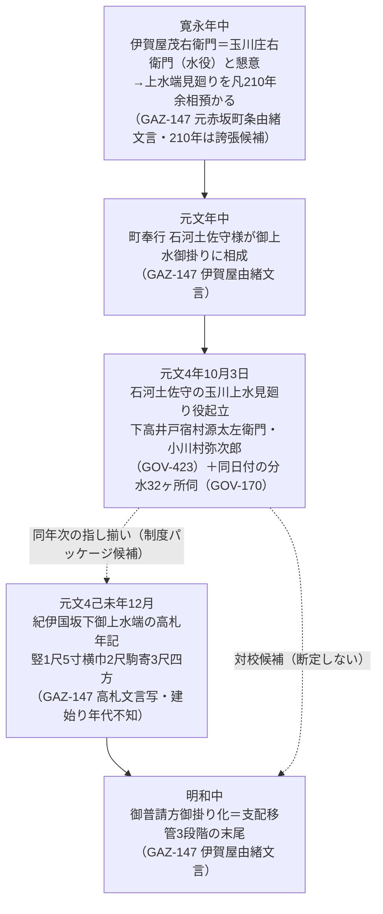

# 第225回（2026-11-21実行）— 町方書上[12][33][34]の掃引と[149]音羽桜木青柳冊の追記＝玉川上水高札・伊賀屋210年・服部屋文言の結末・樋籠・宮益町改称・鼠ヶ谷字名・丸太橋・菊井戸・東西小松原・肴町文言変種

## 実行概要

- 第224回に続き町方書上シリーズ（文政10亥年〜11子年の地誌御調書上帳）の未掃引冊をNDL lab OCR全文で掃引し、**新規3点を正規採番**（[GAZ-146](sources/gazetteers/GAZ-146.md)〜[GAZ-148](sources/gazetteers/GAZ-148.md)）。中心は①渋谷冊（[12]＝渋谷町方書上全・広尾町・宮益町・道玄坂町等）の樋籠・宮益町改称・赤羽川水源文言、②赤坂冊（[33]元赤坂町・[34]田町1〜5丁目・一ッ木町・門前町等）の玉川上水端高札・伊賀屋由緒・服部屋文言の結末。③[149]音羽桜木青柳三ヶ町冊（2571630）は[GAZ-035](sources/gazetteers/GAZ-035.md)へ第225回追記6条、[15]駒込壱冊は[GOV-224](sources/gov/GOV-224.md)へ追記（三ッ家町条の肴町委任文言・肴町条文言変種）。
- 対照表（[地名・河川名対照表](地名・河川名対照表.md)）: 鼠ヶ谷下水行・渋谷川行への追記＋**菊井戸・東西小松原・樋籠の3行新設**。橋名調査（[四河川の橋名・橋跡調査](四河川の橋名・橋跡調査.md)）へ第225回追補節（丸太橋〔音羽5丁目〕・窪尾大反橋=広尾大坂橋）を追加。
- 陰性・監視記録: [35]2571515（表紙「二七四ノ第三十五」＝赤坂参・155頁）は本回は川系Keyword掃引で文言不在傾向（不残文言のみ命中）＝**次回掃引候補**。監視系はweb/newsの5クエリ（谷端川・弦巻川・水窪川・千川上水・神田川下水道・30日）を実施: 野球選手「谷端将伍」等の同名ノイズが大半で**四河川の直接文言は0件**。国史跡玉川上水の補修工事続報（東京新聞2026-10-27・渋谷区笹塚の開渠160m・日本イコモス国内委員会の見直し提言で工事中断）は四河川直接言及なし＝[第67回](2026-11-14（第67回）・板橋区立郷土資料館紀要全巻目録取得（小林保男水車論文の書誌特定・平尾邸論文群・横山恵美産業論文）.md)見送り記録（2026-10-16東京民報）の続報として監視継続（README本体は変更せず）。**開札2026-12-02（環七調節池広域整備検討その2）は第226回最優先**。

## 本回の成果（確認/観察/推定/仮説の区別）

### 1. 渋谷広尾町の旧小名「樋籠」・宮益町改称年月日・赤羽川の水源認識文言〔文言候補・GAZ-146〕

- [GAZ-146](sources/gazetteers/GAZ-146.md)（[12]渋谷町方書上全・[2571493](https://lab.ndl.go.jp/dl/book/2571493)・文政11子年1828年3月上）: ①広尾町条「**町名之儀は渋谷村地之節ゟ小名樋籠と相唱候場所ニ付 則町名ニ相唱候哉に御座候処 享保年中ゟ文字相改候由**」＝**広尾町の旧小名「樋籠」と享保年中の改称文言repo初出候補**（寛文8申年町家作御免・元禄12卯年伊奈半左衛門検地の起立文言も併記）、②宮益町条「**元禄十三辰年六月十八日五益町(=宮益町・OCR)ゟ町銘之唱相改候由 右唱之儀は町内鎮守御嶽権現之宮有之候ニ付 宮益町而申候**」＝**渋谷新町→宮益町改称の年月日と御嶽権現「宮」由来説の一次文言repo初出候補**、③赤羽川の水源認識が広尾町条「**内藤新宿追分ゟ玉川分水**」・宮益町条「**同vron玉川分れ**」＝**[GAZ-103](sources/gazetteers/GAZ-103.md)の「四ッ谷大木戸ゟ分流水」との起源位置対立**（給水源の比定・流路の正否は保留・水窪川＝渋谷川上流の源流論の対校材料）、④窪尾大反橋（長12間巾2間・御公儀普請）＝[GAZ-103]広尾大坂橋との寸法完全一致＝**OCR判読変種候補（元資料側witness）**、⑤富士見坂（宮益町）=道玄坂他称の相互参照文言＋上目黒村宿山北の道玄物見松（明和9辰年切払）repo初出候補。

### 2. 元赤坂町条の玉川上水端の高札文言写と伊賀屋210年の相預り〔文言候補・GAZ-147〕

- [GAZ-147](sources/gazetteers/GAZ-147.md)（[33]赤坂壱・表紙「二七四ノ第三十三」・[2571513](https://lab.ndl.go.jp/dl/book/2571513)・文政10亥年）: ①「**高札壱ヶ所 紀伊国坂下御上水端に建有之 御文言之写 定 此上水道にて魚を取…**」＝**玉川上水端に建つ御高札の御文言を町方書上が書き写した文言repo初出候補**（年記「**元文四己未年十二月奉行**」・高札寸法竪1尺5寸横巾2尺駒寄3尺四方）、②伊賀屋半次郎家の「**凡二百拾年余相預申候**」由緒文言＝寛永年中に玉川庄右衛門（水役）と懇意に及び上水端見廻りを相預かる譚＋**支配移管3段階**（元文年中に町奉行石河土佐守様が上水御掛りに相成→明和中に御普請方御掛り）＝**上水端見廻りの民間相預りの系譜文言repo初出候補**、③弁慶堀の名義文言「**寛永年中堀割**」＝**[GAZ-116](sources/gazetteers/GAZ-116.md)「宝永年中」との年次対立の元資料側witness**、④裏伝馬町壱丁目条の桜川・赤坂川の名義併存文言＋湯光寺門前の「証ケ渕」小池文言（repo初出候補）＝[GAZ-143](sources/gazetteers/GAZ-143.md)述作の条帰属をOCR頁構造で修正済み（横切大下水・証ケ渕文言=元赤坂町条p19-20、桜川/赤坂川名義・万年石垣樋文言=裏伝馬町条p72-73）。

### 3. 田町五丁目条の服部屋文言の続き＝安永7年の町屋敷化の結末〔文言候補・GAZ-148〕

- [GAZ-148](sources/gazetteers/GAZ-148.md)（[34]赤坂弐・表紙「二七四ノ第三十四」・[2571514](https://lab.ndl.go.jp/dl/book/2571514)・文政10亥年）: ①田町五丁目条（p63-66）「**明和七寅年上り地ニ相成…安永七戌年九月 御経師田中勘兵衛(=源兵衛・OCR変種候補)・御小買物方今津茂兵衛(=仁兵衛・OCR変種候補)え拝領町屋敷ニ相成 両人御用達ニ而松平備前守様御預り地…**」＝**明暦2年神田御上水白堀の通り極（通樋候補）請負人・服部屋清右衛門の拝借地が、明和7寅年に上り地化→安永7戌年9月に御経師田中勘兵衛/源兵衛・御小買物方今津茂兵衛/仁兵衛への拝領町屋敷化・両人御用達・松平備前守御預り地化したという結末文言repo初出候補**（[GAZ-116]服部屋文言・GAZ-146〜147系対校の続き。明和七「寅」年は干支整合で[GAZ-116]「亥年」と対立）、②田町壱丁目条の「十辰年 田町壱丁目ゟ四丁目迄長弐百五拾間 幅大下水ゝ御堀之方五間合千四百坪」の替地文言・万年石垣樋→埋樋化の文言群＝[GAZ-116]の元資料側対校、③田町四丁目条の古来の御公儀橋＋享保4年修復文言、④麹町山王社前の5石張歩行道等も読取点。

### 4. 音羽・桜木・青柳冊（[149]）の追記＝鼠ヶ谷の字名文言・菊井戸・鉄砲坂と丸太橋・東西小松原・奥女中衆の御名formula〔文言候補・GAZ-035追記〕

- [GAZ-035](sources/gazetteers/GAZ-035.md)第225回追記6条（[149]音羽桜木青柳三ヶ町・[2571630](https://lab.ndl.go.jp/dl/book/2571630)・文政10亥年）: ①音羽弐丁目条「**音羽町之分不残町屋ニ相成不申以前鼠ヶ谷与申字**」＝**鼠ヶ谷下水の名義が谷名→字名→下水名に下ったと読める唯一の一次文言候補repo初出**（元禄5年の干支対立: 未年〔弐丁目条〕/申年〔他条〕/甲年〔桜木条〕＝壬申で「申」が整合・御代官細井九左衛門の実名も初出）、②「鼠ヶ谷下水」の判読変種の拡大（3丁目条「開き谷」・4丁目条「崩ケ谷」＝鼠/陰/厳/開/崩の対立群）、③音羽4丁目条の村菊稲荷と**菊井戸**（宝永元年譚・repo初出候補）、④音羽5丁目条の**鉄砲坂**名義文言（大筒角場＝御先手春日八十郎組・依田大助殿御預り場所）と**丸太橋**（長7尺巾4尺斗・鉄砲坂への渡り・「里俗の名橋には無御座候」＝[GAZ-013](sources/gazetteers/GAZ-013.md)細目の五丁目/六丁目帰属を支持・巻50本文の「壱貫橋」帰属とは対立）、⑤音羽7丁目条の**東小松原・西小松原**（御賄方御組屋敷の里俗地名・repo初出候補）、⑥桜木町条の**古道文言**（一体橋通り→関口蓮光寺門前→大泉寺/洞雲寺境外→西小松原・里俗奥州街道跡説に「手ニ御納ハ相知不申」の保留）・**速田領/戸田領/関口村領の領名文言**（使田領・決田領はOCR変種）・**奥女中衆の御名による町名起譚の同型formulaが東青柳（青柳え申御方）・音羽1丁目（音羽様）・桜木町（桜木与申御方）の三町で並走する**（元禄10丑年8月→家作人無之→御公儀家作御取建→於御城奥女中衆御名の拝領→御名を町名に・repo初出候補）＋正徳3己年の支配移管年次文言・神田御上水幅弐間程・承応2年・目白坂の対校文言。

### 5. 駒込三ッ家町条の肴町委任＝代表町の第三系統と肴町条の文言変種〔文言候補・GOV-224追記〕

- [GOV-224](sources/gov/GOV-224.md)第225回追記（[15]駒込壱・2571496）: ①三ッ家町条「**一 千川上水跡 右委細は駒込肴町vron申上候**」＝**千川上水跡の委細申上の代表町が「追分町」「浅嘉町」に次ぐ第三の「肴町」でも現れる**（[GOV-225](sources/gov/GOV-225.md)対校）、②肴町条の文言変種「**明和六丑年二月中…幸右衛門…安永八亥年十一月廿八日御検地御改有之 掛渡出来仕 天明二寅年…水銭小間壱間に付廿八文…出銀相止…埋立**」＝**追分町条「御見分」vs肴町条「御検地御改」の表記対立・「小間1間28文」解読支持**・幸右衛門witness（いずれも原画像照合前提）。

### 6.【観察】玉川上水の元文4年整備パッケージの対校チェーン〔対校候補・断定しない〕

- [GAZ-147]伊賀屋由緒文言「元文年中に而町奉行石河土佐守様 町奉行御上水御掛りに相成候」・高札年記「元文四己未年十二月」・[GOV-423](sources/gov/GOV-423.md)（元文4年10月3日石河土佐守見廻り役起立・下高井戸宿村源太左衛門・小川村弥次郎）・[GOV-170](sources/gov/GOV-170.md)（同年月日の分水32ヶ所伺）が同年次で指し揃う。**ただし「同一の制度整備パッケージか」は対校候補の域を出ない**（高札の建始り年代不知文言との関係も未解決・[GAZ-147]制限②⑤）:

## 対校・採番の整理

| 今回 | 資料 | 対校先 | 性格 |
| --- | --- | --- | --- |
| GAZ-146 | [12]渋谷全・広尾町条・宮益町条・道玄坂町条（樋籠・宮益町改称・赤羽川水源・窪尾大反橋・富士見坂/道玄坂・道玄物見松） | GAZ-103（赤羽川・広尾大坂橋・塩谷譚・大木戸分水対立）・GAZ-106 | 新採番 |
| GAZ-147 | [33]赤坂壱・元赤坂町条・裏伝馬町条（高札文言写・伊賀屋210年・弁慶堀・桜川/赤坂川・証ケ渕） | GAZ-116（宝永対立・通樋）・GAZ-112・GOV-423・GOV-170（元文4年パッケージ） | 新採番 |
| GAZ-148 | [34]赤坂弐・田町五丁目条ほか（服部屋文言の結末・替地・古来御公儀橋享保4年修復） | GAZ-116（服部屋文言・亥年/寅年対立）・GAZ-147・GOV-423 | 新採番 |
| GAZ-035追記 | [149]音羽桜木青柳・音羽2/3/4/5/7丁目条・桜木町条・東青柳町条（鼠ヶ谷字名・判読変種・菊井戸・鉄砲坂・丸太橋・東西小松原・古道・速田領・奥女中formula） | GAZ-013（細目の丸太橋/壱貫橋帰属・鼠ヶ谷橋・幅弐間承応2年）・GAZ-035第223回追記・GAZ-048 | 既存ファイル追記 |
| GOV-224追記 | [15]駒込壱・三ッ家町条・肴町条（代表町第三系統・文言変種・水銭小間1間28文） | GOV-225（浅嘉町条・幸右衛門）・GOV-217（幸島対立）・GOV-224既存（追分町条） | 既存ファイル追記 |
| 対照表 | 鼠ヶ谷下水行・渋谷川行追記＋菊井戸・東西小松原・樋籠の3行新設 | GAZ-146・GAZ-035追記 | 追記・新設 |
| 橋名調査 | 第225回追補（丸太橋・窪尾大反橋） | GAZ-103・GAZ-013 | 追補 |

## 次回（第226回）以降の引き継ぎ

- **開札2026-12-02（環七調節池広域整備検討その2）の結果確認を最優先**（本回時点ではまだ未来）。
- **[35]2571515（赤坂参・155頁）の掃引**: 本回は川系Keywordで文言不在傾向（不残文言のみ命中）だったが、表紙「二七四ノ第三十五」確認済み・山城試藪等の収録町の全面掃引が未実施＝次回候補。
- 原画像照合backlogの累積（本回分）: 「樋籠」の表記・「玉川分れ/分水」の原字・「窪尾大反」・「元禄五未年/申年/甲年」・「開き谷/崩ケ谷」・「使田領/決田領/速田領/戸田領」・「廣気」・「菊井戸」・「甚と相旧田」・「安永八/代亥年」・服部屋文言の「寅/亥」対立・窪尾大反橋の原字等。丸太橋・壱貫橋の丁目帰属（御府内備考本文・細目・町方書上の三方の差）の原画像・条境照合。
- 監視系継続: 東京新聞2026-10-27玉川上水補修続報（渋谷区笹塚開渠160m・イコモス国内委員会提言・工事中断）とその関連記事「玉川上水緑道の再整備事業　イコモス国内委、渋谷区に提言」の展開、神田川・環七調節池インフラツアー2027年1月9日〜（一般見学）。
- 採番現況: **GAZ-148まで使用**（第224回はGAZ-145まで）。GOV番号は本回不使用（次回の新規行政史料はGOV-*の採番をINDEX再確認後に実施）。第224回ノート記載の「GAZ-145→146/147/148」は本ノートの本表が正式記録。
