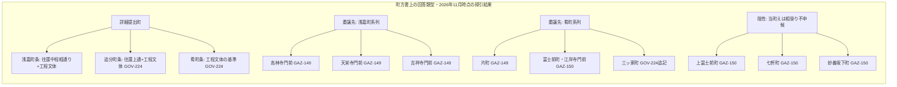
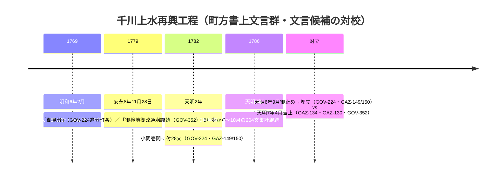

# 第226回（2026-11-21実行）— 第225回並走衝突分の回収（駒込[16][17]のの採番・陰性3町・宮益橋寸法対立）と[35]赤坂参冊の全面掃引＝太刀洗川の元資料側対校・赤坂新町五丁目の駒止橋（同名異橋候補）

## 実行概要

- 前回（第225回）は同一日に2つの実行が並走し、後続側はpushを見送って[未反映ドラフト](../knowledge側で引継ぎ・otowa-pending-2026-11-21-2.md)に保存していた。本回はその**引継ぎ分を回収**した: ①[GAZ-149](sources/gazetteers/GAZ-149.md)（[16]駒込弐・2571497）・[GAZ-150](sources/gazetteers/GAZ-150.md)（[17]駒込参・2571498）の新規採番、②[GAZ-146](sources/gazetteers/GAZ-146.md)（[12]渋谷）への追記（宮益橋寸法対立・赤羽川方位基準用例・「下水三ケ所」書き出し）、③[対照表](地名・河川名対照表.md)千川上水行・渋谷川行への追記、④[橋名調査](四河川の橋名・橋跡調査.md)への宮益橋追補。**「repo初出」表記は引継ぎメモの指示どおり全面見直し**し、工程文言・料率文言（安永8.11.28御検地御改・天明2.8水銭28文/小間・天明6.5半減・9月出桟/出銀停止・埋立）は[GOV-224](sources/gov/GOV-224.md)既登録の同一テキスト群として「第3・4の書き分け」表述に置き換えた。
- 第225回の残課題②**[35]赤坂参冊（2571515・表紙「二七四ノ第三十五」・155コマ）の全面掃引**を実施し、**[GAZ-151](sources/gazetteers/GAZ-151.md)を新規採番**（太刀洗川文言の元資料側対校・条帰属対立、享保年中赤坂溜池端新規大下水の元資料側と請負人判読対立（豊田屋/白田屋）、赤坂新町五丁目の駒止橋と青山御掃除町水源の横切下水、上石橋・下石橋の無名橋寸法pair、「東都宮橋」文言候補、四丁目条の無名下水・石橋・井戸、床見世願立ての「上水番」人名用例）。対照表太刀洗川行へ元資料側witness追記＋橋名調査第226回追補（宮益橋・駒止橋・無名橋群）。
- 採番はpush前INDEX・ディレクトリ実測で再確認（前回終了時点GAZ-148→本回GAZ-149/150/151。並走追加なし・HEAD=6f7924f7確認後にpush）。

## 本回の成果（確認/観察/推定/仮説の区別）

### 1. 千川上水跡の駒込区間: 位置語の第2点と陰性3町〔文言候補・第225回並走分の回収〕

- [GAZ-149](sources/gazetteers/GAZ-149.md)（[16]駒込弐・文政10亥年）浅嘉町条「**千川上水跡町内往還中程相通り申候**」＝[GOV-224](sources/gov/GOV-224.md)追分町条「往還上通」と対になる経路位置語の第2点。浅嘉町と追分町の2点で「往還」に沿う言い回しが揃い、[GAZ-135](sources/gazetteers/GAZ-135.md)御駕籠町条「巣鴨町往還ゟ…駒込富士前町通り江掛り」系の**往還添い流路の読み**に材料が加わる（「中程」の語義＝交差点か沿道中段かは照合まで決めない）。
- **委譲の分業構造（観察）**: 詳細提出先が①浅嘉町系列（高林寺門前・天栄寺門前・吉祥寺門前）と②肴町系列（片町・富士前町・江岸寺門前・三ッ家町〔GOV-224〕）の2系列に分かれ、駒込区内で代表町が2つ並走する実務構造が見える。陰性回答（「当町えは相掛り不申候」）は[GAZ-150](sources/gazetteers/GAZ-150.md)の上冨士前町・七軒町・妙義坂下町の3町＝**経路特定のマイナス側確定材料**。冨士前町条だけが定型工程文を採用しつつ「相掛り」語を持たない点と、御駕籠町条「富士前町通り江掛り」文言との間に現在3仮説（①「富士前町通り」は町界外の往還③流路は富士前町〜肴町側③書上係の定型文誤配）が等しく保持される。

- **工程文体の年次対立は解消されず**: [GAZ-149/150]浅嘉町条・冨士前町条の「天明6年9月出桟（出銀）相止→埋立」は、天明7未年4月差止系列（[GAZ-134](sources/gazetteers/GAZ-134.md)・[GAZ-130](sources/gazetteers/GAZ-130.md)・[GOV-352](sources/gov/GOV-352.md)）や[GAZ-114](sources/gazetteers/GAZ-114.md)の天明6年1〜10月水銭継続記録と年次が食い違ったまま。判読の摇摆（出桟/出銀/出浅・安永八/安永一同十一年・天明二/天明一）が同一文体の書き分け×4で裏付けられたことは、**原画像照合がこの問題群の唯一の決着手段**であることを強める（仮説観察）。

- なお水銭204文/404文（[GAZ-114](sources/gazetteers/GAZ-114.md)）と28文/小間の換算（204÷28≒7.3・404÷28≒14.4）は整数に落ちない＝**小間の語義（商家間口か貸間か）が固まるまで断定しない**（観察のみ）。

### 2. 宮益橋の寸法対立〔文言候補・〔確認〕第225回並走実行の回収〕

- [GAZ-146](sources/gazetteers/GAZ-146.md)追記（[12]渋谷・文政11子1828年3月提出）宮益町条「**長五間 巾弐間**…字宮益橋…掛始年代相知不申…御公儀普請」 vs 丁亥書上（[GAZ-103](sources/gazetteers/GAZ-103.md)・文政10）「**長拾間 巾弐間**」。渡る町・属性が同一で橋長だけが食い違う＝**判読（拾/五）・4年間の掛替・別橋の3仮説を等しく保持**。寛延2年出水（1749）・天明6出水（1786）の被災歴と組み合わせると架替説の検証材料となる可能性がある（推定）。対照表渋谷川行・橋名調査第226回追補に反映済み。

### 3. [35]赤坂参冊の全面掃引＝太刀洗川・新規大下水の元資料側対校〔文言候補・GAZ-151〕

- **太刀洗川の元資料側**: [GAZ-116](sources/gazetteers/GAZ-116.md)（御府内備考巻67-69）は同文体を「新町1丁目条」として収録するが、本冊OCR上の条区切りでは文言は**弐丁目条**（見出しp14〜署名p29）に属し、**条帰属対立候補**が成立（本冊側条区切りの誤読・集成時の再配列の両可能性を保持）。流路の定量（一ツ木町浄土寺東→田町御堀端明地内大下水流落・巾三尺五寸・水源は妻木彦右衛門様屋敷内流出）は御府内備考側記載の元資料側確認（確認だが文言はOCR由来で照合前提）。
- **享保年中赤坂溜池端新規大下水**: [GAZ-116]既登録文言の元資料側を三丁目条で確認＋**請負人の判読対立が新規成立**（本冊OCR「豊田屋源助」vs 御府内備考側「白田屋源助」・原字照合まで保留）。
- **駒止橋（赤坂新町五丁目）**: 青山御掃除町流出→赤坂田町五丁目大下水落合の横切下水（巾七尺）に架かる板橋（巾壱丈壱尺・渡り九尺）の「**駒止橋**」＋馬が進まなかったとする名目伝承＝**音羽の駒止橋（[GAZ-013](sources/gazetteers/GAZ-013.md)・古名鼠ケ谷橋）と同名異橋候補**。「駒止め」伝承の独立併存か系譜かは断定しない。橋名調査第226回追補に別橋として記録（採録数には加算せず）。
- **周辺の無名橋群**: 上石橋（幅弐間程・渡り四尺）・下石橋（幅九尺・渡り三尺）は本文が「名目無御座候」と明記＝**無名橋の寸法を対で記す一次文言**（呼び分けの性格は照合課題）。「東都宮橋」（三丁目条）はOCR崩壊大で橋名確定は保留。四丁目条の無名下水（巾五尺・長百間・町内持）と石橋（巾六丈〔=六尺候補〕長六尺五寸・修復は武家方御組合持出銀）も読取点。床見世起立願に「**上水番・落助**」という人名・役職名の用例候補（どの上水の番方かは本文言から確定不能、安永三年願立て・寛政6年退役の人物記録）。
- **陰性の確定〔観察〕**: 氷川門前・氷川社僧屋敷両条はboilerplate「御箇條之廉…無御座候」、溜池端芝代地群（p124-144）は増上寺火除地の代地履歴中心で水系文言なし。千川上水・四河川の直接文言は本冊none（[35]は赤坂界隈の冊で水系は太刀洗川系下水・赤坂大下水群＝広域対校材料）。

### 4. 監視系の記録

- **news/web監視（6クエリ・30日）**: 「谷端川」（阪神谷端選手等のfalse positive）、「弦巻川」（moegirl・人物名ノイズ）、「水窪川」（米沢・静岡の水窪ダム等）、「千川上水」（Wikipedia既存記事のみ・新規なし）、「神田川下水道」（都庁プレス2026-11-02環七インフラツアー2027-01-09〜＝[GOV-291](sources/gov/GOV-291.md)既登録の再掲のみ）、「雑司ヶ谷幹線」（駅・不動産情報のみ）。**四河川の直接新情報は0件**。
- **ぼ～せん雑記帳「神田川を下ってみる③ー1」（2026-10-31・[ameblo kuzu2019](https://ameblo.jp/kuzu2019/entry-12983155335.html)）**: 神高橋→面影橋→江戸川橋の一般ウォーキング記録。面影橋の距離標識石柱（すみだがわ→7km／みなもと←17.1km＝神田川水源・隅田川合流の距離標）の観察はあるが、[GAZ-101](sources/gazetteers/GAZ-101.md)面影橋条等の既存収録を深める新事実なし＝**見送り**（ノート記録のみ）。
- **都建設局（kensetsu.metro.tokyo.lg.jp）がHTTP 200で到達可能に復旧**（第214回以降403継続だった）。速報レベルの新着確認は本回は実施せず、次回以降の通常監視対象に復帰させる。
- **musashi.repo.nii.ac.jp＝http 000不通6回目（第214回〜）・nabunken 113630＝不通継続・NDL lab 1900493/1900475/1900485/1900487＝API 500継続**（いずれも再試行済み）。
- **kanzyou7.comのWHAT'S NEWは2026/11/20のまま不変**（週間工程表・シールド進捗図更新の例行便り）。
- **開札2026-12-02（環七調節池広域整備検討その2）＝まだ未来で、第227回最優先として順送り**（第225回・第226回で合意の順送り）。

## 本回の反映

- pushは慣例の分割（docs一括→対照表・橋名調査→INDEX→README単独）。push前にキリル・簡体字・英単語混入のgrep掃引・採番重複チェック・BASE-MATCH（remote raw との差分が意図どおりか）検証、push後はSHA固定codeload tarballで全ファイルcmp（過去回のチャンク境界空行事故対策）。
- 採番現況（第226回終了時点）: **GAZ-151**・GOV-472・BOOK-221・MAP-204・ORG-035・BLOG-246・PAP-095・LOST-005。次回新規はGAZ-152・GOV-473・BOOK-222・MAP-205・ORG-036・BLOG-247・PAP-096・LOST-006。

## 次回（第227回）課題

1. **開札2026-12-02（環七調節池広域整備検討その2）の入札結果確認＝最優先**（まだ未来なら継続順送り）。
2. **本回の原画像照合backlog**: 太刀洗川の条帰属対立（[GAZ-151]p28-29の条区切り＝弐丁目条説の確認・[GAZ-116]壱丁目条説との決着）、「豊田屋/白田屋」請負人判読、「上石橋/下石橋」の名目無文言、「東都宮橋・弐百目」の原字、宮益橋「長五間/長拾間」、[GAZ-149/150]の「出桟/出銀/出浅」「安永一同十一年」、[GAZ-146]「凡巾八丈/八間」。
3. **町方書上シリーズ残冊の棚卸し継続**（目録[154]冊体制で[1]〜[154]のうち掃引済みは凡そ半数。赤坂周辺の残り冊と、浅草・本所・深川等の未掃引冊の水系文言捜査）。
4. **都建設局の通常監視復帰**（403→200復旧。千川・谷端川関連の河川改正・測量の新着確認）。
5. musashi.repo.nii・nabunken 113630・NDL lab 1900493系の取得再試行（継続）。
6. news6クエリ・kanzyou7監視の継続。
