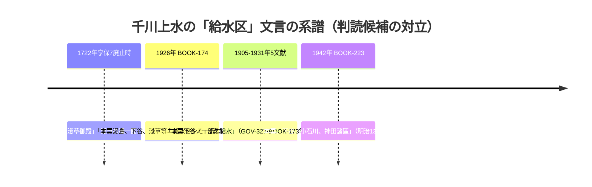

# 2026-11-21（第227回）・市街篇6の白山御殿跡条と区史2点の千川文言・千川水道給水区の追加調査

第227回定期実行。前段（同一実行内）ではNDL次世代デジタルライブラリーの東京市史稿市街篇連番（3450747〜3450829系）・深川区史・赤坂区史・大東京町名沿革2（1212511）・橋梁篇1（1915626）等のfulltext一括掃引を行い、本ノートはその整理・反映段階で作成した。

## 成果（新規3点＋追記3点＋対照表1行）

1. **[GAZ-152](sources/gazetteers/GAZ-152.md)＝東京市史稿 市街篇第六（1929・NDL lab [3450785](https://lab.ndl.go.jp/dl/book/3450785)）新規登録**
   - 白山御殿跡条「**今御藥園ノ西南ハ地低ク、西ヨリ南へ小溝ノ貫ケルハ、古ヘ御堀ノ名殘ナルヘシ**」＝**御薬園南西の低地を貫く小溝＝白山御殿の古堀の名残とみる観察文言候補〔repo初出〕**。原町西遺跡（2025年刊・既収録）の「千川上水から小石川御殿堀へ入る水路3本」の遺構と、同じ地点周辺の文書側観察として対照できる〔観察〕。
   - 同条の千川上水御堀引用「或ノ舊記」文言「**御門下町家ヘ御歩行目付堺庄兵衞申渡いハ、此度御堀之端ニ高札建申い…水アビ申間敷**」＝[GAZ-083](sources/gazetteers/GAZ-083.md)⑫の小石川志料側文言（「水アヒ(汲合?)」判読）に対する**市街篇集成テキスト側の対校1票**。判読対立は原画像照合まで断定しない〔文言候補〕。
   - 戸崎町条「**字小石川**」＋「**御殿坂**」＝[GAZ-102](sources/gazetteers/GAZ-102.md)「古名小石川」の対校本文（「字」と「古名」の表現差）。
   - 位置づけ: 白山御殿跡条・戸崎町条は御府内備考（純庸案）系の再録で、独立の採集ではなく同じ祖本に遡る対校テキスト。実質新事実ではないため採録は簡潔に留め対校価値を明記した。
2. **[BOOK-222](sources/books/BOOK-222.md)＝深川区史上巻（1926・NDL lab [1020207](https://lab.ndl.go.jp/dl/book/1020207)）新規登録**
   - 「**（江戸の上水=神田・玉川・千川）それらの水道の末端は總て隅田川西岸に至つて絕え、地方に及ぶものはなかつた**」＝千川上水の給水末端を「隅田川西岸」と整理する1926年区史レベルの地理的文言候補〔文言候補〕。
   - 本所上水（亀有上水）の通史: 瓦曽根溜井→亀有村→上千葉〜請地→小梅村・法恩寺橋の経路（[GAZ-093](sources/gazetteers/GAZ-093.md)風土記稿・[GAZ-138](sources/gazetteers/GAZ-138.md)小梅瓦町書上と対校）＋白堀上水＝業平橋筋配水説を『新編武藏風土記稿』『葛西誌』が否定する旨。
   - **享保4年（1719）本所奉行→勘定奉行への所管移替**＋**享保7年「八九月の交『此頃水も參らず』による廃止**」＋「千川·靑山·三田の各上水が（同時に）同じ運命」の並記＝四上水差止（[GOV-170](sources/gov/GOV-170.md)・[GAZ-138](sources/gazetteers/GAZ-138.md)享保7年9月）と整合する江東側の文言候補〔文言候補〕。
   - **『御府内上水在絕略記』「天和三年やみ元祿年中又開發」引用**＝[GOV-171](sources/gov/GOV-171.md)（在絕略記・千川上水条）が本所上水の興廃年次も載せる帳簿であることの1926年区史レベルのwitness〔文言候補〕。
3. **[BOOK-223](sources/books/BOOK-223.md)＝赤坂区史（1942・NDL lab [1042120](https://lab.ndl.go.jp/dl/book/1042120)）新規登録**
   - 千川上水の通史: 「**元祿九年には千川上水を開いて、先の神田玉川兩上水の給水地外の場末市街に供水した**」＋保谷村分水・「**本〓、下谷、淺草邊に給水**」＋**享保7年10月室鳩巣献議による四上水（靑山・龜有・三田・千川）廃止**と千川再興の不永続（[GOV-170](sources/gov/GOV-170.md)・[GAZ-049](sources/gazetteers/GAZ-049.md)⑫1・[GOV-390](sources/gov/GOV-390.md)系と整合）。
   - **明治13年再興の給水区「本〓、下谷、小石川、神田諸區」文言候補〔本回の最重要文言〕**: [BOOK-174](sources/books/BOOK-174.md)「本〓湯島、下谷、淺草等」・[GOV-290](sources/gov/GOV-290.md)系「本〓下谷ノ一部」5文献一致と対立する区名構成。**「小石川・神田」の追加と「浅草」の欠落**が対校上の新規性。江戸期の給区から明治13年の給区への「浅草→小石川・神田」の入れ替わりが実態（給水先変更）か区史の混同かは断定しない〔文言候補〕。「小石川」は千川旧上水路の小石川区間への給水と読める候補で[GOV-471](sources/gov/GOV-471.md)の千川線設計・実測図リスト（音羽町・柳町・富坂・谷中・初音町）との対校課題。
   - 室鳩巣献議の趣旨の詳細文言（「水道管が地脈を絕つ故に大地の噫氣である風を拘束する力を失ひ…火が誘はれて大火となり易い」）＝[BOOK-161](sources/books/BOOK-161.md)・[PAP-023](sources/papers/PAP-023.md)・[PAP-027](sources/papers/PAP-027.md)の同系説の1942年行政刊行レベルの文言（建議書は未同定のまま）。
4. **追記**: [GAZ-083](sources/gazetteers/GAZ-083.md)（市街篇6テキストとの対校・水アビ判読対立への1票）・[GAZ-102](sources/gazetteers/GAZ-102.md)（戸崎町条「字小石川」の別テキスト）・[地名・河川名対照表](地名・河川名対照表.md)「小石川」行。
5. **README本文への追記3箇所**: 千川水道の給水区文言（[BOOK-223]）・本所上水と在絕略記本所条（[BOOK-222]）・御薬園南西の小溝＝古堀残存の観察文言（[GAZ-152]）。

## 給水区文言の対立構造（Mermaid）

「本〓」＝本郷は全系統で共通。「下谷」は BOOK-222無し・BOOK-223有りなど区名構成が資料ごとに異なる。給水区域の行政文書側（會社届出・登記）の直接確認が未実施のため、優劣はつけない〔未解決〕。

## 陰性・見送り（記録のみ）

- 市街篇2（3450781）「千川屋敷」2件＝町奉行所与力同心屋敷系の列挙の中の言及（OCR列崩れ・性質の確定まで留保）。
- 市街篇6・16・18・20・22・橋梁篇1（1915626）の千川屋敷文言＝第111〜114・188・211回・BOOK-131/133/134・GOV-124等で既出の対校再録（採録せず・GAZ-034/049/083/102等に軽追記のみ）。
- 市街篇11（3450758）「千川口」＝神田川口のOCR判読候補。
- 市街篇23（3450804）「北千川」＝千川村方向の方位語候補で流路情報なし。
- [1212511]（大東京町名沿革2）白山前町条＝GOV-229系で既出扱い。
- 室鳩巣献議説・元禄9年開鑿説・保谷分水・享保7年10月廃止＝いずれも既出多数（新規2冊は対校材料として採録）。

## 監視系

- news_search 6クエリ（谷端川／弦巻川／水窪川／千川上水／神田川下水道／雑司ヶ谷幹線・2026-10-22〜11-21）: 全陰性。
- kanzyou7.com WHAT'S NEW: **2026/11/20「週間工程表・シールド進捗図更新」＝定常更新のみで新情報なし**。
- 都建設局procurement: 到達不能（000）継続。**開札2026-12-02（環状七号線地下調節池広域整備検討その2）はまだ未来＝次回以降の最優先確認事項**。
- NDL lab 1900493（旧幕府引継書実測図系）・1900475・1900485・1900487・1908617: 403継続。musashi.repo.nii（8回目不通）・nabunken 113630: 不通。

## 採番現況（第227回終了時点）

- 今回使用した採番: GAZ-152・BOOK-222・BOOK-223。
- 次回以降の新規採番候補: GAZ-153〜・BOOK-224〜・MAP-205〜・ORG-036〜・BLOG-247〜・PAP-096〜・LOST-006〜・GOV-473〜（push前に必ずINDEX.mdで最新の使用状況を再確認すること）。

## 次回課題

1. **『御府内上水在絕略記』（GOV-171・NDL 2541386）の本所上水条の直接確認**（「天和三年やみ元祿年中又開發」の原冊本文・OCR走査範囲の見直し）。
2. **千川水道の明治13年再興の給水区域の行政文書側の確認**（會社の届出・府県の認可書・水道条例関係のGOV系探索。「小石川・神田」文言の典拠の同定）。
3. **開札2026-12-02（都建設局・環七調節池広域整備検討その2）の結果確認**。
4. 「此頃水も參らず」の廃止理由文言の一次史料（勘定奉行側の実務文書）の探索。
5. 「水アヒ／水アビ」判読対立の原画像照合（GAZ-083 vs GAZ-152・IIIF画像）。

## 確認/観察/推定/仮説の区別

- 本ノートの引用文言はすべてNDL次世代デジタルライブラリーのOCR由来で、**原画像（IIIF）との照合を要する**。
- 「御薬園南西の小溝＝古堀残存」は市街篇編者の観察文言の再録〔観察・文言候補〕で、現地の残存状況の確認は今回実施していない。
- 「浅草→小石川・神田」の給区の入れ替わりの解釈は対立の併記〔推定／未解決〕。
- 給水区文言の典拠（BOOK-223）は区史の編纂過程で示されず〔未解決〕。
