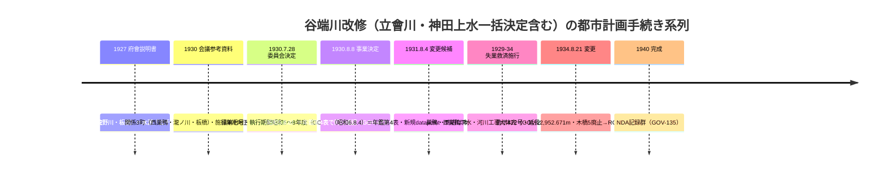

# 2026-11-21（第228回）・都市年鑑第4の河川表bbox同行復元と千川筋下水道の芝浦処分場・全国都市問題会議の谷端川行・在絕略記本所条・水アビ判読の追加調査

第228回定期実行。前段（同一実行内）では御府内上水在絕略記（2541386）の本所条の本文側確認・市街篇6（GAZ-152）の「水アビ申間敷い」のIIIF原画像直接判読・NDL labの満遍ない掃引（日本都市年鑑系・全国都市問題会議・北豊島郡史概説・滝野川区勢要覧・府政概報・東京都市計画概要）を実施済み。本ノートは①日本都市年鑑 第4（1464980）の都市計画河川表・下水道表のbbox同行復元、②第二回全国都市問題会議參考資料甲編（1132241）の東京府現況表の同行復元の成果を中心にまとめる。

## 成果（新規2点＋追記3点）

1. **[GOV-473](sources/gov/GOV-473.md)＝日本都市年鑑 第4・昭和10年用（1934・NDL lab [1464980](https://lab.ndl.go.jp/dl/book/1464980)）新規登録**
   - **都市計画河川表（画像129＝印刷頁216-217・画像136＝印刷頁230-231・いずれも昭和9年3月末現在）のbbox同行復元**: 「立會川、神田上水、谷端川(全部事業決定)」の行は「**(昭)5.8.8 同6.8.4變更、**」の書き出し＝**事業決定昭和5年8月8日（1930.8.8）・事業決定変更昭和6年8月4日（1931.8.4）の候補**。5.8.8＝[GOV-159](sources/gov/GOV-159.md)（1930.7.28委員会決定）・[PAP-064](sources/papers/PAP-064.md)の引用する1930年8月8日決定と同年月日＝**統計年鑑側での独立確認**。
   - **列崩れ平文OCRの「14.12.8 同7.3.31變更」は「古川」行の文言**（時代字「大」＋密度照合「大正」2字＋「1」「4.」「1」「2.」「8」の5数値ラン＝大正14.12.8決定の候補）＝**前段作業メモの「谷端川＝大正14.12.8決定候補」は誤対応と判明**。trioの変更日は**6.8.4（1931.8.4）＝GOV-159（1930）とGOV-160（1934.8.21変更）の中間の新規datapoint候補**。
   - **下水道表（画像321＝印刷頁596-597）の「千川筋下水道改良工事」行**: 繼續年度**昭4-9**（1929-34年度）・計畫面積「-」・計畫延長**6,407米**（完成分**6,146米**＝約96%完成）・汚水最後の處分方法「**芝浦汚水處分場に導き高級處理の上放流**」・支出額**1,586千円**（完成分1,431千円）＝**東京市の都市計画下水道事業としての千川筋下水道改良の1934年3月末時点の統計記録**〔repo初出〕。列崩れ平文OCRの「311,426米」は別行の数値で千川筋行に非対応と判別〔bbox〕。
   - 対照課題: 千川幹線＝三河島処理区（第24回記録・現代区分）と本表の芝浦の対応（処分区の変遷）・[GOV-299](sources/gov/GOV-299.md)（1929-31失業救済下水・着手年度昭4年度と同期）と[GOV-300](sources/gov/GOV-300.md)との関係。
2. **[GOV-474](sources/gov/GOV-474.md)＝第二回全國都市問題會議 參考資料 甲編（1930・東京市政調査会・NDL lab [1132241](https://lab.ndl.go.jp/dl/book/1132241)）新規登録**
   - 画像32（印刷頁426-427）の東京府都市計画事業現況表（縦書き）: 「**谷端川(西巢鴨、瀧ノ川、板橋) 昭五-七**」＝**関係市町村3町＋施行年期昭和5年度〜7年度（1930-32）の1930年時点の府側現況記録**〔bbox同一列復元〕。着手年度昭五＝GOV-159の年度割（昭和5年度8.8%開始）と整合。
   - 「立會川(荏原、大井) 昭五-八」「神田川(戶塚、落合、淀橋、中野) 大二-昭六」「澁谷川(澁谷町、千駄ヶ谷町) 昭二-六」「目黑川(品川、大崎、目黑) 大一…」も同行復読〔立会川の受益市町村表記はrepo初出候補〕。
   - **[GOV-258](sources/gov/GOV-258.md)（1927）の「巢鴨町、西巢鴨町、瀧野川町及板橋町ノ四箇町」と対比して巣鴨町が欠ける**（OCR列崩れで別欄に刷られている可能性も残す・実確定過程か簡略化かは断定しない）＋表下方の割合列（受益者負担か遂行済割合か未確定）の存在記録。
3. **[GOV-171](sources/gov/GOV-171.md)（御府内上水在絕略記）追記＝本所条（亀有上水）の本文側確認**
   - 「**亀有上水 万治二亥年 本所へ上水をかけ渡す…（天和?）三亥年（やみ元禄?）年中 本所開発の砌また始り 亀有より本所法恩寺前まて白堀にて懸る 南は高橋万年橋まての内 南北本所一圓に懸渡す** 樋筋弐万間余と云 **享保七寅年やみたり**」＋「**亀有の水道は夫より先に御差止に成候やうに申上候由**」＝万治2年（1659）本所給水開始→天和3年（1683）中止・元禄年中本所開発に伴い再興→享保7年（1722）再廃止の3工程（**干支3点すべて整合**）＋樋筋2万余間の定量文言＋千川上水（享保7年10月差止）との差止先後関係の意識文言候補。
   - **第227回課題②（[BOOK-222]深川区史「天和三年やみ元祿年中又開發」引用の原本側確認）を解消**。「大和三亥年屋之元様年中」=「天和三亥年やみ元禄年中」の判読候補（干支＋区史引用の整合で候補扱い・断定しない）。「亀九川を引初て出来たり」「六月十日川四」はOCR崩壊のまま。
4. **[GAZ-152](sources/gazetteers/GAZ-152.md)追記＝「水アビ申間敷い」のIIIF原画像直接判読（活字側確定）**
   - R0000453該当行（OCR行id17・bbox x3069-3143・y1071-3296）のASCII判読で「ア」直後グリフ右上に**濁点2点の2画クラスタ**を確認（句読点「、」の単一点画との字形対比）＝**活字刊本側の表記は「水アビ」で固定**〔確認・判読〕。第227回課題⑤のうち活字側を解決。
   - 写本側（[GAZ-083](sources/gazetteers/GAZ-083.md)小石川志料・2577111巻之五R0000043）の原画像判読は**地ノイズにより本回は未確定**（ア・ヒ周辺y1610-2076の密度照合を次回課題に回す）＝「アヒ（汲合?）」対「アビ」の**意味上の対立はそのまま残る**。
5. **[GOV-301](sources/gov/GOV-301.md)追記＝年鑑第3の制限①の修正材料**: 第4表の同行復元により、第3表で候補とした「7.3.31變更（trio）」は**否定方向**（7.3.31は古川行・trioの変更日は6.8.4）、「改修3線、埋立2線」は**新川・鐵砲洲川行の文言**である可能性が高い（第3表の行立ちの原画像照合は残課題）。

## 見送り・陰性記録

- **763773『北豊島郡史概説』（1910）＝GAZ-153採番見送り（第127回・第167回と同じ結論を再確認）**: 千川用水利用町村（新井・長崎・上板橋・板橋・瀧野川・巢鴨等）＋「千川水道株式會社 印刷局抄紙部 板橋火薬製造所」の文言は[GOV-196](sources/gov/GOV-196.md)（北豊島郡農業志料1903）と**同一文言系統**。石神井川用水の組合構造文言（中用水・下用水・分水組合等）は四河川スコープ外寄りで単独採録には薄い。**GAZ-153は次回も未使用のまま繰り越す。**
- 1456834滝野川区勢要覧（「南部の谷端川沿岸と谷田流域とは低地」「瀧野川は石神井川の下流」）・1455027東京府政概報1936・1463284東京都市計画概要1939は表崩壊のみ/文言薄く採録見送り（所在記録のみ）。
- lab検索「水窪川」keywordは静岡の水窪地域が主で四河川関連の新資料なし。

## 谷端川改修手続きの通時系列（Mermaid）

## 千川筋下水道の処分先（対照課題）

- 1934年3月末時点: 東京市「千川筋下水道改良工事」＝**芝浦汚水處分場に導き高級處理の上放流**（計画延長6,407米中6,146米完成）（GOV-473）。
- 現代の区分: 千川幹線＝三河島処理区（第24回記録）。**芝浦→三河島（または他処分場）への移行時期・本表の「千川筋」の範囲（全域か一部幹線か）が対照課題**。

## 監視系

- news_search 6クエリ（谷端川/弦巻川/水窪川/千川上水/神田川下水道/雑司ヶ谷幹線・30日・2026-10-22〜2026-11-21）＝**全件陰性**。
- kanzyou7.com WHAT'S NEW＝2026/11/20例行更新のまま変化なし。
- musashi.repo.nii.ac.jp＝不通継続（第214回〜）。nabunken 113630＝不通継続。NDL lab 1900493系＝API 500継続。
- 都建設局＝トップ200だが procurement該当URLは本回も特定できず。
- **開札2026-12-02（環状七号線地下調節池広域整備検討その2）はまだ未来＝第229回以降の最優先確認事項として順送り。**

## 採番現況（第228回終了時点）

- 本回使用: **GOV-473・GOV-474**（新規2点）。GAZ-152・GOV-171・GOV-301は追記のみ。
- 次回以降の新規採番候補: **GAZ-153〜・BOOK-224〜・MAP-205〜・ORG-036〜・BLOG-247〜・PAP-096〜・LOST-006〜・GOV-475〜**（push前に必ずINDEX.mdで最新の使用状況を再確認すること）。
- INDEX 1,426→**1,428 items**。

## 技術メモ

1. **NDL lab IIIF原画像の取得法（確立）**: manifest=`https://www.dl.ndl.go.jp/api/iiif/{pid}/manifest.json`（lab.ndl.go.jp側は不可）。画像=`https://www.dl.ndl.go.jp/api/iiif/{pid}/R{n:07d}/{x},{y},{w},{h}/full/0/default.jpg`（jpgのみ・`-L`追跡必須）。**R番号=zip内ページ番号**（1464980ではR0000129=印刷頁216-217の見開き対応）。
2. **bbox同行復元法（表崩壊OCRへの対抗手段・本回の中核手法）**: ページ別OCR JSON `{pid}_{page:07d}.json`（行単位・`contenttext`/`xmin`/`ymin`/`xmax`/`ymax`）をy座標バンドで切って同一印刷行の行リストを復元すると、列崩れの平文テキストでは読めない表の「日付→河川名」「年度→事業名」の対応が確定する。**年鑑第4では独立2ページ（印刷217の摘要欄と231の決定年月日欄）の相互検証で対応規則（日付が河川名の前に置かれる体裁）を確定**した上で対応づけた。
3. **IIIF原画像インク密度照合（数値の確定手段）**: 小領域をcropし、列密度（閾値<128の画素数）でグリフランを分割すると、OCRが欠落した数字・年号の**文字数とラン幅**が判別できる（例: 「大12.8」→「大正」2字ラン＋「1」「4.」「1」「2.」「8」の5ラン＝大正14.12.8）。
4. **ASCII判読（活字・くずし字）**: 閾値3段（120/170/210）で`#`/`*`/`+`/`.`に置換して判読。活字（市街篇6の水アビ）は確定に成功、くずし字写本（小石川志料）は地ノイズで未確定。
5. **lab fulltext API**: `https://lab.ndl.go.jp/dl/api/book/fulltext/{pid}`（zip）・検索`https://lab.ndl.go.jp/dl/api/book/search?keyword=...`（20件/頁・`from=N`オフセット）。

## 次回課題

1. 小石川志料（GAZ-083・2577111巻之五R0000043）の「水アヒ/水アビ」写本側の原画像判読（ア・ヒ周辺y1610-2076・地ノイズ対策の二値化パラメータ探索）。
2. 日本都市年鑑 第4の表のIIIF原画像**目視全照合**（trio「昭5.8.8 同6.8.4變更」・古川「大14.12.8 同7.3.31變更」の数値・時代字の最終確認）＋第3表（GOV-301・1464954）自体の原画像照合。
3. 千川筋下水道の処分先の変遷（芝浦→三河島）の追跡（東京市下水道統計・[GOV-472]系土木局統計年報30回・下水道沿革誌等）。
4. GOV-474の割合列（受益者負担か遂行済割合か）の原画像照合と谷端川行の対応確認（巣鴨町欠落の実否）。
5. 6.8.4変更（1931.8.4）の内容の追跡（都市計画東京地方委員会の速記録1931年分・内務省告示）。
6. **開札2026-12-02（環七調節池広域整備検討その2）**の結果確認（最優先）。
