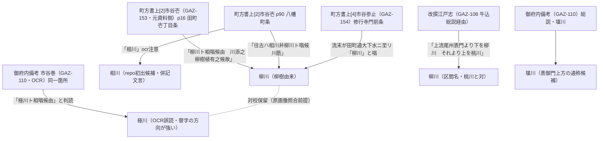

# 2026-11-21（第229回）・町方書上[2][4][19][66][143]の掃引＝市谷大下水「柳川」元資料側witness・万年石樋分水路の両口構造・玉川上水引請樋218→88間の縮小運用・三田上水差止の伊皿子側一次記録

第229回定期実行。前段（同一実行内）でNDL次世代DL lab API（`https://lab.ndl.go.jp/dl/api/book/fulltext/{pid}`）による町方書上シリーズ（pid=257148x〜257162x連番）の満遍ない掃引を実施し、町方書上[2]市谷壱（2571483）・[4]市谷参止（2571485）・[19]西久保（2571500）・[66]四谷附録（2571547）・[143]芝伊皿子・二本榎（2571624）の5冊を採録した。また既登録冊の追加分として高田雑司ヶ谷町方書上（2571626＝[GAZ-075]）の未採録文言（済松寺領高田四ツ家町条・雑司谷町条）を追記した。ブログ・ニュース監視（news/web 6クエリ）は陰性。

## 成果（新規5点＋追記1点＋対照表追記）

1. **[GAZ-153](sources/gazetteers/GAZ-153.md)＝町方書上[2] 市谷町方書上　壱（写・2571483）新規登録**
   - **市谷田町壱丁目条（p16）の大下水文言＝[GAZ-110]御府内備考市谷巻の「極川」OCR語の元資料側witness〔本冊最重要〕**: 「**右下水堀石垣出来以前ハ只今尾張様表御門ゟ下之方ヲ柳川ト相唱候由 右ハ川添之柳樹植有之候故之唱被申伝候**」＝**文政書上そのもの（御府内備考の採録元候補の側）では「柳川」（柳樹由来）と読め、御府内備考写本OCR「極川」は誤読・替字の方向が強い裏付け**（原画像照合までは断定しない）。配套の流路文言（寛永18丑年堀千之助様御手伝普請・大久保辺落水＋四ヶ谷辺吐水の二口・八幡町ゟ一口→田町通→船河原町→牛込牡丹屋敷→揚場町→船河原橋際→江戸川落込）も元資料側で確認。
   - **市谷八幡町条（p89-90）の「四ツ谷辺上水之吐水」両側石垣石橋・明暦二甲年松平下総守様御手伝文言＋「往古は相川幷柳川と唱候川筋」の併記**: 市谷大下水の別称系列に「相川」を加える文言＝repo初出候補（判読要照合）。
   - **同条の寛政5年蓋坂文言（八幡表門前の大下水の蓋坂・水茶屋願い）**＝大下水暗渠化の実務例の年次記録候補。
   - **市谷左内坂町条（p127-128）の無名石橋（文政8年大破・武家方半分/町方半分の修復負担体制）と堀兼之井戸の呼称混同文言**（本元＝牛込富士見馬場久保平左衛門屋敷内の明示）＝repo初出候補。
2. **[GAZ-154](sources/gazetteers/GAZ-154.md)＝町方書上[4] 市谷町方書上　三止（写・2571485）新規登録**
   - **修行寺門前条（p112-120）の饅頭谷・桜川・楓川文言の元資料側（文政10亥年五月・名主次郎左衛門署名）確認**: 素性法師詠哥の心で名付・桜→楓→柳川の錦の義理・四ツ谷御上水分水→田安様御泉水→饅頭谷→本村町後口楓川→田町通大下水（柳川）の流路チェーン＝[GAZ-110]採録文言の対校材料（「万年七郎左衛門様」「詠哥之心ヲ以名付」等の判読改良候補）。
   - **市谷三軒屋敷条（p90-97）の源慶寺持添御年貢地内下水→桜川江落込文言＋植木屋平蔵前の無名石橋（巾六尺・長三尺・新規掛渡）**＝桜川の上流側の給水構造の補助文言（repo初出候補）。※条帰属は冊子見出し順（p90=市谷三軒屋敷条開始・p99=安養寺門前条開始）で確定。
3. **[GAZ-155](sources/gazetteers/GAZ-155.md)＝町方書上[66] 四谷町方書上　附録　全（写・2571547）新規登録**
   - **四谷御門外左右の高枡＝万年石樋分水路の流路詳細（p15-17）**: 塩町三丁目ゟ相流→麹町13丁目箱根屋横町分水→中箪笥町往還枡で水路両口→第一口（大横町→麹町12・11丁目→四谷御門外南角高枡→御門内麹町10丁目南側樋→半蔵御門外南枡→**御本丸**）／第二口（裏御箪笥町角→麹町12丁目北之方出桝→四谷御門外北角高枡→御門内麹町10丁目北側樋→半蔵御門外北之方桝→**吹上御庭**）＝[GAZ-128]麹町11丁目条の御本丸掛・吹上掛樋2筋の対校材料。
   - **桜川・紅葉川・太田川の三川委譲文言＋筆之井・鏡之井（角谷村松平中務大輔様御下屋敷内）＋久左衛門坂（p17）**＝井2件ともrepo初出候補。
   - **御堀高札文言（「此御堀にて水をあひ又は魚鳥を取り塵芥を捨てる輩あらば可為曲事」・麹町11丁目持場）**＝「水アヒ」文言の高札実例（[GAZ-152]の水アビ判読問題の系譜の傍証材料）。
   - **四谷御門・御堀・御多門の寛永13子年同時起立文言＋御堀揚土の上一ツ木村入江埋土頂戴の申伝（p14）**。
4. **[GAZ-156](sources/gazetteers/GAZ-156.md)＝町方書上[19] 西久保町方書上　全（写・2571500）新規登録**
   - **新下谷町条（p6-13）の玉川上水引請樋の運用変遷文言〔本冊最重要〕**: 古来引請・藪小路通右上水御組合垣ゟ水口・【森坂町】（OCR崩れ要照合）経由・引請樋218間→**明和7寅年に130間不用水口差止→残88間を家主弥右衛門表井戸え水口付替（明和7.6.21願・閏6.17願済）**・只今88間引請中＝**玉川上水末端の供給縮小（218→88間）の町方側一次記録**（repo初出候補）。
   - **葺手町条・神谷町条の城山里俗（熊谷次郎直実城跡伝承）・熊谷橋（巾四間の石橋・伝承橋名）・城山稲荷（元禄4未年引移）・芝切通入口の無名石橋・鳫金之井・7月12日の精霊棚市**＝いずれもrepo初出候補（四河川流域外の周辺記録として採録・2571506鮫河橋と同様の扱い）。
   - **同朋町条（p83）の大下水（巾三尺・芝富山町(left)↔神谷町(right)）等の周辺系下水文言**: 流末（古川・汐留系か）は未確定。
5. **[GAZ-157](sources/gazetteers/GAZ-157.md)＝町方書上[143] 芝伊皿子・芝二本榎町方書上（写・2571624）新規登録**
   - **伊皿子台町条（p20）の三田上水文言**: 「**一三田上水 寛文四辰年十一月中 武州多摩郡代田村ゟ玉川上水を分水致 右上水当町え相懸り候処 享保七寅年十月中相止 当時上水無御座候**」＝**三田上水の分水地点（代田村）・起立年次（寛文4年11月）・差止年次（享保7年10月）の給水側町の一次記録候補＝[GOV-170]（享保7年8-9月の32ヶ所差止伺）の被差止側witness**（行政側の伺い→実施〔10月中相止〕の時間差を埋める実務記録候補）（repo初出）。
   - **附帯**: 伊皿子坂（芝田町九丁目→伊皿子台町の坂・長壱町半・幅三間）・伊皿子各町の上高輪村小町附属の起立沿革（寛文2年町方支配化）も記録。
6. **[GAZ-075](sources/gazetteers/GAZ-075.md)追記（済松寺領高田四ツ家町条・雑司谷町条）**
   - **済松寺領高田四ツ家町条（p24-28）**: ①「往古越前家高田御前様馬場下辺ニ御用屋鋪…此辺高〔下〕田村ト相唱候由申伝」＝**高田の地名の起原を越前家の高田御前様馬場に求める別説**（repo初出候補）②「往古御料所之頃此辺ニ四軒之家有之候ニ付字ニ四御家ト相唱候由申伝」＝**「四軒之家→四御家」の字の起原説と4軒のうち2軒の先祖の氏名（組頭七郎左衛門先祖・家持伝兵衛先祖）**（repo初出候補）③横丁九ヶ所の「北裏宮谷一円鷲山」「南表御番一円に吹上」の里俗3名＋町内下水（町内ゟ村方江入）（repo初出候補）。
   - **雑司谷町条（p36）**: 「御蔵坂ト申坂…是ハ村方之内ニ…先達而御調之節持上申候・一川渡下水堀等無御座候」＝**御蔵坂の坂名の用例（repo初出候補）＋村方属のため町方書上で立件しない委譲構造の文言＋同条の川渡・下水堀なしの消極文言**。
7. **対照表への反映**: 既存5行への第229回追記（高田馬場（地名由来）・極川/堰川・柳川・桃川・桜川/楓川/饅頭谷・万年石樋）＋新設8行（相川・引請樋・三田上水・城山/熊谷橋・堀兼之井戸・筆之井/鏡之井・宮谷/鷲山/吹上・御蔵坂）。

## 市谷大下水の判読系譜（Mermaid）

## 陰性・見送り〔確認済み〕

- **2571494「[13]小日向壱」**: 実体は牛込水道町の仏書写本（道人四相法第）で書上内容なし＝陰性・採番せず。
- **2571495「[14]小石川弐附録」**: 浅井氏由緒書（金杉水道町家主新兵衛所蔵）＝陰性・採番せず。
- **2571484「[3]市谷弐」**: boilerplate的な内容が主体で陰性。
- **2571506「[25]鮫河橋并権田原」**: 玉川上水系（大下水・石橋文言あり）だが四河川直接流域外の判断を維持・ノート記録のみ。
- **2571627「[146]六軒茶屋等」**: 三田用水系（下北沢村分水）・前回見送りどおり対象外。
- **ブログ・ニュース監視**: news/web 6クエリ（谷端川・弦巻川・水窪川・千川上水・神田川下水道・雑司ヶ谷幹線×30日）＝阪神谷端選手・米沢/静岡水窪ダム等のfalse positiveのみ。神田川環七調節池インフラツアー2027-01-09は既出再掲。
- **不通継続**: musashi.repo.nii（000・第214回〜）・nabunken 113630（000）・NDL lab 1900493/475/485（500）・echo-lab深田PDF（502）。kanzyou7 WHAT'S NEW=2026-11/20のまま不変。

## 採番現況（第229回終了時点）

- 新規採番: GAZ-153〜157（5点）。次回はGAZ-158から。
- 対照表: 既存5行追記＋新設8行。

## 次回（第230回）課題

1. **開札2026-12-02（環七調節池広域整備検討その2）**: 開札日はまだ未来（2026-11-21時点）。第230回以降の最優先監視事項。
2. **水アビ写本側のIIIF判読**: [GAZ-083]（2577111 R43）・y1610-2076の密度照合（第227・228回から順送り）。
3. **芝浦→三河島処分区の変遷**: [GOV-473]千川筋の芝浦処分場と現代三河島処理区の対照（第228回から順送り）。
4. **都市年鑑IIIF目視照合・[GOV-474]割合列**（順送り）。
5. **町方書上残冊の棚卸し継続**: 未掃引は三田[20-22]・飯倉[23-24]・品川芝[42-59]・本所深川帯[101-141]等。牛込[5]-[12]帯（蟹川系・紅葉堀の元町方側）も未掃引。
6. **新文言の原画像照合課題**: 「極川/柳川」の御府内備考・[GAZ-153]双方の該当頁の原画像照合（極川誤読説の最終確定）、「相川」の原字、[GAZ-156]「森坂町」、[GAZ-155]「筆之井」の原字。
7. **musashi.repo.nii（000継続）等の再試行**・kanzyou7監視継続。
8. **2571506鮫河橋・2571627中目黒の再検討可否**（四河川との関連で再スコープするかの判断は次回以降）。
