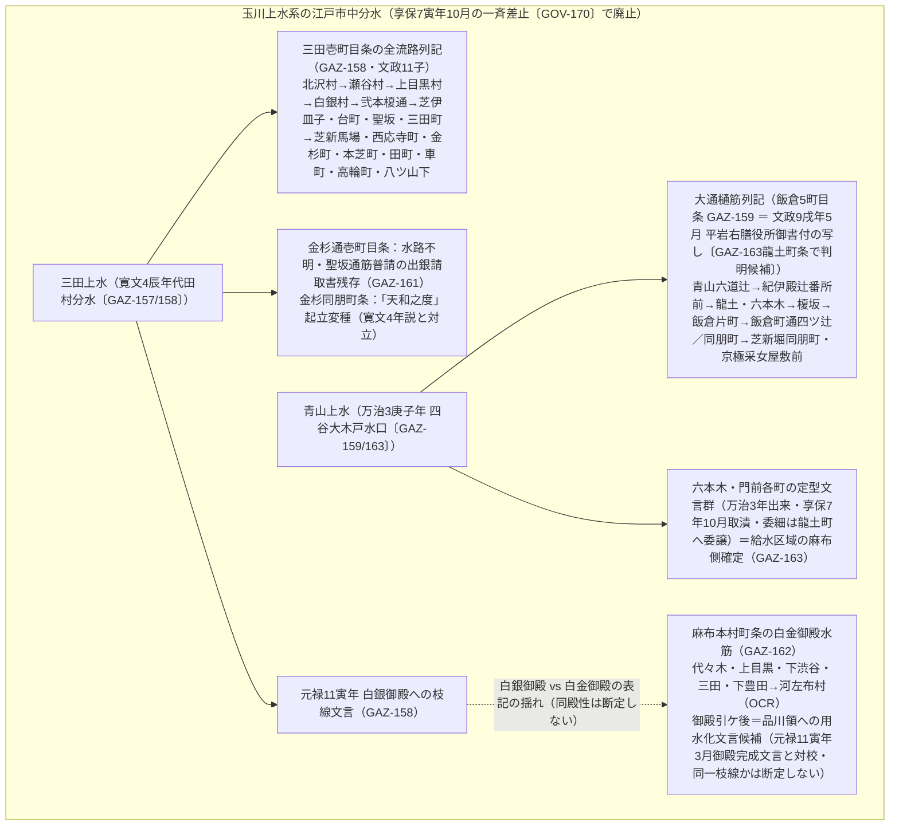

# 2026-11-21（第230回）・町方書上三田・飯倉・芝・麻布・牛込の冊掃引＝三田上水全流路・青山上水大通樋筋・赤羽新堀川の三度工事・榎川の芝用例の追加調査

第230回定期実行。前回（第229回）に引き続き、NDL次世代DL lab API（`https://lab.ndl.go.jp/dl/api/book/fulltext/{pid}`）による町方書上シリーズ（文政10-11年地誌御調書上・pid=257148x〜257163x連番）のfulltext掃引を、未掃引だった三田・飯倉・芝・麻布・牛込・品川帯に拡大した。**7冊の新規登録（GAZ-158〜164）**と**対照表3行への追記＋金杉川行の新設**を実施。ニュース監視（news/web 6クエリ）は陰性、朝日新聞の「暗渠」記事（2026-11-14「川をあかりましょう」）は田端の谷田川（当repoの谷端川とは別水系）の記事で対象四河川と無関係＝陰性。

## 成果（新規7点＋対照表追記4行分）

1. **[GAZ-158](sources/gazetteers/GAZ-158.md)＝町方書上[20] 三田町方書上　壱（写・[2571501](https://lab.ndl.go.jp/dl/book/2571501)・文政11子）新規登録**
   - **三田壱町目条p14の三田上水の全流路列記文言〔本冊最重要〕**: 代田村分水→荏原郡北沢村・瀬谷村・上目黒村・白銀村・大山寄村（OCR）→弐本榎通→芝伊皿子・台町・聖坂・三田町→芝新馬場・西応寺町・金杉町・本芝町・田町・車町・高輪町・八ツ山下迄＋**元禄11寅年の白銀御殿への枝線文言**＝[GAZ-157][GAZ-161]の金杉・伊皿子側への委譲構造の指し先である本流側（三田側）の全流路記録候補（repo初出）。
   - 高札13ヶ町惣持（三田12ヶ町＋芝伊皿子・台町）・中村八太夫代官・同朋町条の四国橋名義も記録。
2. **[GAZ-159](sources/gazetteers/GAZ-159.md)＝町方書上[23] 飯倉町方書上　全（写・2571504）新規登録**
   - **飯倉町五町目条p78-79の青山上水の大通樋筋列記〔本冊最重要〕**: 万治3庚子年新規掛渡・水口＝四谷大木戸の水門・石垣・木柱→裏大笹町→表大番町→森川出羽守・久能和泉守前→青山六道辻→紀伊殿辻番所前で2筋→足軽町・龍土・六本木→市兵衛町・榎坂→飯倉片町→飯倉町通四ツ辻／同朋町→西＝芝新堀同朋町・東＝京極采女屋敷前・「**右は凡大通樋筋計如此**」＝[GAZ-103]上水在絕記（未解決④＝流路復元）への回答材料候補（repo初出）。
   - **赤羽新堀川の三度の工事年代記（p76-77）**: 古来＝高井戸代々木辺用水之余・渋谷辺落水が金杉川口までの小堀→**寛文8申年**新規川普請（松平相模守・松平新太郎御手伝）→**延宝3卯年**飢人御救の御浚＋赤羽橋新規掛渡（12月7日・岡田将監・石川蔵人）→**元禄11寅年**川渡（伊達美作守・溝口信濃守・稲生七郎右衛門・奥田八郎右エ門）＝各自の内部年数整合（文政10基準）付き＝[GAZ-106]麻布新堀総説の白金御殿造営時改水流説に対立する寛文8年新規普請文言候補（決着させない）。新堀川＝里俗赤羽川文言・赤羽地名群（高札10ヶ町・元赤羽植木溜・赤羽広小路・赤羽円月院）も付随。
3. **[GAZ-160](sources/gazetteers/GAZ-160.md)＝町方書上[50] 芝町方書上　四（写・2571531）新規登録**
   - **芝新細町条p74-76の金杉川名称・将監橋名義文言**: 芝新堀之末の御堀＝里俗「金杉川」・堀割年代不知・川巾3段変遷（7間余→18間→11間）＋延宝3卯年川御渡（石川蔵人・岡田将監）＝**将監橋名義（岡田将監の御掛に由来）**＋元禄11寅年金杉川口ゟ渋谷迄の川御渡・船入掘拡（稲生・奥田・溝口・伊達）＝[GAZ-159]と役名一致の芝側独立witness。
   - **増上寺構堀大下水＝里俗「榎川」（p77-78）**: 愛宕下通大下水の末・宇田川横町西境で分水→芝神明社地後→増上寺表御門前→金杉川落入＝**「榎川」の第2用例（四谷坂町〔GAZ-112〕とは別地）**（repo初出候補）。
   - **玉川御上水渡樋（p78）**: 樋長13間・1尺6寸四方・高塀2ヶ所・高枡2ヶ所・松平豊後守御一手持＝汐留・将監橋西の構造文言候補（repo初出候補）。
4. **[GAZ-161](sources/gazetteers/GAZ-161.md)＝町方書上[52] 芝町方書上　六（写・2571533）新規登録**
   - **金杉通壱町目条p26の三田上水の実態文言**: 「**右水路之義者相分兼候 三田台町辺 聖坂通り通筋普請之節 出銀之請取書有之候迄ニ御座候**」＝水路不明・通筋普請の出銀請取書残存の実務記録文言候補（repo初出）＝[GAZ-158]の本流側文言と情報を分担する給水区側（金杉側）の実態記録。
   - **金杉同朋町条p101の「天和之度ゟ相掛」起立変種**: 寛文4辰年定型説（[GAZ-157][GAZ-158]等）との年次対立をnew datapointとして記録（決定しない）。金杉裏・本芝等の「金杉通壱町目ゟ申上候」委譲定型群（[53]〜[59]冊のcross-refは対校のみ）。
5. **[GAZ-162](sources/gazetteers/GAZ-162.md)＝町方書上[41] 麻布町方書上 七止（写・2571522・文政11子）新規登録（麻布本村町単独冊）**
   - **本村町条p17の白金御殿水筋の全域流路＋品川領用水化文言〔本冊最重要〕**: 「**御上水跡壱ヶ所 玉川分水ニ而白金御殿江掛り候水筋…代々木村・上目黒村・下渋谷村・三田村・下豊田村ゟ河左布村（OCR・判読不能）江成り候処 其後御殿引ケ候節 上水之儀は品川領へ用水に被下置候 同所田地江相懸り候用水普請等不残右百姓ニ而改来り候**」＝**上水→（品川領の）農業用水への転用文言候補（repo初出）**＝[GAZ-158]元禄11寅年白銀御殿枝線文言の御殿側対比史料候補（白金／白銀表記の揺れは断定しない）。
   - **同p15-16の白金御殿起立文言**: 元禄年中被仰出・**元禄11寅年三月中御出来**（御掛り若年寄秋元但馬守・米倉丹後守・普請奉行酒井彦太夫）＝御殿完成と上水枝線の同年代性の候補材料。p14の「渋谷川とも又は新堀川とも」二重呼称・p17の御薬園＝里俗新堀端・享保17壬年検地文言も記録。
6. **[GAZ-163](sources/gazetteers/GAZ-163.md)＝町方書上[39] 麻布町方書上 五（写・2571520・文政11子）新規登録（六本木・龍土町と門前各町の合本）**
   - **龍土町条p59-61の青山上水文言の「御書付写し」である旨の文言〔本冊最重要〕**: 「**去文政九戌年五月中御代官平岩右膳様ゟ御刀（=掟・OCR候補）持之節上水通筋御書付出候間右写左に申上候**」＋大通樋筋流路文言（[GAZ-159]飯倉条とほぼ文言一致）＋指令部「**別紙廉々之内其村ニ而相心得居候儀者書付に致差出可申候…十日迄に…可申出候 平岩右膳役所**」＝**飯倉（GAZ-159）・龍土（本冊）の大通樋筋列記が同一の御書付（文政9年5月の代官所の照会文書）を写したことが分かる過程レベルの鍵史料候補（repo初出）**＝地誌御調書上の水系文言の出所（fielddocumentの系譜）を直接示す用例。
   - 六本木町・門前各町の青山上水定型文言群（万治3年・享保7年10月取潰・委細の龍土町への委譲＝[GAZ-158]三田壱町目・[GAZ-161]金杉通壱町目と並ぶ代表町構造の第3例）・うとん坂（うらん坂）名義文言も記録。
7. **[GAZ-164](sources/gazetteers/GAZ-164.md)＝町方書上[9] 牛込町方書上 五（写・2571490・文政10亥）新規登録**
   - **牛込水道町条p35-36の江戸川名義文言**: 「**江戸川ゟ唱候川有之 往古田畑之用水ニ而古川ゟ相当申候処 万治年中より江戸川ゟ相唱候由申伝候**」＝**[GAZ-105]御府内備考江戸川条・[GAZ-109]牛込水道町条の元資料側（文政書上側）witness候補（repo初出）**。井之頭流出・関口の神田御上水分水・川巾凡10間余の全体構造も文言一致。
   - **江戸川大橋＝「又里俗ニ者石切橋共唱来リ候」（p37）**: **「石切橋」が本冊OCRでは明瞭＝[GAZ-109]「石切損」判読問題の解決方向**（要原画像照合）。大橋掛直しの仮板橋文言（巾三尺余・壱人立往来）・寛文12子年検地の「武州豊嶋郡牛込水道町屋敷改水帳」表書文言も記録。
8. **対照表への反映**: 既存3行（三田上水・渋谷川・榎川）への第230回追記＋**金杉川行の新設**。

## 三田上水・青山上水の流路と年代の対比（Mermaid）

## 陰性・見送り〔確認済み〕

- **品川寺社門前帯 [42]-[45]（2571523-26）**: 上水・千川・代田関連の文言0件＝陰性。[46]高輪（2571527）も0件＝**三田上水流路列記に「高輪町」が含まれるのに高輪側の文言がない**＝流路末端部の対照課題として要継続監視。
- **麻布帯**: [45]一（2571516）・[36]二？（2571517）・[42]四？（2571519）陰性。**2571518（麻布三〔37〕?）は準陽性**＝「赤羽川堀留ニ而荒地」文言（p7）・「新堀端」町名（宝永6年「新堀端芝御霊屋御掃除屋敷代地」〔GAZ-106・GAZ-160と同系〕・増上寺火除地→赤羽新堀端代地の文言p20-23）＝ノート記録のみ・採番見送り。
- **牛込帯**: 2571487（[6]牛込二）・2571488（[7]牛込三）陰性。2571492（[11]牛込七止?）は上水跡設問テンプレのboilerplateのみ（既知類型）＝採番見送り。
- **三田帯**: [21]（2571502）・[22]（2571503）は寛文4辰年→享保7寅年定型のboilerplate＋壱町目へのcross-refのみ＝採番見送り・対校記録。[24]飯倉続（2571505）は大井戸・下水石橋程度で陰性。
- **本所深川帯 [101]-[141]（2571582-2571622＝26冊）**: **未掃引**＝次回以降の掃引レーン最優先候補（GOV-171本所条の亀有上水文言系の町方側に当たる可能性）。
- **表紙「二七四ノ第◯」通し番号とNDL catalog bracket [N]の±1ずれ**: 赤坂冊の登録〔GAZ-049系〕は表紙基準、[2][12][143]等はcatalog基準でrepo内で既に混在。**本回の新規エントリ7点はすべてcatalog bracket [N]＋pid基準**（NDL APIのvolume表記で直接確認: 2571501=[20], 2571504=[23], 2571531=[50], 2571533=[52], 2571522=[41], 2571520=[39], 2571490=[9]）で統一し、表紙番号は書誌項での言及に留めた。
- **ニュース・監視**: news/web 6クエリ陰性（第229回と同型のfalse positiveのみ）。朝日新聞デジタルの本田創氏「暗渠」記事（2026-11-14）は田端の谷田川＝対象外（有料本文未確認だが見出し・プレビューで対象四河川との関連なし）。kanzyou7 WHAT'S NEW=2026/11/20例行更新のみ不変。
- **開札（環七調節池広域整備検討その2・2026-12-02）**: まだ未来＝第231回以降に順送り。
- **不通継続**: musashi.repo.nii（TLS alert・第214回〜）・nabunken 113630（同）・NDL lab API 500の失敗pid（1900493/475/485/487）は本run未再試行＝次回判定送り。

## 採番現況（第230回終了時点）

- 新規採番: **GAZ-158〜164（7点）**。次回はGAZ-165から。
- 対照表: 既存3行への第230回追記＋金杉川行の新設。
- 未掃引の主な残り: 本所深川帯26冊（最優先）・[53]〜[59]冊側の金杉裏帯の原画像照合・飯倉・麻布の残冊。
