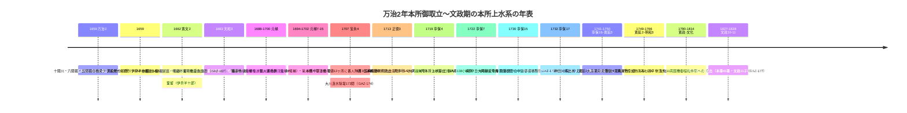

# 第231回（2026-11-21）本所深川帯41冊掃引＝万治2年本所御取立の総説と請負人実務層・源森川対岸文言の追加調査

## 概要

- 第230回ノートで「本所深川帯 [101]-[141]（2571582-2571622）＝26冊・未掃引＝次回最優先レーン」とした町方書上シリーズ（NDL次世代デジタルライブラリーfulltext）を全41冊掃引した（26冊という数字は誤りで、同pid区間のNF catalog bracketは[101]〜[141]の41冊。NDL APIのvolume欄を全冊直接確認）。
- 結果: **[GAZ-165](sources/gazetteers/GAZ-165.md)〜[GAZ-178](sources/gazetteers/GAZ-178.md)新規14点**（[105]+[110]は同型2冊まとめ）＋[対照表](地名・河川名対照表.md)白堀上水（本所）行・源森川行への追記と6行新設（源兵衛堀/源兵衛橋・源安川→大横川入・桑平川・黒口川/黒江川・十間川・竪川通橋名群）。
- 掃引の中心は本所上水（亀有上水・白堀上水）系の実務文言群で、repoの四河川（水窪川・弦巻川・谷端川・千川）の直接史料ではなく**対照系（神田川・本所上水の管理系譜）**として採録した。第223回の「[103][108][110][130]はboilerplate陰性」判定は**四河川keyword掃引のみに基づく見逃し**だったことが確定し、本回で訂正した（該当冊はいずれも本所上水系の実質文言を含む）。

## 本回の主要成果

### 1. [GAZ-165]（[101]本所起立記）— 万治2年本所御取立の総説と橋梁起立書

- koma 6の「**（OCR「弘化二亥年」=万治二亥年判読候補）本所御取立之節 徳山五兵衛様山崎四郎右衛門様御掛りニ而 竪川横川拾間川六間堀五間堀新規御堀立 右上ケ土ヲ以テ川中地形誂等立御普請出来**」＝本所御取立の5水路（竪川・横川・十間川・六間堀・五間堀）の新規堀立総説。「弘化二亥年」は万治2年（1659）のOCR誤読候補（[GAZ-171]元町条「万治二亥年本所御取立有之」・[GOV-171]在絕略記「万治二亥年 本所へ上水をかけ渡す」と干支・内容が整合し、弘化2=1845は書上年〔文政11=1828署名〕より後で成立しない）。
- koma 15-17の「**本所竪川通合せつ六間堀橋々起立書**」＝竪川通一之橋〜四之橋・新辻橋・猿子橋（元禄7戌年）／横川通法恩寺橋・長崎橋・北辻橋・南辻橋・菊川橋・猿江橋（元禄15）／十間川天神橋・旅所橋・清水橋／六間堀松井柳小之橋・中之橋（OCR候補）／五間堀弥勤寺橋（=弥勒寺橋候補）・伊豫橋＝**18橋の起立書で大半が万治2年**。万治2の堀立と同時の橋梁クラスターの一次リスト（repo初出候補）。
- koma 7-8・14の本所見廻り道役の系譜＝万治2（先祖の御普請目論見）→天和3（本所中が御代官所化＝[GOV-171]「天和三年やみ」年代との照合材料候補）→元禄6（清水八郎兵衛・家城善兵衛の道役・伊奈半十郎支配）→**享保4年4月3日本所御奉行廃止（「道橋川内一円」町奉行持込）→同年10月27日大岡越前守御内寄合で道役継承**。

### 2. 本所上水系の請負人実務層（元禄〜宝永）— GAZ-166〜169・176

- [GAZ-167]（小泉町条）: 元禄11年「本所上水白堀浚受負人」「本所上水白堀定渡受負人善六為」（鈴木兵九郎・鳥井久五郎）・元禄13年「本所埋樋受負人」・「本所埋垣受負人清六為」→享保4年4月3日奉行廃止で上り地→本所方御用屋敷。**白堀・定渡・埋樋・埋垣の施設分類ベースの請負人職名の体系的列記（repo初出候補）**＋宝永4年「本所中下水埋樋拾弐ヶ所番人附置」の助成文言。
- [GAZ-168]（[105]新坂町+[110]吉岡町の対校）: 「本所上水桶掛破損修復御請負役孫八伊兵衛」（[105]）vs「本所上水樋掛破損修復之御請負役伊兵衛孫八」（[110]）＝桶掛/樋掛の別文言と人名の語順対立。→[GAZ-169]（[108]）で第3の書き分け「樋枡破損修復」が現れ、**桶掛・樋掛・樋枡の3語形と「孫八伊兵衛/伊兵衛孫八」の対立群が揃った**（原画像照合前提）。
- [GAZ-176]（三角屋敷条）: 「**元禄十四巳年二月中 本所上水替負人ニ而吉右衛門ト申者拝借町屋敷**」（伊奈半左衛門支配）→正徳3閏5月町方支配化→「**享保七寅年九月中上り地ニ相成**」→寛政9正月晦日氷川明神別当大乗院へ引渡。[GAZ-138]（小梅瓦町条「享保七年九月 右上水相止候由」）と**月次で一致する独立witness**＝上水差止と上り地処分の同期性の裏付け。
- [GAZ-169]（長岡町2丁目条）: 上水白堀東添いの割り余り湿地の稽古場文言（元禄13拝借・宝永4断絶・享保4御用地）＋南割下水（巾2間・万治2堀割・天明2浚請負長兵衛/惣五郎）＋沢樋2ヶ所（横川両縁の南割/東中割下水吐口・横川水位増減による開閉）＝**横川と割下水群の水利接続の実務記録（repo初出候補）**。

### 3. 源森川系の対岸側の文言 — GAZ-172・174（+対照表）

- [GAZ-174]（中之郷瓦町条）: 「**源森川幅拾四間長凡百七間…名目源兵衛堀…万治年中堀割之由申伝…万治二亥年中大横門御堀割ニ相成其後…中之郷業早（=平・OCR候補）橋辺寛文三卯年中田堀官（?）ニ相成 右代地竪川通五之橋町之場所被下置…大川え流通…御檜蔵材木入…中之郷村ニ立帰新田…享保十七子年御高入**」＝[GAZ-138]（小梅側・業平橋南の上水堀埋立跡・寛文年中堀割・享保17高入）と**同年次（寛文・享保17）・同地点（業平橋）で指し揃う対岸側の処分チェーン候補**。巾14間・長107間は初の定量文言（[GAZ-138]「川巾五間」との対立は照合まで決めない）。
- 名目論文言「源森」=書上の正系、「源兵衛堀」=里俗の申伝え。源森橋＝寛文2伊奈半十郎初懸・一名源兵衛橋。寛文12浅草川西水の押流→伊奈半十郎築留→元禄6水戸様御屋敷の船通路で築留を100間余引込→**「以前は源安川」→「当時は大横川入」の呼称変遷文言（ともにrepo初出候補）**。
- [GAZ-172]（[116]南本所・元町条・名主友太郎）: 「**近来桑平川（OCR判読候補）とも相唱〆切より西之方を源森川と申候 万治二亥年中初而御堀割**」＝横川の同一区間の空間的呼び分け（〆切を境）の文言候補。享保16年伊奈半左衛門の土手敷築立・文政7申年11月の新規御掛直も記録。

### 4. 神田川系の実務文言 — GAZ-166・177

- [GAZ-166]（相生町3丁目条）: 元禄6年（新之口御堀〜霊岸橋〜南川口の4区間川筋常浚・嘉兵衛外6人）→宝暦系の重層→**寛延3年「神田川常浚請負人駿河屋新兵衛・錠屋清五郎」**→天明4年山崎屋七郎兵衛・北門屋治郎右衛門→寛政2上り地＝**「神田川常浚」の語の町方書上用例と請負人名の系譜（repo初出候補）**。相生町3丁目の町名が常浚請負の助成地に由来する起立譚も独特。
- [GAZ-177]（両国橋御役船仲間由緒書）: 「**万治二亥年初而西国御橋（=両国御橋判読候補）相懸リ候節伊奈半十郎様ゟ被仰付**」＋寛文類焼時の船渡・天和溢水（千住御橋の材木流懸り）・**寛延2巳年出水（「大高瀬舟神田川ゟ流レ出シ御橋え流懸リ」）**・**明和3戌年6〜8月度々出水（千住大橋流落・神田昌平橋え竹木流懸りの差止実働）**・文化11「神田川本所竪川通其外加入」＝**神田川系の洪水・流木史の一次記録群（repo初出候補）**。

### 5. 竪川・十間川・深川側の管理・水路文言 — GAZ-170・173・175・178

- [GAZ-170]（神田徳右衛門町・菊川町条）: 「**登川巾弐拾間…万治二亥年堀割**」＋「**享保十五戌年正月廿七日大風越前守（=大岡越前守・OCR候補）様御番所御内寄合ニ而竪川両側町々名主月行事被召出以来川巾弐拾間川岸行八間道巾五間ニ仕**」＝**竪川の川巾21→20間規制確定の一次文言（repo初出候補）**＋菊川御橋（元禄15初懸・享保の頃菊川橋改称候補）・北樋番屋（宝暦10桶番人・依田和泉守信番所）・横川満水時〆切の入樋吐口。
- [GAZ-173]（又之橋町条）: 「一ツ目ヲ一之橋ト相唱候故又之橋町ト申来」＋竪川通一ツ目〜五ツ目の橋の**貞享年中御取払文言（repo初出候補）**＋里俗「岸堀」→「誤り堀留」の名義文言（御材木蔵の岸通起唱）＋「筧播磨守」享保17検地文言群（4箇所）vs「覚播磨守」（1箇所）＝**[GAZ-138]の「筧播磨守」判読の4:1の多数決裏付け材料候補**。
- [GAZ-175]（桶師町条）: 「**水道附キ有之 其比黒江川エ唱候**」（寛永6年築立の節に川筋附則黒江川に固定・巾変化の数値群）＝**「水道附キ」という川の属性文言（repo初出候補）**＋元禄12堀割（深津八郎左衛門）・八幡橋元禄16未年3月2日掛替。
- [GAZ-178]（北松代町条）: 「**十間川巾拾間余…竪川ゟ南小名木川え之横川ニ有之汐合之場所ニ而流相定り不申 里俗十間川と相唱**」＝十間川の機能記録（repo初出候補）＋悪水の「**伏越**」文言（亀戸村入極の水吐の逆水のため小梅押上百姓方が往還に伏越箱木付置）＝**「伏越」の江戸期実務用例（repo初出候補・ただし当該komaはOCR崩壊甚大で要原画像照合）**＋清水橋・清水町の再引地文言・真田伊豆守（信州松代）抱屋敷起立説。

## 万治2年〜文政期の処分チェーン（Mermaid）

万治2年（1659）の本所御取立とその後の本所上水系の行政・実務の年表:

※上記の年次はOCR由来で原画像照合前提。「弘化二亥年（=万治2判読候補）」「西国御橋（=両国判読候補）」「覚/筧播磨守」等の対立は断定しない。

## 陰性・見送り〔確認済み〕

- **本所深川帯41冊のうち文言面から採番を見送った27冊**: [102][104][106][107][109][112][113][115][118][120][121][123]-[129][131]-[133][135]-[140]（番号はcatalog bracket）。boilerplate定型（公役銀・神田系の繰り返し書式）か四隣情報のみで、上水・水路文言の新規性なし。ただしフルページ目視ではなくfulltext grepベース＝梱包ミスの可能性は再掃引で拾い直す余地を残す。
- **水窪川・弦巻川・谷端川・千川の直接文言**: 本回の本所深川帯41冊は四河川の直接文言を含まない（江戸市区の神田川・本所上水系の対照系が中心）＝対照表とGAZの comparative枠で管理。
- **監視系**: news/web 6クエリ（谷端川・弦巻川・水窪川・千川上水・神田川下水道・雑司ヶ谷幹線・7日以内）＝陰性。kanzyou7 WHAT'S NEW=2026/11/20週間工程表・進捗図更新のみ（定例）。開札2026-12-02（環状七号線地下調節池広域整備検討その2）はまだ未来＝**第232回以降の最優先**（都財務局が2026-11-10公告〔建設通信新聞2026-11-11〕の裏付けは確認済みに変わりなし）。musashi.repo.nii / nabunken 113630 / NDL lab API 1900493系（500）は不通継続。
- **水アビ写本側原画像 (GAZ-083, 2577111 R43, IIIF)**: 人手確認原則のため本回も着手せず＝順送り。

## 採番現況（第231回終了時点）

- 新規採番: **GAZ-165〜178（14点）**（[INDEX](sources/INDEX.md) 1,440→1,454 items想定）。次回はGAZ-179から。
- 対照表: 白堀上水（本所）行・源森川行への追記＋6行新設（源兵衛堀/源兵衛橋・源安川→大横川入・桑平川・黒口川/黒江川・十間川・竪川通橋名群）。
- 町方書上シリーズの残り: 本所深川・南本所・中之郷・小梅側の未掃引冊は本回で一巡＝次は[1]-[100]帯（山手・下谷・浅草側）の再掃引か、Keyword未着手の資料帯へ。前回までに陰性とした冊の第223回判定（[103][108][110][130]他）は本回の訂正例のように再検証余地がある。

## 次回以降の課題

1. **開札2026-12-02（環状七号線地下調節池広域整備検討その2）の結果確認**（第231回時点ではまだ未来）。
2. 本冊14点の**原画像（IIIF）照合**: 特に「弘化二亥年」→万治2判読（GAZ-165 koma 6）・「西国御橋」→両国御橋（GAZ-177）・伏越文言（GAZ-178 koma 65）・「桑平川」の原字（GAZ-172）は原文の字面で確定させる。
3. 源森川の川巾対立（5間: GAZ-138 vs 14間: GAZ-174）の測区間の同定。
4. 神田川常浚請負人群（駿河屋新兵衛・錠屋清五郎等）と他資料（市中の浚請負帳簿類）の突き合わせ。
5. 第223回のboilerplate陰性判定の残冊の再検証（四河川keywordだけでなく上水系keywordでの再掃引）。
