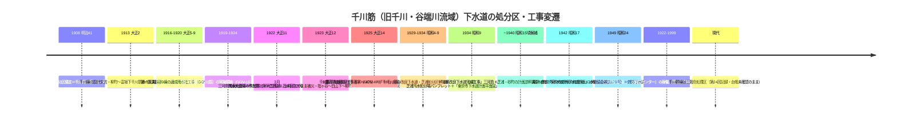

# 第232回（2026-11-21）東京市下水道震害調査報告1925＝「千川」川名の行政用例と指ヶ谷線幹線・三分区文言・三河島処分場稼働文言・芝浦1934パンフ・継続改良下水道シリーズ・郊外計画1949の追加調査

## 概要

- NDL次世代デジタルライブラリーの検索APIが不通（HTMLシェル返却）のため、**NDL Search SRU（dcndl・recordPacking=string）で書誌横断検索に切替**して下水道系資料を探索した結果、**[GOV-475](sources/gov/GOV-475.md)〜[GOV-478](sources/gov/GOV-478.md)の4点を新規採録**した。
- 中核は**東京市下水課『東京市下水道震害調査報告』（1925・NDL 1876361・fulltext OCR全文取得）**。①1908年市区改正委員会議定の**下水三分区（第一區＝隅田川以西＝小石川・本郷を含む＝千川・谷端川・水窪川・弦巻川流域の行政区分上の所属）**、②大震時（1923.9）の**第一區残部＝千川筋は実施調査完了も未起工**という進捗文言（[GOV-473](sources/gov/GOV-473.md)の昭和4年度着手と整合）、③既成管渠統計表の**線名欄「指ケ谷線」判読**・「**柳町至千川**」幹線（9.0×5.0尺・柳町附近被害密度13.0）と「**自指ヶ谷〔至〕白山下經**」行＝**「千川」川名の1925年下水行政実務用例（repo初出）**、④**藍染川の中流＝千駄木町・下流＝不忍池西岸**という流路規定文言（線名「藍染線」・第22コマの「藍染排水路」施設名も文言候補）⑤**三河島汚水処分場＝第二區201万8千坪・大正11年3月作業開始**の一次文言。いずれもOCR由来で**文言候補・要原画像照合**（統計表はOCR列崩れが甚大・bbox行復元併用）。
- あわせて、**NDLサーチで書誌のみ確認できる3点**を採録: [GOV-476](sources/gov/GOV-476.md)（1934.10・芝浦パンフ＋「東京市下水道計画平面圖」図2枚・2009年複製叢書収録確認）、[GOV-477](sources/gov/GOV-477.md)（白翁「東京市郊外下水道計画」水道協会雑誌179号・1949＋2008年口語訳版（町村誌下水道計画収集・折り込み図2枚）・「郊外下水道決定ニ至ル迄ノ経過」原本の存在裏付け）、[GOV-478](sources/gov/GOV-478.md)（継続改良下水道完成工事シリーズ**三河島・芝浦・砂町の3処分場分の存在と、三河島・芝浦冊のTOKYOアーカイブ・インターネット公開（パブリックドメイン）確認**。アーカイブは自動アクセス遮断のため文言は未取得）。
- repoの四河川（水窪川・弦巻川・谷端川・千川）の直接文言は③④（＝千川・藍染川＝谷端川小石川区間）で、①②⑤は千川筋処分区変遷の行政区分レベルの定点資料。

## 本回の主要成果

### 1. [GOV-475] 東京市下水道震害調査報告（1925）— 三分区・千川吐口幹線・三河島処分場

- **三分区文言**: 「明治四十一年當時ノ東京市區改正委員會ノ議定ニ係ル…隅田川以西ノ大部分卽チ芝、麻布、麴町、赤坂、四谷、牛込、小石川、本郷、京橋、日本橋ノ十區、神田區ノ大部分及下谷區ノ一部ヲ加ヘテ之ヲ第一區トシ、上野臺、本郷臺ヨリ以東神田川以北ノ低濕ナル地區…ヲ第二區トシ、殘餘ノ江東方面…ヲ第三區トシ」。**四河川流域（小石川・本郷・牛込側）は第一區**＝[GOV-471](sources/gov/GOV-471.md)（1913・千川線構想）→[GOV-163](sources/gov/GOV-163.md)（1924・実施調査報告）の系列の上位区分。
- **進捗文言**: 第一期工事＝第二區（明治44年起工→大正11年竣功）、第二期＝第一區中枢（京橋・日本橋・丸の内・芝一部・大正10年起工・施工中）、「殘餘ノ地區…實施調査ヲ完了セシト雖未ダ起工スルニ至ラズシテ這般ノ大震ニ際會」＋「大震當時迄ニ竣工セルハ全市ノ約二割ニ止マリ」。**千川筋＝第一區残部の未起工状態で1923.9を迎えた**ことの行政側文言（原画像照合前提）。
- **速成雨水吐工事**: 大正5〜9年度（1916-20）に第一區の溪谷部（市ケ谷谷町・古川流域等）9線へ局所雨水吐管渠。谷戸地形への先行実務例。
- **既成管渠統計表（第10-11コマ）の千川・藍染川行**: 線名欄「**指ケ谷線**」判読・「自指ヶ谷〔至〕白山下經」・「**柳町至千川 9.0×5.0 但柳町附近ハ土覆少ナシ**」／「地勢千川流域低地カ本郷臺小石川臺ニヨリテ將ニ狹マレントス…川口ニ位ス」／「被害ハ大部分下流柳町方面ニ集マル」「之ノ附近ハ特ニ地盤惡シ而シテ柳町附近ノ被害密度ハ13.0ニ及ブ」／規模「6.5×5.0乃至…520」（=延長520間候補）＝**指ヶ谷→白山下→柳町（千川吐口）の第一區雨水吐幹線の震害実測**と**「千川」川名の1925年実務用例**。〔表崩れ著しく線名・数値対応は原画像照合まで候補〕
- **藍染川流路規定**: 「駒込臺彌生町臺ト上野臺〔間ヲ北ヨリ南ニ流ルル〕藍染川ノ流域ノ中流部ニ位ス（自千駄木町）」／「藍染川ノ下流不忍池西岸ニ沿フ 方向略南北 下流ニ東西ノ部アリ」＋「方向開渠部南東其他北東」＋線名欄「**藍染線**」判読＝**谷端川小石川区間の藍染川呼称（桜川系史料群と対照）の下水実務用例**。ほか第22コマの火災損害額内譯に「**藍染排水路**」の施設名列読（repo初出候補）。
- **三河島汚水処分場**: 「府下三河島町荒川岸ニ位シ、…第二區卽チ淺草、下谷兩區ノ大部竝外神田ヲ包含スル地域、面積約二百一萬八千坪ノ下水ヲ…（淨）處分スル施設ニシテ、大正十一年三月作業ヲ開始」「敷地面積約五萬六千坪」「處分能力ハ最大乾天時一日約二百四十萬立方尺」＝**千川筋処分区変遷系列の初期定点の一次文言**。
- **対照系**: 「舊三味線堀ヲソノマ改修」文言（第二區の旧堀転用幹線）＝三味線堀の実務用例（repo初出候補）。

### 2. 所在のみ採録の3点（書誌確認・本文未見）

- [GOV-476]: 1934.10の芝浦パンフレット。付図「東京市下水道計画平面圖」「芝浦汚水處分場一般平面圖」＝**1934年時点の計画平面図の存在**。2009年複製叢書『近代都市の衛生環境 東京編39』（NDL 000010603325）収録を書誌目次で確認（本文未見）。
- [GOV-477]: 郊外下水道の系統。1949の水道協会雑誌記事＋2008年口語訳版（「郊外下水道決定ニ至ル迄ノ経過」の口語訳＋**各町村誌の下水道計画収集**＋現行設計基準対比・折り込み図2枚）＝**東京市域外（各町村＝谷端川・千川流域町村含む）の下水道計画の原典候補**として要本文確認。
- [GOV-478]: 「継続改良下水道完成工事」シリーズ（三河島・芝浦・砂町）。**三河島・芝浦冊はTOKYOアーカイブでインターネット公開（PD）**を確認したが、アーカイブは自動アクセス遮断で文言未取得（手動閲覧が次回課題）。三河島処分場の稼働期間（大正11年〜平成11年・日本初の近代下水処理施設）は荒川区立図書館ページのスニペット確認（要開封）。

## 千川筋下水道の処分区変遷タイムライン（Mermaid）

## 陰性・不通の記録（第232回時点）

- **NDL lab検索API**: 不通継続（lab.ndl.go.jpの検索エンドポイントがHTMLシェルを返却）。fulltext配信（`https://lab.ndl.go.jp/dl/api/book/fulltext/{pid}`）は1876361で正常動作。
- **NDL Search SRU**: 正常。CQLは`title=="..."`形式（`keyword=="A" and keyword=="B"`はillegal query）。pidは応答内`rdf:about="https://ndlsearch.ndl.go.jp/books/R...-I..."`から取得。
- **1874952（1688226同時期の設計標準図1929）**: fulltext APIが「PID is not allowed」で拒否・見送り（次回も良好な取得ルートを探索）。
- **TOKYOアーカイブ（archive.library.metro.tokyo.jp）**: 自動アクセス遮断（`archive.library.metro.tokyo.jp/da/*`は開封不可）。NDLサーチ経由の書誌・公開範囲情報のみ取得可能。
- **荒川区立図書館の三河島喞筒場ページ**: URL開封はリンク切れ表示、web検索スニペットでのみ文言確認。
- **news_search 6クエリ**（谷端川・弦巻川・水窪川 豊島区／千川上水／神田川 下水道 幹線／雑司ヶ谷幹線・11/1-21）: 0件。
- **監視系**: kanzyou7 WHAT'S NEW=2026/11/20不変。musashi.repo.nii=000不通継続、nabunken 113630=503、NDL lab 1900493/1900475=500継続。**開札2026-12-02（環七調節池広域整備検討その2）はまだ未来＝第233回最優先**。

## 技術メモ（次回以降の参照用）

- SRU例: `https://ndlsearch.ndl.go.jp/api/sru?operation=searchRetrieve&version=1.2&recordPacking=string&recordSchema=dcndl&maximumRecords=8&query=title%3D%3D%22...%22`。`recordPacking`が`string`だとXMLエスケープ有り／`packed`相当のレスポンスでは素のXML。numberOfRecordsは`<numberOfRecords>N</numberOfRecords>`。
- 1876361のfulltext zipは`/dl/api/book/fulltext/1876361`、頁別txtは`/dl/api/book/1876361`のinfoでコマID一覧を取得。
- ラボ資材は環境リセットで消失したため、必要時に上記APIで再取得（第232回は1876361を再取得してOCR全文を確認）。**GOV-475の引用文言は本回中に再取得したfulltextの原文と突き合わせて表記を補正した**（原文は「の・を」交じり・OCR崩壊部は〔〕や（=候補）注記。引用のカタカナ化はしない方針）。

## 採番現況（第232回終了時）

- GAZ-178／GOV-478／BOOK-223／MAP-204／ORG-035／BLOG-246／PAP-095／LOST-005 まで使用済み。
- 次回採番: GAZ-179／GOV-479／BOOK-224／MAP-205／ORG-036／BLOG-247／PAP-096／LOST-006。

## 次回課題

1. **開札2026-12-02「環七調節池広域整備検討その2」の結果確認（最優先・順送り）**。
2. GOV-475の原画像照合backlog: 統計表の指ヶ谷線の線名帰属・延長520間の行対応・柳町被害密度13.0・「至千川」の川名/地名解釈・三分区文言の「本郷」判読。
3. 1688226（設計標準図1929）fulltext再試行。
4. TOKYOアーカイブの三河島・芝浦・砂町計画説明書の文言取得（手動閲覧・公開APIの有無調査）。
5. 荒川区立図書館 三河島喞筒場ページの開封（URL修正の可能性）。
6. 27陰性冊（musashi.repo.nii=000系・lab 1900493/1900475等）の再掃引。
