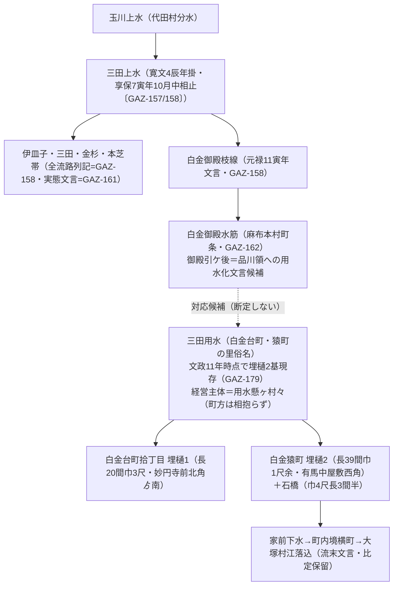

# 2026-11-21（第234回）・町方書上白金・芝帯残冊の掃引＝三田用水白金埋樋2基・金杉川全流路の裏町側文言・桜川宇田川大下水の二重呼称の追加調査

第234回定期実行（第233回として開始したが、準備中に並走実行がTOKYOアーカイブ系の第233回としてpush済みだったため第82回前例に倣い第234回に再採番）。第230回が敬遠した町方書上（文政10-11年地誌御調書上）の白金冊[1]と芝帯残冊[47]〜[59]・[142][150][151]・四谷[63][64]のfulltext掃引を、NDL labの頁別OCR（`https://lab.ndl.go.jp/dl/api/book/fulltext/{pid}`・zip内頁別txt）で実施した。**新規3点（GAZ-179〜181）**と**対照表3行（三田上水・金杉川の追記＋桜川〔芝〕／宇田川の新設）**を実施。最大の成果は**白金冊の三田用水埋樋2基の文言**＝三田上水の白金経由系の実務一次資料。

## 成果（新規3点＋対照表追記3行分）

1. **[GAZ-179](sources/gazetteers/GAZ-179.md)＝町方書上[1] 白金町方書上　完（写・[2571482](https://lab.ndl.go.jp/dl/book/2571482)・文政11子1828年4月提出）新規登録**
   - **白金台町拾丁目条p98の三田用水埋樋文言**: 「**埋樋右は当町往還南側妙円寺前北角より南之方え凡長弐拾間巾三尺程有之 三田用水埋樋有之候得共 右用水懸り村々ニ而取計 町内ニ而者相抱り不申候**」＝長20間・巾3尺の埋樋が文政11年時点で「有之」＝三田用水の通水実務が町方の負担ではなく「用水懸りの村々」（品川領側）の取計である文言。
   - **白金猿町条p120-121の埋樋・石橋・流末文言**: 白金猿町・品川台町両町境の横切下水（巾2尺余・堀割年代不知）＋石橋（巾4尺・長3間半）＋有馬玄蕃頭様御中屋敷西角からの埋樋（長39間・巾1尺余）＝「**三田用水と相唱申候**」（里俗呼称）＋流末「**町内境横町ゟ大塚村江落込**」＋「**三田用水懸ヶ村々二而取計**」。
   - ＝[GAZ-162](sources/gazetteers/GAZ-162.md)（白金御殿水筋→品川領への用水化文言）の**文政期の現況を町方側から裏付ける候補**。享保7年の上水差止後に品川領の農業用水として残存稼働した系統の、給水対象町側（白金台町・猿町）の第一次文言（通水継続の直接文言ではないため断定はしない）。猿町名義の「去り町→猿」書替説（p116）・台町拾町目と猿町条の署名（p102/p126・いずれも名主甚右衛門）で条帰属を確認。
2. **[GAZ-180](sources/gazetteers/GAZ-180.md)＝町方書上[53] 芝町方書上　七（写・[2571534](https://lab.ndl.go.jp/dl/book/2571534)・文政10亥1827年8月提出）新規登録**
   - **金杉裏壱町目条p14の金杉川全流路文言**: 「**水上武州原郡下渋谷村ゟ 麻布相模橋 肥後橋 三田久保町漬(?) 一之橋 麻布十番二之橋 中之橋 赤村佐橋 芝将監橋 金杉橋 川口ゟ海上江流入**」＝[GAZ-103]（渋谷川総説）・[GAZ-112]（吐水系統の橋列）・[GAZ-160]（芝新細町条の金杉川名称文言）に加わる**裏町側の第3の全流路・橋列witness**（repo初出。橋名の表記対立は原画像照合まで保留）。川中18間余・金杉惣町内持。
   - **寛文七未年十月の川幅広ケ文言＋家持8人の屋敷地3,240坪余の収用→三田有馬中務大輔様御上屋敷前拝借地文言**（p14-15）＝[49]芝神明条p63の「寛文七未年八月…川幅堀底ニ相成…」と同型事件の独立witness（月日の対立は八月／十月・決めない）＝[GAZ-160]川巾3段変遷の初段の改修事件の候補。
   - **取払済み旧橋の「橋之形斗絵図面二有之候」文言**（p15・芝湊町へ掛渡の旧橋）＝消滅橋が「絵図面にのみ残る」類例（橋跡資料）。
3. **[GAZ-181](sources/gazetteers/GAZ-181.md)＝町方書上[48] 芝町方書上　弐（写・[2571529](https://lab.ndl.go.jp/dl/book/2571529)・文政10亥1827年8月提出・宇田川町名主弥兵衛）新規登録**
   - **宇田川町条p58の大下水文言**: 「**幅壱丈 長五拾壱間壱尺 右は本堂宿下より増上寺裏門前通り宇田川横町裏手之方江懸り…新銭座町海手江流落申候 里俗桜川又は宇田川(?)ト相唱申候**」＝**増上寺周辺大下水の里俗二重呼称（桜川／宇田川）の文言候補（repo初出）**＝[GAZ-160]の増上寺構堀大下水＝「榎川」（宇田川横町西境で分水→増上寺表御門前→金杉川落入）と対校すると主水路側の記述と読める（同定は保留）。桜川は四谷・赤坂と同名異流の第3例候補。
   - **源助町条の弁天ノ井文言**（p15）: 往古は水が赤い「油之井」→弁財天掘出後「清水」と成り「弁天ノ井」＝井戸水質変遷の一次書上文言候補（[GAZ-113]名水之井戸系の対校材料）。明和6年正月に芝口三町目日比谷稲荷へ相殿。
   - **源助町条の下水実務文言**（p14-15）: 下水浚入用を5ヶ所の水落口の割合で分担・水吐口は濱御殿脇堀江落・新道大下水（長91間余幅6尺）は寛文4辰年7月以降町方一手持・源助橋の人名由来説・長南ケ崎の船着説。
4. **対照表への反映**: 三田上水行・金杉川行への第234回追記＋**桜川（芝）／宇田川行の新設**（金杉川行の直後）。

## 三田用水の白金通過の位置づけ（Mermaid）

※枝線の系統の同定（白銀御殿枝線〔GAZ-158〕と白金御殿水筋〔GAZ-162〕と三田用水〔GAZ-179〕の同一水路か）は今後の原画像照合と対校まで決めない。

## 陰性・見送り〔確認済み〕

- **芝帯残冊の小幅文言（採番見送り・ノート記録）**: ①[47]芝口（2571528）＝二葉町条の土橋（御堀水落・丸屋町渡）・堀抜井戸（文政4年榊原主計頭御番所で普請）・新橋の由来（御多門焼失享保9→享保11町々入用で相懸ケ）＝いずれも対象水系の文言なし、②[49]芝神明門前（2571530）＝正徳3巳年神明社地辺の4ヶ町による新規下水仕付（長43間・吐口は増上寺表御門前大下水江落）＋寛政5丑年の下水巾1間化文言＝[GAZ-181]の大下水系（桜川／宇田川）の上流側支線の候補（精読は次回）、③[51]（2571532）＝切通時之録等、水系文言なし、④[54][55][56][57][58]の三田上水跡の委譲定型文言群（「寛文之度始而出来」変種＝[GAZ-161]第230回記録の裏付け・p単位の確認のみ）＝採番見送り、⑤[59]芝車町（2571540）＝海岸石垣と往還横切大下水の石橋（明暦3〜万治2年成就石垣普請と同時出来・幅4間石長7尺・下水落口巾8尺）＋如来寺門前の水車樋文言（塩浜の潮汲揚げ用の樋・相州山田原で実用・文政6年出火後再建）＝対象水系外だが水車樋の実用史料として言及のみ。
- **青山帯[26][27][28]（2571507-09）・麻布[40]（2571521）**: 上水・用水関連の実質文言なし（hitsは人名「清水」・御灯路町の移転関係）＝陰性。
- **浅草帯[91]-[100]（2571571-80・11冊）**: ほぼboilerplateの「古上水跡…無之」テンプレート＝**第222回のboilerplate陰性判定の裏付け**（[95]2571576のみ既登録GAZ-134の実質文言）＝採番見送り。唯一[99]（2571580, p0087）に「下谷辺ゟ悪水落下水宗安寺門前北之方脇ゟ専光寺門前脇手え流れ新堀へ落」の悪水文言あり（台コードの低優先対照候補・本回は採番せず）。
- **[142]桜田（2571623）**: 実質水系文言なし＝陰性。 **[150]両国橋（2571631）**: 両国橋の普請・修復・船渡の沿革が詳細だが対象外（万治2年元禄宝暦天明の橋史文言の塊＝隅田川橋梁史としては一級だが本repoの採録範囲外・言及のみ）。 **[151]大川橋（2571632・吾妻橋）**: 菱垣廻船の渡銭橋沿革＝対象外。 **[63]（2571544）**: 人名のみ＝陰性。 **[64]（2571545・内藤新宿側と思われる冊）**: 「玉川御上水万年…棒杭際迄道法凡三丁程 石樋幅六尺 西ゟ東え流申候 委細之義は同所塩町三丁目ゟ申上候」＝[GAZ-112]/[GAZ-141]の四谷万年石樋のcross-ref断片のみ（新情報なし）。
- **書誌インフラ**: NDL labのbook API・fulltext APIは稼働。町方書上volume↔pid対応表（bracket N = pid−2571481）を再構築（155冊分の目録確認済み）。
- **監視系の不通（引き継ぎ）**: kanzyou7.jp＝**DNS解決失敗（Could not resolve host）＝本runは監視不能**。都建設局procurementページ＝403（開札2026-12-02環七調節池その2はまだ未来＝第234回へ順送り）。musashi.repo.nii（000/TLS）・nabunken 113630（503）・NDL lab 1900493（500）・1688226 fulltext（403）＝不通継続。

## 次回以降の課題

- **最優先（順送り継続）**: 開札2026-12-02（環七調節池広域整備検討その2）の結果確認＝第234回。
- GAZ-179の原画像照合（妙円寺／妙玄院表記対立・「竹岡筋違」の判読・「大塚村」の比定）と、両埋樋の同一水路性の検討（白金猿町条p130の毛利大和守様御下屋敷方位材料との突合）。
- GAZ-161の委譲定型文言群のp単位の対照表（[53]〜[59]冊の変種の個別採録は本回でp単位確認が進んだため、変種の分布のまとめだけでも次回作成候補）。
- 白金村・下豊沢村条（2571482 p145-149）の精読（土筆ケ原・広尾原の三ケ村入会文言＝[GAZ-159]赤羽新堀川の周辺資料）。
- [49]芝神明門前冊の新規下水文言と桜川／宇田川系（GAZ-181）の接続対校。
- 水アビ写本側原画像照合（GAZ-083・2577111 R43）・芝浦→三河島処分区変遷・都市年鑑IIIF目視・TOKYOアーカイブ文言取得・GOV-477口語訳版・NDL SRU（千川上水・谷端川）での新規書誌探索。
