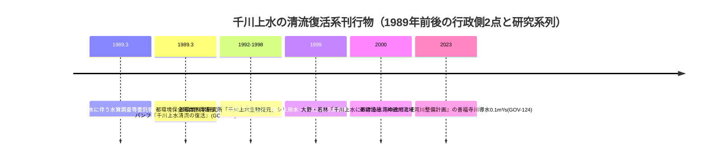

# 第235回（2026-11-21実行）: NDL Search SRU書誌横断＝千川用水拡張1993・雑司ヶ谷窮民層1985・1989試験通水水質調査・椿山荘写真帖群の追加調査

調査日：2026年11月21日。第234回課題⑪「NDL Search SRUによる書誌横断」を本体レーンとして実行。監視系も継続。

## 実施内容

- **NDL Search SRU書誌横断**（recordSchema=dcndl・title=="…"完全一致系クエリ・maximumRecords=50）：**谷端川**（31件）・**弦巻川**（2件）・**水窪川**（13件）・**千川上水**（117件・全頁走査）・**千川用水**（24件）・**雑司ヶ谷／雑司ヶ谷**（279件・全頁走査）・**濯川**（64件・伊勢御裳濯川のみで東京無関係と判定して打ち切り）・**椿山荘**・**谷端川排水区**。429レート制限が頻発するため**10秒sleep＋リトライ**で回避（事実上の有効手法・下記技術メモ）。
- **重複判定**：repo横断grepで既登録一致はすべて見送り（第70-75回・第191回CiNii横断等で既に網羅性が高く、PAP-003/047/090＝山口高志系（水文観測・流出シミュレーション）、PAP-085〜088＝大野・中西・山本の清流復活系列、BOOK-019/034/088、GOV-026/038/099/104/105/110/121等は既収録）。**新規9点のみ採録**。

## 新規採録（9点・INDEX 1,466→1,475 items）

1. **[PAP-096](sources/papers/PAP-096.md)**: 水久保克英「幕末期滝野川大炮製造所建設と村落 千川用水拡張工事を中心にして」『文化財研究紀要』6（東京都北区教育委員会・**1993-03-31**・DOI [10.24484/sitereports.127755-109640](https://doi.org/10.24484/sitereports.127755-109640)）＝**千川用水の幕末期の拡張工事を主題化した研究で[PAP-079](sources/papers/PAP-079.md)（馬場永子・滝野川反射炉2014）の21年先行研究候補**（本文はnabunken不通のため未取得・所在のみ）。
2. **[PAP-097](sources/papers/PAP-097.md)**: 大石庄一「江戸場末町における窮民層の存在形態 : 享和・文化期雑司ヶ谷町の事例」『横浜商大論集』18(2)（1985.2・pp.66-90・NCID AN00246711・CiNii KJ00004473145）＝**享和・文化期雑司ヶ谷町の窮民層の社会史**。**横浜商科大学機関リポジトリでフルテキストPDF（全10コマ・画像スキャン）が公開されていることを確認**（文言判読は未実施・人手待ち）。
3. **[BOOK-224](sources/books/BOOK-224.md)**: 『江戸時代に生まれた庶民信仰の空間 : 音羽と雑司ヶ谷』（文の京地域文化インタープリター・日本女子大学永村研究室 企画・編集・2010.9・85p・30cm・都立中央図書館蔵）＝**音羽（水窪川の谷）と雑司ヶ谷（弦巻川の谷）をまたぐ庶民信仰の展示冊子**（護国寺展示 平成22年9月24日-10月5日・年表付き・本文未見）。
4. **[BOOK-225](sources/books/BOOK-225.md)**: 井出彰『精進ヶ池へ』（河出書房新社・2006.10・190p・ISBN4-309-90693-1）＝NDL書誌の内容細目に**「姥ヶ懐」「精進ヶ池へ」「千川上水」の3篇**＝**千川上水の随筆篇を含む作品集**（本文未見）。
5. **[BOOK-226](sources/books/BOOK-226.md)**: 青条美羽『雑司ヶ谷下水道水難事件』（繍眼書店・2009.9・224p・18cm・叢書「青条美羽短詩・短文セレクション」）＝**題名が雑司ヶ谷の下水道と水難を戴く短詩・短文集**（本文未見・「水難事件」の同定は一切しない）。
6. **[BOOK-227](sources/books/BOOK-227.md)**: 水野義夫『雑司ケ谷界隈』（1994.2・231p・22cm・都立中央図書館蔵）＝雑司ヶ谷界隈の単著地誌書（本文未見）。
7. **[BOOK-228](sources/books/BOOK-228.md)**: 『写真でみる椿山荘の歴史』（椿山荘・[1978]／1980／1983／1983.3／[1987.7] の版次群5レコード）＝**水窪川源流の谷（音羽・椿山荘）の写真帖シリーズ**（版群一括1ファイル採録・画像未見）。
8. **[GOV-481](sources/gov/GOV-481.md)**: 東京都環境保全局（編）『千川上水試験通水に伴う水質調査等委託報告書』（1989.3）＝**本体22,21p＋分冊『資料収集整理結果』129pの2冊**（都立中央図書館蔵・本文未見）＝**清流復活系のこれまで書誌不明だった行政報告書**。
9. **[GOV-482](sources/gov/GOV-482.md)**: 東京都環境保全局自然保護部『千川上水清流の復活』（1989.3・8p・30cm・都立中央図書館蔵）＝**清流復活の都パンフの所在確定**。

## 千川上水研究史の整理〔観察・本回の横断で見えた構図・断定しない〕

- PAP-096（1993・千川用水拡張）→PAP-079（2014・滝野川反射炉）の**滝野川幹線の先行・後続関係候補**。
- GOV-481/482（1989）→PAP-086（1992-98・生物復元）→PAP-087/088（1999）→PAP-085（2000）→GOV-124（2023）の**清流復活系の公刊系列がほぼ揃った**（欠けていた1989年の起点側2点が本次で所在確定）。

## 見送り（採番せず・理由つき）

- 坂本弘道「東京見て歩き 千川上水を歩く」2021.7＝既知内容の散歩記で新情報なし候補。
- 野本禎司（千川上水展の展示批評）2006.12＝展評で文言の独自性低い。
- 栄森康治郎「日本水紀行-29-」1997.08＝随筆記で同上。
- 葛西孝周「雑司ヶ谷幹線再構築事故を教訓に」2018.3＝**[mlit報告書は第78回で本体既登録**のため書誌重複]。
- 清水与一『目白台・雑司ヶ谷・護国寺界隈の小さな歴史と文学見聞記』2002.7＝読み物・内容不明で観察価値を判断できない（次回の判断材料として保留）。
- 原田信男「江戸の小さな旅」2009＝**第89回見送り前例**（随筆で現地観察と不可分）。
- 山本瞳「霊園の形成過程」2025.9＝**分割前README全文.md既出**。
- まち歩きアルバム群2021-22＝現況写真としてGAZ/GOVの対象外。
- 中山道と千川上水公園フェア2005＝イベント記録で河川文言の裏付けなし。
- 雑司ヶ谷ナス（園芸品種）関連＝false positive（作物・店名等）。
- 「千里ヶ池」＝「精進ヶ池」の表記ゆれ（精進ヶ池が正式）。

## 監視系（すべて状況記録）

- kanzyou7.com： HTTP200復旧していたがWHAT'S NEWは2026/11/20のまま（変化なし・定例行更新を継続）。
- 東京都建設局トップ： HTTP200復旧。**開札2026-12-02（環七調節池広域整備検討その2）はまだ未来＝結果なし。procurement page（入札関連）のURLは今回も特定できず、第236回以降へ順送り**（12月2日以降の実行で最優先）。
- musashi.repo.nii.ac.jp： 不通継続（TLS/000）。
- sitereports.nabunken.go.jp： 503/000不通継続（**PAP-096の本文取得を妨げている要因**）。
- NDL lab API（1900493系ほか）： 500継続。
- news/web系6クエリ（谷端川／弦巻川／水窪川／千川上水／神田川下水道／第十二社幹線・recency30日）： 全件陰性（阪神谷端選手・moegirl・米沢/静岡水窪ダム等のfalse positiveのみ）。

## 技術メモ（次回以降のSRU横断用）

- **NDL Search SRU URL形式**：`https://ndlsearch.ndl.go.jp/api/sru?operation=searchRetrieve&version=1.2&recordPacking=string&recordSchema=dcndl&maximumRecords=50&query=title%3D%3D%22（URLエンコード語）%22`。
- **429レート制限**が発生頻度高め。**1クエリごとに10秒sleep＋429時12秒sleep×リトライ**で実質回避可能。全頁走査もbreathingで安定した。
- recordDataは`<foaf:name>`（出版者・編集者）と`<dcndl:publicationName>`（誌名）を別タグで持つ。`<dcterms:extent>`は`<rdf:value>`内ではなく直接テキストの場合がある（パーサ注意）。
- NDL書誌（R100000002系）のレコードは**内容細目（partInformation）**に篇名が出ることがある（BOOK-225の「千川上水」篇をこの方法で発見）＝**書名に川名がなくても篇名で引っかかるケースを横断できる**。
- **書誌ヨミ（transcription）で叢書名・出版者の読みが取れる**（BOOK-226の「繍眼書店」はfoaf:name由来）。
- 機関リポジトリ系レコード（R100000025系）は`rdfs:seeAlso`に**フルテキストURLが入ることがある**（PAP-097で横浜商科大学リポジトリ records/1384 → PDFを特定）。**PDFが画像スキャンでテキスト層なしだと文言判読は不可**（当アップグレード環境ではOCRなし・入手した上で人手閲覧待ちが現実的）。

## 次回以降の課題

1. **開札2026-12-02（環七調節池広域整備検討その2）の入札結果確認**（実施日以降の実行で最優先・都建設局の入札関連ページの特定から）。
2. nabunken／sitereports復旧時に**PAP-096の本文取得**（DOIリゾルバ経由でも可）。
3. PAP-097の**PDF判読**（享和・文化期雑司ヶ谷町の窮民層の対象史料と水・地形への言及の有無の確認）。
4. GOV-481/482・BOOK-224〜228の**本文・画像確認**（都立中央図書館の書庫資料〔B2書庫C〕属のため閲覧条件の確認を含む）。
5. SRU横断の残レーン（千川・千川新田など派生地名の書誌、図版・挿絵系の書誌、人名系（千川清・伊勢屋など）は要否判断の上で次回以降。

## 関連

- [README](../README.md)冒頭「現時点で重要なこと」（第235回bullet）・[INDEX](sources/INDEX.md) 1,466→1,475 items・[第234回ノート](2026-11-21（第234回）・町方書上白金・芝帯残冊の掃引＝三田用水白金埋樋2基・金杉川全流路の裏町側文言・桜川宇田川大下水の二重呼称の追加調査.md)（SRU課題⑪の提唱元）
