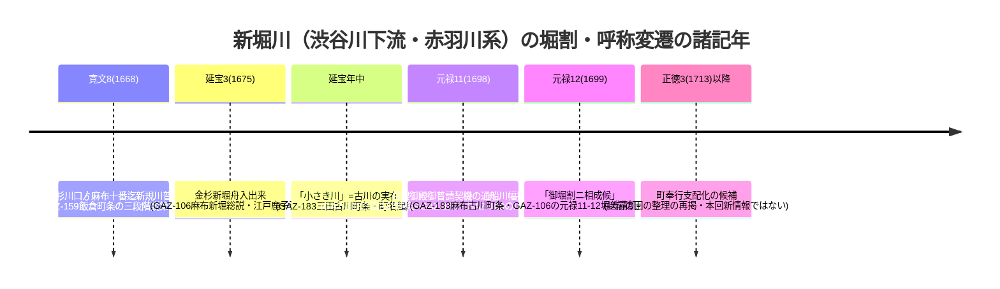

# 第236回（2026-11-21実行）: 町方書上牛込七止・三田弐・柳島・亀戸冊の掃引＝古川→新堀川呼称変遷の一次文言・浄泉寺谷・北十間川/大横川・亀戸銭座舟入堀の追加調査

調査日：2026年11月21日。第231回「陰性」冊リストの再読とNDL lab町方書上残冊の掃引を本体レーンとして実行。監視系も継続（musashi.repo.nii.ac.jp不通継続・nabunken 113630 503継続・kanzyou7 WHAT'S NEW 2026/11/20不変・都建設局系は本セッション403〔第235回は200と記録したが本セッションの観測では403・都の側のReferer/UAフィルタの揺れの可能性があり断定しない〕・開札2026-12-02環七調節池広域整備検討その2はまだ未来のため順送り）。

## 実施内容

- **NDL lab町方書上残冊の掃引（fulltext OCR）**: [1]白金（[2571482](https://lab.ndl.go.jp/dl/book/2571482)・第234回GAZ-179既登録冊の再読・追記）・[11]牛込七止（[2571492](https://lab.ndl.go.jp/dl/book/2571492)）・[21]三田弐（[2571502](https://lab.ndl.go.jp/dl/book/2571502)）・[153]柳島（[2571634](https://lab.ndl.go.jp/dl/book/2571634)）・[154]亀戸（[2571635](https://lab.ndl.go.jp/dl/book/2571635)）＋陰性確認冊（[18]駒込肆2571499・市谷弐2571484・田町参止2571503・牛込弐2571487・[14]小石川貳附録2571495・飯倉続2571505）＝**いずれもOCR由来で文言は要原文照合**。
- **訂正記録**: ①第230回の[11]牛込七止「boilerplateのみ」判定は**誤り**（p50-76の水系文言を拾い落としていた）→[GAZ-182](sources/gazetteers/GAZ-182.md)新規で回収。②第230回の[21]三田弐見送り判定も**誤り**→[GAZ-183](sources/gazetteers/GAZ-183.md)新規で回収。③第231回「陰性」冊リスト掲載の[153]柳島・[154]亀戸は**水系文言を含む**→[GAZ-184](sources/gazetteers/GAZ-184.md)・[GAZ-185](sources/gazetteers/GAZ-185.md)新規で回収。**「陰性」判定はfulltext OCRの判読難易度に左右されるため、将来の再読枠として残す価値がある（本回で3冊が陽転）**。
- 第234回課題④（白金村・下豊沢村条p145-149の精読）を解消：長者ヶ丸犬小屋跡・梅ヶ茶屋・土筆ヶ原/広尾原（児置村・下豊沢村・下渋谷村三ヶ村入会場・御年貢地・嘉永7年御成の御場所候補）＝**水系文言は陰性**（土地利用史料として[GAZ-179](sources/gazetteers/GAZ-179.md)第236回追記に記録）。

## 新規採録（GAZ-182〜185の4点＋GAZ-179追記・INDEX 1,475→1,479 items）

1. **[GAZ-179](sources/gazetteers/GAZ-179.md)追記（[1]白金・文政11子1828）**: 白金台町壱・弐丁目条p15-17＝**「字玉名川」＝白金村・今里村入会場の小字**＋**水上は往古「玉名之壱池」〔玉名之池・判読候補〕（池埋立済で文政11年時点「池跡地窪」）**＝**玉名川=池流出川の呼称継続文言候補（repo初出）**＋蛍名所「名小先」（OCR崩れ候補）＋**石橋「玉名橋」＝巾六尺・長壱丈八尺**・覚村寺〔判読候補〕「玉名橋角」＋p25-26「悪水祓」・p79「悪水溜」語彙。対照表玉名川行新設。
2. **[GAZ-182](sources/gazetteers/GAZ-182.md)（[11]牛込七止・文政9戌1826）**: 牛込馬場下町条「**穴八幡前石橋 釣之橋ト相唱**」＝[GAZ-109]「駒之橋」との**判読対立の元資料側witness**＋流路「大久保村下水→戸山御屋敷「仙水」〔泉水判読候補〕→早稲田村・江戸塚村〔下戸塚村候補〕用水→江戸川」＋馬場下横町条の俗呼「**浄泉寺谷**」（repo初出候補）と往還下伏せ構造候補＋早稲田町条の下水堀（巾六尺）と石橋「**下稲橋**」（長八尺二寸・巾壱丈）＋「**上稲橋**」（御組屋敷に現存）pair（いずれもrepo初出候補）。
3. **[GAZ-183](sources/gazetteers/GAZ-183.md)（[21]三田弐・文政11子1828）**: 三田古川町条＝**町名起原として「延宝年中まで小さき川（古川）有之→元禄11寅年白銀御殿御普請…通船川幅壱間余堀広→其節ゟ新堀川ト相唱」の一次文言候補（repo初出）**＋大雨湛水文言（川際迄凡間数拾間余も湛地）＋里俗「**肥後殿橋**」＝「**三之橋**」（細川越中守様一手持）＋麻布古川町条「細流ハ古来古川ト相唱候哉 **元禄十二卯年御堀割**ニ相成候ツゝ新堀ト相唱候得共 其以前之川名ヲ取元 麻布古川町ト相唱」＝**元禄11/12の記年対立の両論併記が可能になった**（寛文8新規普請説GAZ-159との対立は維持）＋久保三田町条の新堀川流路規定（南渋谷辺ゟ北芝金杉辺迄）＋「**二之橋**」（幅弐間三尺・長拾弐間）＋三田老増町条「**大下水 右は三田用水之末ニ而…芝新堀引え相流**」＝**三田用水の文政11年現役用例＋流末=芝新堀文言（repo初出）**＝享保7年差止後も用水呼称が実務で生き続けたwitness。
4. **[GAZ-184](sources/gazetteers/GAZ-184.md)（[153]柳島・文政11子1828）**: 柳嶋境町条「**北十間川**ト相唱申候 中川ゟ流レ来り横十間川え相流」＝**川名repo初出候補**＋万治年中本所御取立堀割申伝（度々出水ニ而書留亡失の文言つき）＋**境橋**（長八間・巾弐間・柳浜村・清地村・亀戸村持）＋柳増嶋土村町条「**大横川**ト相唱申候 竪川続ニ而万治年申本所御取立之節御堀割之由申伝」＝**川名repo初出候補（横十間川系の別称候補）**＋「**宗法恩寺橋**」（法恩寺橋判読候補・長七間・4ヶ町持ち）＝[GAZ-165]本所起立記の法恩寺橋（万治2年）の文政期現況witness。
5. **[GAZ-185](sources/gazetteers/GAZ-185.md)（[154]亀戸・文政11子1828）**: 亀戸町条「横十間川御堀割之義は**万治弐亥年 本所御奉行徳山五兵衛様 山崎四郎左衛門様御懸りニテ堀割出来候趣申伝**」＝**GAZ-165と年代完全一致の十間川側witness（奉行実名はrepo初出級）**＋亀戸銭座の**舟入堀の銭座廃止後埋立→耕地悪水吐の伊奈半左衛門様宛願出**の実務文言（repo初出級）＋「**大雨之節天神裏門辺地水相湛…文化五辰年中奉願…左右蓋共石ニ**」＝**文化5年湛水→石蓋暗渠（蓋掛け）化の実務文言候補（repo初出級）**＋天神橋「**右橋懸リノ初メゟ亀戸橋ト相唱候由 其後天神社造営以後天神橋ト申 間ハシ 笹戸橋之名目ハ止ミ候**」＝**旧名二層（笹戸橋→亀戸橋→天神橋）の変遷文言候補（repo初出）**＋亀戸境町条の境橋（長拾間・板橋・亀戸村・柳嶋村・請地村三ヶ村入会・梁田治助・蔵田屋清左衛門請負）＋亀戸清水町条＝横十間川「**竪川え流入**」＋小土手規格（馬踏壱間程・敷弐間半位・高三尺又者壱尺位）の現存文言候補。

## 古川→新堀川呼称変遷の年代論の現状（対校の整理・断定しない）

- **本回の寄与**: 「古川」から「新堀川」への**呼称変遷を町方書上本文の側から直接に記す一次文言**（三田古川町条・麻布古川町条）が初めて入り、延宝古川→元禄11通船→新堀川呼称転換のつらなりと、「其以前之川名ヲ取元」という川名継承の思考形式が見えた。元禄11（三田古川町）と元禄12（麻布古川町）の**1年差の対立は資料レベルで並存**し、白銀御殿普請（1698-1701頃）をはさむ連続的な工事の起終点の置き方の違いとも読める（断定しない・原画像照合と絵図対校ののち判断）。
- **十間川系の万治2年チェーン**: [GAZ-178]（141深川北松代町条・十間川里俗名）＋[GAZ-184]北十間川・大横川＋[GAZ-185]亀戸町・亀戸境町・亀戸清水町＋[GAZ-165]本所起立記＝**万治2亥年（1659）・本所御取立の堀割群が本所側の少なくとも6条文言で平行的に申伝される状態になった**。ただしすべて申伝（伝聞）形式で、「度々出水ニ而書留亡失」（柳嶋境町条）と一次文書が失われた理由の当事者側説明も残る→万治2年起源を裏付ける管控文書（奉行所文書・本所御取立帳等）の探索が次の課題。

## 見送り（採番せず・理由つき）

- [18]駒込肆（2571499）・市谷弐（2571484）・田町参止（2571503）・牛込弐（2571487）・[14]小石川貳附録（2571495・浅井家系譜の冊）・飯倉続（2571505）＝boilerplate・家臣リスト中心で水系文言なし（陰性確定。ただし本回の教訓=判読の進展で陽転しうるため、再読枠としては残す）。
- 三田古川町条「水銭204文」等の賦課文言＝水路と無関係（橋名とも無関係）のため不採録。
- 豊岡町条（p59-79）・北代地・南代地・久保町条（[21]三田弐内）＝実質文言薄。柳島町・柳島裏町条も同様。

## news6陰性記録（2026-11-21実行・recency30・第236回）

- 谷端川・弦巻川・水窪川・千川上水・神田川下水道・第十二社幹線の6クエリ（web＋news・直近30日）を本回実行：**repo未収録の新情報は検出されず**（命中はすべて無関係＝野球選手名・米沢の水窪ダム・BanG Dreamの弦巻こころ・Wikipedia英語版の千川上水常规項目等）。news corpusは全クエリ0件。次回も継続（都web検索は本セッション403状態にあったため、都の河川関連の新着の再試行は次回課題として記録）。

## 次回以降の課題

- ①「釣之橋」（GAZ-182）vs「駒之橋」（GAZ-109）の原画像照合による判読決着（本repo最大の判読対立案件に追加）。②元禄11/12対立（GAZ-183内）の寛文8説（GAZ-159）・白金御殿改水流説（GAZ-106）との調停＝絵図（古図・御城下絵図）対照。③万治2年本所御取立の管控文書の探索（nabunken復旧待ち・113630も継続監視）。④北十間川・大横川の実体比定（本所絵図類との対照・位置特定）。⑤亀戸銭座舟入堀・文化5年石蓋文言の原画像照合（蓋掛け暗渠の系譜の最古級文言候補として要確定）。⑥「三田用水之末」（三田老増町条）の白金枝線系残存流用の同定。⑦ 境橋両岸対校（GAZ-184/185）の絵図照合＝同一橋か2橋か。⑧玉名川・玉名之池の明治期字名への残存探索（原本照合後）。

## 技術メモ（push運用）

- 並走の第235回（12:46Z・HEAD=1504b089・INDEX 1,475 items）をpush前にlist_commitsで確認し、GitHub API push・SHA固定codeload tarball でdiff -rq検証（運用慣例どおり）。
