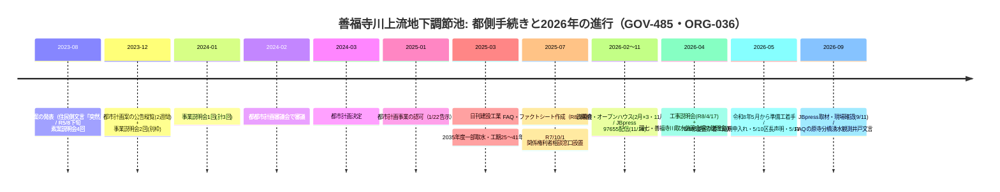

# 第241回（2026-11-21実行） — 善福寺川上流地下調節池の都側一次裏取り（[GOV-485](sources/gov/GOV-485.md)）・住民会サイト（[ORG-036](sources/org/ORG-036.md)）・河骨川暗渠歩きnote（[BLOG-247](sources/blogs/BLOG-247.md)）の新規3点

## 概要

- 第240回が「次回課題」とした**善福寺川上流地下調節池の都側一次資料の直接確認（裏取り）**を主軸に、都建設局の事業ページ（2026-04-24更新）とFAQ PDF（令和7年7月作成・令和8年3月最終更新・17頁・本文全文抽出）を取得して[GOV-485](sources/gov/GOV-485.md)として新規登録した。同時に住民側の[ORG-036](sources/org/ORG-036.md)（善福寺川流域の自然と暮らしを守る会）と [BLOG-247](sources/blogs/BLOG-247.md)（河骨川暗渠の写真紀行）を登録し、**INDEX 1,481→1,484 items**。
- 監視系: 開札2026-12-02（環七調節池広域整備検討その2〔GOV-148系〕）は**まだ未来＝第242回最優先へ順送り**（変更なし）。kanzyou7 WHAT'S NEW=2026/11/20不変・都建設局は事業ページ本文取得で**有効に動作**（前回の403は揺れと確認）・nabunken・musashi.repo.nii・NDL lab API検索系は継続不通。
- 第240回との重複整理: JBpress 97655（2026-11-16・全5頁）と環七インフラツアー都プレスは**第240回でGOV-149追記済み**とpush前に判明したため、本回は同じ資料の再登録を避け、**都側一次裏取り・住民側一次資料・2035年度一部取水・2026年5月の住民抗議・作業中止という新層**に絞って採録した。

## ① 都側一次資料の裏取り〔GOV-485・repo初出の数値群〕

- **[GOV-485](sources/gov/GOV-485.md) の核心**（いずれも**確認**・事業ページ本文・FAQ PDF本文）:
  - 事業期間**令和3年度〜令和23年度**・全体事業費**約1,557億円**（令和7年度時点）＝第240回のJBpress数値（17年・1557億円）と**完全整合**。
  - 都市計画手続きの実名: **R5/8下旬素案説明会4回→R5/12公告縦覧2週間→R6/2都市計画審議会→R6/3都市計画決定→R7/1事業認可**。
  - 取水施設3箇所の確定: **①都立善福寺川緑地 ②区立関根文化公園 ③原寺分橋下流右岸部**（選定3原則＝浸水被害軽減効果・公共用地優先・カーブは水位不安定なので直線区間）＝**「3公園」文言の都側具名**。
  - 公園名の確定: **都立善福寺川緑地（センター広場・ロケット公園）・区立関根文化公園（大木伐採の文言あり）・区立井荻公園（低地部のみ使用）**。
  - **原寺分橋湧水の保全文言**＝「東京の湧水マップ（都環境局アンケートベース）にも記載されている善福寺川の貴重な湧水箇所の一つ」→**観測井戸設置（地下水位観測）＋河川内水量調査**を約束〔〔原寺分橋＝湧水×武蔵野市吐口（毎秒27m³）×第3立坑×住民立退きの地理的重複を都側が自己文書化〕。
  - **B/C=1.41の公式値**（神田川流域全体・B=681,488百万円・C=484,451百万円・R6年度時点評価）＝森川明夫技術士（住民側）の「B/C 1.41 は流域全体評価」という主張の**公式側文言と一致**＝争点が「事業単体評価の在り方」に純化したことを一次資料側で確認できた。
  - 維持管理の水理＝**トンネルは関根文化公園から善福寺川緑地へ下り勾配、緑地側施設から善福寺川へ排水**。
  - **令和5年台風2号の定量的検証**＝原寺分橋で時間最大50mm・総308mm・**環七で約24万m³取水**・下流側に効果発現。
  - 武蔵野市側の一次数値＝小中学校18校中17校に8,800m³・北町保育園4,500m³・合流改善10,700m³、**R5年度の流域対策進捗＝目標15.9万m³中10.2万m³（64%）**。
- **関連報道のリード/見出しレベルの裏付け**（会員限定・本文未取得・スニペット確認）:
  - 東京新聞 2026-05-12＝**5/8杉並区の着工延期申入れ・5/10区長声明・5/11作業中止**（住民抗議）＝R8/4工事説明会→2026年5月の摩擦という時系列上の空白を埋める報道。
  - 日刊建設工業新聞2025-03-14＝**2035年度一部取水開始、工期25〜41年度、管理棟等を含む**＝先行稼働という事業相貌の実務側情報。
  - 建通新聞（2026）＝**ECI本体工・鹿島/大成JV・見積1,173億円で随意契約へ**（内径9m級・延長約5.8km・約30万m³取込）。
- **未解決**: ファクトシートPDF（`202603zenpukuji_fact`）の本文が**当環境から取得不能**（kensetsu documentsホストのチャレンジ）＝貯留量約30万m³・内径約9m・延長約5.8km・地下約40mはスニペット一致文言止まり＝**都一次文言での諸元確定は第242回以降の課題**。

## ② 住民側一次資料〔ORG-036・repo初出の住民団体〕

- [ORG-036](sources/org/ORG-036.md)（zenpukujigawa.com・2026-11-21取得）: **立坑3か所（ロケット公園〜センター広場・関根文化公園・原寺分橋付近住宅地）・署名18,000筆超・立退き50軒以上・区分地上権・公式工期17年に対し実質20〜30年見込み・水害現場調査なし・複数案検討なし・武蔵野市流入未対策**という住民側の文言を一次サイトとして確保＝都側（GOV-485）と**同一事実を対極から共有する構図**（争点＝工期・用地取得・評価方法）。
- **同サイト・朝日・建通のスニペット諸元（直径約9m・全長約5.8km・1557億円）と都の事業ページ文言が一致**＝住民側の事実認識の正確さの裏付け〔観察〕。

## ③ 河骨川暗渠のnote記事〔BLOG-247〕

- [BLOG-247](sources/blogs/BLOG-247.md)（シジマ・note・**2026-10-27投稿**）: **宇田川跡（暗渠）＝レンガタイル敷き道路表示の現況**と**河骨川×宇田川合流地点の写真特定**＝repo初出の観察定点〔春の小川モデル説・暗渠化工法は既知文言の繰り返しで新規性なし〕。**合流地点の座標・レンガタイルの設置主体・年は未確認**＝human地図照合待ち。

## ④ 本体レーンの陰性記録（町方書上残冊掃引の完了）

- 第240回から持ち越した**町方書上残冊候補の目視評価・追加取得14冊の掃引を完了**し、以下を**陰性**と確定した（新規文言なし・採番なし）:
  - [3]市谷弐 2571484・[7]牛込参 2571488（関口市五郎は人名）・[13]小日向附録 2571494（千川・上水・用水・湧の全語0件）・[14] 2571495（第236回陰性を維持）・麻布四 2571519・麻布七 2571522・品川寺社門前一 2571523（**「善福寺」は麻布・北品川の寺名であって善福寺川とは無関係**＝[123-124回の麻布・品川帯]と同じ型のfalse positive）・品川寺社門前弐 2571524・品川参止 2571525・品川台町高輪 2571526（いずれも全語0件）・渋谷全 2571493（関口は人名）・大川橋書上 2571632（水戸2件は文言希薄）・浅草[91]-[100]帯（**[95]猿屋町＝GAZ-134既録の再確認のみ**・[92]山之宿の道灌井戸・[93]-[100]はboilerplate（古上水跡定型文）で repo未登録の文言なし）。
- **解釈の補足**: 町方書上定型文「○○上水跡…無之候」群は**「どこに上水が無いか」を列挙する陰性証明型の史料**であり、これ以上の浅草・品川帯掃引ではboilerplate率が高いと判断し、**町方書上の未掃引冊は145冊コレクションの実質的な掃引完了**と位置づける（今後は増補・特定冊の原画像照合に移るのが合理的）〔推定〕。

## 監視系の陰性記録

- news/web監視（recency30日・8クエリ: 谷端川・弦巻川・水窪川・千川上水・神田川下水道幹線・雑司ヶ谷幹線・善福寺川地下調節池・渋谷川暗渠）＝「谷端川」は阪神谷端将伍選手（記事2本）、「弦巻川」は弦巻こころ（BanG Dream）等のnoise。毎日新聞2026-10-30「シネマの週末・映画、ある風景: 渋谷川」は「渋谷川の再生（渋谷ストリーム開業に合わせた遊歩道化＝ラブ＆ポップのラストシーンとの対比）」を扱うが**有料（全文563文字のうち421文字しか読めず）・repo既知の渋谷川遊歩道化の枠組みを超える情報なし**で見送り。
- kanzyou7 WHAT'S NEW＝2026/11/20週間工程表のみ不変・nabunken 113630＝000不通・musashi.repo.nii＝000不通・NDL lab API検索系＝500/HTMLシェル継続・**都建設局は本セッションで正常取得可**（事業ページ・FAQ PDF・build 403→200の揺れの実測・procurementの開札結果確認は12/2以降）。

## 第241回の系譜（Mermaid）

（時点列挙で因果は断定しない。）

## 採番

- 本回の新規採番: **GOV-485・ORG-036・BLOG-247**（INDEX 1,481→**1,484 items**）。
- 次回新規採番の起点: **GAZ-186・GOV-486・BOOK-229・MAP-208・ORG-037・BLOG-248・PAP-098・LOST-006**（push前にINDEX.mdと各dir実測で再確認）。（push前にINDEX.mdと各dir実測で再確認）。

## 次回（第242回）課題

1. **開札2026-12-02（環七調節池広域整備検討その2〔GOV-148系〕）の入札結果確認＝最優先**（procurement page再試行・403時は干し上げ待ち）。
2. **ファクトシートPDF（`202603zenpukuji_fact`）の本文取得**＝貯留量約30万m³・内径約9m・延長約5.8km・地下約40mの**都一次文言での確定**（kensetsu documentsホストのチャレンジ回避策: ブラウザUA・タイムアウトを変えた再試行・Wayback Machineスナップショットの探索）。
3. **「第11分区・12分区幹線」の比定**（杉並区/都下水道の処理分区体系・善福寺川流域の下水道分区分割図）。
4. **BLOG-247の合流地点の位置特定**（human地図照合・レンガタイル設置主体の確認）。
5. **原寺分橋湧水の都環境局「東京の湧水マップ」側文言の取得**（GOV-485の観測井戸文言の接続先）。
6. 2026年5月の作業中止後の準備工再開時期の追跡（JBpress 9/11撮影の中間経過・都の進捗ページ監視）。
7. musashi.repo.nii・nabunken・NDL lab API再試行・kanzyou7・news監視継続（第241回と同8クエリ）。tech: 本回の作業ファイルは/home/user/otowa241/（repo/=ミラー・lab/ft=町方書上fulltext・hits1.txt）。
