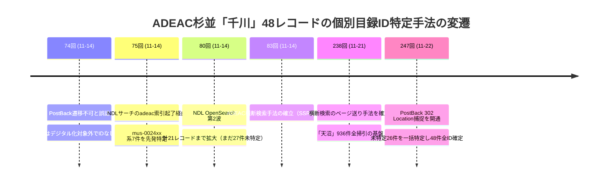

# 第247回ノート: ADEAC「天沼」936件全掃引とPostBack 302 Location捕捉による「千川」48レコード全ID特定・須田家文書分水群の追加調査

- 実行日: 2026-11-22（第247回定期調査）
- 対象: ADEAC杉並区コレクション（横断検索・個別目録ページ）
- 成果: [GOV-494](sources/gov/GOV-494.md)（須田家文書分水・水料系8レコード）・[GOV-495](sources/gov/GOV-495.md)（暗渠前の公共溝渠写真2レコード）の新規収録、[GOV-110](sources/gov/GOV-110.md)（「千川」48レコード横断）の全ID特定完了・追記
- 監視系: kanzyou7 WHAT'S NEW=2026/11/20不変、musashi.repo.nii（000）・nabunken（000）不通継続、NDL lab 1900493（500）継続、news 8クエリ（谷端川・弦巻川・水窪川・千川上水・神田川下水道・雑司ヶ谷幹線・善福寺川地下調節池・環状七号線地下調節池・2026-11-08以降）＝全件0件〔陰性〕
- 開札2026-12-02（環七調節池広域整備検討その2＝[GOV-148](sources/gov/GOV-148.md)系）はまだ未来＝**第248回最優先**

## 1. 技術的突破: PostBack 302 Location捕捉で個別目録IDが全件取れる

第74回の「PostBack遷移不可（POSTしても結果一覧が返るのみ）」の原因は、**POSTに対する応答が302リダイレクトで個別目録ページ（`/suginami-city/catalog/<mus-ID>?from=search`）へ飛ぶ**ことにある、と判明した。urllibのデフォルトではredirect handlerが302を自動追従するためLocationを見失い、前回はCookieの欠缺なども相まって一覧へ戻っていた形跡がある。今回、`HTTPRedirectHandler`を無効化したopenerで302の**Locationヘッダーを直接捕捉**したところ、期待したカードのmus-IDが正確に取れた。

手順（確立した汎用レシピ）:

1. `GET /cross-search`（クッキー取得＋__VIEWSTATE等の隠しフィールド採取）
2. `POST /cross-search?mode=catalog`（fieldsAll_input=キーワード・searchBTN=検索）→ 結果一覧のレコード列挙
3. 対象レコードのインデックス（1始まり）に対応する `catalog_grid_rpt$ctlNN$catalogsLink` を__EVENTTARGETに指定して再POST
4. 302のLocationヘッダーを読む → `/suginami-city/catalog/<mus-ID>?from=search`
5. `GET https://adeac.jp/suginami-city/catalog/<mus-ID>`（`?from=search`なしで安定取得可）

同一キーワードで複数ヒットする場合（例: 「水税水費収入簿」×2件）は検索一覧の表示順（年月日昇順）でインデックス1・2を押し分け、**全レコードで押した直前の画面タイトルと目録詳細のタイトルが一致することを検証**した（誤index防止）。

### ADEAC杉並の個別ID特定手法の変遷

## 2. 「千川」48レコード全ID特定（GOV-110第247回追記）

上記手法で未特定26カード（№3・№5・№8・№9・№12・№13・№15・№16・№19・№20・№22・№23・№28〜№41）を一括特定。詳細と全IDは[GOV-110](sources/gov/GOV-110.md)第247回追記参照。特記事項:

- 全レコードが[BOOK-032](sources/books/BOOK-032.md)『星野家文書 千川用水関係史料（文化財シリーズ29）』の**翻刻対象**で、目録の「翻刻」欄に**頁数と書中史料名**が記載されていることが判明（№30 mus-002493=翻刻25〜45頁が同書の主軸史料、ほか全レコード25〜136頁に分布）。
- **№28（関村地内の青梅街道道路下水→千川田用水口への掛樋流込願）の書中史料名は「掛樋設置反対の願書」**（翻刻88〜89頁）＝願書の中身が反対運動である可能性を示す。差出=阿佐ヶ谷村田持惣代相澤喜兵衛ほか6か村・受取=南豊島郡長江連尭則・1884年11月（明治17年11月）。本文未確認のため「反対」の対象（何への反対か）までは断定しない。
- 宛先人の層: 「東京府知事 楠本正隆」（№36）、「東多摩土木課」（№8）、「南豊島郡長 江連尭則」（№5・№28）＝明治10〜20年代の千川用水行政の窓口。
- №12回章は**多摩郡側5か村戸長役場**（阿佐ヶ谷・天沼・下荻窪・上井草・下井草）への会合周知＝竹下新田分水口会合の当事者構成を初めて明示。
- №3の受取人は星野紋左衛門本人＝星野家文書が「戸長（役所）あて公文書」だけでなく**村長個人の水世話米・見守料の受領記録**を含む。

## 3. 「天沼」936件全掃引（GOV-494・GOV-495）

第238回手法（cross-search GET→searchBTN POST→btnnext+pageinput POST・クッキー保持）で**936件/19頁を全取得**（tenuma.tsv・936行）。水系関係の新出は:

1. **須田家文書の分水・水料系8レコード**（[GOV-494](sources/gov/GOV-494.md)）: 「天水分水入用取立帳」（mus-013115・repo初出の「天水分水」文言候補）・「分水高」「分水反別」「分水石高」「分水一件入用」「（水料米他納高）」「（下田の納合・水料覚）」・「廻状（田用水字柄杓屋口へ鍔板取付に付立合見分下さる様）」（mus-013261・**repo初出の「字柄杓屋口」用水口地名候補**、天沼村始め3か村名主あての樋口設備立合見分の回状）。いずれも「千川」キーワード非ヒット＝GOV-110の48レコード外。江戸期の同一村間用水ネットワーク（千川用水系の前身含む）の運営記録である可能性は推定段階。
2. **「暗渠前の公共溝渠」（荻窪1-50付近・1962年）写真2レコード**（[GOV-495](sources/gov/GOV-495.md)）: mus-003915（地域の学び推進課・CC BY-NC-ND）とkoho-photo-135（広報課）の**ダブルレコード**＝荻窪駅近辺の開渠が昭和30年代後半に暗渠化される直前の写真資料候補（対象水系は特定不能・断定しない）。ADEACで同一資料が複数レコードIDで現れる実例としても記録。
3. 見送り: mus-000775（石造物3基・水系無関係）・mus-014012（弁天社祭礼通知・天沼弁天池との関連不確定）。

## 4. 対照表の更新

- 「六ヶ村分水」行へ須田家文書の「天水分水」文言を追記（[GOV-494](sources/gov/GOV-494.md)）。
- 新設行「字柄杓屋口」（用水口の字名〔地名〕）。

## 5. 次回（第248回）への引継ぎ

1. **開札2026-12-02の入札結果確認（GOV-148系・環七調節池広域整備検討その2）＝最優先**。
2. GOV-110全レコードの翻刻本文確認は[BOOK-032](sources/books/BOOK-032.md)（既収録・図書レコードlib-bukazai_s_029の目次画面あり）経由が本命。№28「掛樋設置反対の願書」の本文（何への反対か）は次回の重点。
3. GOV-494の8レコードの年代確定・字柄杓屋口の比定には画像（ IIIF マニフェスト有無含む）確認が必要。
4. ADEAC杉並portalのdetailed-search系GETエンドポイント（機関別詳細検索）もPost必須の模様＝ Potter できないため、横断cross-search＋PostBackで十分回せることを今回確認（十分条件）。
5. musashi.repo.nii（000）・nabunken（000）の不通継続は要watch（第238回から）。
