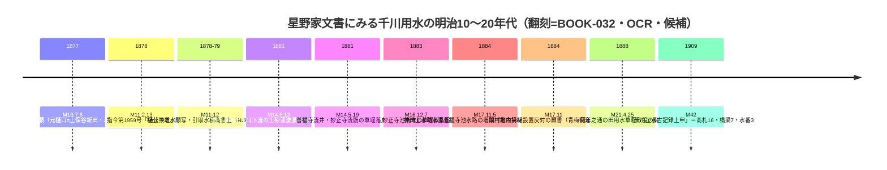

# 第248回定期調査ノート（2026-11-22）: BOOK-032のNDLOCR全文取得・№28掛樋反対願本文・№30樋口寸法群・神田上水助水源草堰運用

第247回で確立したADEAC個別目録ID特定の手法に続き、[BOOK-032](sources/books/BOOK-032.md)『星野家文書 千川用水関係史料』（杉並区教委・1983）の**ADEAC版ビューアがNDLOCR viewer実装であることを利用し、OCR全文データ（全76コマ分・約878KBの `xml/data.xml`）を一括取得**した。これにより「22〜25頁の全文転記は未了」（第15回以来のBOOK-032課題）を含む書中本文がデータ側で読み取り可能となり、第247回に目録レベルで特定した№27・№28・№30等の**翻刻本文の文言候補を読んだ**。新規ソースファイルの採番は行わず、[BOOK-032](sources/books/BOOK-032.md)追記＋[GOV-110](sources/gov/GOV-110.md)第248回追記＋[GOV-494](sources/gov/GOV-494.md)小追記＋対照表新設1行＋本ノートの構成（INDEX 1,514 items・増減なし）。

## 1. 手法〔確認・2026-11-22・ai〕

- ADEACビューア `https://adeac.jp/suginami-city/viewer/lib-bukazai_s_029/v-lib-bukazai_s_029` は iframe で `https://adeac.jp/viewitem/suginami-city/viewer/viewer/v-lib-bukazai_s_029/index.html`（NDLOCR viewer）を読む。同viewer配下の `xml/data.xml`（OCR行データ・全76コマ分）・`xml/images.xml`・`xml/data_reg.xml` を直接GET取得。
- **頁マッピング: コマn＝本書pp.2n-8〜2n-7**。検証: コマ15=pp.22-23・コマ16=pp.24-25＝2026-10-27のブラウザ目視確認と一致。コマ2-3=目次、コマ4〜71=本文、コマ73-74=解説（pp.138-141）。
- 制限: **OCR（NDLOCR）は1983年本の活字面の機械読取（二重加工）**。本回の文言はすべて原画像照合前提の候補。判読対立（楠木/楠本・朝豊/南豊島・161坪/131坪・「昭」〔幅?〕・「高寄五六」〔高崎五六候補〕等）は断定しない。

## 2. 主要な読み取り成果（詳細は各ソースファイルの第248回追記を参照）

1. **№28（mus-002500）「二十一、掛樋設置反対の願書」M17.11の本文**（[GOV-110](sources/gov/GOV-110.md)第248回追記）: 反対理由の3点（悪水・土砂混入／飲食・衛生／水量減）と「従来之儀据置」要求・田持4か村7名＋戸長9人の連署＝第247回の「反対側の願書」読みを本文レベル（OCR）で裏付け。
2. **№30（mus-002493）系の樋口寸法群**: M10.7.6樋口伏替願の3分構造（紙幣局抄紙部水車1尺6寸7分×7寸9分=131坪9合3勺／六ヶ村水門1尺5寸6分=123坪2合4勺／豊島郡11ヶ村1尺3寸7分=108坪2合3勺）＋**総水積363坪4合（検算一致・解説の「水積1坪＝1寸四方」定義と整合）**＋指令M11.2.13第1959号「樋伏換之」＋分樋表の各村寸法群（金井窪四ヶ村用水 幅6寸5分×高6寸3分＝2026-10-27目視と一致）＋M3書上の王子村組合千束村外22ヶ村への残余水下付・麻島万平糸操器械水車「元反射爐掛リ」＋M14.5.13の竹下新田分水口下流土砂溜浚渫の毎年4月定例化（3氏協議）。
3. **「神田上水助水源」文言群**（対照表新設行・[BOOK-032](sources/books/BOOK-032.md)④）: M14〜21の妙正寺池流末・善福寺池水路が「神田上水助水源」として府土木課宛の届出に記録され、上下井草村の田方が例年の草堰・板堰（張上・取払・引揚・看手）を運用していた実務記録群＝弦巻川（妙正寺川）・善福寺川の水源側の明治期実態としてrepo初出候補。
4. **№27（mus-002490）「十二、用水増水願」M13.9の本文**: 保谷新田地先150坪増水に伴う南六ヶ村引取分口（1尺5寸6分→7寸何分）縮小への対抗願＝水門据置＋別樋建設の請願。
5. **解説部（pp.138-141）**: M42「千川上水古記録上申」の高札16ヶ所・橋梁7ヶ所・水番3か所（長崎村・竹下新田・保谷新田元樋口取締）の文言・宝永4年二十ヶ村リスト・江戸期分水口名5種（谷頭口・沓掛田養水口・清水田養水口・八寸廻り竹筒・堀割流落し）・M10年分水口6口の水積（『千川用水南六ヶ村樋口?法反別配当書』〔『今川氏と観泉寺』所収〕＝**新書誌候補2点**）・五ヶ村の千川用水依存率（平均60%）。
6. **[GOV-494](sources/gov/GOV-494.md) mus-013115の全欄位確認**: 年月日・翻刻・IIIF・関連画像URLの各欄が空欄＝年代確定の遠隔不能を再確認。公開解説の「山王領」文言と所在地（大宮1-20-8）を記録。

## 3. 星野家文書の明治10年代の水利イベントの整理（OCR・要原画像照合）

## 4. 監視系の結果（2026-11-22）

- kanzyou7（環七地下調節池WHAT'S NEW）: 2026/11/20「週間工程表、シールド進捗図を更新」のまま**不変**（定例）。
- news/web横断8クエリ（谷端川・弦巻川・水窪川・千川上水・神田川下水道・雑司ヶ谷幹線・善福寺川地下調節池・環状七号線地下調節池・recency14日）: 谷端川=野球選手の同姓noise、水窪川=静岡の水窪ダム・米沢の水窪ダムnoise等**全体はnoise中心**。非noiseとして、①**神田川・環状七号線地下調節池インフラツアーの開催告知（2027年1月9日開始・東京都建設局・公園協会・民間事業者連携）**（newscast.jp・anemo・2026-11-11頃）、②日経クロステックの都市排水強化コラム（環七石神井川区間12.5m内径・5.4km・地下河川具体化・水害対策債・2026-11-02）を確認＝いずれも既存方針の継続・公開イベント情報であり新規収録は見送りツアー情報のみノート記録。
- musashi.repo.nii（武蔵野市のADEAC系）: 今回も不通継続。nabunken: 不通継続。NDL lab 1900493: HTTP500継続。都建設局procurement系: 403継続。
- **開札2026-12-02（環七調節池広域整備検討その2〔GOV-148系〕）はまだ未来＝第249回最優先で再チェック**。

## 5. 制限・次回課題

- 本回の文言はすべてOCR由来。**原画像（ビューア高解像度画像）との照合**で判読対立（楠木/楠本・朝豊/南豊島・161坪/131坪・下荻窪の依存率%等）を解消する必要がある。BOOK-032のstatusは「所在のみ（ADEAC版NDLOCR全文取得・原画像照合未了）」に更新済み。
- 解説部の引用書誌2点（『千川用水南六ヶ村樋口□法反別配当書』〔『今川氏と観泉寺』所収〕・『豊島区史 資料編』4の当該頁）の直接確認＝**新書誌候補として次回以降**。
- NDLOCR viewerの `xml/data.xml` 手法の他ADEACコレクションへの一般化（杉並の須田家文書関連・豊島区ADEAC等）は未検証。
- NDLデジコレ版BOOK-032（NDLJP:13136007・館内限定）との本文対校は未実施（OCRに依拠したため）。

