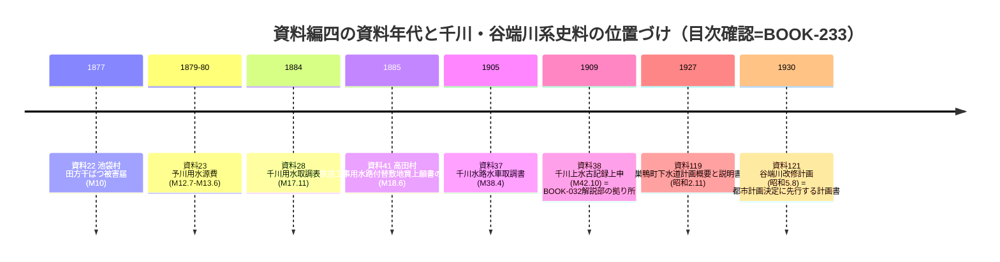

# 第249回定期調査ノート（2026-11-22）: 解説部引用書誌2点の確定（今川氏と観泉寺・豊島区史資料編四）・馬橋村史・中嶌年報論文2点

第248回で解説部（BOOK-032 pp.138-141）から拾得した新書誌候補2点（『今川氏と観泉寺』所収の配当書・『豊島区史 資料編』4）の書誌を確定し、さらに[BLOG-256](sources/blogs/BLOG-256.md)の参考文献1969（馬橋村史）の所在特定と、[PAP-065](sources/papers/PAP-065.md)と同一著者陣の中嶌一彦らの年報論文2点の所在を新規特定した。新規ソースファイルは[BOOK-231](sources/books/BOOK-231.md)・[BOOK-232](sources/books/BOOK-232.md)・[BOOK-233](sources/books/BOOK-233.md)・[PAP-098](sources/papers/PAP-098.md)・[PAP-099](sources/papers/PAP-099.md)の5点（INDEX 1,514→1,519 items）。第248回課題②「解説部の引用書誌2点の直接確認」のうち書誌確定までは解決（本文判読は次回以降）。

## 1. 手法〔確認・2026-11-22・ai〕

- NDL Search SRU（`ndlsearch.ndl.go.jp/api/sru`・`operation=searchRetrieve`）でタイトル・著者・件名・JPNO等の書誌レコードを取得。『今川氏と観泉寺』・『馬橋村史』の2点はこれで確定した。
- 『豊島区史 資料編 四』はADEAC「としまひすとりぃ」の目録詳細頁（mp120040）と目次ファイル `https://adeac.jp/toshima-history/top/topg/06kikankushi/tosimas4.html` を直接GETし、全資料項目の配信頁つきリストを取得（本文画像ではなく目次頁から頁特定まで）。
- NDL 雑誌記事索引（`ndlsearch.ndl.go.jp/api/sru`・medialogical記事単位）で著者名掃引により、中嶌一彦らの年報論文2点の書誌を確定（本文はtmpc.or.jpの年報PDF所在を確認したが当環境からは遮断）。
- **ADEAC横断検索のPostBack POSTは全フォーム構成でHTTP 500を返し遮断**（第238回・第247回手法が今回合は不成立）。ただし個別目録・目次頁のGETは常に有効であり、上記の豊島区史目次取得などはこれで補った。

## 2. 主要成果（詳細は各ソースファイルの第249回追記を参照）

1. **BOOK-231『今川氏と観泉寺』（書誌確認）**: 観泉寺史編纂刊行会編・吉川弘文館・東京・1974・832p 図 22cm・NDC288.1・R100000002-I000001220995・請求記号GB43-64・JPNO73012024・件名「観泉寺（東京都杉並区）／今川（氏）」・NDL・都立中央のほか宮城・静岡県立・静岡市立・名古屋市・滋賀・大阪府立・和歌山県立等に蔵本・NDLテキストデータ(BN02457975)あり＝BOOK-032解説部が引く『千川用水南六ヶ村樋口寸法反別配当書』の**収録書**＝千川用水南六ヶ村側文書の「今川家・観泉寺系」という新所蔵系統。
2. **BOOK-233『豊島区史 資料編 四』（目次・頁の直接確認・本文画像は未判読）**: 豊島区史編纂委員会・昭和56年6月・1485p・ADEAC「としまひすとりぃ」目録mp120040・刊行画像形式・二次利用不可。千川系6資料（資料23「予川用水源費」M12.7-M13.6=頁118〔目次表記ママ〕・資料28「千川用水取調表」M17.11=頁131・資料37「千川水路水車取調書」M38.4=頁190・資料38「千川上水古記録上申」M42.10=頁191＝BOOK-032解説部の高札16・橋梁7・水番3文言の**出典資料の所在特定**・資料41「高田村鉄道工事用水路付替敷地買上願書の下戻願」M18.6=頁195・資料22「池袋村田方干ばつ被害届」M10=頁113）＋水車5資料30-33/36（頁134-137・189）＋谷端川系（資料121「谷端川改修計画」昭和5年8月=頁849＝1930年8月時点の改修計画書が豊島区に現存・資料119「巣鴨町下水道計画概要と説明書」昭和2年11月=頁840）＋弦巻川上流域（資料35「雑司が谷柳下家日記」M29-32=頁146-188・資料62「柳下家大福帳(抄)」M7-8=頁242・資料63-66「柳下家領収(抄)」M32-33=頁253ほか＝GAZ-048/GAZ-072の雑士「柳下若狹」の柳下家と家名を同じくする雑司ヶ谷の家の明治期帳簿群・家系同一性は本文未見で断定しない）。
3. **BOOK-232『武蔵国多摩郡馬橋村史 : 近世の馬橋村』（書誌確認）**: 1969.10・682p 図版 22cm・R100000002-I000001210057・GC67-13・JPNO73001086・NDL・都立中央・神奈川県立蔵・別レコードR100000002-I000001962082（GC67-E64・「付（図3枚 袋入）」）＝BLOG-256の参考文献の実物所在特定＝天保新堀用水（石橋用水・広場堰・弁天池）系の村的通史の一次確認候補。付図3枚の内容（馬橋村絵図類か否か）は未確認。
4. **PAP-098（所在のみ）**: 中嶌一彦・小作好明・高崎忠勝・石原成幸「神田川水系桃園川の下水道移管並びに課題への対応経緯」『東京都土木技術支援・人材育成センター年報 2024』pp.23-32（Z43-1380・R000000004-I033912952・ISSN 1884-040X）＝[PAP-065](sources/papers/PAP-065.md)と同一著者陣の都庁内部誌版。tmpc.or.jp `www.tmpc.or.jp/.../000071334.pdf` に公開所在（当環境から遮断・本文未取得）。
5. **PAP-099（所在のみ）**: 中嶌一彦・枝澤知樹・小作好明・高崎忠勝・石原成幸「東京都管理河川の特別区移管と管理変遷」『同センター年報 2023』pp.25-38（R000000004-I033241680）。冒頭表断片「桃園川 準 4.40 準用解除 廃止」が検索インデックスで確認（PAP-065の4.40kmと一致）。tmpc.or.jp `.../000065000.pdf` に公開所在（同遮断）。

## 3. 今回確定した書誌の相対位置（Mermaid年表）

## 4. 監視系の結果（2026-11-22）

- kanzyou7（環七地下調節池WHAT'S NEW）: 2026/11/20のまま**不変**。
- news/web横断クエリ: **noiseのみ**（新規収録なし）。日経クロステック2026-11-02記事・環七インフラツアー2027年1月告知はGOV-291/GOV-149既出。
- musashi.repo.nii（000）・nabunken（000）不通継続・NDL lab 1900493は500継続。
- 千川養水/千川水路/千川善蔵/須田家文書のNDLエイリアス掃引は既存GOV-110等と全件重複。subject=="須田家文書"は常陸国須田家（学習院大学史料館）で杉並区須田家文書と無関係（陰性記録）。
- **開札2026-12-02（環七調節池広域整備検討その2〔GOV-148系〕）はまだ未来＝第250回最優先**。

## 5. 制限・次回課題

- BOOK-231（『今川氏と観泉寺』）は書誌確認止まり。配当書該当頁の同定はNDLオンライン請求・館内での現物確認が必要（NDLテキストデータありでの遠隔判読可否も未確認）。
- BOOK-233は目次・配信頁の確認止まり。本文画像の判読（特に資料121「谷端川改修計画」昭和5年8月・資料38「千川上水古記録上申」M42.10の本文・柳下家帳簿群の家名の連続性）が本命の次回課題。
- PAP-098・PAP-099は2点とも所在のみ。tmpc年報PDFの本文取得が次回課題（当環境からの直接GET遮断の回避策検討）。
- ADEAC横断検索のPostBack POST 500遮断の回復監視と、`xml/data.xml` 直接GET手法（第248回・BOOK-032で確立）の他ADEACコレクション（としまひすとりぃ＝BOOK-233等）への一般化検証を継続。
- BOOK-032原画像照合（humanタスク）は継続。
