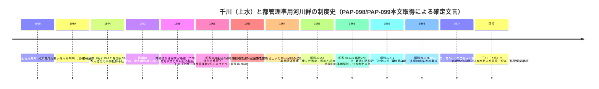

# 第250回定期調査ノート（2026-11-22）: tmpc年報2論文の本文取得と関口1964水利科学の新規収録

第249回で書誌のみ確定だった中嶌一彦らの年報論文2点（[PAP-098](sources/papers/PAP-098.md)・[PAP-099](sources/papers/PAP-099.md)）の**本文PDF取得・全文抽出**に成功し、千川（上水）の法的地位（昭和36年移管保留河川・現行法定外公共物・延長16,782m）を都庁内部誌の本文で一次確定した。さらに[PAP-098](sources/papers/PAP-098.md)注5の引用元である関口助之丞（1964）『水利科学』論文をJ-STAGEから特定し[PAP-100](sources/papers/PAP-100.md)として新規収録した（本文PDF取得済み・画像形式でhuman目視待ち）。対照表に3行（千川の法制度行・宮園橋・逆川=出井川の通称）を新設。

## 1. 手法〔確認・2026-11-22・ai〕

- **tmpc.or.jp年報PDFの取得**: 直URLは当環境から遮断（接続タイムアウト）だが、**Wayback Machineの`id_`（オリジナル生データ）スナップショット経由で取得可能**（`web.archive.org/web/<日時>id_/<元URL>`）。000071334.pdf=nenpo2024（PAP-098側・10頁）・000065000.pdf=nenpo2023（PAP-099側・14頁）を取得。
- **自作PDF抽出器**（純Python・外部ライブラリなし）: ToUnicode CMapを展開し1バイト/2バイトコード幅のフォント混在に対応した版で、両論文の全本文・数値欄（管理延長一覧・移管保留9河川延長表）を復元。2段組表の行対応は機械確定不能のため、表の列帰属は原PDF目視確認前提と明記して引用した。
- **関口1964の特定**: NDL Search記事索引（R000000004-I774192）とJ-STAGE記事頁（DOI [10.20820/suirikagaku.8.3_54](https://doi.org/10.20820/suirikagaku.8.3_54)）の双方で書誌確定。本文PDF（19頁）を取得したが**画像形式（テキスト層なし）で機械判読不能**＝文言の引用はhuman目視待ち（引用文言はPAP-098注5側の中嶌らによる引用で確認済み）。
- 監視系（news/web横断8クエリ・recency14日）は全て陰性（noise/既知のみ）。kanzyou7（環七地下調節池WHAT'S NEW）は2026/11/20のまま不変（当環境から取得不能）。**開札2026-12-02（環七調節池広域整備検討その2）はまだ未来＝第251回最優先へ順送り**。ADEAC横断PostBack500遮断の再試験は本回未実施（順送り）。

## 2. 主要成果（詳細は各ソースファイルの第250回追記を参照）

1. **PAP-099（本文取得・status直接確認へ格上げ）**: ①**昭和36（1961）年4月1日の特別区移管の際の「移管保留河川」9河川**（貴船堀・旧呑川・北前堀・南前堀・六間堀〔大田区〕・谷沢川・江古田川〔中野区〕・神谷堀〔北区〕・千川〔上水〕〔練馬区ほか〕）と**延長表**（千川16,782m/未改修8,090m・9河川計29,421m/14,647m）、②**千川（上水）はS39旧法整理→S40新河川法施行→S54→現行を通じて法定河川化されず公有水面（法定外公共物）の都管理として現存**（現況表「国有財産（法定外公共物）：地元区移管が保留／財産・機能面ともに東京都管理」）＝[BLOG-129](sources/blogs/BLOG-129.md)の都議会回答の本文裏付け、③**旧河川法準用河川認定規準の原文**（流域五方里・流路五里・本堤一里・水害区域百五十町歩等）と**公共溝渠認定標準「幅1.5m未満の在来下水路」**、④**S40.2.4の準用除外基準**（①埋立施行中/計画中②河川と認めがたいもの）と新法移行の政令番号（政令43号・法律168号・政令50号）、⑤**管理延長一覧**（神田川4.38→25.48・江戸川2.21・神田上水18.89・**妙正寺川9.05〔S39→現行で不変〕**・江古田川1.64〔都告619号・下徳田橋〜妙正寺川合流点〕・善福寺川8.84・桃園川4.40準用解除・石神井川21.72/21.60/25.20・田柄川4.91廃止・出井川3.05廃止〔通称逆川〕・前谷津川3.80廃止）、⑥準用認定の制度動機＝**緊急失業対策法（S24法89）の失対事業の要件対象化**（S30.7.26労働・建設・運輸次官通達・S31申請時通達原文）、⑦出井川・前谷津川・雑色運河の**区移管→遺漏→事後の準用再認定**という手続の齟齬の実態、⑧大田区6河川のS54.11.26二級河川廃止先例。
2. **PAP-098（本文取得・status直接確認へ格上げ）**: ①**神田川のS39呼称区分**（神田川4.38＋江戸川2.21＋神田上水18.89、江戸川＝船河原橋〜水門〔文京区関口台町〕）、②**昭和19.6.21「許可認可の臨時措置に関する件依命通牒」（発国第38号）**＝準用河川認定の事前指揮手続のrepo初出法史料、③**準用指定区間の地番**（左岸 杉並区馬橋3-386-1／右岸 同3-897-1〜中野区川添町1-1/1-24）、④**36答申14河川の整備表**と「重複管理vs準用解除・河川廃止」の判別枠組み、⑤都告279の詳細文言と公有水面の国有普通財産化、⑥桃園川の**初段2.1km（神田川合流点〜宮園橋〔桃園橋上流・旧中野区役所前〕）の事実上の分割移管**、⑦**重複管理区間は開渠復元への法的制約が少ない**という復元論点、⑧表-4の建告794（L=3,876m 中央線交差点〜東雲橋下流 W=5-6m）・建告1092・建告74の文言。
3. **PAP-100（新規収録・repo初出書誌）**: 関口助之丞「武蔵野を流れる上水と中小河川の改修計画」『水利科学』8巻3号 pp.54-72（水利科学研究所・1964-08-01・ISSN 0039-4858・DOI [10.20820/suirikagaku.8.3_54](https://doi.org/10.20820/suirikagaku.8.3_54)・NDL R000000004-I774192・J-STAGEインターネット公開）＝**36答申直後・新河川法施行直前の1964年に水利技術者が武蔵野の上水・中小河川の改修計画を総説した同時代史料**。本文PDF（画像19頁）取得済み・判読human目視待ち。
4. **対照表3行新設**: 千川（上水）〔昭和36年移管保留河川〕（法制度行）・宮園橋（桃園川・旧中野区役所前）・逆川（出井川の通称）。

## 3. 千川・準用河川系の制度史タイムライン（本回確定文言によるMermaid）

備考: 上記の年月日・番号は両論文の抽出テキスト上の文言に基づく（一字一句の正は原PDF目視確認前提）。桃園川の1965年都告279・1966年建告74（PAP-098）と、旧準用河川の新法移行政令群（PAP-099）が接続する。

## 4. 制限・次回課題

- **開札2026-12-02（環七調節池広域整備検討その2〔GOV-148系〕）の入札結果確認＝第251回最優先**。
- 関口1964（PAP-100）本文画像PDFのhuman目視判読（千川上水・桃園川の記載の有無からの確認が本命）。
- PAP-098原PDF目視: 表-4の土地坪数の桁・建告794（L=3,876m）の行対応・東雲橋の位置・図-1/2/5の判読。PAP-099原PDF目視: 現況表の行・列対応（S52:一級廃止の帰属河川）・大田区6河川の全河川名・昭和36年移管の告示番号。
- ADEAC横断検索PostBack500遮断の回復試験（第247-249回からの順送り）。
- 河川法施行法（昭和39年法律168号）・昭和40年政令43号等の一次文言の独立確認（PAP-099の引用文言の対校）。

