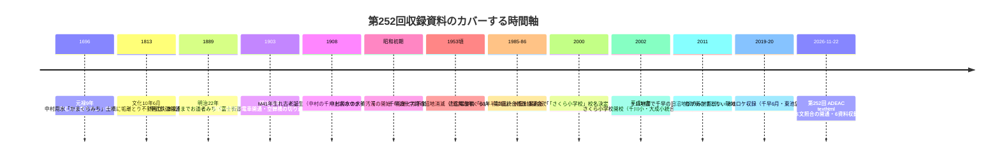

# 2026-11-22（第252回）・ADEAC本文検索PostBack302の開通とわが街ひすとりぃ3ロケ・保谷市史千川用水文言・桜堤校名特定の新規収録

## 概要

第252回は、第251回で残した「本文検索ヒットの本文頁特定（PostBack302 Location 捕捉）」を実装して **ADEAC texthtml 本文の原典照合が可能になった**回。としまひすとりぃ「わが街ひすとりぃ」現地ロケ編（千早・北大塚・東池袋）の全文テキスト3件（GOV-497〜499）・保谷市史通史編2の「千川用水保全の負担」目次項目（BOOK-238）・平成ひすとりぃの「さくら小学校」校名選定理由（BOOK-239）を新規収録し、第251回スニペット止まりだった『中むらの昔』その一/その二（BOOK-236/237）を原典照合のうえ格上げした。INDEX 1,525→1,530 items。

## 最重要の成果

### ① ADEAC texthtml 形式 URL の確立と PostBack302 による本文取得〔技術面の主成果〕

- 第251回課題②「本文検索ヒットの本文頁特定」を `resolve_text.py`（wordごとに Session／ViewState を採り直す仕様）で解決。テキスト一覧公開資料の本文頁が `texthtml/<機関>/<複合ID or mpXXXX>/htXXXXXXX` 形式で取得できることを確立した（例: `https://adeac.jp/toshima-history/texthtml/d000000/mp00500101/ht420150`＝千早ロケ）。
- これにより第251回の「スニペット確認（要原典照合）」資料の**原典照合が一括で可能**になった。第251回の「文言は要原典照合」の縛りから「直接確認（texthtml本文取得）」への格上げが進む。

### ② わが街ひすとりぃ現地ロケ編3件（GOV-497〜499）〔repo初出・オーラルヒストリー群の拡大〕

- ADEACとしまひすとりぃ（toshima-history）の映像系オーラルヒストリー「**わが街ひすとりぃ 現地ロケ編**」の全文テキストが texthtml で公開されていることを確認（映像は二次利用不可・全文テキストはCC BY）。第251回保留の千早・北大塚・東池袋ロケ3件を収録。
- **GOV-497（千早ロケ・mp00001510・収録2019-06-26・製作2019-10・14分53秒）**: ①「**上水の余り水と弁天様の湧き水。今でも出てるって噂だけど**」＝千川上水旧通水区域（千早）の湧水現存の口碑（BLOG-067の千早公園残存湧水観察と対照）②千早の十字路が「**昭和28年ぐらいまではまだ沼地**」＋3.11で沼地部のみ地盤弱い＝低湿地記憶と被害の地点差の証言 ③山手通り拡幅で「**谷端川との間にもう一本道があった…それを潰して**」＝谷端川並行路消滅の証言 ④千早公園地下防火水槽7〜8割・雪で位置特定。
- **GOV-498（北大塚ロケ・mp00002010・収録2019-12-12・製作2020-03・14分10秒）**: ①**谷端川を舞台とする民話『うなぎの道あんない』**（落ち武者がうなぎに案内されて谷端川を渡る・矢嶋家の「うなぎを食べない」しきたり・柳川昌子の紙芝居化・道灌時代＝1400年代の成立うたい）＝**谷端川の民話の口述全文が区の聴取記録として保存されている repo 初出の系統** ②空蝉橋＝明治36年池袋―田端間電車開通の切り通し架橋説話＋出世稲荷「空蝉の松」の明治天皇行幸譚。
- **GOV-499（東池袋ロケ・mp00001210・収録2019-04-24・製作2019-07・14分31秒）**: ①辻広場の細い小川「**これは下水管に繋がってる**」「**大神側の（方に繋がってる）**」＝水窪川の水景意匠の流水が下水管接続である口述 ②案内板「**水窪川 小さな川が流れていた 後世に伝える**」＋「**これが1986年**」 ③「**60年半ば頃かな、この辻広場ができたのは**」＝BLOG-106/109/110系の1986年辻広場整備説の一次口述側補強。
- 第251回陰性整理で「GOV-128〜132〔としまひすとりぃ オーラルヒストリー群〕の未収録兄弟レコード」としていた現地ロケ編側の本格収録。谷端川・千川上水・水窪川の3水系すべてに一次聴取文言が入った。

### ③ 保谷市史通史編2の「千川用水保全の負担」目次項目（BOOK-238）〔repo初出〕

- 西東京市デジタルアーカイブ（nishitokyo-lib）の保谷市史通史編2（1988・676p・画像ビューアのみで本文テキストなし）の目次（pagecode=462）に、「四 近世後期の保谷 第一章 産業の発達と生活の変化 第三節 農民の負担」内の**「千川用水保全の負担」項目**（「玉川上水保全の負担」と並列）を確認。
- 千川用水の維持・保全に村方負担があったことを独立目次項目として立てた自治体史＝**千川上水を普請・賦課の対象として捉える制度史系の文献**として repo 初出。本文（画像）の文言確認は次回へ。

### ④ 平成ひすとりぃ「さくら小学校」校名選定理由の特定（BOOK-239）〔第251回保留の解決・repo初出〕

- 豊島区「としまひすとりぃ: 平成ひすとりぃ」第2節第2項（mp101000・2023公開・CC BY）の texthtml 本文を取得し、**千川小学校・大成小学校の統合新校「さくら小学校」の校名選定理由**を直接確認: 「**両校の所在がかつての千川上水の桜堤の地域にあり、その当時の桜並木のイメージが地域住民に根付いていること**」（2000年6月統合推進協議会設置→同年10月第3回協議会で決定→2002年4月開校・児童361名）。
- 第251回で「校名2校が特定できず保留」だった桜堤校名文言が「さくら小学校」に特定解決〔BLOG-131の千川上水まち歩き「現さくら小学校」記述と対応〕。**千川上水の桜堤の記憶が2000年代の公式な校名選定に採用された事実**＝桜堤景観記録（GOV-341・BOOK-180）の現代的継承。

### ⑤ 『中むらの昔』その一/その二の原典照合と格上げ（BOOK-236/237 追記）〔repo初出文言の大量確定〕

- 第251回スニペット止まりだった両書の本文頁（「馬と追はぎ」「垢離とり不動㉘」「農村であった頃」章）を texthtml で取得し、status を「直接確認（texthtml本文取得）」に格上げ。
- **新規確定文言**（その一）: 「**帰り道、冷酒を一ぱいひっかけて、目白の坂を通り江古田近くまで戻る頃は…すいどっぱた（千川上水）なども恐ろしく淋しい道でした**」＋**父親が追い剥ぎに襲われ馬にしがみついて逃げた譚**＝千川上水沿道が荷馬車の流通路であり夜間の追い剥ぎ危険地だった生活史証言。
- **新規確定文言**（その二）: ①垢離とり不動の建立銘は本文で「**文化十年六月（一八一二）**」＝**文化10年（1813）と1812の原典内表記対立**（両記） ②不動盗難→品川波止場発見→大八車迎えの伝承 ③**「中村用水の水質汚濁は、昭和初期頃より始まった爲、水の清らかな取水口近くに移された…又、元の場所に還り**」＝中村用水の水質史・社殿移転史 ④**垢離とり講（富士・大山・榛名・三ッ峰・御嶽の5講）の水垢離儀礼拠点**・お道者みち（富士街道）・明治22年甲武鉄道開通まで主要道 ⑤「**この上水から頂いた細い流れ（子供たちが跳び越えられる位の）が中村用水**」＋五ケ所程の流【洗】い場・田にし・しじみ・だぼはぜ・小さなえび・かわにな・夏の平家螢・減水時のウグイ群と鰻とり（**M41年〔1908〕生れ古老の話と本文明記**）＝**中村用水の規模・生物相・利用実態の一次文言**。

### ⑥ 対照表の更新

- 「うなぎの道あんない」（谷端川の民話名）・「垢離とり不動」・「さくら小学校」・「空蝉橋」の4行を新設、「すいどっぱた」「中村用水」行に第252回追記（原典照合済みと新文言）。

## 監視系

- kanzyou7 WHAT'S NEW＝**DNS解決不能**（先回200取得→今回名前解決失敗。継続監視）。
- musashi.repo.nii.ac.jp＝000不通・nabunken＝000不通・NDL lab 1900493＝500／fulltext API＝403 継続。都建設局＝403。
- news/web 監視8クエリ＝noiseのみ（環七インフラツアー2027再配信は第120/123/166/248回記録済み＝既知）。
- **開札2026-12-02（環七調節池広域整備検討その2・GOV-148系）はまだ未来＝第253回最優先へ順送り**。

## 課題⑤（e-Gov法令一次文言）

- 本回は実施せず（ADEAC本文照合に実行時間を充当）。SPA／API障害の状況は第251回記録のまま。第252回で順送り分と合わせて第253回以降の課題。

## ADEAC技術メモ（第252回）

1. **texthtml 本文頁の取得**: `resolve_text.py` は **word（検索語）ごとに Session／ViewState を採り直す仕様**で動かす（同一 Session の使い回しは ViewState 不整合で失敗する）。PostBack の 302 Location から `/texthtml/...htXXXXXXX` URL を捕捉。
2. texthtml URL の番号系統: `https://adeac.jp/toshima-history/texthtml/d000000/mp00500101/htXXXXXXX`（d000000＝機関別連番・ht＋6桁＝各ロケ編頁）と `.../texthtml/d100010/mp101000/ht0102020`（平成ひすとりぃ第2節第2項）の2系統を確認。目録→テキスト一覧→本文頁の遷移は table-of-contents 頁経由の PostBack。
3. わが街ひすとりぃ現地ロケ編の書誌は目録詳細頁（catalog/mpXXXXXXX）で収録日・製作年・出演者を確認できる（mp00001510千早・mp00002010北大塚〔作成者欄「北本建夫」/解題欄「北村建夫」の表記対立〕・mp00001210東池袋）。
4. **小平市史（BOOK-234/235）の本文頁原典照合は本回は未実施**（対象は kodaira-lib 側の texthtml 取得）＝第253回へ。

## 採番現況（第252回使用分）

- **GOV-497〜499・BOOK-238〜239 を使用**（GAZ-186・MAP-209・ORG-038・BLOG-264・PAP-101・LOST-006 は引き続き不使用）。
- 次回（第253回）の新規採番は **GOV-500〜・BOOK-240〜・GAZ-186・MAP-209・ORG-038・BLOG-264・PAP-101・LOST-006**（push前に INDEX.md と該当 dir 実測で再確認）。

## 陰性・見送り

- news/web監視8クエリ＝環七インフラツアー既知再配信のみで新規なし。
- kanzyou7（DNS解決不能）・musashi.repo.nii（000）・nabunken（000）・NDL lab 1900493（500）・都建設局（403）＝継続不通・閲覧不能の陰性記録。
- 保谷市史通史編2の「千川用水保全の負担」は**本文が画像公開のみ**のため文言未確認（書誌・目次確認の status で収録・本文照合は第253回）。
- 東池袋ロケのその他の文言（日暮里・巣鴨プリズン跡地・美久仁小路・旧庁舎跡地等）＝本テーマから外れるため個別採録せず（GOV-499内にcontextとして残す）。
- 北大塚ロケの子安天満宮の「お社500年・1500年頃には建ってます」＝社殿年代の口碑は本回は水系文言ではないため独立採録せず（GOV-498意義に言及のみ）。

## 次回（第253回）課題

1. **開札2026-12-02 の入札結果確認（GOV-148系・最優先）**。
2. **小平市史（BOOK-234/235）本文頁の原典照合**（甘薯試作・千川家再興運動・川崎定孝桜植樹・境水衛所水死体の4文言候補）。
3. 保谷市史通史編2「千川用水保全の負担」の本文（画像ビューア pagecode系）の文言確認。
4. 平成ひすとりぃの残章走査（第2節第2項以外に千川上水・谷端川関連の記述の有無）。
5. 『うなぎの道あんない』紙芝居・柳川昌子整理資料の所在（巣鴨図書館の親子読書会）と、民話の矢嶋家と GOV-128 の矢島勝昭（谷端川橋名連載）の関係確認。
6. 空蝉橋の明治36年架橋説（GOV-498口述）の文書対校（橋梁文献・都史料）。
7. 水窪川案内板の現地文言・年的代表示（1986年）の直接確認〔現地観察必要・本repo実行では文書のみ〕。
8. e-Gov法令一次文言（河川法施行法・政令43号）の対校（第251回からの継続課題）。

## タイムライン（本回の資料的時間軸）

## 関連

- [GOV-497](sources/gov/GOV-497.md)・[GOV-498](sources/gov/GOV-498.md)・[GOV-499](sources/gov/GOV-499.md)（わが街ひすとりぃ3ロケ）
- [BOOK-238](sources/books/BOOK-238.md)（保谷市史通史編2）・[BOOK-239](sources/books/BOOK-239.md)（平成ひすとりぃ・さくら小学校）
- [BOOK-236](sources/books/BOOK-236.md)・[BOOK-237](sources/books/BOOK-237.md)（中むらの昔・格上げ）
- [対照表](地名・河川名対照表.md)（うなぎの道あんない・垢離とり不動・さくら小学校・空蝉橋の4行新設）
- [前回ノート](2026-11-22（第251回）・ADEAC本文検索の開通と小平市史3編・中むらの昔2冊・谷端川緑道計画文言の新規収録.md)
