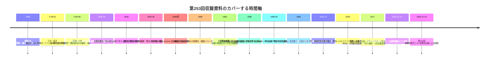

# 2026-11-22（第253回）・貫井池資料と区議会あいさつ157会期全走査・GLOBAL RING丸池文言・小平市史本文照合・川施餓鬼供養塔文言の新規収録

## 概要

第253回は、第252回並走側実行が本体に反映できずに残していた成果（貫井池資料・中むらの昔川施餓鬼章・平成ひすとりぃ GLOBAL RING・小平市史本文頁・御伝馬方旧記の所在情報の6案件）を、**原典（texthtml本文）をこの実行内で取り直して文言ごと照合したうえで回収**した回。あわせて自らの掃引として**豊島区区議会定例会招集あいさつ157会期（昭和62年〜令和7年第四回・2025-11-12）の全文走査**と**平成ひすとりぃ本文30頁の残章走査**を行い、谷端川緑道整備の定量文言群（全体約2,200m・残り270m/600m・追加経費6,800万円）・千川上水公園沈澱池復元（1992）・弦巻川水源「丸池」のデザインモチーフ文言（2017）・中央環状新宿線高架計画 vs 千川中学校（1988〜92）・千川小跡地の特養「千川の杜」・「せんかわみんなの家」等を新規収録した。

新規採番4件（[BOOK-240](sources/books/BOOK-240.md)〜[BOOK-243](sources/books/BOOK-243.md)）＋既存3件の大幅追記（[GOV-496](sources/gov/GOV-496.md)・[BOOK-237](sources/books/BOOK-237.md)・[BOOK-234](sources/books/BOOK-234.md)）＋対照表5行新設。

## 最重要の成果

### ① 葛城明彦『郷土史研究ノート・"幻"の「貫井池」と「富士見台ファミリーランド」』（BOOK-240新規）〔第252回並走分の回収・貫井池の総合資料の原典照合〕

- 練馬区立貫井図書館ADEAC（nerima-nukui-lib・mp000030-100020・2025年4月制作・教育目的の利用可・テキスト公開）の全20頁を取得・照合。
- **出頭（でがしら）**: 『東京府北豊島郡誌』（1918）「**池の中心出頭と称する個所を存するのみなり**」＋弘法大師の杖の泉の伝説・「貫井の地名もまた此より起こる」の一次文言。鷲頭文男氏聞き取り（2016-05-25・1932年生）＝最大水源は**貫井1-30の真ん中あたり**（ゴボゴボ湧水・温泉のような湯気）。関口信保氏談話＝貫井1-22付近・約1反歩・南の約百坪の出頭。
- **千川上水からの土管導水**: 「**高台の千川上水からの流れも少しあった。それは土管で流されていた。**」（鷲頭）＝**千川上水（高台側）と貫井池（低地側湧水池）の間の水の連鎖の一次証言**（敷設主・経路の第一次史料はなく断定しない）。
- **氾濫記憶**: 「**雨が降ると、貫井川や千川上水はすぐに氾濫していた。貫井川脇の家ではボートで２階から脱出**」「**大雨で水が溢れ、富士見台～中村橋間では西武線が不通**」「西武線・富士見台～中村橋間の**線路が宙吊り状態**」＝中流域低地の水害史の生活史記録（repo初出）。
- **呼称群**: 「**しまっぽり**」（下石神井上久保〜下久保・「しまちびっこ遊園地」下石神井2-35に名残）・「**ほりっこ**」（富士見台付近支流）・「**貫東川」「かんぴょう川」「かんちょう川**」（貫井池〜石神井川間・円光院「灌頂」関連説）・「**重殿山**」（じゅうどのやま・池の東側坂上）。**前回ノートの「しまっぱり」は原典照合で「しまっぽり」に訂正**。
- そのほか貫井池の旧称「溜井」説（江戸期絵図）、1958年頃の池消滅（ADEAC目録解説）、1968年頃の飯田百貨店側の流れの暗渠化、円光院の大根洗い桟橋（昭和20年代）、秋葉神社（1969年・飯田百貨店経営者の火伏せの神）、水天宮（明治期に円光院脇へ移転）。

### ② 区議会あいさつ157会期の全走査（GOV-496大幅追記）〔谷端川緑道の定量文言と千川・弦巻川の行政発言の定点系列〕

- レコード群範囲を「令和5年」から**「令和7年第四回（2025-11-12）」に訂正**（Index=157 ht全走査）。
- **谷端川緑道の定量文言〔repo初出〕**: 平成元年第1回（1989-02-23）「**全体計画約二千二百メートルのうち、昭和六十三年度末までに約半分を完了しており、平成元年度では残りのうち東橋以北の約二百七十メートルを整備**」＋平成元年第3回（1989-09-28）「**谷端川緑道整備計画期間を二か年短縮し、平成二年度で完了するための追加経費約六千八百万円**」＋平成2年第1回（1990-02-22）「**十カ年計画を二年短縮して、平成二年度中に完成させるべく、残り約六百メートルの整備経費を計上**」＝**昭和58年度開始→1990年度完了（2年前倒し）の年代・延長・経費の通時系列が確立**（1991.4.1全線開通〔GOV-106〕と整合）。
- **千川系**: 昭和63年第1回（1988-02-25）「**千川児童遊園の一部をありし日の千川上水の復活をイメージした親水公園**に整備」＋平成4年第1回（1992）「**歴史的文化遺産でもあります千川上水**につきまして、千川児童遊園内の**清流復活**とあわせ**千川上水公園沈澱池の復元に着手**」（区制施行六十周年）＋平成11年第1回（1999）「**西武鉄道の地下を通す千川立体横断施設**…平成十二年度には歩行者の利用」。
- **千川小跡地の転用系列**: 平成22年第1回（2010・特養有力候補として浮上）→平成24年第2回（2012・**49事業者**参加の公募説明会）→平成26年第4回（2014・**特別養護老人ホーム「千川の杜」は平成27年4月1日の開設に向け**）＝「千川の杜」の告知文言（区史側の所在=[BOOK-243]）。
- **丸池モチーフ文言**: 平成29年第3回（2017年9月）「**かつてあった弦巻川の水源、「丸池」をデザインモチーフとしたリング状の屋根**…事業者は三菱地所設計と…ランドスケープ・プラスの共同企業体」＝[BOOK-242]（区史本文）と対になる**議会側の丸池モチーフ文言の二重記録**。
- **令和期**: 令和7年第四回（2025-11-12）公園再構築モデル地区「高田」「巣鴨・西巣鴨」「高松・要町・千川」＋「ボール遊びや親水施設が少ない」のヒアリング文言。**令和期（2019-25）の走査では谷端川・水窪川の直接文言はゼロ・弦巻川は2017年の1件のみ**＝旧河川名が区長スピーチから退いた負の観察として記録。

### ③ GLOBAL RINGと平成ひすとりぃ残章（BOOK-242・BOOK-243新規）

- **BOOK-242**: 第4章第2節（ht0402030）＝2017年5月池袋西口公園整備検討会設置→プロポーザル公募（8者応募）→7月三菱地所設計+ランドスケープ・プラスJV選定→「**池袋の地名の由来とも言われるこの地にかつてあった弦巻川の水源「丸池」をモチーフにしたリング状の屋根（GLOBAL RING）**」→12月基本計画。**丸池の公式デザイン採用の区史本文文言**。
- **BOOK-243**: 残章掃引群6頁＝①**中央環状新宿線高架計画 vs 千川中学校**（1988陳情2件採択・請願4件・聖パトリック幼稚園・要町交差点換気塔・1992大部分地下化の変更案）＝千川・要町地区の環境史・土地利用史の一次記録（repo初出）②**谷端川プロムナード構想1988**（ht0302020・README既出文言の資料ファイル化＝SSOT補完）③旧千川小の文化活用（ANJ・芸術家と子どもたち・2002〜03ワークショップ・2003アート夏まつり＠旧千川小）④「**せんかわみんなの家**」（要町3-54-8・定員105名）と特養「**千川の杜**」（**要町3-54-16**・平成27年4月開設・216名分増床・千川小跡地と旧中央図書館跡地の2か所）＝千川地名を冠した施設群の所在（repo初出）。

### ④ 『中むらの昔 その二』川施餓鬼章の照合（BOOK-237追記）

- ht000250（15頁）の本文取得で「**中新井との境とよ口近くに、川施餓鬼供養塔が建っていました**」の全文言を確定＝**「とよ口」という中村・中新井境の地名（音写）が新たに一次確認**＋塔の現位置（**南蔵院墓地入り口近くに移設**・地蔵様と共に）・地蔵様（破風屋根付角柱・造立年不明・無数の傷跡）の記録。千川の水死人馬の供養とその石造物の位置・目的・移設史の一次文言が確定した。

### ⑤ 小平市史近世編の本文照合（BOOK-234格上げ）

- ht000570・ht002910・ht000330の3頁本文取得で第251回のスニペット文言を格上げ。
- **桜植樹（ht000570）〔repo初出の重要文言〕**: 『調布日記』（1808）「**本数一万株小川村の地内より千川上水の口まで六十町の間、両岸に植そめて、延享の頃までは年々に御植つぎありし**」＋『向岡閑話』（1809）＋『東都近郊図』（1825）「**上水の両岸五十余町ノ間、桜樹数百株アリ**」＝**桜並木の下端が千川上水取水口に一致する距離文言（六十町）**。「享保中」（向岡閑話）と「元文年中〜延享」（調布日記・東都近郊図）の年代指定の揺れも年代論の対校材料。
- **甘薯試作（ht002910）**: 天明2年関前新田の水番所脇で試作・「**相応ニ出来仕り候**」（史料集19-30頁）・天明3・4年「**甚だ不出来**」（同33頁）＝水番所の実務と支出の一次文言。
- **小川分水（ht000330）**: 明暦2年（1656）6〜10月頃の工期推定・開発人小川九郎兵衛「**九郎兵衛入用をもって取り立て**」（享保16年代官尋・史料集24）・「**樋口一尺四方の分水**」＝千川上水取入口の小川村側開発史の本文確定版。

### ⑥ 対照表5行新設

- 「しまっぽり」（訂正を含む）・「ほりっこ」・「貫東川・かんぴょう川・かんちょう川」・「重殿山」・「出頭（でがしら）」の5行を地名表尾に新設（いずれも貫井川・貫井池系＝石神井川水系の隣接呼称だが、千川上水中流域南側の湧水域の呼称として四河川研究の水文学的対照資料）。

## 監視系

- kanzyou7（DNS解決不能）・musashi.repo.nii（接続失敗）は今回も不通。nabunken 113630はJSシェルのみ・NDL lab 1900493はJS描画で本文取得不可（いずれも継続監視）。日経クロステック「排水強化進む都市」は有料のまま（第214回保留継続）。
- news/web横断: 四河川関連の新報道なし。**環七調節池広域整備検討（その2）の開札2026-12-02はまだ未来**＝第254回以降の最優先課題。
- 朝日本田創インタビューは有料のため見送り（既存どおり）。

## 技術メモ（第253回）

- **ADEAC texthtmlのURL形式**: `https://adeac.jp/<lib>/texthtml/<d番号>/<mpID>/htNNNNNNN`（catalog頁の`table-of-contents/<mp>/<d>`に目次Index.html（`data="htNNN"`属性の頁一覧）がある）。区議会あいざつ群は d400500・mp01000000・Index 157 ht。平成ひすとりぃは d100010・mp101000・本文30 ht全取得。
- **157会期全走査の方法**: Index.htmlから全ht番号を抽出→頁本文（.txt化）から「千川・谷端川・弦巻川・水窪川」で grep→該当頁とその前後を精読。自分は約35 htを本文取得した（保存は次回実行で消える可能性があるため、文言は資料ファイルに写した）。
- **貫井池資料（mp000030-100020）の本文は20頁**: ht000010〜ht000220（飛び番あり）。目次構造は章題が「☆」「◇」記号で始まるメモ書き形式。
- 対照表の新行は第252回と同じく「## 文学作品からの補足」直前の地名表尾に新設行として挿入（3列形式）。

## 採番現況（第253回使用分）

- 新規: **BOOK-240・BOOK-241・BOOK-242・BOOK-243**。INDEXは 1,530→**1,534 items** 想定（build.pyで再生成・要再確認）。
- 使用済み最大: GAZ-185・GOV-499・**BOOK-243**・MAP-208・ORG-037・BLOG-263・PAP-100・LOST-005。次回新規は GAZ-186・GOV-500・BOOK-244・MAP-209・ORG-038・BLOG-264・PAP-101・LOST-006から。

## 陰性・見送り

- 御伝馬方旧記（BOOK-241）は書誌の存在（CiNii BN03142200・132館）を確認したが、ADEAC岡山機関デジタル化の目録URL形式がこの実行では確定できず「所在のみ」で登録（「千川上水御用」目次項目は前回観察の知識継承・要再確認）。
- 小平市史の「千川家再興」「境水衛所水死体」の本文頁は目次走査では特定できず（本文検索PostBackの再構築が必要）＝次回課題。
- 保谷市史「千川用水保全の負担」本文（BOOK-238）は画像公開のみで今回も未照合。
- 平成ひすとりぃの未採録文言（バブル期の-hashi等）は千川・谷端川と直接関係しないため見送り。
- 令和期区議会スピーチの谷端川・水窪川文言ゼロ（陰性観察・本文検索の網羅性の限界は注記済み）。

## 次回（第254回）課題

1. **開札2026-12-02（環七調節池広域整備検討その2〔GOV-148系〕）の入札結果確認＝最優先**。
2. 御伝馬方旧記のADEAC目録の再取得と本文照合（「千川上水御用」の文言確定）。
3. 小平市史「千川家再興」・「境水衛所水死体」本文頁の特定（ADEAC本文検索PostBack再構築）。
4. BOOK-238（保谷市史）「千川用水保全の負担」の本文照合（画像ビューアの頁特定）。
5. 貫井池1958年消滅（ADEAC目録解説）の独立史料（練馬区の公報・行政資料）での対校。鷲頭証言の「土管」導水の第一次史料探索。
6. 池袋西口公園等整備基本計画（2017年12月・丸池モチーフの設計側一次資料）の入手可能性確認。
7. 監視系継続（kanzyou7・musashi.repo.nii・nabunken・NDL lab・news四河川クエリ）。

## タイムライン（本回の資料的時間軸）

## 関連

- [BOOK-240](sources/books/BOOK-240.md)（貫井池資料）・[BOOK-241](sources/books/BOOK-241.md)（御伝馬方旧記・所在のみ）・[BOOK-242](sources/books/BOOK-242.md)（GLOBAL RING・ht0402030）・[BOOK-243](sources/books/BOOK-243.md)（平成ひすとりぃ残章掃引）
- [GOV-496](sources/gov/GOV-496.md)（区議会あいさつ157会期群・大幅追記）・[BOOK-237](sources/books/BOOK-237.md)（川施餓鬼・とよ口・南蔵院墓地移設の追記）・[BOOK-234](sources/books/BOOK-234.md)（小平市史・本文照合3点の格上げ）
- [対照表](地名・河川名対照表.md)（しまっぽり・ほりっこ・貫東川・重殿山・出頭の5行新設）
- [前回ノート](2026-11-22（第252回）・ADEAC本文検索PostBack302の開通とわが街ひすとりぃ3ロケ・保谷市史千川用水文言・桜堤校名特定の新規収録.md)
