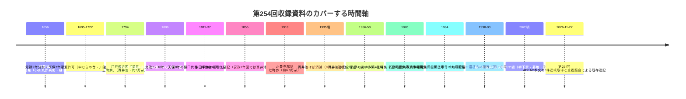

# 2026-11-22（第254回）・御伝馬方旧記目次文言・多摩のあゆみ第4号・雑司が谷ロケ編の新規収録と小平市史分水口普請・巻末聞き取り全文・貫井池面積変遷の照合

## 概要

第254回は、ADEAC系の本文テキスト取得を主軸に、①御伝馬方旧記の目次テキスト文言の確定（[BOOK-241](sources/books/BOOK-241.md)更新・p.813訂正）、②『多摩のあゆみ』第4号特集目次の新規収録（[BOOK-244](sources/books/BOOK-244.md)）と第34号特集目次の照合（[PAP-068](sources/papers/PAP-068.md)追記）、③雑司が谷第8回現地ロケ編全文テキストの新規収録（[GOV-500](sources/gov/GOV-500.md)）、④小平市史の本文頁の3件連続取得（近世編ht003630分水口普請・ht004830桜並木＝[BOOK-234](sources/books/BOOK-234.md)追記、地理・考古・民俗編ht004930岡田章・ht004940島村章＝[BOOK-235](sources/books/BOOK-235.md)格上げ）、⑤『中むらの昔』川浚いと川刈り章の全文照合（[BOOK-236](sources/books/BOOK-236.md)）、⑥保谷市史の目次テキスト頁の隣接項目メモ（[BOOK-238](sources/books/BOOK-238.md)追記）、⑦貫井池面積変遷頁の取得（[BOOK-240](sources/books/BOOK-240.md)追記）を行い、対照表3行（温井橋・小平水衛所・大堀）を新設した回。

**重複照合が機能した回でもある**: 冒頭候補だった小池陸子インタビュー（ht430020）は[GOV-128](sources/gov/GOV-128.md)として第83回収録済み、肥留間博「分水レポート『千川上水』」（第34号）は[PAP-068](sources/papers/PAP-068.md)として既収録と判明したため、新規採番（GOV-501・BOOK-245相当）を作らず既存ファイルへの追記・照合に切り替えた。

新規採番2件（[BOOK-244](sources/books/BOOK-244.md)・[GOV-500](sources/gov/GOV-500.md)）＋既存6件の追記・格上げ（[BOOK-234](sources/books/BOOK-234.md)・[BOOK-235](sources/books/BOOK-235.md)・[BOOK-236](sources/books/BOOK-236.md)・[BOOK-238](sources/books/BOOK-238.md)・[BOOK-240](sources/books/BOOK-240.md)・[BOOK-241](sources/books/BOOK-241.md)・[PAP-068](sources/papers/PAP-068.md)）＋対照表3行新設。

## 最重要の成果

### ① 御伝馬方旧記 巻十九「千川上水御用ニ付，両御番所与力衆賃伝馬」項目の目次文言確定（BOOK-241更新）

- 岡山県立図書館系ADEAC（okayama-pref-digioka・M2008011918585063583）の目次テキスト頁（ht000010・テキスト公開）で巻十九の末尾項を直接確認＝「**拾八 一 千川上水御用ニ付，両御番所与力衆賃伝馬１件 …p.813**」。
- **第253回記録の「p.811付近」は誤りと確定**（p.811は「拾七 御番所江差上候書付之事」の頁）→BOOK-241本文でp.813に訂正。隣接項「板橋宿為助成，音羽町江馬市場相建申度願…p.788」の書誌も記録。
- 翻刻本文はADEAC未公開＝「与力衆が賃伝馬（有償人馬）を差し出した1件が千川上水御用に関連して残っていた」ことが**項目名レベルで確定**した段階。対象年次・内容は本文確認まで断定しない。

### ② 『多摩のあゆみ』第4号特集「玉川上水」（1976）の目次テキスト確認（BOOK-244新規）と第34号（1984）の照合（PAP-068追記）

- たましん地域文化財団ADEAC（tamashin・d100010・目次テキスト頁ht000040）＝第4号（昭和51年〔1976〕8月15日）特集目次の全項目を確認＝**堀越正雄「江戸の上水―六水道の興廃経過―」・矢嶋仁吉「玉川上水とその分水」・皆木繁宏「江戸名所「小金井桜」」・蓑田倜「玉川上水沿いの碑と遺蹟」**等。**repoが利用してきた肥留間博第34号記事（PAP-068）の12年前に、六水道史・分水史・小金井桜の3系統が同誌に揃っていた**ことが目次レベルで確定＝千川上水研究史の1976〜84年の層の座標。
- 第34号（ht000340）の特集目次も取得＝**鈴木理生「玉川上水の勾配を見る」・堀越正雄「玉川上水系配管の仕組み」・栄森康治郎「新聞にみる明治時代の玉川上水」・肥留間博「分水レポート「千川上水」」**（ビューアp=28から）・三田鶴吉・立川愛雄・高崎勇作・蓑田倜「玉川上水「橋物語」」。PAP-068の未解決③（特集内の位置づけ）を解消＝**肥留間記事は本流の水理・配管・新聞報道という中核記事群に並ぶ「分水」枠**だった。

### ③ 雑司が谷第8回現地ロケ編（GOV-500新規）＝柳下家の戦後生活史・水系文言は陰性

- 豊島区「としまひすとりぃ」（雑司が谷の歴史をたずねて corpus・mp00500101・CC BY・ht420080）＝**柳下家の墓地（「柳下宗家」）・屋敷内の小土俵（相撲部屋）・終戦後のプール（焼けた学校への貸出）・「森の柳下」呼称・弦巻通り商友会「雑二ストアー」の火事焼失の口述**を新規採録。
- [BOOK-233](sources/books/BOOK-233.md)（柳下家文書・資料35）と家名が一致するが**家系の同一性は断定しない**（本文に系譜の文言なし）。
- **本文中に川・水系の直接文言はゼロ**＝水系資料ではなく弦巻川上流域の集落の生活史資料として、陰性の一面を正直に記録した（「プール」「池袋」の語はあり）。小池陸子インタビュー（同corpus ht430020）はGOV-128既収録と照合済み。

### ④ 小平市史の本文頁の3件連続取得（BOOK-234追記・BOOK-235格上げ）

- **近世編 ht003630（分水口普請・pp.495-496）**: 表2-27拝借金（受取村の割当・天保8年3月合金**64両1分**・当初入用金22両との対比）＋表2-28人足動員（文政2年・文政10年・天保8年の樋口伏替3回＝**大工28→40人・鳶14→21人・村役115→126人**）＋嘉永5年入用覚帳（普請役人のご機嫌伺い・砂川村への馬借用・砂利・竹縄・足場丸太）＝**玉川上水系分水口の樋口伏替の制度実務の一次データ一式**。千川上水側の樋口伏替文言群（GOV-005・GOV-353・星野家文書№30・№35）の**同時代・同型の対校事例**として、千川への直接適用はせず推定の旁証に使う。
- **近世編 ht004830（桜堤名所 pp.679-682）**: 江戸期紀行文・日記の桜堤観賞の一次引用群＝**林述斎（文化3＝1806）「（温井橋（貫井橋）から）景物此ニ至リテ墨水ヨリモ勝レリ」**・十方庵敬順「古今の僻地」・佐藤一斎「人亦稀疎なり」・**依田学海（安政3＝1856）「花と景と未だ必しも墨・殿の上に出でず」（期待と失望）**・大田南畝「路の遠きを恐れていまだ見ず」＋狂歌＋江戸から日帰りは午前6時出発・午後9時帰着の実感＝**温井橋＝貫井橋が桜堤観賞の定点**であった文言（対照表「温井橋」行の根拠）。
- **地理・考古・民俗編 ht004930（岡田久義氏聞き取り・平成2年7月15日号）**: 「**此の辺では分水を堀と言い、上水は大堀と呼んでおり、玉川上水と呼ぶようになったのは戦後のこと**」＝**「大堀」＝玉川上水、分水＝「堀」（鈴木堀・大岱田堀〔大沼田〕・田無堀）の小平市域旧呼称体系**（対照表「大堀」行の根拠）＋境水衛所の水死体文言の前後文脈確定（**花見時の酔っ払いが大堀に落ちる→「一たん潜ってしまうと水圧も手伝って再び浮上しない構造」→水死体は千川用水が分岐する境水衛所で引き揚げ**）＋田圃は明治36年頃まで・東京府への水利権委譲と「不正事件」の風聞（断定せず）＋沼ざらいは春・秋の年2回＋平家ボタル。
- **同 ht004940（島村繁治氏聞き取り・平成5年7月18日号）**: 「**小平水衛所、境水衛所等で衛視によって厳重に監視、監督され管理しておったものですから親しみどころか触らぬ神意識**」＝**「小平水衛所」の施設名文言＋衛視＝監視人員＋庶民の「触らぬ神」心理**（対照表「小平水衛所」行の根拠）＋生産組合員の年一回浚渫（**小平町予算計上・全域区内全長六〇キロの用水路を復元**）＋鈴木用水を四斗樽の砂礫層で濾過して飲料水にした実務＋「大部分が暗渠」の1993年時点観察。
- BOOK-235は「スニペット文言候補」から「**直接確認（texthtml本文全文取得）**」へ格上げ。

### ⑤ 『中むらの昔 その一』川浚いと川刈り章の全文照合（BOOK-236追記）

- 練馬区立貫井図書館ADEAC・ht000240（p.21）＝「**春の「川浚い」（霜解け・代かき・田植え前…村中力を合せて）＋秋の彼岸の頃には「川刈り」と云って**、春と同様に灌漑用水の手入れ」＝**千川用水末端（中村）の年2回の維持サイクルの本文確定**。上流の小平（BOOK-235島村章・年一回・町予算の行政側浚渫）との対比＝維持実務の主体と周期の地方差の datapoint。テキスト化本文の「使川」「手人れ」は「使用」「手入れ」のOCR誤読と記録（原文表記のまま引用）。

### ⑥ 保谷市史の目次テキスト頁（BOOK-238追記）と貫井池面積変遷（BOOK-240追記）

- 保谷市史資料グループ（nishitokyo-lib・d100030）は通史編2〜3について**本文テキスト層なし・目次テキスト頁のみ**。ht000300で「千川用水保全の負担」の目次配置（農民負担系項目の末尾・玉川上水保全の負担と並列）を再確認＋隣接項目として**通史編3明治前半期「4 玉川上水と保谷」（保谷の水積と賦金・上水賦金の仕組み・玉川上水と衛生）**・幕末維新期「水車仲間の成立」・明治後半期「水車と銅線工場」の書誌メモを記録（いずれも本文照合待ち）。
- 貫井池資料（BOOK-240）の**ht000030「貫井池面積の変遷」**＝『**江戸傍近図』（寛政6＝1794）の「溜井 三町余」**（約3万㎡）→1918年七町歩（約6.9万㎡）→昭和初期992㎡（関口談と一致）→**1935年頃ほぼ消滅・湿地化→1956年小川のみ→1958年頃完全埋立**＝160年間の縮小系列＋**「溜井」呼称の典拠が江戸傍近図の図記載に特定**（ht000050の「江戸期は溜井」説の裏付け・図そのものの確認は未了）。1794→1918の増大という逆説について筆者自身が「？」付きで併記している点もそのまま記録（断定しない）。

### ⑦ 対照表3行新設

- **温井橋**（貫井橋の別表記・玉川上水桜堤の観賞定点・林述斎1806文言・BOOK-234）＝練馬区貫井（貫井池）とは別の「貫井」である旨の注意を付記。
- **小平水衛所**（島村章・衛視による監視・触らぬ神意識・BOOK-235）。
- **大堀／堀**（玉川上水と分水の小平市域旧呼称体系・岡田章・BOOK-235）＝千川上水がこの体系のどこに入るかの文言はなく断定しない付記。

## 監視系

- kanzyou7.com WHAT'S NEW＝最新2026/11/20で**不変**（記録価値なし）。
- 都建設局河川整備計画頁＝JSボディで実質不通（継続監視）。
- news/web横断8クエリ（谷端川・弦巻川・水窪川・千川上水・神田川下水道・雑司ヶ谷幹線・環七調節池・桃園川暗渠・2026-10-22以降）＝**noiseのみ**。朝日暗渠記事2026-11-14（本田創・谷田川）は第230回で陰性記録済み。
- **JBpress 2026-11-16「善福寺川で繰り返された『レベル4警報』、環七調節池にはどれほど余力があったのか」（広域調節池1557億円疑問論）**＝開札2026-12-02（環七調節池広域整備検討その2〔GOV-148系〕）の**背景材料として1行記録**。入札結果の確認は第255回の最優先。

## 技術メモ（第254回）

- ADEAC texthtml本文のURLは機関により2系統: ①`https://adeac.jp/<lib>/texthtml/<d>/<mpID>/htNNNNNNN`（kodaira-lib etc.）②`https://adeac.jp/<lib>/text-list/<d>/htNNNNNNN`（tamashin等の目次テキスト層）。いずれもcurlで200・日本語本文取得可（第251・252回メモのPostBack問題はtexthtml直指定なら回避できる）。
- 小平市史地理・考古・民俗編の聞き取り2章: **岡田久義章＝ht004930（pp.848-852）・島村繁治章＝ht004940（pp.852-855）**（compaction前のノートにあった ht000410/ht004040 説は誤り）。
- tamashinの目次テキスト頁のht番号＝第4号ht000040・第34号ht000340（ビューア頁リンクつき）。
- 保温ファイル名とht番号の照応は都度curl再取得で二重確認（貫井池面積変遷＝text-list/d210010/ht000030）。
- push技法は第250〜253回メモ通り: bashセンチナル付きcat→`tools.github_app.push_files`（配列形式。Gateway MemoryLimitError表示後も成功する場合あり→list_commits SHAで確認→SHA固定codeload tarball＋diff -rq検証）。

## 採番現況（第254回使用分）

- 新規: **BOOK-244・GOV-500**。使用済み最大＝**BOOK-244・GOV-499→GOV-500**。**BOOK-245は不使用**（肥留間第34号分はPAP-068既存と判明したため）。
- INDEXは 1,534→**1,536 items** 想定（build.pyで再生成・要確認）。

## 陰性・見送り

- 雑司が谷第8回ロケ編＝川・水系文言ゼロ（GOV-500として陰性の一面を記録して採録）。
- 小池陸子インタビュー＝GOV-128既収録、肥留間第34号分水レポート＝PAP-068既収録（新規採番せず既存追記に切替）。
- 御伝馬方旧記の翻刻本文＝ADEAC未公開（岡山機関は目次テキストのみ）。
- 保谷市史通史編2・3＝本文テキスト層なし（目次テキスト頁のみ）。「千川用水保全の負担」等の本文は画像ビューアでの該当頁照合待ち。
- 関口1964『水利科学』画像PDF＝human判読待ち（第250回から継続）。池袋西口公園2017年12月計画書＝入手未了（第253回から継続）。

## 次回（第255回）課題

1. **開札2026-12-02（環七調節池広域整備検討その2〔GOV-148系〕）の入札結果確認＝最優先**（JBpress 2026-11-16の1557億円疑問論との対応も含め）。
2. BOOK-238（保谷市史）「千川用水保全の負担」の本文画像照合（ビューアpagecode特定）＋通史編3「保谷の水積と賦金」「水車仲間の成立」の本文。
3. 御伝馬方旧記 p.813の翻刻文言の探索（岡山県立図書館の原本閲覧情報・『近世交通史料集3』の他機関デジタル化の有無）。
4. PAP-068肥留間博記事・BOOK-244第4号各記事のビューア画像判読（human判読）。
5. 対照表の「温井橋」と[BOOK-240](sources/books/BOOK-240.md)練馬区貫井の同名「貫井」の関係の整理（小金井側貫井村＝鈴木新田開発の名主層〔BOOK-235〕と玉川上水貫井橋の位置対応）。
6. 監視系継続（kanzyou7・都建設局河川整備計画頁・news四河川クエリ）。

## タイムライン（本回の資料的時間軸）

## 関連

- [BOOK-244](sources/books/BOOK-244.md)（多摩のあゆみ第4号）・[GOV-500](sources/gov/GOV-500.md)（雑司が谷ロケ編）＝新規
- [BOOK-241](sources/books/BOOK-241.md)（御伝馬方旧記・p.813訂正）・[BOOK-234](sources/books/BOOK-234.md)（ht003630・ht004830追記）・[BOOK-235](sources/books/BOOK-235.md)（岡田・島村章全文照合・格上げ）・[BOOK-236](sources/books/BOOK-236.md)（川浚いと川刈り章照合）・[BOOK-238](sources/books/BOOK-238.md)（保谷市史目次テキスト追記）・[BOOK-240](sources/books/BOOK-240.md)（貫井池面積変遷追記）・[PAP-068](sources/papers/PAP-068.md)（第34号目次照合）
- [対照表](地名・河川名対照表.md)（温井橋・小平水衛所・大堀の3行新設）
- [GOV-128](sources/gov/GOV-128.md)（小池陸子インタビュー・重複照合により追記なし）
- [前回ノート](2026-11-22（第253回）・貫井池資料と区議会あいさり157会期全走査・GLOBAL RING丸池文言・小平市史本文照合・川施餓鬼供養塔文言の新規収録.md)
