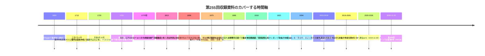

# 2026-11-22（第255回）・西東京水飲み噺・小平市史貫井村開発願い・小金井湧水点通信・立教池袋西口公園論文の新規収録

## 概要

第255回は取得レーンを3系統（Wayback Machine・自治体公式PDF・大学機関リポジトリ＋ADEAC texthtml）で広げた回で、①西東京市図書館「西東京『水』飲み噺」（行田健晃氏・令和元年8月18日講演・[GOV-501](sources/gov/GOV-501.md)）をWayback MachineのCDX API＋アーカイブ取得で全文入手、②小金井市文化財センター通信「小金井の湧水点part1」（[GOV-502](sources/gov/GOV-502.md)）と同通信№6「小金井の湧水点part5・小金井の井」（[GOV-503](sources/gov/GOV-503.md)）の2点の公式PDFを自作抽出器で全文テキスト化、③小平市史近世編ht000730「貫井村の開発願い」（pp.131-133）をADEAC texthtmlで取得して[BOOK-234](sources/books/BOOK-234.md)に追記、④立教大学機関リポジトリの2025年論文（[PAP-101](sources/papers/PAP-101.md)）と2019年調査研究ノート（[PAP-102](sources/papers/PAP-102.md)）を本文PDF取得・全文抽出、を行い、対照表に2行新設＋温井橋行に追記した回。

新規採番5件（[GOV-501](sources/gov/GOV-501.md)〜[GOV-503](sources/gov/GOV-503.md)・[PAP-101](sources/papers/PAP-101.md)・[PAP-102](sources/papers/PAP-102.md)）＋既存1件の追記（[BOOK-234](sources/books/BOOK-234.md)）＋対照表2行新設・1行追記。

## 最重要の成果

### ① 西東京「水」飲み噺（GOV-501新規）＝現行URLが403の自治体公式コンテンツのWayback取得

- 西東京市図書館「テーマごとに西東京市を知ろう」掲載の行田健晃氏（徳川記念財団非常勤研究員）による一般向け講演記録。**現行URLは403だが、Wayback Machine CDX API（`web.archive.org/cdx/search/cdx?url=...&matchType=domain`）でアーカイブを特定し全文取得**した（2026-08-09アーカイブ・約22KB）。
- **収録文言群**: ①「**田無地域は田無分水、保谷地域は関野分水を利用**」（田無1700年頃分水通過）＝関野分水の明文はrepo初出。②水道料金＝「**1年あたり1両で、これは村ごとに払う決まり**」「**使う水の量に関係なく1村あたり年1両**」＝使用量無関係の定額制。③「**上保谷新田は19世紀前半、水車を作るために関野分水の流れる道筋を勝手に変更し、下流にある関前新田と二度も裁判**」「**いずれも関前新田に水が流れなくなったことが重く見られ、設置された水車は取り払われました**」＝流路変更・断水・二度の裁判・水車取り払いの実体叙述。④「**1770年頃の幕府の調査によると、羽村で玉川上水に流れ込んだ水は、江戸に届くまでに半分以下**」。⑤水門規制＝「**三分明け**」（全開の30%）→安政3年（1856）4月「**二分明け**」→田無村名主**下田半兵衛の願い書き**（**清書と下書きの紙焼きが西東京市中央図書館に保管**）→同年6月三分明け復帰許可。
- **対校の位置づけ**: [BLOG-096](sources/blogs/BLOG-096.md)（上保谷新田の千川上水沿い水車・文政元年1818年設置願い）との関係は**流路・水系の異同も含めて本回では未対校**（GOV-501の「制限・未解決」に明記）。

### ② 小金井市文化財センター通信の2点（GOV-502・GOV-503新規）＝「温井」表記の由来源流と「小金井の井」の地名由来論

- **GOV-502（part1・令和2年11月30日発行）**: 「貫井＝温井」説の情報源＝**前田武四郎「貫井は昔し温井と書いた理由」**（武蔵野会会報『武蔵野』大正11年12月寄稿）＝**大正10年の水温実測（おおせど・貫井神社・新次郎池＝15～16℃ vs 付近の玉川上水分水2箇所＝9℃・9.5℃）**＋竹越与三郎（1865～1950・民友社出身）が「温井」と書かれた書物（タイトル不詳）を読んだと伝えた文言＋**「小金井…黄金井・金井／貫井…温井・抜井」の表記ゆらぎ**の明示。湧水点群＝新次郎池（国分寺市南町1-7・57選No.36）・貫井神社（本殿西横湧水・**「湧水の道」＝旧野川流路**）・おおせど（「前田邸下」・十尺の滝）・**滄浪泉園（嘉永4年〔1851〕鈴木家の賃搗き水車「弁車」・527番地所・大正元年に波多野承五郎が買取・前田文言「波多野氏は之で水車を廻はし米を搗かして居る」）**＋明治8年『貫井村全図 坂下』（**池539番・水車527番・元湧水501番・滝500番**の地番・貫井トンネル東側まで田圃）＋『甲武鉄道もより名所案内』（明治23年）の貫井弁天文言＋貫井遊園地看板・貫井プール（大正12年・湧水引込・昭和48年6月閉鎖）＋富永次郎『失われた季節』（昭和31年）のムジナ坂西横出水記録。
- **GOV-503（№6・part5・令和8年3月31日発行・文／構成 多田哲〔学芸員〕）**: ①**星野甲子三郎『小金井神社略縁起』**（大正7年＝1918発行推定）「**往昔武蔵野に七井あり、井ノ頭、石神井、貫井、小金井等今に存す…小金井の名茲に起ると、今は大久保氏の有たり**」＝武蔵野七井説。②**十方庵敬順『遊歴雑記』（文化10年）**の黄金井説＝**人見山（府中市浅間山・「おみたらし」）の湧水であって「小金井の井」（本村中央）とは場所が異なる指摘**＋「小金井の井」は「貫井の井」と釣り合いを採って案出されたとする通信の地名学史整理。③**『小金井村郷土誌』（昭和9年）**の「**黄金井**」表記採用＋湧水量「**一分間五石（約900リットル）**」。④「小金井の井」＝大久保善左衛門家（下小金井村名主）隠居宅「**金泉草露**」→大正8年磯村貞吉→昭和2年谷口鴨涯。⑤**明治8年『小金井村全図』読図＝「小金井の井」の湧水流路が二又に南下し、連雀通り沿いの分水から分岐した玉川上水系水路と交わりながら野川に落ちる**。⑥大正期の花圃群＝小金井園（喜平橋畔・民友社）・華丘香園（小金井橋以南半丁・磯村貞吉）・**康楽園（桜橋以北三丁・保谷新田平井氏）**＝[BOOK-137](sources/books/BOOK-137.md)康樂園の別出典として一致（平井家の家系同一性は断定しない）。⑦閻魔堂墓地（小金井小次郎の墓）と貫井共同墓地を結ぶ薬師通り参詣道。
- **意義**: 「温井橋（貫井橋）」〔対照表第254回新設〕の「温井」の由来源流・位置対応の実体側（貫井湧水群）・小金井側の対になる地名由来論が一挙に揃った＝**第254回課題⑤（温井橋と小金井側貫井村の位置対応）の主要文言を確保**。

### ③ 小平市史近世編「貫井村の開発願い」（BOOK-234追記・ht000730）＝玉川上水の流路が貫井村の開発願場の「中通り」だった文言

- [BOOK-234](sources/books/BOOK-234.md)（小平市史 近世編）のht000730（pp.131-133・第一章第二節3（1））をtexthtml本文取得＝①貫井村（ぬくいむら・現小金井市）の名主鈴木利左衛門（利左衛門重広から三代前＝寛永期の鈴木若狭守重貫）が鈴木新田の開発願書を出した。②享保6年史料による「70年前の巳年」（承応2年＝1653年頃）の「**内野**」400町余の開発試み＝「大長久保」「小長久保」の湿地（現花小金井南町3丁目「長久保」・小金井市「小長久保」に比定）＋**「井戸を掘ったが水は出ず…貫井村へ帰った。まだ玉川上水が開通する前」**。③「**貫井村が開発を願っていた地域の「中通り」が、玉川上水の流路になった**」「**玉川上水の南と北の一帯を、貫井村百姓の開発願場としていた**」（史料集12・77-78頁）。④正徳2年（1712）12月の開発願（「国分寺村御召上地」「小金井村岩間屋敷」・獣害理由・鈴木家文書）。⑤享保5年（1720）10月の貫井村百姓48名「入置申証文之事」（代地買い請け金50両・開発場10分割・7割願元締・3割名主組頭百姓分配）。
- **意義**: **温井橋（貫井橋）＝貫井村地先の玉川上水の橋という位置対応を開発史側から裏付ける本文文言**＋GOV-502の嘉永4年水車鈴木家・GOV-501の関野分水系水車裁判と並ぶ「貫井」の用地史の対校群。

### ④ 立教大学機関リポジトリの池袋西口公園研究2点（PAP-101・PAP-102新規）＝2019年再整備の学術系資料の追加と2017年業務報告書の書誌初出

- **PAP-101（2025）**: 佐藤裕亮・庄子諒・鍋倉咲希・関駿平「池袋西口公園再整備による建築環境の変化とその企図──フィールドノートと政策関連資料から──」『立教社会学』第2号 pp.57-64（2025-03-31・研究ノート・2024年度日本生活学会助成）＝**「新公園のコンセプトは劇場公園「GLOBAL RING」「**2014年、日本創成会議によって豊島区は東京23区内唯一の「消滅可能性都市」**・註(5)＝**2018年3月27日豊島区庁舎「池袋西口公園整備基本計画説明会」への参加（区民と区関係者〔高野之夫区長（当時）と都市整備部、文化商工部〕）**。**丸池・弦巻川・千川への言及は全文走査でゼロ**＝[BOOK-242](sources/books/BOOK-242.md)（平成ひすとりぃ）・[GOV-496](sources/gov/GOV-496.md)（区議会あいさつ）の丸池モチーフ文言に対する**学術系の陰性記録**（中立的記録としてのみ掛かる）。
- **PAP-102（2019）**: 関駿平・佐藤裕亮・鍋倉咲希・有田将也・庄子諒「池袋西口公園調査研究ノート」『社会学研究科年報』26号 pp.73-78（2019・ISSN 1346-6259・DOI 10.14992/00017653）＝**参考文献欄の豊島区都市整備部公園緑地課2017『池袋西口公園等整備基本計画策定業務報告書』の書誌がrepo初出**（第253・254回から探索していた2017年12月計画書の業務報告書側の宛先書誌）＋註(2)「**図1にある噴水は、2018年7月に撤去されている**」＋南池袋公園2009年閉鎖→2015年再整備の先行事例＋水系文言は同じく陰性。**陰性・見送りの中立維持**: 両論文とも丸池モチーフ採用の有無は判定しない。

## 対照表の更新

- 「温井橋」行に第255回追記（「温井」表記の由来源流＝GOV-502／位置対応の補強＝BOOK-234 ht000730＋GOV-502/503／明治23年名所案内の桜堤観賞定点文言）。
- 新設2行: 「**貫井の湧水点群**」（湧水点群・GOV-502）と「**小金井の井（黄金井）**」（水源・地名・GOV-503）。

## 監視系

- kanzyou7.com WHAT'S NEW＝**本回はDNS解決不能**（getent失敗・curl失敗・open_urlもブロック）＝「取得失敗・前回2026/11/20不変と仮定」と記録（継続監視）。
- adeac.jp横断検索（`/search?keyword=...`）＝依然`access_error`だが**小平市史機関（kodaira-lib）のtexthtml本文GETは成功**＝部分的に回復（ht000730取得で確認）。
- news/web横断8クエリ（谷端川・弦巻川・水窪川・千川上水・神田川下水道・雑司ヶ谷幹線・環七調節池・桃園川暗渠・20日分）＝**noiseのみ**（谷端→阪神谷端選手・日本各地の同名河川等）。日経クロステックの環境整備記事・建設newsの着手系は第214・254回で記録済み（重複確認済み）。
- 朝日新聞暗渠記事（2026-11-14・本田創・谷田川・田端）＝第254回で陰性記録済み（重複）。musashi.repo / nabunken は不通継続（本回は未試験）。

## 技術メモ（第255回）

- **pdftext4.py完成**: BJ圧縮PDF・ObjStm展開・ToUnicode・ページごとの/font資源マップ対応の自作抽出器＝**小金井市文化財センター通信2点（約6,900字/10,700字）・立教2論文（約11,900字/7,700字）でほぼ全文抽出に成功**（初めての実用成功）。ただし③特定書体の文字化け（立教2019年の「者」→「植」等）・④数字の制御文字化（小金井№6の末尾）の2系統の欠陥があり、引用は該当書体を含まない文に限る運用。
- **Wayback Machine CDX API**（`http://web.archive.org/cdx/search/cdx?url=...&matchType=domain`）でdomain内のアーカイブURLを列挙→`id_`サフィックスで原のレスポンスを取得＝403ページの本文回収に有効（西東京水飲み噺で実績）。
- **Rikkyo repo**: 検索APIは不可だが**OAI-PMH ListSets/ListRecords（set=329＝立教社会学 vol.1-2等99 records）・`api/records/N`・`record/N/files/AA11550133_26_08.pdf`**は有効＝機関リポジトリのPDF直取得レーン。
- 小金井市文化財センター通信のCSS内のPDF URLは`bunkazaimagazineNNN.pdf`連番＝part1=001（令和2）〜part5=006（令和8）で、**part2〜4（002〜005と連番対応は目視確認要）は未取得**。
- push技法は第254回メモ通り: bashセンチネル付きcat→`tools.github_app.push_files`（配列形式）→MemoryLimitError表示後もlist_commits SHAで成功判定。

## 採番現況（第255回使用分）

- 新規: **GOV-501・GOV-502・GOV-503・PAP-101・PAP-102**（いずれもpush前にINDEXとdir実測で再確認）。
- BOOK-245・GAZ-186・MAP-209・ORG-038・BLOG-264・LOST-006 は本回不使用（次回採番候補のまま）。
- INDEXは 1,536→**1,541 items** 想定（build.pyで再生成・要確認）。

## 陰性・見送り

- 立教2論文（PAP-101/102）＝丸池・弦巻川・千川への言及ゼロ（中立的な陰性記録として採録文言にのみ掛かる）。
- 通信part1末尾の「【以下、次号に続く】」以降（part2〜4の湧水点⑤以降）＝PDF未取得。
- 通信№5（magazine005.pdf・令和7年「40本の小金井桜」特集）＝本回は№6（part5）のみ取得、№5は未取得（次回候補）。
- 御伝馬方旧記（BOOK-241）p.813翻刻＝岡山機関ADEACは新システム（adeac.jp/okayama-pref-digioka）でも翻刻本文は依然非公開＝「所在のみ」で更新不要（第254回継続）。
- BOOK-238保谷市史「千川用水保全の負担」本文＝画像ビューアの全頁jpg（`data/NNN.jpg`）取得は可能だが本環境ではOCR不能＝human目視待ち（第254回継続）。

## 次回（第256回）課題

1. **開札2026-12-02（環七調節池広域整備検討その2〔GOV-148系〕）の入札結果確認＝最優先**（現時点より未来）。
2. **PAP-102参考文献の『池袋西口公園等整備基本計画策定業務報告書』（豊島区都市整備部公園緑地課・2017）の入手試験**（豊島区図書館・区文書館系の目録確認）＋[PAP-101](sources/papers/PAP-101.md)参考文献の豊島区1989『東京都豊島区立池袋西口公園整備工事』も同じく入手候補。
3. 小金井市文化財センター通信part2〜4の取得（湧水点リストの続き）＋№5「40本の小金井桜」（magazine005.pdf）の取得。
4. 『小金井村全図』『貫井村全図 坂下』（明治8年・小金井市文化財センター所蔵）の原本画像照合（通信の読図文言のみに依拠している状態の解消）。
5. GOV-502の嘉永4年水車鈴木家とBOOK-234の貫井村名主鈴木家の家系対応・GOV-501の関野分水系水車とBLOG-096の千川上水沿い水車の流路異同の対校。
6. kanzyou7/musashi/nabunken/NDL labの継続監視・news/web横断の継続。
7. pdftext4.pyの文字化け2系統（特定書体・数字の制御文字化）の原因調査（次回以降の抽出精度向上）。

## タイムライン（本回の資料的時間軸）

## 関連

- [GOV-501](sources/gov/GOV-501.md)・[GOV-502](sources/gov/GOV-502.md)・[GOV-503](sources/gov/GOV-503.md)・[PAP-101](sources/papers/PAP-101.md)・[PAP-102](sources/papers/PAP-102.md)＝新規5件
- [BOOK-234](sources/books/BOOK-234.md)（ht000730貫井村の開発願い追記）＝既存追記
- [対照表](地名・河川名対照表.md)（温井橋行追記＋貫井の湧水点群・小金井の井の2行新設）
- [BLOG-096](sources/blogs/BLOG-096.md)・[BLOG-097](sources/blogs/BLOG-097.md)（上保谷新田の水車・平井家＝GOV-501/503との対校課題）
- [BOOK-137](sources/books/BOOK-137.md)（康樂園・GOV-503の別出典）・[BOOK-240](sources/books/BOOK-240.md)（練馬区の貫井池＝小金井の「貫井」とは別用地）・[BOOK-242](sources/books/BOOK-242.md)・[GOV-496](sources/gov/GOV-496.md)（丸池モチーフ文言＝PAP-101/102の陰性との対照）
- [前回ノート](2026-11-22（第254回）・御伝馬方旧記目次文言・多摩のあゆみ第4号・雑司が谷ロケ編の新規収録と小平市史分水口普請・巻末聞き取り全文・貫井池面積変遷の照合.md)
