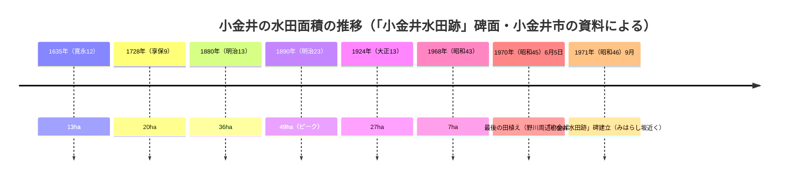

# 2026-11-22（第257回）・市報写真展PDFと多摩のあゆみ全号目次横断の新規収録

第257回定期調査の記録。前半はADEAC横断検索の遮断からの回復と『多摩のあゆみ』全160号目次取得、後半は小金井市公式PDF2種の全文取得と資料6件の新規収録。

## 今回の成果（新規収録6件）

1. **[GOV-508](sources/gov/GOV-508.md)**: 小金井市「市報でみる昭和の小金井」写真展パンフレットPDF（平成30年・小金井史談会編集解説・32頁版面16p・公式ページ更新日2020-04-27）＝**全文テキスト取得**。昭和期小金井の水田閉田・河川改修・水質・下水道・玉川上水量変遷の通史。
2. **[BOOK-245](sources/books/BOOK-245.md)**: 『小金井市史 年表・索引編』（令和4年・A5・340頁・800円・市公式ページ確認）＝所在のみ。
3. **[BOOK-246](sources/books/BOOK-246.md)**: 小金井市文化財ブックレット3『小金井桜拾遺』（令和7年・A5・80頁全編カラー・200円・内容見本PDFあり）＝所在のみ。
4. **[BOOK-247](sources/books/BOOK-247.md)**: 『多摩のあゆみ』第146号（特集 多摩の縄文後晩期遺跡・2012）＝**中山真治「野川流域の遺跡―府中市武蔵野公園遺跡、小金井市武蔵野公園低湿地遺跡、野川中洲北遺跡他―」の書誌特定**。
5. **[BOOK-248](sources/books/BOOK-248.md)**: 『多摩のあゆみ』第61号（特集 野川流域・1990）＝野川単独特集号。井上孝・大嶋一人・秋山道生・高麗正・小倉紀雄・君塚芳輝・古谷春吉らの全流域型構成。
6. **[BOOK-249](sources/books/BOOK-249.md)**: 『多摩のあゆみ』第13号（特集 多摩の川・1978・多摩中央信用金庫名義）＝矢嶋仁吉「武蔵野台地の泉と井戸」・岩屋隆夫「武蔵野台地上の「河川変流考」」・渡部一二「玉川上水とその分水路の蘇生」・坂上洋之「梶野新田分水と熊川分水」等の書誌。

## ①市報写真展PDF（GOV-508）の要点

### 小金井水田跡の定量データ（碑面6時点）〔確認: 本文文言〕

「小金井市の資料によると」寛永十二年（1635年）13ha／享保九年（1728年）20ha／明治十三年（1880年）36ha／明治二十三年（1890年）49ha／大正十三年（1924年）27ha／昭和四十三年（1968年）7ha＝**小金井の水田面積6時点の定量系列（repo初出）**。

閉田の直接原因＝度々洪水のあった野川改修工事。最終的な洪水対策＝拡幅＋蛇行修正＋調整池化で、**現在水田跡は調整池**。工事に先立つ遺跡調査＝**武蔵野公園低湿地遺跡**（丸木橋状遺構・漆塗り櫛・板碑片3片・遺構は近世まで使用〔武蔵野公園低湿地遺跡報告書〕）。碑下に籾入りタイムカプセル。

### その他の要点〔確認: 本文文言〕

- **仙川分水路（昭和48年）**: 「仙川の水を野川に流す、仙川分水路工事も行われています。（市報昭和48年7月20日号）」＝江戸期の仙川分水（千川用水系〔GAZ-093〕）と同名異系統の昭和期排水路。対照表に新設行。
- **台風4号（昭和41年6月28日）**: 本町2丁目交差点洪水・激甚災害指定（政令288号→294号）・全国浸水12万戸・ビートルズ来日3日前の事故文脈。昭和41年には台風26号でも被害。
- **野川・仙川の水質**: 昭和47年市水質調査＝重金属・農薬陰性、原因は家庭排水。改善＝野川昭和55年・仙川54年（下水道＋水洗化）。**仙川は小平上水南町の源流の一部が枯れて水量激減→空堀化→一部暗渠化**。
- **下水道**: 昭和44年着手→昭和56年全市域100%＝**多摩26市中4番目**（三鷹・武蔵野・狛江・小金井）。
- **玉川上水**: 淀橋浄水場東村山移転（昭和40年3月）→空堀化→「なし崩し的に破壊が進んでいる」→昭和56年三鷹駅北口〜欅橋循環→**昭和57年6月22日清流復活（1日3万トン・国史跡指定現状保存）**→昭和61年7月15日〜8月27日昭島通水処理場の下水2次処理水砂濾過通水で現在の姿。
- **五日市街道と桜堤**: 戦後の進駐軍道路拡張時に玉川上水沿い（北側）の桜を伐採＝**現在の「上水の南側だけ」の桜並木の成因**。桜樹接種碑（関野町）のトラック衝突・玉川上水落下事故も記録。

### 抽出手法のメモ〔観察〕

- 小金井市公式PDF（`shashinten.files/H30shashinten.pdf`）をcurlで取得し、自作PDF抽出器（BJ圧縮・ObjStm展開・ページごとfontマップ対応・`lab/ftext.py`）で全文テキスト化。InDesign出力（`3275.indd`）の縦書き部分に文字順の乱れがあるため、**引用文言は要原画像照合**（特に数値・パネル番号対応）。
- 小金井市公式ページの正確なパス＝`https://www.city.koganei.lg.jp/kankobunka/bunkazai/oshirase/`配下（nenpyosakuin.html〔年表・索引編・更新日2022年7月22日〕・koganeibooklet3.html〔桜拾遺・更新日2025年4月22日〕）。桜拾遺は**発行月記載なし＝令和7年（年）までの確認**とする。

## ②ADEAC横断検索の回復と『多摩のあゆみ』全160号目次横断〔観察〕

- ADEAC横断検索 `https://adeac.jp/cross-search?mode=text&word=<URLエンコード>` のGET形式が動作回復（前回500遮断から）。「武蔵野公園 低湿地」1件ヒット＝『多摩のあゆみ』第146号中山真治記事の特定契機。
- 目次テキスト頁のURL規則＝`https://adeac.jp/tamashin/texthtml/d100010/mp100010/ht{号×10:06d}`（第13号=ht000130・第61号=ht000610・第146号=ht001460で検証）。**中身は号ごとの目次のみ（個別記事本文テキスト層なし＝画像ビューア形式とみられる）**。
- 目録catalog ID規則＝`https://adeac.jp/tamashin/catalog/mp{号×100:06d}-100010`（第4号=mp000400・第146号=mp014600で検証済み）。
- **全160号の目次テキスト**を取得（labファイル`tamanoayumi_mokuji.txt`約230KB。再実行環境では消失するため、重要文言は本ノートと各BOOKファイルに写した）。
- 『多摩のあゆみ』の水系関連特集の要点：**「川」の特集は第13号（多摩の川・1978）と第61号（野川流域・1990）の2号のみ**。第4号（玉川上水・1976〔BOOK-244〕）・第34号（玉川上水再訪・1984〔PAP-068〕）と合わせて小金井・玉川上水系の文献層は計4号特定。
- repo重複確認済み：既収録は第4号・第34号のみ。第13・61・146号はrepo初出。「武蔵野公園」「中山真治」もrepo 0件。

### 次回の登録候補（今回は見送り・ノート記録のみ）

- **第111号**（2003・特集 武蔵野の古井戸）＝東海林隆夫「武蔵野の地形と野水―小平市・西東京市付近の浅い凹地と窪地」・角田清美「武蔵野台地における古井戸の歴史」＝湧水・旧河道レーン。
- **第147号**（2012・特集 多摩の小川）＝會田梢「残堀川と矢川」・東海林隆夫・角田清美「湧泉と緑地が周辺の気温分布に及ぼす影響」＝残堀川は千川上水系の可能性。

## 対照表の更新

- 武蔵川行（旧仙川の呼称変遷）へ第257回追記：仙川の近代的縮退系列（小平上水南町源流一部枯れ→水量激減→空堀化→部分暗渠）。
- 新設行3行：**小金井水田跡**（水田→碑→調整池）・**武蔵野公園低湿地遺跡**（丸木橋状遺構・漆塗り櫛・板碑片3片）・**仙川分水路（昭和48年）**（江戸期仙川分水と同名異系統の明記）。

## 文学作品・資料レーンの監視メモ

- kanzyou7 WHAT'S NEW＝2026/11/20不変。musashi.repo.nii不通・nabunken不通継続。news8クエリはnoise/既知のみ。朝日「楽問のススメ」本田創（2026-11-14・谷田川言及のみ）見送り継続。
- **開札2026-12-02（環七調節池広域整備検討その2・GOV-148系）はまだ未来＝次回最優先**。

## 未実施の継続課題（前回からの積み残し）

- 2017年『池袋西口公園等整備基本計画策定業務報告書』の入手試験（PAP-102書誌宛先・豊島区図書館蔵書検索）
- BOOK-238保谷市史「千川用水保全の負担」本文画像照合、梶家文書の現物所在（『小金井市誌Ⅲ資料編』）、御伝馬方旧記（BOOK-241）本文、NDL Search SRUでの小金井市史叢書書誌
- 明治8年『小金井村全図』『貫井村全図 坂下』の原本画像照合、part3欠落数字の原画像判読、嘉永4年水車鈴木家と貫井村名主鈴木家の家系対校
- **第257回新規**: 「武蔵野公園低湿地遺跡報告書」の正式書誌特定（小金井市文化財センター・都埋蔵文化財系の報告書一覧）、小金井市文化財ブックレット1・2の書誌（hannpusassi.html）、仙川分水路工事の着工・竣工年次（市報昭和48年7月20日号本文の直接確認）、「小金井市の資料」（碑面原典）の特定
