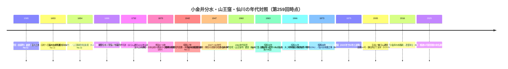

# 2026-11-22（第259回）調査ノート: まろん通信水路跡シリーズ全目録確定・山王窪築樋の規模記録の多書一致・仙川上流部別川説と1947〜50年代新流路掘削説・わきみず第125号

※本ノートは同一実行日の並走実行（先行push済み・[まろん通信本文6件＋先駆2件のノート](2026-11-22（第259回）・まろん通信水路跡シリーズ本文6件と全目録確定・梶野分水系譜の新規収録.md)）と調査対象が重複したため、先行収録分と重複しない素材（山王窪築樋の規模・江戸末期対立観察・[BLOG-269](sources/blogs/BLOG-269.md)〜[BLOG-272](sources/blogs/BLOG-272.md)・[GOV-511](sources/gov/GOV-511.md)・シリーズ21本文の要点）を主とする。シリーズ全目録の確定内容（41回・No.36重複）は独立2実行の結果として一致した〔確認〕。

## 本日の新規収録

- [BLOG-264](sources/blogs/BLOG-264.md)第259回追記: まろん通信「小金井の水路跡」シリーズの**全目録41本確定**（第1期No.1〜36＝Vol.275〜627〔2016-05-15〜2018-01-20〕＋第2期No.36〜40＝Vol.914〜922〔2018-10-28〜11-03〕・**No.36番号重複あり**）。本文21本を新規抽出（No.1・3〜6・24〜33・35・36・第2期No.36・No.40）。
- [BLOG-269](sources/blogs/BLOG-269.md): tama-meguri.com（403遮断・二次転記）＝山王窪築樋＝元禄9年（1696）・56間・1丈8尺＋**梶野分水＝享保17年（1732）許可・築樋230m・高さ4m**＋残堀川×玉川上水の伏越（明治41年改修）。
- [BLOG-270](sources/blogs/BLOG-270.md): まち歩きで趣味探しと図書館めぐりを自転車で（2022-01-16・直接確認）＝承応3年（1654）玉川上水→元禄年間幕府許可の小金井分水開通・八尺四方（24cm）樋口→明治3〜5年通船→砂川用水切替・貫井北五号・六号水源・**山王窪築樋＝全長56間（102m）・1丈8尺（5.4m）「と記録」・元禄9年（1696）造営**・陸軍技術研究所境界石杭の現地確認。
- [BLOG-271](sources/blogs/BLOG-271.md): あきぼう写真帖（2016-01-18・直接確認）＝公務員住宅内の築樋・堤2段・錆ついた分水門・山王稲穂神社説明板を起点に「**少なくとも当初は江戸末期の建設**」という観察（元禄9年説と対立）・窪地の湧水池推測。
- [BLOG-272](sources/blogs/BLOG-272.md): 西東京水路跡散歩（2020-05-22・直接確認）＝**仙川上流部別川説（上流部＝江戸期から排水路・流末は三鷹上連雀方面）・1947〜50年代に本来の仙川（新川5丁目丸池起点）まで新流路掘削で現在の流路完成説**・山王窪北西＝本来の源流（中央大学付属中高付近の谷状地形）・現上流端方面は合流支流とする観察・小金井分水接続＝水質是正目的説。
- [GOV-511](sources/gov/GOV-511.md): わきみず第125号（上祖師谷地区ミニコミ・2025-12-15・世田谷区公式サイト掲載PDF直接確認）＝仙川の全体像（起点小金井・20.9km・一級河川）・名称由来＝新川丸池の湧水池「千釜」＋川「せんかわ」／地名「せんがわ」の連濁・**1966年台風4号（ビートルズ台風）＝床上浸水6千戸弱・床下浸水3万戸弱**・**2005年台風14号の鎌田周辺浸水（repo初出）**・佐藤治雄証言（丸太橋・洗い場・長靴文化・孟宗竹の節でのウナギ・ナマズ・ゲバチ捕獲・オリンピック残土→宅地化）・都道54号宮下橋下流の新設橋命名選考中・祖師谷公園開園50年（1975年開園の逆算）。
- [対照表](地名・河川名対照表.md)第259回追記: 山王窪築樋行（規模・年代の多書一致と江戸末期対立観察の整理）・仙川治水史行（1966年台風4号の数値・2005年台風14号）＋新規13行挿入（山王稲穂神社・千釜・仙川上流部別川説・平代坂＝梶平太夫・神明宮／モーリー農園・湧水の道の第2区間／大川＝野川旧称・マイマイ井戸・ほっこ抜き・梶野分水の許可年代対立／市杵島神社分水／亀久保新田・蛇窪用水・花と緑の小径／はけの小径・下弁天の水路／市教委写真集古地図・佐藤治雄証言／都道54号新設橋）〔境村分水・深大寺分水は先行push分（まろん通信系）の対照行と内容が同一のため新行を立てず既存行に統合〕。

## 今回判明した主要事項の対照

### 1. 山王窪築樋の年代・規模: 3系統一致と1つの対立観察

- **1696年（元禄9年）説＋全長56間（約102m）・高さ1丈8尺（約5.4m）規模**: ①まろん通信No.2・No.3（[BLOG-264](sources/blogs/BLOG-264.md)・第258回＋第259回追記）②tosyokan-bicycle（[BLOG-270](sources/blogs/BLOG-270.md)）③tama-meguri（[BLOG-269](sources/blogs/BLOG-269.md)・二次転記）の3系統が一致。ただし①と②は独立系統と評価できるが①は同一筆者内の2出現のため独立性は限定的、③はスニペット由来。
- **対立観察**: あきぼう写真帖（[BLOG-271](sources/blogs/BLOG-271.md)）の「少なくとも当初は江戸末期の建設」。山王稲穂神社横の説明板を読んだ後の筆者の受け止めで、説明板文言そのものが引用されていないため、①説明板が江戸末期説を掲げている②筆者の解釈、の2通りが残る。**断定せず対立候補として記録**。
- 構造・現況: 堤2段（[BLOG-271]）・公務員住宅敷地内（[BLOG-271]）・関東ロームの土橋工法（[BLOG-264]No.2）・陸軍技術研究所の石杭・石標の現地遺存（[BLOG-270]＋[BLOG-264]No.1・No.3）・昭和17年の研究所設置で水路の向き変更（[BLOG-264]No.1）。
- 山王稲穂神社勧請1654年（承応3年）→分水1696年という年代系列（[BLOG-264]No.3）。

### 2. 仙川の流路形成史の新仮説（[BLOG-272](sources/blogs/BLOG-272.md)）

- 現在の上流部＝元々別の川で江戸期から排水路の扱い（流末は三鷹上連雀方面と推察）。当時の仙川源流＝三鷹市新川5丁目の丸池。「千釜」（[GOV-511](sources/gov/GOV-511.md)）＝同じ丸池の湧水池の通称で仙川の名称由来とする説が別系統から出た。
- 1947〜48年頃〜1950年代に本来の仙川までの新流路を掘削、この時の新流路は砂川用水程度の幅、以後1本の流れ「仙川」となった。その後拡幅して現在の形。
- 山王窪側は、小金井本町住宅（1960年代前半）造成前に現在の仙川とは別に北西方向へ1本の水路があり、こちらが本来の源流、現上流端への水路は合流支流の1つ。明治期地図は北西方向の水路しか記載しない＝Wikipedia「仙川」（中大附属中高付近＝河川記号の上流端）の読図と整合。
- 「小金井分水を繋げ水量を増やして是正」＝排水路の水質是正目的の分水接続観察＝Wikipedia「仙川」の「死の水」（昭和初期の落水）文言（三次・対照メモ）と同型の機能説。**いずれも「推定・仮説」段階で、都水利資料・建設省絵図など一次史料の探索は次回課題**。

### 3. 梶野分水の許可年代: 「1632年」は「1732年」の誤記候補

- まろん通信No.25（[BLOG-264](sources/blogs/BLOG-264.md)追記）: 「江戸時代享保の頃…梶野分水が造られたのが1632年、同じ年に市杵島神社が創建」〔同一文内で享保の頃（1716〜36年）と1632年（寛永9年）が矛盾〕。
- tama-meguri（[BLOG-269](sources/blogs/BLOG-269.md)）: 「梶野分水は享保17年（1732）に幕府から許可を受け」＝**「1732年の誤記」説が最有力候補**（対照表に整理・一次史料確認まで断定しない）。
- 梶野築樋の規模: 約230m・高さ約4m（tama-meguri）vs 仙川低地約300m（まろん通信No.26）＝計測範囲の解釈の対立候補。

### 4. 小金井の用水網の体系化（まろん通信全目録の効果）

- 砂川用水→（旧名主梶藤右衛門家系の屋敷付近で）梶野分水へ呼称切替。梶野分水から境村分水（梶野町三丁目の遊歩道→桜堤遊歩道）・市杵島神社分水（仮称・流末＝亀久保新田の溜池）が分岐。梶野分水本体は玉川上水から直接取水（享保の頃）→明治3年通船で砂川用水切替（接続＝梶野町二丁目12番付近〔推定〕）。
- 梶野分水の特徴＝「ほっこ抜き」＝地下トンネル方式（所々の穴から汲み出し・泥出し）。
- 流末: 梶野分水西流×小金井分水が連雀通りで合流→「深大寺分水」へ名称変化。
- 坂下: 野川の旧称「大川」・「湧水の道」＝野川旧河道の埋立遊歩道（貫井神社からの伏渠導水）・「マイマイ井戸」（消滅口碑）・花と緑の小径＝遊歩道南6号線（滄浪泉園の現役湧水路＋貫井神社湧水〔貫井プール経由〕の旧合流水路・前史＝鈴木弁次郎の水車小屋）・はけの小径＝美術の森（中村研一庭園）の現役湧水路。
- 前原町の遊歩道群＝「蛇窪用水」（起点府中市内）が由来。下弁天＝荒巻橋→下弁天社（湧水合流）→野川の環状水路・水路＝町界（貫井南町二丁目×前原町三丁目）＋市教委写真集「小金井」付属古地図という新地図史料の所在情報。

### 5. 年表の整理〔観察〕

※1696年築樋年代は3系統の一致で優勢だが江戸末期観察（[BLOG-271](sources/blogs/BLOG-271.md)）を対立候補として残す。1732年許可・1947〜50年代掘削はいずれも断定前の候補。

## 陰性・アクセス不能の記録

- **tama-meguri.com**: open_urlで403 Forbidden（Cloudflare系のボット判定と推定）。検索スニペットで文章は取得（→[BLOG-269](sources/blogs/BLOG-269.md)・二次転記）。**「ほっこ抜き」**が杉並区の用語か小金井の用語かの確認もスニペットからは不能だった。
- まろん通信No.7〜23（Vol.296〜505）・No.34（Vol.571）・第2期No.37〜39（Vol.918〜920）＝本文未取得（21本）。次回の掃引対象。
- 西東京水路跡散歩の他記事（仙川下流部・千川上水系・新堀用水・保谷系水路の紹介記事群）＝本回は未掃引。**当ブログは「西東京市近隣の河川・用水・小水路」の体系的紹介ブログで、repo関心水域を広く覆う一次監視対象に昇格させる**。

## 技術メモ（次回実行用）

- **ja.wikipedia.org はopen_urlで直接取得可能**になった（第258回までの遮断が解消。Wikipedia「仙川」の本文確認＝「死の水」文言の三次→本文確認が可能）。
- tama-meguri.com＝403遮断。ameblo.jp（akif4914・musasinowalker）＝open_url直接取得可。cocolog-nifty.com（tosyokan-bicycle）＝直接取得可。koganei-kanko.jp/maron＝直接取得可。
- まろん通信の記事URL体系: `https://koganei-kanko.jp/maron/archives/{archives番号}`。Vol番号とarchives番号の対応表は[BLOG-264](sources/blogs/BLOG-264.md)第259回追記の全目録を参照。

## 第260回以降の課題

1. **「環七調節池広域整備検討その2」の開札（2026-12-02）結果確認**（最優先・都建設局procurement page・建設通信新聞のウォッチ）。
2. まろん通信未取得記事の本文掃引（No.7〜23＝本町けやき通り・連雀通り方面・緑町・砂川用水6本、No.34＝花と緑の小径2、第2期No.37〜39＝前原町の遊歩道2〜4）。
3. 西東京水路跡散歩の他記事掃引（仙川下流・千川系・新堀用水・保谷系・境村分水の武蔵野市側）。
4. 梶家文書（[GOV-509](sources/gov/GOV-509.md)）と梶平太夫の水車（[BLOG-264](sources/blogs/BLOG-264.md)No.4・平代坂）の対校＝梶家文書中に水車・梶平太夫名があるか。
5. わきみず第125号の「都道54号新設橋」の命名結果の再監視（世田谷区・建設省関係の発表）＋古号に仙川・野川特集があるかの探索。
6. 仙川の1940〜50年代新流路掘削の一次史料（都土木資料・建設省絵図・昭和20〜25年前後の地形図）の探索。
7. 山王窪築樋の規模記録（56間・1丈8尺）の元史料特定（小金井村誌・貫井村誌〔[GOV-504](sources/gov/GOV-504.md)〕の該当箇所・市立図書館デジタル資料）。
8. Wikipedia「仙川」本文の直接確認（「死の水」文言の引き上げ、ja.wikipediaがopen_urlで開けるようになった）。
