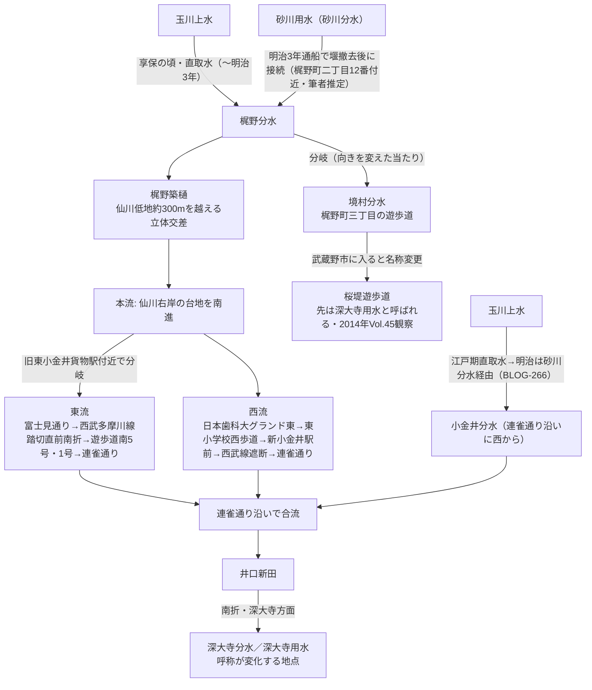

# 第259回（2026-11-22）: まろん通信「小金井の水路跡」シリーズ本文6件の取得と全目録確定・梶野分水系譜の新規収録

## 新規収録（3件・INDEX 1,562→1,565 items）

- **BLOG-266〔第258回課題③の前半解決〕**: まろん通信「小金井の水路跡」No.1（Vol.275・2016-05-15・archives/3043・**第258回の制限①「No.1未特定」の解決**）＋No.6遊歩道北2号（Vol.291・2016-06-21）＝
  1. **シリーズの枠組み宣言**: ハケ上（武蔵野段丘面）＝玉川上水系分水・ハケ下（立川段丘面）＝湧水・野川系という**二層の水路型**＝GOV-505（田用水／悪水）・GOV-502〜504の座標軸の観察文言。
  2. **小金井分水の明治の切替**: 江戸期玉川上水直取水→「明治に入り玉川上水で通船のために堰を取り外しの（=取り外したので・原文ママ）ので直に分水できず、砂川分水から分水」＋流路跡＝**貫井北町三丁目→小金井生活実習所西側→築樋**（地上座標）。
  3. **昭和17年陸軍技術研究所で水路の向き変更**＝GOV-504の技研（昭和15・17年強制買収・小金井分水の逆L字改変）の**観察側第2witness**。
  4. **No.6＝「1696年の小金井分水開通」**〔repo初出の独立文言・No.2の築樋1696年説と同シリーズ2witness〕＋**山王稲穂神社勧請＝1654年（承応3年・玉川上水開通と同年・江戸の日枝神社から勧請説）**＋**遊歩道北2号の全流路＝築樋前分岐→仙川北側高台→小金井街道越え→南折→大松木下之稲荷大神社東側で仙川**＋昭和12年古地図引用の明示。
- **BLOG-267〔本回の目玉〕**: 同シリーズ梶野分水・境村分水群4本（No.24境村分水 Vol.524・No.26梶野分水1 Vol.526・No.29梶野分水4 Vol.529・No.30梶野分水5 Vol.530・いずれも2017年8月）＝
  1. **梶野分水の開削＝享保の頃の玉川上水直取水→明治3年の通船で砂川用水経由に切替**（接続地点＝梶野町二丁目12番付近〔筆者推定〕）＝BLOG-266（小金井分水）・BLOG-224/225（新堀用水の明治3年統合）と同年次の分水口再編群。
  2. **梶野築樋＝仙川低地約300mを越える立体交差**＝山王窪築樋（小金井分水側）と対をなす仙川越え構造物。
  3. **本流の東西二流への分岐**＝旧東小金井貨物駅付近（東流＝富士見通り→西武多摩川線踏切直前南折→遊歩道南5号・1号／西流＝日本歯科大グランド東→東小学校西歩道→新小金井駅前→西武線遮断→連雀通り）＝**梶野分水の流末を街道・公共施設の現況地名で最も具体的に記した観察記録**。
  4. **境村分水〔repo初出の独立分水名〕**＝梶野分水から東分岐→梶野町三丁目の遊歩道→武蔵野市で「桜堤遊歩道」に名称変更＝玉川上水分水嶺の尾根に沿って開墾地へ自然流下。
  5. **連雀通りで小金井分水と合流→井口新田→南折→深大寺方面＝「深大寺分水」に名称変化**〔repo初出の系譜文言〕＋かっての梶野新田名主**梶藤右衛門の子孫が現住**＝GOV-505/509の梶家文書系の土地側接続点。
- **BLOG-268**: 先駆別記事2本＋湧水の道＝Vol.9前原遊歩道（2013-11-18・前原町1〜5丁目の遊歩道群＝昭和12年古地図の水路跡・府中方面接続・**流向は本文が「不明」と明記**）・Vol.45桜堤遊歩道（2014-04-30・砂川用水の続きで先は深大寺用水・小金井市側約100m・武蔵野市標識＝2014年観察と2017年境村分水特定の接続）・No.31湧水の道1（Vol.562・2017-10-13・湧水の道＝**野川旧蛇行跡（河川改修で直線化・蛇行の川幅が残る遊歩道化）**＋**野川の旧称「大川」の伝聞文言〔repo初出候補〕**＋鞍尾根橋下流約100m左岸の黒御影石碑＋貫井神社の湧水を地下導水した現役流水路のザリガニ復活観察＋貫井プール跡地）。
- **BLOG-264追記**: サイト内検索全4頁走査で**シリーズ全目録を確定**＝No.1からNo.40まで41回（**No.36がVol.627はけの小径2とVol.914前原町の遊歩道1の2回で重複**）＋先駆別記事Vol.9/Vol.45＋非シリーズ関連記事（Vol.3431・Vol.2052・Vol.1849）＝第258回の制限①（No.1特定）③（本文取得）④（連載の終了確認）を解消。

## 梶野分水・境村分水・深大寺分水の系譜（BLOG-266〜268・BLOG-225の統合）

〔図はBLOG-266〜268・BLOG-225の文言統合による。すべての流路・接続・年代はブログの観察文言・推定文言に基づく「候補」であり、境村分水の「境村」の比定・深大寺用水の灌漑対象・井口新田とGOV-284の井口村の同一性は断定していない〕

## 対照表の更新（第259回・追記2行＋新設6行）

1. **山王窪築樋行に追記**: 1696年小金井分水開通の第2witness（No.6）＋遊歩道北2号流路＋昭和17年技研向き変更の第2witness（No.1）＋1654年稲穂神社勧請説。
2. **貫井の湧水点群行に追記**: 湧水の道＝野川旧蛇行跡・「大川」呼称・黒御影石碑・貫井神社地下導水のザリガニ観察・貫井プール跡地。
3. **新設6行**: 遊歩道北2号／大松木下之稲荷大神社・梶野分水・境村分水／桜堤遊歩道・深大寺分水／深大寺用水・井口新田・前原遊歩道。

## 仙川Wikipediaの対照（第258回課題④・ノート的对照メモ・source file化せず）

ja.wikipedia「仙川」の本文を直接取得（環境遮断なし。第258回の「対照メモ」の前提文言を本回本文で確認）:

- **上流端変遷**: 現在の上流端＝貫井北町三丁目の新小金井街道直下（都立札・雨水排除管）。**明治国土地形図では中央大学附中付近に上流端**（上流端の後退=河川改修・湧水減衰説）＝山王窪築樋（貫井北町3丁目付近）との位置関係で対照可能。
- **稲穂神社付近築樋＝江戸時代の水路立体交差**＋**昭和初期のある期間、小金井用水（砂川用水〜深大寺用水の分水路）から「死の水」と称された仙川へ一定量落水＝水質緩和**（説明板あり）＝BLOG-264第258回の文言が本文で直接確認できた。
- **支流**: 北烏山の中川（遊歩道に名残）・祖師谷つりがね池支流。**2005年9月4日台風14号前線で氾濫・鎌田浸水**。
- **参考文献から新たに得る書誌候補〔要個別確認・本回は未登録〕**: ①毎日新聞1966年6月29日「**東京の浸水三万戸 八区三町に災害救助法**」＝**GOV-508（台風4号1966年6月28日小金井本町2丁目洪水）の全国紙側の広域文面の候補**・②朝日新聞1966年7月2日「浸水地域で集団下痢 小学校で二百五十人」③**『世田谷区水害記録（昭和22年〜平成3年）』世田谷区建設部土木計画課・1992年4月**＝仙川下流部の行政水害記録の書誌候補④陸地測量部地形図（府中明治39・立川昭和22・吉祥寺昭和20・田無）＝上流端変遷の図面史料群。
- Wikipediaはrepo慣行通りsource file化せず、上記の対照メモとして扱う（文言の3次資料性は既存の山王窪築樋行の注記のまま）。

## 監視系の結果

- **開札2026-12-02（環七調節池広域整備検討その2〔GOV-148系〕はまだ未来＝第260回最優先へ順送り**（希望申請は11月13日受付終了・開札12月2日）。
- **kensetsunews/archives/1307376（2026-11-11記事）を直接確認**: 内容はGOV-148の登録内容（対象流域＝神田川・石神井川・野川、履行期間2027年12月10日まで、その1をパシフィックコンサルタンツが担当、境川中流部基礎調査〔町田市木曽西約25万m³・森野約4.4万m³〕の併せ公告）と完全に一致＝**新情報なし・GOV-148の重複裏付けのみ**。
- **ja.wikipedia「仙川」が直接取得可能**（第258回までの遮断環境を更新）＝仙川・中川（北烏山）などレーン拡張の技術メモ。**weblioの仙川頁も取得済み**（lab/senkawa_weblio.html）。
- nabunken＝503（2026-11-20〜23メンテナンスの公表範囲内・BOOK-254/255のsitereports直接確認は復旧待ち）。kanzyou7＝WHAT'S NEW 2026/11/20不変（直接閲覧成功）。musashi.repo.nii＝000不通継続。
- news/unified_search 8クエリ（recency14日: 谷端川暗渠・弦巻川・水窪川護国寺・千川上水・環七入札・雑司ヶ谷幹線・仙川小金井・武蔵野公園低湿地遺跡）＝**noiseのみ**（前橋のクマ暗渠騒動・BanG Dreamの弦巻こころ・Vibe内のドライブ文書等）。環七関連の新規_hitなし（インフラツアー2027-01-09＝既知）。

## 技術メモ（次回のLLM必読）

- まろん通信の本文はarchives番号のcanonical URLで直取得可（第258回の技法を再確認・本回9本取得）。サイト内検索「?s=水路跡」の全4頁走査でシリーズ全目録＝41回の特定に成功（検索結果頁の記事見出し＋archives番号の組で目録化するのが確実）。
- ja.wikipediaの遮断は本回は解けていた（第258回までの「直取得不能」の前提は毎回検証し直すこと）。extract_maron.py（articleタグ〜authorタグの正規表現＋サイドバーは「前の記事 >>」で切る）が使える。
- 対照表の行は4列構成（名前｜種類｜説明｜出典列）と3列構成が混在する。editで列の末尾の「 | [出典列] |」部分に第259回追記文言を差し込む際は必ずawk -F'|' でNFを確認する。

## 次回（第260回）の課題

1. **開札2026-12-02 環七調節池広域整備検討その2〔GOV-148系〕の入札結果確認（最優先・開札は未来日ではなくなった直後＝第260回の最初のタスクにふさわしい）**。
2. **まろん通信シリーズの残り本文取得**: No.3〜5（Vol.277・278・281）・No.25市杵島神社分水（仮称）・No.27/28（梶野分水その2/3）・No.32湧水の道2（Vol.567）・No.33〜40（花と緑の小径・はけの小径・下弁天付近）→ 特に**No.7〜17の小金井分水下流（けやき通り・緑町・連雀通り方面）と砂川用水その1〜6（No.18〜23）**＝連雀通り合流点の対岸からの視点と砂川用水本体の記述が梶野分水系譜を補完する。
3. **nabunken復旧後にsitereports 85224・85311/85312を直接確認**（BOOK-254/255のstatus更新、中世排水溝・版築水利遺構の一次文言確認）〔第258回から順送り〕。
4. **仙川Wikipedia参考文献3点の個別source化の可否**（毎日新聞1966-6-29・朝日新聞1966-7-2・世田谷区水害記録1992）＝本文未閲覧でsource化はまだしない。
5. **明治国土地形図（府中明治39）の仙川上流端（中央大学附中付近）の図面確認**＝収録は既存MAP群の慣例（地形図・地図の採録方針）に従い要検討。
6. [BOOK-238]保谷市史「千川用水保全の負担」本文画像照合・嘉永4年家系対校（[GOV-509]活用）〔第255回からの人的キュー・継続〕。
