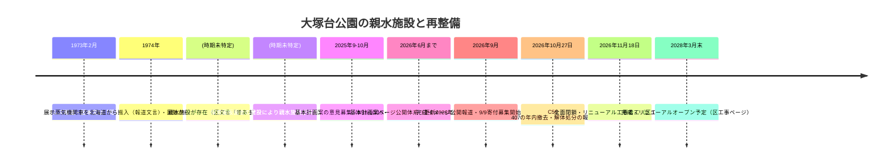

# 2026-11-23（第268回）・大塚台公園の親水施設「未復旧」文言とリニューアル着工・C58 407撤去報・千川コミュニティガーデン・神田川説明会一覧・公園再構築プラン本編第4章の追加調査

第268回の調査記録。開始時の main は 6eb865f1（第267回〈3/3〉）。push前にlist_commitsで並走を確認のうえ採番した（並走なし）。

## 成果の要約

- **大塚台公園（南大塚3-27-1・昭和48年開園・3546.9㎡）の再整備3ページ＋報道2件を新規収録**。区公式の一次文言で「**昔あった親水施設が保育園仮園舎の建設により未復旧**」と記録されている点が核心＝**谷端川上流域の区立公園の親水施設の喪失と復活（ウォーターパーク遊具）の公的な記録**。
- **千川コミュニティガーデン**（千川中学校プール跡地・高松1丁目12・2026年6月6日開園・DAIKEN×区の事業提案制度）＝千川上水旧流域の土地履歴の2026年現況。
- **神田川整備工事説明会の一覧ページ**を取得し、シリーズの目録構造（現存5本・その210と事業説明会「番屋橋〜神泉橋」の所在）を確定＝GOV-514の系列所在制限を部分解消。
- **GOV-518（公園等再構築プラン）に本編第4章を追記**＝千川上水公園・ふるさと千川ひろばへの親水施設設置方針の本編文言・選定基準③の親水施設・「歴史に由来した『水』施設を導入し…区の顔になる公園に」というワークショップ参加者意見まで確認。

## 資料別の詳細

### 1. 大塚台公園リニューアル（GOV-519〜521・BLOG-290〜291）〔確認: いずれも本文取得〕

時系列（確認の取れた文言のみで構成・推定部分は注記）:

- **[GOV-519](sources/gov/GOV-519.md) 基本計画案ページ（ページID56313・更新2026-09-04）**: 親水施設「未復旧」文言・施設7点・令和7年9月時点の令和8年10月着工表示。
- **[GOV-520](sources/gov/GOV-520.md) リニューアル工事ページ（ページID57516・更新2026-11-11）**: **2026年11月18日全面閉鎖・着工・令和10年3月末完成**・トイレ以外全解体・完成パース・ウォーターパーク遊具（蒸気機関車モチーフ・夏は噴水・他季節は複合遊具）・2面球技場（6〜10mフェンス・ゴムチップ舗装）・都電側入り口テラス。
- **[GOV-521](sources/gov/GOV-521.md) 寄付募集ページ（ページID57442・更新2026-11-11）**: GCF（ふるさと納税型）・「水深20cm程度」「回転バケツ」「シャワートンネル」・**全体工事費約6.8億円〔repo初出〕**。
- **[BLOG-290](sources/blogs/BLOG-290.md) 池袋タイムズ（2026-09-05）**: 開園1973年2月・SL搬入1974年北海道から・2026年11月着工・2028年3月完成の報道。区公式にない開園月・SL来歴の補完文言（報道二次扱い）。
- **[BLOG-291](sources/blogs/BLOG-291.md) PublicTransportDiary（2026-10-27）**: 展示機＝**C58 407号機**（1946年新製・北海道現役・廃車後国鉄から豊島区へ無償貸与）の同定情報と**2026年内撤去・解体処分の報**。形式・車歴は二次情報〔原典照合は次回課題〕。

観察: 親水施設の復元が「ウォーターパーク遊具（蒸気機関車モチーフ）」で実現する設計は、撤去されるC58 407の記憶の移転先と読めるが、設計側が意匠継承を公言した文言は未確認で断定しない。

### 2. 千川コミュニティガーデン（GOV-522）〔確認: 本文取得〕

[GOV-522](sources/gov/GOV-522.md): 千川中学校のプール跡地（高松1丁目12・要町駅徒歩5分）を豊島区の未利用地としてDAIKEN株式会社が「豊島区企業等による事業提案制度」の下で整備・提供・開園2026年6月6日・月額3,000円/世帯（水道・農具・肥料種込み）・開園約2.5か月で満員・追加募集も満員。観察: GOV-518の「千川中学校（改修中）」文言と併せ、**千川上水旧流域（高松1丁目）の学校施設・土地の2026年の活用実態**が行政側から裏付けられた。プールの廃止年次・区画数・補助額は本文に未記載。

### 3. 神田川整備工事説明会の一覧ページ（GOV-523・GOV-514追記）〔確認: 一覧本文取得・添付PDF未取得〕

[GOV-523](sources/gov/GOV-523.md): 「工事説明会（神田川整備工事）」一覧（更新2026-08-21・記事ID 017-001-20240620-001259）。現存個別ページ＝その153・154・158その2・**210（kandagaw_209・記事ID 017-001-20240820-006351・添付4種）**・213その2。開催結果表示＝その213その2（杉並区和泉四〜二丁目・R8.3.13-14）・その158その2（中野区本町五〜弥生町二・R8.7.24-25）〔**GOV-514の議事要旨記載の7/14-15（その1説明会）・GOV-515の3/12-13との間に1日ずれの文言が並存**＝両記録を並記し断定しない〕。**新カテゴリ「事業説明会（神田川整備事業）」の「事業区間（番屋橋～神泉橋）」ページ（jigyou/banya_sinsen・記事ID 017-001-20240710-002801・添付3種）も所在確認**。URL体系＝152→その153・209→その210・211→その213（欠番あり）という対応〔規則ではなく事実の記録〕。155〜157等の欠番に対応するページは一覧に現れず。

GOV-514の制限「中間シリーズの所在」を一覧側で部分解消（追記済み）。

### 4. GOV-518追記＝公園等再構築プラン本編第4章〔確認: 抽出テキスト判読〕

[GOV-518](sources/gov/GOV-518.md)に本編第4章分を追記:
- 選定基準①〜④の全文（**③に「親水施設、キャッチボール場、インクルーシブ遊具等」**が明記）。
- **巣鴨・西巣鴨地域の方向性「親水施設」を千川上水公園へ設置**・巣鴨四丁目折戸児童遊園〔repo初出の公園名〕は遊具を設置せず「憩い」特化。
- **高松・要町・千川地域の方向性「親水施設」をふるさと千川ひろばへ設置**・インクルーシブ遊具は高松一丁目公園予定地へ・高松三丁目公園予定地＝「広場」＋「公園活用」「防災機能」サブ。
- 第2回ワークショップ参加者意見＝千川上水公園への「**歴史に由来した「水」施設を導入**し、大通り沿いの「区の顔になる公園」に再構築」「**歴史が分かるようにするのが良い**」／ふるさと千川ひろば「活用されていない小道沿いに「水施設」を導入」。
- 役割割付（千川彫刻公園＝みどり・自然に親しむ・ふるさと千川ひろば＝健康・スポーツ）・「子どもレター」で「水遊び・親水施設がほしい4%」・ヒアリング期間R7.3.11-4.10・ワークショップ開催日6件・区全体165か所。
- 技術メモ: **本編PDFに編集者の修正指示書き込み（「川口修正」等）が混入したまま公開**されている＝引用時の注意。

### 5. BOOK-255の85312 JSON（第264回課題の再確認）

第264回課題③・第265回に解消済みのnabunken 85312（野川中洲北遺跡・自然科学分析編）の書誌JSONを本回も取得できた（`/ja/85312/format/json`）＝**repoのBOOK-255記載（Volume「自然科学分析編」・NCID BN06187453・1989-11）と完全一致**。既に反映済みのためファイル変更はなし（陰性＝再確認記録のみ）。

## 陰性・既収録（記録のみ）

- kanzyou7.com WHAT'S NEW＝2026/11/20不変。
- 細川正博HP経過リストの最新項目＝R8.7.15のまま（[BLOG-289](sources/blogs/BLOG-289.md)が最新・新記事なし）。
- musashi.repo.nii.ac.jp＝引き続き接続不可。
- 環七インフラツアー都プレス201・FNN「もう一つの川」＝[GOV-149](sources/gov/GOV-149.md)既収録。
- 神田川説明会のkandagaw_152/154個別本文・daisan0052/daisan0062＝curlは403/エラー応答（open_urlでは系列取得可・[GOV-523](sources/gov/GOV-523.md)に所在記録）。
- **環七調節池その2（調節池広域整備検討その2）の開札は2026-12-02＝まだ未来のため第269回（開催後）に最優先で順送り**。

## アラート・次回課題

1. **環七調節池その2の開札結果（2026-12-02）＝開札日後の最初の実行で最優先（第259回から順送り）**。
2. **大塚台公園**: 着工実績（2026-11-18以降の現況）・GCF寄付結果（ポータル側の目標金額・実績値）・**C58 407の撤去実況**（公式撤去決定文書の所在含め）を追跡。
3. **神田川説明会**: その210・その153・154・番屋橋〜神泉橋の添付PDF本文取得（工事概要書・説明資料の中身次第でGOV個別格上げ）。
4. **千川コミュニティガーデン**: プール廃止年次（千川中学校改修との前後）・事業提案制度採択一覧の行政文書確認。
5. 定期タスクは**継続**（停止・無効化しない）。

## 採番の記録

- GOV: 518まで→**519〜523（5件新規）**。BLOG: 289まで→**290〜291（2件新規）**。BOOK/PAP/GAZ/MAP/ORG/LOST: 今回の新規なし。BOOK-255は再確認のみ（変更なし）。INDEX 1,625→1,632 items。
