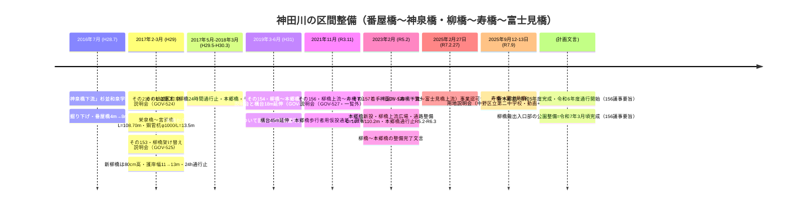

# 2026-11-23（第269回）・神田川整備説明会シリーズの本文確定（その153・154・156・157・210・番屋橋〜神泉橋・寿橋〜富士見橋事業認可）の追加調査

第269回の調査記録。開始時の main は 38a67313（第268回〈3/3〉）。push前にlist_commitsで並走を確認のうえ採番した（並走なし）。

## 成果の要約

- **都建設局三建の神田川整備説明会シリーズで本文を7件一括確定**（[GOV-524](sources/gov/GOV-524.md)〜[GOV-530](sources/gov/GOV-530.md)・GOV-523の制限②「210・番屋橋〜神泉橋添付未取得」を解消）。**千代田橋〜柳橋〜本郷橋〜寿橋〜富士見橋区間の改修（平成28〜令和10年）が行政一次資料の本文で時系列につながった**。
- **欠番観察の更新**: その156の個別ページ（kouji/daisan0052）とその157の「お知らせ」単発文書（000062212）が**一覧外に実在**＝155〜157は「未作成」ではなく**ページ形式の違う文書・未掲載ページがあり得る**という観察に更新（[GOV-527](sources/gov/GOV-527.md)・[GOV-528](sources/gov/GOV-528.md)）。
- **寿橋〜富士見橋整備事業の発見**: 令和7年2月27日事業認可告示（東京都市計画河川事業第6号神田川・寿橋下流〜富士見橋上流区間）と令和7年9月12-13日の用地説明会（[GOV-530](sources/gov/GOV-530.md)）＝**神田川の区間整備が寿橋から下流へ進む現在進行形の事業認可**。
- **橋梁幅員・整備手法の一次数値初出**: 番屋橋4m→8m・宮前橋5.5m→6m（[GOV-529](sources/gov/GOV-529.md)）・中野区側の護岸幅11.00m→13.00m（[GOV-525](sources/gov/GOV-525.md)）・「**川幅はあまり変えずに、川底を深く掘り下げる方法で整備**」（番屋橋〜神泉橋・H28.7）。

## 取得レーンの技術（今回確立・repoのJina/Waybackレーン）

- 都建設局（Liferay CMS）のページ本体はcurl不可。**WaybackスナップショットHTMLから添付PDFの`/documents/d/kensetsu/<ID>`URLを抽出**し、**`https://r.jina.ai/https://www.kensetsu.metro.tokyo.lg.jp/documents/d/kensetsu/<ID>`でPDF本文テキストを取得**＝ページ添付・単発文書の両方で有効（000062212=157のお知らせもこの経路）。
- 一部のdocument ID（000044411等）はエラー頁応答（WAF差）・**画像PDF（000055823=156の説明資料38頁・dai79のパネル資料4点計36頁）は本文抽出不能＝human目視待ち**。

## 資料別の詳細

### 神田川整備説明会シリーズの時系列（確認文言のみ・推定は注記）

- **[GOV-524](sources/gov/GOV-524.md) その210（杉並区側・栄泉橋〜宮前橋）**: 議事要旨（H29.2.8・杉並和泉学園会議室1・宮前橋H30中〜H32初通行止・迂回=番屋橋・**熊野神社の神輿・山車ルート**・桜植栽）・次第（H29.2.7・青木あすなろ・都市建JV・柳澤祥次）・工事概要書・説明資料39頁（**L=108.70m・鋼管杭φ1000/L=13.5m・市街化率60%→97%・栄泉橋下流左岸69本・「お寺側（龍光寺側）」と「学園側」・桜12本剪定・「209工事」言及・番屋橋下流〜神泉橋下流事業スケジュール**）。
- **[GOV-525](sources/gov/GOV-525.md) その153（中野区側・柳橋架け替え）**: 議事要旨（H29.3.28・中野区立第二中学校体育館・**新柳橋は80cm高・家屋の階段設置影響**）・次第（大豊・黒部JV・雛形未置換のTitle文字列）・工事概要書（**柳橋下流〜本郷橋下流 左岸91.5m右岸96.8m・護岸幅W=11.00→13.00m・24時間通行止H29.5〜H30.3・迂回=本郷橋・千代田橋・位置図の「氷川橋」〔repo初出の橋名〕**）。
- **[GOV-526](sources/gov/GOV-526.md) その154（柳橋〜本郷橋・構台延伸）**: 議事要旨（H31.3.7・**「新橋から寿橋までの540mの区間について国からの事業認可」・支持杭は仮設・用地交渉後に鋼管杭・柳橋上流右岸の搬出入口・家屋調査対象=ビオス中野・本郷橋フラット・152・153と154の家屋調査の層」**）・工事概要書（H31.4〜6・構台18m延伸・大豊建設単独）。
- **[GOV-527](sources/gov/GOV-527.md) その156（一覧外ページ・kouji/daisan0052）**: 次第（R3.11.4・巴山建設）・工事概要書（xlsx由来・柳橋上流〜寿橋下流・構台45m延伸・本郷橋歩行者用仮設通路・1時間50mm文言）・議事要旨（**参加者7名・家屋損害賠償作業の遅延文言・「説明資料38ページの①②③工事」・②=新本郷橋R5年度完成R6年度通行開始・柳橋搬出入口部=公園整備R7.3頃**）。
- **[GOV-528](sources/gov/GOV-528.md) その157のお知らせ（一覧外の単発文書・000062212）**: 柳橋上流〜本郷橋上流の仕上げ・**本郷橋の新設**・河川沿い通路整備・広場整備（R5.2下旬〜R6.10上旬・L=左岸107.9m右岸110.2m・本郷橋通行止R5.2下旬〜R6.3下旬）＝**「本工事で柳橋から本郷橋までの整備が完了し、通行可能となります」**。
- **[GOV-529](sources/gov/GOV-529.md) 番屋橋〜神泉橋事業説明会（事業単位の最古層・H28.7.21）**: 議事要旨（**「川幅はあまり変えずに、川底を深く掘り下げる方法で整備」「番屋橋が現在の4mから8mに、宮前橋は5.5mから6mに」**・通学安全の意見）・次第（木曜開催・次第のTitleには「○○寺川」雛形）・事業概要図（**H28.7発行・1時間50mm+調節池で75mm文言・番屋橋・宮前橋・栄泉橋の通行止チャートH28〜H33**）。
- **[GOV-530](sources/gov/GOV-530.md) 寿橋〜富士見橋整備事業（daisan0079・更新2025-09-16）**: **令和7年2月27日事業認可告示（寿橋下流〜富士見橋上流区間）**・ご案内本文（**東京都市計画河川事業第6号神田川（寿橋〜富士見橋）**・説明会R7.9.12(金)/13(土)・中野区立第二中学校体育館・動画+パネル形式・丸ノ内線中野新橋駅徒歩5分）・パネル資料4点（計36頁）は画像PDFで所在のみ。
- **[GOV-523](sources/gov/GOV-523.md) 追記**: 制限②③を第269回の結果で更新（210・番屋橋〜神泉橋の添付本文解消・156/157の一覧外実在・daisan0079の発見）。

## 陰性・既収録（記録のみ）

- kanzyou7.com WHAT'S NEW＝2026/11/20不変・musashi.repo.nii.ac.jp不通継続・mu.repo=200・nabunken 85312はHTML応答に変化（[BOOK-255](sources/books/BOOK-255.md)記載不変）・kandagaw_158は再び403（WAF挙動差は既知・[GOV-514](sources/gov/GOV-514.md)記載どおり）。
- 大塚台公園GCF・現場ページ・千川コミュニティガーデン＝第268回記載と不変。
- 豊島区議・細川正博ブログ（ameblo）＝副都心開発調査特別委員会関係の記事のみで水路関連の文言なし（陰性）。
- 朝日楽問のススメ＝第262回判定済み同一記事。news系8クエリはnoiseのみ。
- daisan0050/51/53のWayback収蔵なし（その155ページの存在は未確認のまま）。

## アラート・次回課題

1. **環七調節池その2の開札結果（2026-12-02）＝開札日後の最初の実行で最優先（第259回から順送り）**。
2. **画像PDFのhuman目視**: 000055823（その156の説明資料38頁・①②③工事区間図）・dai79のパネル資料4点（寿橋〜富士見橋の区間図・横断形）。
3. **その155の探索**: daisan0050/51/53周辺・kandagaw_155/157系URL・000062212のリンク元ページの特定。
4. **その153の説明資料・その154の次第・説明資料の取得**（エラー頁応答の再試行・ID特定）。
5. **寿橋〜富士見橋事業認可告示の原典**（都公報・都市計画決定公告）の所在特定。
6. 定期タスクは**継続**（停止・無効化しない）。

## 採番の記録

- GOV: 523まで→**524〜530（7件新規）**。BOOK/BLOG/MAP/ORG/PAP/GAZ/LOST: 今回の新規なし。INDEX 1,632→1,639 items。
