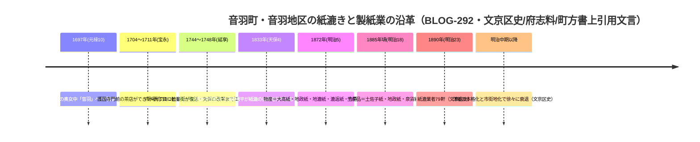

# 2026-11-23（第270回）・神田川着手プレス（寿橋〜富士見橋250m）・谷端川南緑道のLED化回答・音羽町製紙史・下水道枝線再構築第2期の追加調査

第270回の調査記録。開始時の main は 35c6c8ae10b0（第269回〈3/3〉）。push前にlist_commitsで並走を確認のうえ採番した（並走なし）。

## 成果の要約

- **都プレスリリース「神田川の新たな区間で河川事業に着手」（2025-02-27）の本文確定**（[GOV-531](sources/gov/GOV-531.md)）＝**中野区本町五丁目（寿橋下流）〜杉並区和田一丁目（富士見橋上流）の約250m・事業期間令和7年2月27日〜令和16年3月31日・「設計等の準備」段階**。[GOV-530](sources/gov/GOV-530.md)（用地説明会ページ）と対応する都公式の着手表明文書で、**認可日・区間（区丁目つき）・延長・事業期限が一点に揃った**〔認可告示の都公報号は未特定のまま＝下記〕。
- **豊島区「区民の声」で谷端川南緑道のウォーカブルエリア化要望への回答（令和7年4月）を確定**（[GOV-532](sources/gov/GOV-532.md)）＝「**剪定や古い水銀灯のLED化を進めます**」「**今後、緑道を全面改修する際には…ウォーカブルな緑道整備を目指してまいります**」〔[GOV-008](sources/gov/GOV-008.md)系の現行維持施策の一次文言・全面改修の時期文言はなし〕。
- **音羽町の町名由来と水窪川流域の製紙業沿革が年代つきで座標化**（[BLOG-292](sources/blogs/BLOG-292.md)江戸町巡り・2017-12-09）＝**音羽町1697年（元禄10）起立・桂昌院の奥女中「音羽」拝領説**、**製紙業1833年（天保4）信州伊那郡の久保田増平の技術持ち込みに始まる**、1885年（明治18）頃の品種＝土佐子紙・地政紙・泉貨紙、**1890年（明治23）紙漉業者79軒**、明治中期以降の衰退（文京区史引用）＋1872年（明治5）物産＝大高紙・地政紙・地漉紙・漉返紙・今戸焼鍋（府志料）＋『富貴地座位』のあみかさ餅〔**氏名・起点年・品種・業者数・衰退要因のすべてがrepo初出**＝[BLOG-099](sources/blogs/BLOG-099.md)〜[BLOG-100](sources/blogs/BLOG-100.md)の紙漉望月家の記録に町史側の通史の補助線がついた〕。
- **区部下水道枝線再構築第2期エリアの2026年度本格化の専門紙報道を確定**（[BLOG-293](sources/blogs/BLOG-293.md)建通新聞電子版・2026-02-27東京版）＝第2期（**新河岸・落合・森ケ崎3処理区・約2万7,700ha・枝線延長約7,300km**）の本格スタート、**北部下水道事務所管内の実施設計8件（豊島区目白四丁目・西池袋三丁目付近など）**、**2024年度試行2件＝豊島区長崎五・六丁目付近（三木田興業）・南長崎三・四丁目付近（イチグミ）**〔弦巻川流域・谷端川上流域の枝線更新が両方とも最初の実働に選ばれた進行座標・流域文言は本文になし（対応付けは本repoの見立て＝推定）〕。

## 資料別の詳細

### 音羽地区（水窪川流域）の紙漉・製紙業の沿革（BLOG-292の確認文言のみ）

- **[GOV-531](sources/gov/GOV-531.md) 都プレス「神田川の新たな区間で河川事業に着手」**: r.jina.ai経由で本文取得（都公式ページ本体）。神田川の説明文言＝「**三鷹市の井の頭池に発し、善福寺川、妙正寺川を合流しながら東京都の中心部を流れ、下流部で日本橋川を分派したのち、隅田川に合流する一級河川**」（流域面積105km²・延長24.6km）も一次文言として確定。認可=「都市計画事業の認可を取得」・着手=「河川整備事業に着手」・「**今後は…設計等の準備を進めていきます**」〔着工ではなく設計準備段階である点も文言で確認〕。
- **[GOV-532](sources/gov/GOV-532.md) 豊島区「区民の声」**: 今回の該当項は1項のみで、ほかに中池袋公園のトレーディング（R7.2）・駐輪場精算（R7.3・椎名橋自転車駐車場の新紙幣対応の文言も拾い得るが水系資料とはしない）・南池袋スポーツ公園のじゃぶじゃぶ池（R7.8）が並ぶ。ページID52958・更新日2026-05-21。
- **[BLOG-293](sources/blogs/BLOG-293.md) 枝線再構築のエリア構成（確認文言）**: 第1期＝芝浦・三河島・砂町・小台（約1万6,300ha・枝線約4,600km・25年度まで約8割・「29年度の完了を目指す」）、第2期＝新河岸・落合・森ケ崎（約2万7,700ha・枝線約7,300km・4下水道事務所管轄）。**今後5年間（30年度まで）で第1期未実施分と合わせ面積ベース3,400haを再構築**。工法＝**内面被覆工法（道路を掘らず管渠の内側からリニューアル）**〔[BLOG-289](sources/blogs/BLOG-289.md)千川系の枝線更新と同一のシリーズ〕。出典図＝「枝線再構築エリアと平均経過年数。東京都下水道事業経営計画2026（案）より」〔経営計画自体はrepo未収録〕。

## 陰性・既収録（記録のみ）

- wanjin（fc2ブログ）のエントリ2/240/241が**直接取得可能になっていた**（かつてDeny Access）が、内容は第64回・第99回収録分と同一（BLOG-183/191/204/205/206/233/234等・矢執川文言も既収録）＝新情報なし。
- kanzyou7.com WHAT'S NEW＝2026/11/20不変。musashi.repo.nii.ac.jp＝HTTP 000不通継続。
- 東京都下水道局の工事情報（gesui…/豊島区116）＝千川・谷端川系の現行枝線工事の文言なし（陰性）。
- **都公報の走査**: 第18251号（R7.2.25）・第18253号（R7.2.27）・第18254号・第18255号・第18262号（R7.3.12・道路事業変更認可のみ）の本文抽出で**神田川の事業認可文言は未発見**＝GOV-531/530系の認可告示の都公報号は未特定のまま（画像PDFの目視未実施を含む・次回課題）。
- nsearch.jpで神田川「再構築工事(その155)」の発注記録（2020/01/23・第三建設事務所）の存在を確認〔説明会ページは非公開・daisan0062のURLは現応答404〕＝その155の実在が示唆されるが本文取得はならず。
- nikoukei 雑司ヶ谷幹線再構築その11の落札者＝北立建設工業（[ORG-012](sources/org/ORG-012.md)・既知・新情報なし）。
- 環境湾七調節池その2の入札公告＝開札2026-12-02（まだ先）。

## アラート・次回課題

1. **環七調節池その2の入札・開札結果（2026-12-02開札）＝第271回最優先（第259回から順送り）**。
2. **GOV-531の別紙「案内図」PDFの取得**（区間図の目視・寿橋〜富士見橋250mの平面位置の確認）。
3. **神田川寿橋〜富士見橋事業認可告示の都公報号の特定**（18251〜18262号の走査では未発見・画像PDF目視を含む再走査）。
4. **BLOG-292の引用原典の直接確認**（文京区史・府志料・町方書上の該当頁＝久保田増平・79軒の数値の原典照合）。
5. **下水道事業経営計画2026（案）本編の所在確認**（枝線再構築エリア図・目白四丁目/西池袋三丁目の枝線の幹線系対応）。
6. 大塚台公園リニューアル着工後の現況・C58 407撤去の実況（[BLOG-291](sources/blogs/BLOG-291.md)系のウォッチ継続・現地観察はhuman）。
7. 定期タスクは**継続**（停止・無効化しない）。

## 採番の記録

- GOV: 530まで→**531〜532（2件新規）**。BLOG: 291まで→**292〜293（2件新規）**。BOOK/MAP/ORG/PAP/GAZ/LOST: 今回の新規なし。INDEX 1,639→1,643 items。
