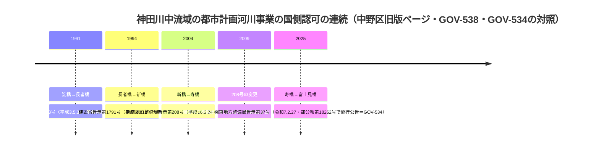

# 2026-11-23（第273回）・中野区旧版ページで神田川整備の告示群特定（告示第208号）・大塚駅南口告示本体3PDF・目白崖線の学習院公式資料の追加調査

第273回の定期調査記録。GitHub リポジトリ `yuubinnkyoku/otowa-ankyoscape` の README.md 既存内容との重複を避けながら、多角的に新情報を調査した。開始時 HEAD=`b6e453e381dd273948462a573becc6def1ad1e08`（第272回終了点と一致・list_commitsで並走なしを確認）。

## 1. 中野区「都市計画河川」ページ旧版の Wayback 確認（第272回課題①＝GOV-535未解決①の解決・GOV-538新規）

第272回で中野区「都市計画河川」ページ（GOV-535・更新日2025年3月5日）の検索断片にのみ見える「平成16年関東地方整備局告示第208号」文言の旧版確認を次回課題として残していた点を、Wayback Machineのスナップショット走査で解決した。

- **取得版**: [2024-02-20 23:23:19 UTC](https://web.archive.org/web/20240220232319/https://www.city.tokyo-nakano.lg.jp/kusei/kousou/seido/toshikeikaku/toshikeikakukasen.html) と [2025-02-14 19:12:06 UTC](https://web.archive.org/web/20250214191206/https://www.city.tokyo-nakano.lg.jp/kusei/kousou/seido/toshikeikaku/toshikeikakukasen.html) の2スナップショット（いずれも**ページ更新日2023年8月3日**の同一版）。
- **現行版との差分**: 旧版にのみ「神田川の整備」「妙正寺川の整備」「環状7号線地下調節池」各節が存在し、2025年3月5日の頁更新の際に削除された（削除の正確な日付はスナップショット間隔から特定不可。2025-02-14＝旧版、2025-07-05＝現行型で確認）。代わりに現行版では「第五号石神井川及び第六号神田川（都告示第1809号）」の計画行が追加されている。
- **旧版が保存していた文言群（いずれもGOV-538に全文言化）**:
    1. **神田川の整備史**: S22(1947)幅員16〜44m都市計画決定→S53(1978)30mm/h整備完了→高田橋下流S56(1981)50mm/h整備完成→平成7年度末淀橋まで護岸改修・平成3年から長者橋まで事業承認。
    2. **平成5年8月台風11号**: 淀橋上流中心に約3千戸浸水→長者橋〜新橋700mを合わせ約1400mの激特申請→H5.11採択→H12.3完了。
    3. **事業承認の告示3連（repo初出）**: 淀橋→長者橋＝建設省告示第1228号（H3.5.31・〜H10.3.31）／長者橋→新橋＝建設省告示第1791号（H6.8.12・〜H13.3.31）／新橋→寿橋＝**関東地方整備局告示第208号（H16.5.24・変更H21.3.31第176号・〜H26.3.31）**。
    4. **妙正寺川**: 平成3年度より新宿区境〜新井橋下流まで改修・調節池5か所の所在と貯留量（北江古田1.7万・妙正寺川第一3万・第二10万・上高田16万・落合5万m³）・**平成17年(2005)年9月4日の大規模集中豪雨**（repo grep初出）→激特H17.11.18採択・H17〜H21年度・落合調節池〜環七地下調節池取水施設。
    5. **環七第1期**＝S61.12.22決定・S63.10〜H12.3・和泉4〜梅里1・2.0km・内径12.5m・24万トン、**第2期**＝H2.1.26決定・H5.7〜H20・梅里1〜野方5・2.5km・30万トン。
- **神田川の国側認可の告示チェーン**（観察・各告示原文の直接確認は未了）:

- **意義〔観察〕**: ①GOV-535未解決①（旧版の文言実在確認）が解決し、しかも年月日・変更告示番号・事業期間まで一段深い文言が得られた。②認可主体が建設省（省告示）→関東地方整備局（地方整備局告示）へ移行した経緯（2001年省庁再編と整合）が同一区ページ内で確認できる。③GOV-526（その154・新橋〜寿橋540mの国認可）の原点が208号の告示番号レベルで特定された（その154自体が208号の再認可かは対照してからで断定しない）。④「平成17年9月4日」豪雨の日付つき記録はrepo初出（妙正寺川流域の記録であり、弦巻川・谷端川・水窪川流域の同日の出水記録の有無は未確認）。
- **技術メモ**: Waybackのスナップショットはgzip圧縘で配信されることがあり（curlの`--compressed`なしではバイナリのまま）、pythonの`gzip.decompress`で復号してから本文抽出する必要があった。CDX API（`web.archive.org/cdx/search/cdx`）で取得対象スナップショットの有無・タイムスタンプを先に確認するのが効率的。

〔GOV-538（同ページ旧版・Waybackスナップショット）として新規資料化。GOV-535の制限①を解決側に更新・GOV-534の関連行に追記〕

## 2. 大塚駅南口地区の都市計画告示本体3PDFの取得（第272回課題③＝GOV-537の未解決①②の解決・格上げ）

第272回で「所在のみ」だった豊島区の告示本体3PDF（ページID56496配下）を取得し、テキスト層の本文抽出に成功した（いずれも刊行日時のHTTPヘッダー＝2026-11-13）。

- **第一種市街地再開発事業（[20261111155618.pdf](https://www.city.toshima.lg.jp/documents/56496/20261111155618.pdf)・6頁）**: **施行区域約0.5ha**／**区画道路5路線の拡幅整備＝特別区道31-1040号（幅員約4.3〜7.7m[約8.6〜12.5m]・延長約5m）・31-960号（約5.0〜5.8[8.0〜9.3]m・約65m）・31-950号（5.8〜6.0[9.0〜9.3]m・約25m）・31-940号（約5.3[7.8]m・約5m）・31-910号（約12.6〜12.8[約22.6]m・約25m）**〔区画道路番号群はrepo初出〕／建築物＝建築面積約2,490㎡・延べ約62,780㎡[容積対象約40,650㎡]・**高さの限度 GL+160m（GL=T.P.+20m＝絶対高さT.P.+180m相当）**〔repo初出の告示数値〕／建築敷地約4,465㎡・壁面後退3m歩道状空地・敷地内約670㎡地区広場／理由書に**天祖神社・東京さくらトラムの文言**。
- **高度利用地区（[20261111155709.pdf](https://www.city.toshima.lg.jp/documents/56496/20261111155709.pdf)・7頁）**: **Aゾーン約0.2ha（約1,640㎡）＝容積率最高105/10・最低25/10・建蔽率最高6/10・建築面積最低200㎡・壁面3m**／**Bゾーン約0.4ha（約3,770㎡）＝容積率最高85/10・最低20/10**／小計約0.5ha（5,410㎡）＋敷地面積規模による容積率特例（三段階）・用途による特例。Bゾーン行の空欄対応（建蔽率等）と表組みの正確な対応はhuman目視が望ましい。
- **地区計画（[20261111155758.pdf](https://www.city.toshima.lg.jp/documents/56496/20261111155758.pdf)・9頁）**: **名称・位置＝豊島区南大塚三丁目地内・面積約1.0ha**（地区整備計画＝南大塚三丁目地内・約0.5ha）／地区計画の目標・土地利用方針＝「**天祖神社の佇まいを生かした一体的なまちづくり**」／地区施設の整備方針＝「**天祖神社と調和した風情が感じられる憩い・交流の場や災害時における地域の避難場所となる空間を創出するため、天祖神社に隣接する広場１号を整備**」「南北自由通路と連続して幅員９ｍの歩行者通路を整備（中央5m通行確保＋両側2m）」／地区施設の規模＝広場1号約670㎡（ピロティ部分・階段・立体的な緑化施設を含む）・広場2号約275㎡・歩行者通路9m・約30m・歩道状空地1号3m・約100m・2号3m・約105m・緑地2〜6m・約160㎡・敷地内通路約5〜6m・約30m〔第272回の審議会資料の数値と本体告示が一致〕。
- **意義〔観察〕**: ①審議会資料ベースだった数値が告示本体で裏付けられ、GOV-537が「告示本体直接確認」まで格上げ。②南大塚三丁目地内・GL+160m・区画道路番号群の3点がrepo初出で、谷端川下流域の天祖神社界隈の再開発の公文書座標が固まった。③天祖神社に隣接する広場＝避難場所という設計文言が本体告示レベルで確認できた。

〔GOV-537（豊島区公式ページ）に告示本体3PDFの項を追記・制限①②を解決側に更新〕

## 3. 学習院大学広報 G.LiFE Web「目白の地理さんぽ」（ORG-039新規）

学習院大学の広報マガジンG.LiFE Webの「目白の地理さんぽ」（2025年2月・[https://glifeweb.jp/articles/sanpo/240](https://glifeweb.jp/articles/sanpo/240)）を取得した。高等科の地理巡検を公式広報としてまとめた記事で、repo grep（glifeweb 0件）で未収録だった。

- **地形・崖線**: 豊島台地＝目白台地・**標高32m**の洪積台地の南端／**西坂＝「椿坂」とも称される**（椿は江戸時代の台地上の雑木林に自生）／**神田川左岸の崖線＝中井駅付近〜江戸川橋駅付近の約5km**、その緑地群（学習院・関口芭蕉庵・新江戸川公園・椿山荘・おとめ山公園・東長谷寺）に「湧水点」が伴う／おとめ山公園の崖線湧水点の実地確認。
- **血洗いの池の説明板**: 「**湧水でできた池。かつては灌漑に用いられた**」。
- **富士見茶屋跡の説明板**: 江戸時代、神田川の崖線の高台から富士山一望・目白不動参りや鬼子母神詣での茶屋（BOOK-100の豊島風土記p.208と対照できる現地説明板文言）。
- **地名由来**: 落合＝神田川と妙正寺川の合流地点説（所説あり）／関口＝上水取水堰命名説（GAZ-013の御府内備考「堰を仮借して関と書く」の続行例の候補）／目白不動＝当初文京区関口1丁目付近→戦災で金乗院へ移転／御留山＝将軍家狩場。
- **日立目白クラブ（repo初出）**: **1928年旧制高等科寄宿舎→1952年中央商事に売却→日立製作所社員クラブ**・権藤要吉設計のアール・デコ様式。
- **霜柱学説**: 結論部で貝塚爽平『東京の自然史』（講談社学術文庫・2011）の霜柱学説（日当たり差→霜柱の凍結融解差→斜面後退）を採用し、**神田川（目白キャンパス前の東西流区間）の非対称谷**（南向き左岸＝急崖／北向き右岸＝緩斜面）を説明。**未解決問題「音羽谷の非対称な横断面の成因」の説明候補4と同型の機構が2025年の高校地理教育で現に使われ続けている**ことの現行記録として、同ページに2026-11-23追記（観察）を最小限追加した。音羽谷（南北流）への直接適用は従来どおり不可という注意は維持。

〔ORG-039（学習院広報）として新規資料化。open-questions/音羽谷の非対称な横断面の成因.mdに追記〕

## 4. 血洗いの池の学習院構内案内全文言（BLOG-295新規・対照表新設行）

FC2ブログ「カフェ「道みち」」の2015-10-26記事（[http://uzo800.blog.fc2.com/blog-entry-674.html](http://uzo800.blog.fc2.com/blog-entry-674.html)・repo grep 0件）が**学習院構内案内の全文言**を引用していた。案内文言部分はブログ経由のため「二次転記」格として登録した。

- **案内文言の要点**: 「**元は湧水でできた用水池で、江戸時代には灌漑に使われており、水門・水路があった**」／堀部武庸（安兵衛）の高田馬場の決闘血刀洗い伝説は「**大正時代の学習院高等科生徒による創作で全く根拠はなく、史実ではない**」／「**2001年に池の浚渫・護岸の整備・水質浄化装置の設置・植栽改善・電灯設置・木製八つ橋の架橋など整備工事が行われた**」〔2001年整備工事の内訳はrepo初出〕。
- **2015年現地観察**: 湧水枯渇の案内文言に対し、**池の南東端付近の斜面から湧き出しが観察された**記録＋おとめ山公園の池（湧水健在・水質は良くない）との対照。
- **対照表への新設行**: `docs/地名・河川名対照表.md` の「地名」テーブルに「血洗いの池（学習院大学目白キャンパス内）」行を追加（血洗池＝下高田村の溜池との同定論の表記・同定には異説ありというREADMEの既存注意を維持）。
- **ORG-039との対照**: 2015年の構内案内（詳細文言）と2025年の学習院広報の説明板文言（簡潔）の変遷の監視座標になった（案内板の入れ替え等の実態は未確認）。

〔BLOG-295（カフェ「道みち」）として新規資料化。対照表に血洗いの池行を新設〕

## 5. 陰性・監視系の記録

- kanzyou7 WHAT'S NEW＝2026/11/20不変。musashi.repo.nii.ac.jp＝不通（000）継続。nabunken 85312 JSON＝429継続。kandagawa_158＝403継続。
- **関東地方整備局告示第37号（R7.2.27・神田川第6号）の原本**＝ktr.mlit.go.jp・統一search共に未特定のまま＝**官報ルートの探索を次回課題へ順送り**（GOV-538の建設省告示第1228号・第1791号の原文確認も同時に官報ルートで可能か検討）。
- kandagawa_153/154: Wayback収蔵なし（その153説明資料・その154次第・その155頁の探索は陰性のまま継続課題）。
- ADEAC cross-search（mode=text）＝JSシェルHTMLのみでcurl不可のまま（第272回不変）。
- 統一searchの8監視クエリ（recency14d）＝ノイズ・既知のみ（前橋クマ暗渠・朝日暗渠人気記事〔本田創・田端の谷田川〕＝既知見送り扱い）。
- NDL opensearch「弦巻川」＝429（再試行は次回）。「谷端川」＝全ヒット既収録（PAP-047/090/091・GOV-103/106/114/115・BOOK-062）。
- GOV-533（経営計画2026）の04/08 PDF・GOV-531の案内図PDF＝画像PDFのままhuman目視待ち（この環境にラスタライザーなし）。

## 6. 次回（第274回）への課題

1. **環七調節池その2（GOV-148系・建設通信1307376）は開札2026-12-02**＝開札日後の最初の実行で最優先（第259回から順送り）。
2. 関東地方整備局告示第37号の原本の官報ルート探索（GOV-538の建設省告示第1228号・1791号・208号・176号の原文確認の可否も含む）。
3. 中野区旧版ページの削除された整備史節の出所史料の特定（区の広報・都建設局の年表類に同様の記述があるか）。
4. G.LiFE「目白の地理さんぽ」の続きのシリーズ頁（sanpo/NNN）の走査（学習院広報内に弦巻川・神田川関連の別記事があるか）。
5. NDL opensearch「弦巻川」の再試行（429）。

## 7. 実施内容のまとめ

- 新規資料: **GOV-538**（中野区都市計画河川ページ旧版・Wayback）・**ORG-039**（学習院広報G.LiFE）・**BLOG-295**（カフェ「道みち」・血洗いの池）。
- 既存追記: **GOV-537**（告示本体3PDFの取得・格上げ）・**GOV-535**（未解決①の解決・GOV-538参照）・**GOV-534**（関連行にGOV-538）・**対照表**（血洗いの池行新設）・**音羽谷の非対称な横断面の成因**（ORG-039の霜柱学説観察の追記）。
- 採番: 終了時 GOV-538・ORG-039・BLOG-295（次回新規はGOV-539・BLOG-296・ORG-040。BOOK-284・MAP-209・PAP-106・GAZ-186・LOST-006は今回不使用のまま）。