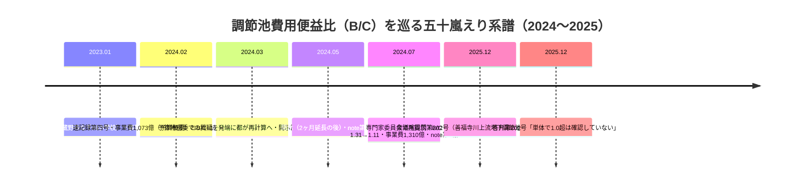

# 2026-11-23（第274回）・善福寺川上流地下調節池B/Cの質問主意書＝答弁書・都議会速記録・官報ミラー2件（水防警報公示・環七第5号第6号公告）・インフラツアー3点史の追加調査

## 1. 前回からの引き継ぎと今回の構成

第273回（中野区旧版の神田川整備告示群・大塚駅南口告示・学習院）終了点から、第273回課題を消化しつつ新規調查を実施。開始時のlist_commitsで並走実行が第273回を反映済みであることを確認（6be52501970d0b3d5f3e81ba77ed77a1ea5ed5e4）。**今回の収穫は①五十嵐えり系譜のB/C問題の一次公文書2点（衆議院質問主意書＋都議会速記録）、②官報全文ミラー（kanpo-backup.com）の発見とそこからの2件（善福寺川水防警報公示・環七第5号第6号公告）、③環七インフラツアー民間展開史の3点接続**。INDEX 1,652→1,658 items（+6: GOV-539〜542・BLOG-296〜297）。

## 2. 五十嵐えり「調節池B/C」監視系譜の一次資料化（本回の目玉）

第273回のkanpo-backupサイト内検索「善福寺川」ヒット（h01610・h01619・h01667）からの掘り下げで、**衆議院第219回国会 質問第202号「善福寺川上流地下調節池整備事業の費用便益比に関する質問主意書」（五十嵐えり・R7.12.12提出）と答弁第202号（内閣・R7.12.23受領・高市早苗署名）の全文を取得**（[GOV-539]）。核心は3点:

1. **国費投入計画**: R7年度当初予算で2億円（社会資本整備総合交付金）、今後は事業費の1/2＝**約700億円以上**の国費投入予定。
2. **B/C算定の構造**: 都公表事業費1,557億円に対し**B/C算定資料上は1,406億円**（設計・管理費等を除く試算値）が併存。神田川流域計画全体事業費**約4,844億円の29%**を占め、総便益6,814億円のうち貯水容量18.6%から按分便益**11.2%**＝**推計B/C約0.5**（質問者試算）。都申請の「調節池群」B/C=1.4は複数事業込み。
3. **答弁書**: 「お尋ねの『善福寺川上流地下調節池整備事業』**のみを対象として『費用便益比が一.〇を上回ること』は確認していない**」＝**単体B/C未確認を政府が明示した初の公文書**。

続けて**都議会令和6年度予算特別委員会速記録第四号**（総括質疑第3日・五十嵐えり質疑・中島東京都技監答弁・[GOV-540]）をopen_urlで全文取得。ここから:

- 石神井川上流地下調節池（南町調節池→武蔵野中央公園・約1.9km・30万m³・R4.3都市計画決定・R4.10認可・2024.2.26準備工事開始）の**事業費4変遷**: 600億（2023.1説明会・計画段階概算）→877億（R5.11.27のB/C資料）→989億（R5.1末公表）→1,073億（R6.1.26予算概要）。
- **B/C=1.31（便益1,154億円・年平均被害軽減85.4億円）が超過確率1/2（無害流量・40mm相当）と1/10（65mm）の2ケースのみで算出**され、国交省マニュアル（6ケース設定・「区間確率が滑らかに減少するよう配慮」）に反するという批判。五十嵐試算では42.7億円/年→**B/C=0.66**。技監は「213.6×0.4=85.4」の直線平均方式を正当化。
- **神田川・環状七号線地下調節池は「二十分の一（75mm・全整備完成前提：調節池＋流域対策＋護岸）と二分の一の2ケース」で算出**という技監答弁＝**神田川系B/Cの算定構造の都側第一次文言**（GOV-485のB/C=1.41・GOV-149森川技術士の二重計上疑いと接続）。
- 住民説明会＝**2024.2.22-23・武蔵野市立千川小学校**（2023.1.18/22も同校）＝千川小学校（BLOG-220既出の千川上水沿いの校）が石神井川上流調節池説明会会場という一次記録。
- 技監「平成28年度以降、事業評価委員会用で費用対効果が1を下回った建設局事業はない」。

そして[BLOG-296]（五十嵐えりnote 2本・2024-05-15・07-24）で10調節池のB/C算出根拠の一括開示請求（2024.3.11請求→5.14開示・2ヶ月延長）と、**都のやり直し専門家委員会で石神井川上流の再提示（事業費1.2倍の1,310億円・B/C 1.31→1.11・算出根拠は原則公表へ運用変更）**を確認（og:description・LDJSONレベル。本文全文は次回）。

### 五十嵐えり系譜のタイムライン

## 3. kanpo-backup.com（官報全文ミラー）の発見（第273回課題の進展）

- URL体系＝`https://www.kanpo-backup.com/detail/{YYYYMMDD}h{NNN}full00010032.html`、サイト内検索＝`https://www.kanpo-backup.com/?search={URLエンコード}`（件数表示・詳細ページへのリンクを返す）。**収蔵は2025-03-10以降のみ**なので、関東地方整備局告示第37号（R7.2.27）自体は取得できず未達（次回課題継続）。
- **重要陰性観察**: 谷端川・水窪川・弦巻川・千川・雑司ヶ谷・妙正寺川・江古田川・環状七号線地下調節池でサイト内検索＝**全て0件**＝対象四河川のうち法定河川に位置づけられていない川々が官報レベルでも告知対象になっていない（PAP-099の千川の法定河川非化と整合）。
- **善福寺川系3件ヒット**から2件を新規資料化:
  - [GOV-541]（官報R8.3.17）＝気象庁公示「**水防活動用洪水予報及び警報の開始について**」＝荒川水系善福寺川で水防活動用洪水予報・警報を開始（**開始期日R8.3.17 13時・基準地点区間＝上流端 杉並区善福寺二丁目〔松見橋〕〜下流端 神田川合流点〔白山前橋〕**・東京都知事と水防法11条2項協議整了・気象庁長官野村竜一）＝**善福寺川の水防体制の法定側文言はrepo初出**。松見橋・白山前橋が基準地点区間の橋名として官報レベルで文言化された点も新規（両橋名自体はGOV-489・BLOG-261既出）。
  - [GOV-542]（官報R7.10.24）＝関東地方整備局公示欄公告＝都市計画事業「**第五号石神井川及び第六号神田川**」（環七地下調節池）の**事業施行期間＝平成28年4月1日〜令和14年3月31日**・種類名称＝「平成28年関東地方整備局告示第176号 東京都市計画河川」・施行者＝東京都・関東地方整備局長橋本雅道。OCR多段組のため**法条（建基法77条の21公示欄か都計法63条公告欄か）・告示番号（176/213/214号）の列帰属は未確定**＝官報原本でのhuman目視を次回に回す（断定しない）。

## 4. 環七インフラツアー民間展開史の3点接続

- [BLOG-297]（PR TIMES公式配信・**2023-12-07**・全文取得）＝クラブツーリズム「**環状七号線地下調節池 幻想的な光の回廊**」ツアー＝**2024年2月4日・25日・6,990円・方南町駅改札前集合→善福寺川取水施設から神田川取水施設まで本管約600mの通り抜けウォーキング**・岩崎電気共同ライトアップ＝環七本管内ウォーキングの初期記録（repo初出。2取水施設間の本管距離約600mという一次文言はGOV-489両監視局の位置対比の補強）。
- [GOV-149]第274回追記＝（公財）東京都公園協会プレス（travelspot.jp転載・全文取得）＝第2期（2027-01-09〜02-28・土日祝12日間）の**プラン3種（外郭放水路とのダブルインフラ・バス16,900円／地下トンネル×プラネタリウム8,500円／伝統芸能6,000円）**・「**大雨等で調節池の中に水が入っている時…中止または縮小開催**」の運用従属文言。案内されている特設サイト（kensetsu…/river/keihatsu/infra）は**2026-11-23時点で404＝未公開の可能性**（陰性観察として記録）。
- 系譜: BLOG-297（2023-12告知・2024-02開催）→都プレス2025-11-13（第1期2026-01〜03）→都プレス2026-11-02＋公園協会プレス（第2期2027-01〜02）。GOV-291第1回議事要旨「完成後の利用はインフラツアーなど多目的な活用」（R8.3.4）との呼応。

## 5. 陰性・監視系の記録

- 学習院G.LiFE sitemap 570 URL走査（第273回課題④）＝sanpoシリーズは「目白の地理さんぽ」240の1本のみ、100〜106・237〜243は汎用シェル応答＝**陰性確定**（ORG-039で既知の1本を補完する新材料なし）。
- 統一search 8監視クエリ（recency14d）＝谷端川/弦巻川/雑司が谷は前橋クマ暗渠ノイズ・水窪川は米沢水窪ダムノイズ・千川上水は不動産案内ノイズ＝**対象4河川の新情報なし**。神田川・環七系は日経クロステック（GOV-291既出・「検討が進む環状七号線地下河川の一部を担う」キャプション文言の微細差のみ＝GOV-291の追記に値しないと判断しノート記録に留めた）とインフラツアー記事サイズ（→GOV-149追記に消化）。
- NDL opensearch「弦巻川」（title検索）＝2件onlyで**いずれも既知**（GOV-003「名こそ流れて」・BOOK-037「弦巻川がきえちゃったよ」〔GOV-104でNDL書誌既出〕）＝any検索拡張でも0件追加。**NDL側の新規書誌なし**という陰性記録（第273回課題⑤消化）。
- 環七what's new（kanzyou7.com）＝2026/11/20「週間工程表・シールド進捗図更新」＝定常更新のみ。
- 都庁プレス2026-11-02（インフラツアー第2期告知）・都建設局特設サイト＝前者はGOV-149既知／後者は404（上記）。

## 6. 第275回以降の課題

1. **官報のhuman目視系の消化**: GOV-541（表欄の確定）・GOV-542（法条・告示番号の列帰属）の官報原本確認（NDL官報は本環境でDNS解決不能の実績あり・関東地方整備局の告示目録ルート〔/toukoku/〕も並行）。関東地方整備局告示第37号（R7.2.27）の取得は継続課題。
2. **開札2026-12-02（環七調節池広域整備検討その2）**＝今回はまだ未来（次回実行期限内の可能性が高い）＝**入札結果の確認**。
3. BLOG-296のnote本文全文の読み（無料公開部分のLazyLoad対応）・開示されたB/C算出根拠資料の実物所在確認。
4. GOV-540の配布資料「B/C資料（R5.11.27）」本体・都の「原則公表」運用変更の正式文書の特定。
5. 環七第5号・第6号公告の施行期間「令和14年3月31日」の従来repo文言との差分照合（水事業年度の延長系の整理）。
6. インフラツアー特設サイト（kensetsu…/infra）の公開再確認・第1期（2026-01〜03）の実施報告の所在。

## 7. 重複確認メモ（採番前実施分）

- 五十嵐えり・質問主意書：repo全体で0件（GOV-485/486/149のB/C系議論は存在するが国会文書は未収録）→新規。
- 「1,310億」「1.11」「開示請求」B/C文脈: repo 0件→新規（BLOG-296）。
- 石神井川上流地下（事業の主体はGOV-149・GOV-291の一覧文言で既出だ={
  費用4変遷・B/C=1.31の2ケース構造・当事者速記録は未収録）→GOV-540新規。
- 水防警報公示・環七第5号第6号公告：repo 0件→GOV-541/542新規。
- クラブツーリズム・光の回廊・600mウォーキング: repo 0件→BLOG-297新規。
- 松見橋・白山前橋: GOV-489・BLOG-261等で橋名既出＝対照表・橋名調査への新規行なし（官報文言は資料内記録）。