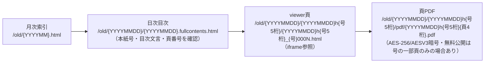

# 2026-11-23（第275回）・官報公式サイトの発見とGOV-541/542の文言直接確認・B/C開示実物の所在確定・善福寺川観測所網と官報走査レーンの技術メモ

## 概要

第274回が残した課題のうち、①官報2件（GOV-541・GOV-542）のhuman目視相当（文言の列帰属確定）、②note本文全文（BLOG-296）、③開示B/C算出根拠資料の実物所在、④都建設局特設サイトの再確認、を消化。加えて⑤東京都水防災総合情報システムの善福寺川観測所網（新規GOV-544）、⑥五十嵐えり公式サイトのB/C開示資料PDF群（新規GOV-543）を収録。**元来human目視待ちとして残っていた官報2件の列帰属問題は、官報公式サイト（www.kanpo.go.jp・2025-04-01運用開始）の頁PDFを入手したことで大幅に解消**したことが本回最大の成果〔残るは表罫線レベルの最終確認と告示37号原本のみ〕。

## 1. 官報公式サイトのURL体系（第276回以降の官報走査レーン＝技術メモ）

 kanpo.go.jp（www付きで200）の本紙アーカイブ構造を実測で確立した:

- **実測値〔確認〕**: 令和8年3月17日＝第1667号（本紙h01667）・令和7年10月24日＝第1575号（h01575）・令和7年2月27日＝第1413号（h01413）〔各日次目次頁の「第○号」文言で確認〕。
- **重要な制約〔観察〕**: ①頁PDFは**AES-256（V/R=5/6・AESV3・空ユーザーパスワード）で暗号化**（pip不可環境のため純PythonAES実装＋ISO 32000-2 Algorithm 2.Bで復号、FIPS-197・SP800-38Aセルフテスト通過の実装を当環境に構築済み）。②**復号しても本文テキスト抽出はできない**＝本文フォント（C0_0〜C0_5等）はToUnicodeを持たず、CIDSystemInfo Ordering=Npb1（国立印刷局専用CID順序）のため、CFF埋め込みフォントのcharset解析（CFFパーサ）なしでは本文抽出不能。③**本文復元の実戦レーンは頁PDFをr.jina.aiでOCRする方法**（本回はこれで告示213号全文・気象庁公示全文を復元・OCRとはいえ官報公式PDF由来でkanpo-backupより一段強い出典）。④**無料公開が号の一部頁のみの場合がある**: 第1413号（R7.2.27＝告示第37号が掲載される号）はviewer/pdfとも**1〜2頁分のみ**＝告示37号本文（目次「都市計画に関する件（関東地方整備局三七）」・掲載頁は無料圏外）は取得不能のまま〔継続課題〕。
- **GOV-541（官報第1667号・9頁）の成果**: 「水防活動用洪水予報及び警報の開始について」が**東京都知事協議分（荒川水系・善福寺川）と北海道知事協議分（十勝川水系・美生川／途別川）の2本立て**であること、担当官署＝気象庁大気海洋部・共同実施機関＝東京都建設局河川部・区間（上流端＝杉並区善福寺二丁目／下流端＝神田川合流点）・開始期日＝令和8年3月17日13時の各欄が確定。**第274回の「上流端〔松見橋〕・下流端〔白山前橋〕」という橋の区間端付記読みは、両橋の地理位置（白山前橋＝成田東2丁目〔GOV-489〕で神田川合流点に非ず）と両橋が水位観測所であること（GOV-544）から、基準地点欄の値と読む方が自然と修正**（表罫線は画像OCRでは確認不能のため「推定（強い傍証）」に格上げ、human目視での最終確定を残す）。
- **GOV-542（官報第1575号・5頁）の成果**: 「〇関東地方整備局告示第二百十三号」の全文を復元し、**法条＝都市計画法63条1項（認可）→62条1項（告示）**、**「平成28年告示第176号東京都市計画河川 事業第五号石神井川及び第六号神田川」＝「種類及び名称」欄**、施行期間＝平成28年4月1日〜令和14年3月31日、収用・使用部分＝変更なし、がすべて確定。第274回が混在と見た「建築基準法77条の21」文言は**隣接の告示第214号（指定確認検査機関更新・無関係の別件）**の本文混入と判明（第274回の「第214号＝収用事業の指定有効期間関係」読みは誤り）。

## 2. BLOG-296全文とGOV-543（開示実物の所在確定）

- note2本（2024-05-15／2024-07-24）の**本文全文を取得**（r.jina.ai・無料公開本文）。note Aから: ①開示実物PDF6点（開示決定通知書・下高井戸調節池・環状7号線地下広域調節池〔5頁〕・城北中央公園調節池・境川金森調節池・谷沢川分水路）が**五十嵐えり公式サイト（igarashi-eri.com/wp-content/uploads/2024/05/…）で公開されている**＝[GOV-543](sources/gov/GOV-543.md)として所在記録（実物4点取得済み、いずれも画像PDFで本文human目視待ち）②「**調節池全体が完成したときの費用便益分析を行ったのは5つあった**」答弁変化と伏せていたことへの批判、③境川金森調節池の**4ケース設定（他は全て2ケース）と「神奈川方式」採用の都回答**、④首都圏央道事業取消訴訟・**東京高裁平成23年7月19日判決**の文言引用、⑤「国により『保留』4/9読売新聞」、⑥石神井川上流への開示は「4点のみ」。
- 意義: **GOV-539（質問主意書）→GOV-540（都議会速記録）→BLOG-296（note全文）→GOV-543（開示実物）のB/C監視系譜の全ノードが本文レベルでつながった**。

## 3. GOV-544（東京都水防災総合情報システムの善福寺川観測所網）

- 白山前橋詳細ページ（2026-11-23 17:32時点表示）から**善福寺川の観測所系列12点**（原寺分橋→原橋→荻窪橋→松見橋→西田端橋→善福池→相生橋（善）→白山前橋→宮下橋→和田堀公園調節池→善福寺取水→朝日橋）と**水位計/静止画の別・各観測所の10進緯度経度**を一括取得〔[GOV-544](sources/gov/GOV-544.md)〕。観測所名としての善福池・和田堀公園調節池・朝日橋はrepo初出。
- 直接の効用: ①[GOV-541](sources/gov/GOV-541.md)の基準地点＝松見橋・白山前橋が**水位観測所として実在**であることの裏付け、②**善福寺取水（35.68540,139.65484）＝環七調節池の善福寺川取水口（堀ノ内2丁目1番〔GOV-489〕）の10進座標**、③宮下橋の10進座標（35.68349,139.64136）。

## 4. GOV-149追記（特設サイトの生存確認＝第274回陰性観察の修正）

- [GOV-149](sources/gov/GOV-149.md)第274回追記が「2026-11-23時点404」と記録した都建設局特設サイト（kensetsu.metro.tokyo.lg.jp/river/keihatsu/infra）は、r.jina.ai経由で本文取得に成功（更新日2026-11-02）＝**陰性観察の修正**〔curl直接はボット対策の403/404系エラーとなり、ページ不存在と区別できないという教訓を記録〕。
- 新規文言: ①**河川施設VR（360°画像）によるバーチャルツアー**の案内（kensetsu3ドメイン・[GOV-149](sources/gov/GOV-149.md)追記参照）＝repo初出、②問い合わせ先＝**建設局河川部計画課 中小河川担当（03-5320-5414）**、③写真文言「神田川から環状七号線地下調節池へ取水している状況」。
- NEWSCAST配信記事（2026-11-11・SOCIALWIRE経由・公園協会リリース）も同一内容を確認〔新事実なし・配信ネットワークの追跡記録のみ〕。

## 5. 陰性・監視系（recency 14日・2026-11-23実施分）

- 統一search 8クエリ（谷端川／弦巻川暗渠／水窪川渋谷／千川上水／環状7号線地下調節池／雑司ヶ谷幹線下水／大塚台公園／C58東京機関車）: ①「谷端川」は阪神・谷端選手の野球noise、②「弦巻川 暗渠」は前橋クマ暗渠騒動のnoise、③「水窪川 渋谷」はハンズ渋谷閉店・Perfume結婚等のnoise、④「千川上水」は市川市水道局・日経クロステック都市型水害シリーズ連載（11-02・GOV-291既出）・国交省11-10プレス（千葉豪雨・対象外）、⑤「環状7号線地下調節池」は**NEWSCASTインフラツアー記事（既知・GOV-149/round120・274）と建設通信新聞2026-11-11（GOV-148と同一内容・公告一次テキストの直接確認はGOV-148の制限事項のまま）**、⑥「雑司ヶ谷幹線」「大塚台公園」「C58」はnoise。**対象4河川（水窪川・弦巻川・谷端川・千川上水）の新情報なし**。
- kanzyou7.comのWHAT'S NEW: **2026/11/20のまま不変**（第274回と同一＝陰性）。
- 建設通信新聞2026-11-11記事の「２７年１２月１０日」履行期間文言はGOV-148で「2027年12月10日」と解釈済み（「令和27年」でなく「2027年」＝令和9年とみなす読みが既に記録済み）のため新規記録なし。

## 6. 次回（第276回）への引継ぎ課題

1. **開札2026-12-02（環七調節池広域整備検討その2〔GOV-148〕）の入札結果確認**（第243回から順送り・次回は開札日を過ぎるため結果確認が可能になるはず）。
2. **GOV-541基準地点欄（松見橋・白山前橋の欄帰属）のhuman目視確定**（官報原本・NDL等の頁画像）と**GOV-542施行期間の旧値**（平成28年告示第176号本文＝都市計画事業認可時の施行期間文言）の照合。
3. **関東地方整備局告示第37号（R7.2.27・神田川寿橋下流〜富士見橋上流区間認可）の本文取得**＝官報公式サイトの無料圏外（第1413号は1-2頁のみ無料公開）・kanpo-backupも2025-03-10以降のみという2重の圏外〔NDL史料館・官報情報検索センターの翌ルート〕。
4. **GOV-543の残り2点PDF取得と6点の内容human目視**（特に環状7号線地下広域調節池5頁のB/C原票・開示決定通知書の非開示文言・境川金森の4ケース数値）＋**note Aの「読売新聞4/9」の当該記事特定**。
5. **GOV-544観測所⑩〜⑫（和田堀公園調節池・善福寺取水・朝日橋）の河道上の配置検証**（座標から本流からの分岐・調節池への接続線と読める部分の確認＝画像・地図での照合）＋「善福池」観測所の設置場所（善福寺池畔〔推定〕）の確認。
6. **CFFパーサの実装**（官報頁PDFの本文抽出用=Npb1 CIDのcharset解析。実装すれば告示37号の無料圏内頁があった場合でも文言抽出可）と、**官報月次索引の定期走査**（関東地方整備局・都関連告示の新着監視レーンとして/old/{YYYYMM}.htmlを月末走査）。
7. **README末尾改行の維持管理**（第274回修正4と同様、push時に末尾改行が落ちないよう本回は末尾改行を付してpush・次回以降もpush前後にバイト数照合を継続）。

## 変更ファイル

- docs/sources/gov/GOV-541.md（第275回追記・status格上げ）
- docs/sources/gov/GOV-542.md（第275回追記・status格上げ）
- docs/sources/gov/GOV-543.md（新規）
- docs/sources/gov/GOV-544.md（新規）
- docs/sources/gov/GOV-149.md（第275回追記）
- docs/sources/blogs/BLOG-296.md（第275回追記・status格上げ）
- docs/2026-11-23（第275回）・…md（本ノート）
- docs/sources/INDEX.md（再生成）
- README.md（第275回bullet・末尾改行復元）

INDEX 1,658→1,660 items（GOV-543・544の新規2件。追記・格上げは増減なし）。
