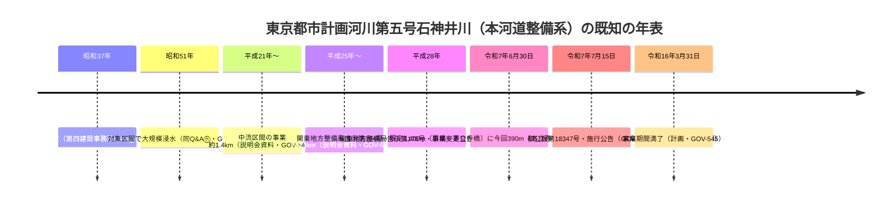

# 第279回（2026-11-23）・石神井川第五号施行公告（都公報第18347号）と別紙案内図取得・武蔵野市の地下調節池年表・豊島区冠水統計（art-pi）の追加調査

**新規採録**: [GOV-547](sources/gov/GOV-547.md)・[GOV-548](sources/gov/GOV-548.md)・[BLOG-299](sources/blogs/BLOG-299.md) ／ **追記**: [GOV-545](sources/gov/GOV-545.md)（別紙案内図本文・制限①②解消）・[GOV-521](sources/gov/GOV-521.md)（GCFポータル実績） ／ INDEX 1,663→1,666 items

## 何をしたか

1. **第五号石神井川の施行公告（GOV-547＝第278回課題②③の解決）**: [GOV-545](sources/gov/GOV-545.md)（着手プレス・説明会資料群）の制限①「別紙案内図未取得」・②「事業認可告示の原典未特定」をともに解消。
   - **別紙案内図**（20250630_03_01・664KB。第278回の直curlはbot避けHTMLを返し未取得だったもの）を **r.jina.ai経由で本文取得** ＝「**既定認可区間 1,400m（扇橋～本立寺橋）**」「**今回認可区間 390m（本立寺橋～弁天橋）**」の文言を固定。**「扇橋」はrepo初出の橋名**（grep 0件で確認）。橋名群＝弁天橋・長者橋・本立寺橋・豊城橋・西豊城橋・庚申橋・扇橋。武蔵関公園（富士見池調節池）の位置表示もあり＝[GOV-416](sources/gov/GOV-416.md)・[BOOK-089](sources/books/BOOK-089.md)（千川上水と富士見池）系と接続。
   - **都公報第18347号（2025年7月15日）公告「都市計画河川事業の施行について」**（号PDF 194,984バイト・r.jina.ai本文抽出）＝ 事業認可の告示「**令和7年6月30日 関東地方整備局告示第百六十四号**」・事業地「**東京都練馬区関町北二丁目、関町北三丁目及び関町北四丁目地内**」（**関町北四丁目の含入はrepo初出文言**・プレス・説明会資料は二〜三丁目のみ。案内図の付近町名ラベル「練馬区関町北四丁目」と整合するが、四丁目含入が範囲の実質的拡大明示か丁目境界の事務的表記かは断定不能で併置）・施行者＝東京都・所管＝第四建設事務所。〔[GOV-534](sources/gov/GOV-534.md)（第六号神田川・告示第37号・第18262号）と完全対称〕。認可→公告15日（第六号は13日）で、ほぼ同じ速度で公告が発出される慣行の傍証。
   - **走査**: 2025年7月の都公報第18337〜18358号（22号・うち18341号は休刊404）をr.jina.aiで本文抽出走査し、「都市計画河川」文言は**第18347号の公告1件のみ**と確認（走査記録はGOV-547本文）。第18345号（R7.7.11）告示「令和七年度地籍調査事業計画」に**豊島区千川二丁目**・練馬区石神井台八丁目・田柄一〜四丁目等の調査対象文言＝千川二丁目＝千川の名の地の2025年度地籍調査対象は**地籍監視系の重点 watch 項目**として記録〔千川遺構の位置特定の一次データ供給源候補〕。

2. **武蔵野市「石神井川上流地下調節池について」ページ（GOV-548）**: ページ番号1039135・更新日2026年11月9日**令和5年6月28日名称決定（仮称→石神井川上流地下調節池）＝名称決定年月日の一次記録はrepo初出**、**令和8年3月11日/15日本体工事説明会＝武蔵野中央公園〜南町調節池区間**の年表・令和4年7月13日要望書PDF・青梅街道や伏見通りの道路区域等の地下トンネル構造（75mm対応）・都立武蔵野中央公園発進立坑・北多摩北部建設事務所の2リンク（kitatamananbu0097_00002/00008）を固定。[GOV-539](sources/gov/GOV-539.md)/[GOV-540](sources/gov/GOV-540.md)（都議会・開示系）・[BLOG-296](sources/blogs/BLOG-296.md)（開示note）で把握していた事業の**市区側公式ポータルの所在を初めて固定**。[BLOG-283](sources/blogs/BLOG-283.md)/[BLOG-287](sources/blogs/BLOG-287.md)（西東京市南町の水田用水・はけ口）の南町が終点側施設側（南町調節池）として扱われている経緯の行政側確認。**本体工事説明会資料（kitatamananbu0097_00008）の本文は未取得＝次回の取得候補**。

3. **豊島区冠水統計（BLOG-299）**: art-pi.com（おかあさんのおうち）「豊島区 冠水 どこが危険の？」（2026-09-23公開・[BLOG-115](sources/blogs/BLOG-115.md)板橋区版の対）の本文全文取得。
   - 谷端川緑道下の住所＝**西池袋4丁目と池袋本町3丁目**の浸水履歴（2011.8.26=87mm/h・100世帯、2000.9.12=18mm・38世帯、1999.8.29=169世帯最多、2008.7.29=22mm・40世帯・ほとんど床上）。
   - 年代別集計＝**1981〜89年3,424世帯 vs 2010年代225世帯**・最多1987.7.31（30分60mm）＝**1,232世帯**〔repo既知の1987.7.31浸水の集計「床上1,123件・床下109件」との**数値差異は併置**（集計単位・出典の違いかは本記事からは未確認で断定せず）〕。
   - **国交省関東地方整備局「道路冠水注意箇所」＝都内135か所・豊島区1か所（ビックリガード/区道12-680号線/南池袋1丁目）・板橋区7・練馬区6・両区跨ぎ3**〔repo初出候補〕＝[BLOG-185](sources/blogs/BLOG-185.md)（ビックリガードの由来・弦巻川上流域）と接続。
   - 都「浸水実績箇所の住所検索」＝**豊島区182行・48回・8回以上の15町**・第二雑司ヶ谷幹線・第二千川幹線・谷端川一号幹線の整備歴・**池袋本町＝下水道浸水対策計画2022の新重点地区10地区の1つ**・高田1〜3丁目＝神田川浸水想定区域のみ・雨水出水浸水想定区域R8.3.25指定。
   - 制限＝浸水数値は記事経由の二次引用。**1987年7月31日の一次資料照合**・**国交省「道路冠水注意箇所」一覧の直接取得**（板橋区7・練馬区6の内訳＝谷端川・千川低地の冠水対象特定に使える）は次回候補。

4. **大塚台公園GCF実績（GOV-521追記）**: ふるさとチョイスGCF 5658（2026-11-23現在）＝**寄付1,070,000円・達成率35.6％・支援12人・受付2026年9月9日〜12月26日（109日）・目標3,000,000円**〔制限だった目標金額・募集期間・実績の一次確認が確定。最終実績の再確認は受付終了後〕。

5. **kanzyou7 WHAT'S NEW の構造確定（第277回訂正の再訂正）**: kanzyou7（環七地下水調節池サイト）の WHAT'S NEW は「更新系リスト」（週間工程表・シールド進捗図等・最新2026/11/20）と「お知らせリスト」（最新2026/11/11）の**二段構成**＝第268回〜第276回の観察が正しく、第277回ノートの「2026/11/20は誤記」という訂正が誤りだったことが確定**。経緯として第277回ノートの当該記述を**再訂正（撤回）**する。最新進捗図2026-11-19・週間工程表・シールド進捗図の更新は現在も確認。

6. **監視・陰性系の記録**:
   - 都公報の最新号＝**第18673号（令和8年11月20日発行）のまま**（11月23日＝祝日〔勤労感謝の日〕のため発行なし・18674号は404）。
   - **河川整備計画一覧ページ**（建設局）＝神田川流域R5.3版・石神井川H28.3版のまま＝**大雨頻発踏まえた見直し後の決定版はいまだ未公表**（GOV-124系・GOV-548の言う「平成28年3月策定」の現行性を再確認）。
   - **神田川中流部調節池（高戸橋〜駒塚橋・約30.9万m³〔第278回のGOV-546〕）の都公式ページ・調達公告は今回も未特定**＝陰性記録（建通新聞・日刊建設工業新聞の2報道のみが確定情報源のまま）。
   - musashi.repo.nii.ac.jp（武蔵野郷土文庫）は HEAD 応答なし＝不通継続。nabunken 85312 JSON＝200 OK・GOV既記載と不変。
   - unified_search 8クエリ（谷端川・弦巻川・水窪川・大塚台公園C58・千川コミュニティガーデン等）＝noise・既知のみ（朝日本田創記事は既記録で見送り、FreedomTrain=BLOG-298〔既〕、Stroly丸池=既見送り）。

## 第五号石神井川の既知の年表（確認ベース）

〔注: 既定認可区間1,400mの当初認可年次は案内図・公告ともに文言なし＝未確認。上図の平成21年〜／平成25年〜の区間的事業は本河道整備の進行を示す文言で、既定認可区間との位置対応は原図判読待ち〕

## 次回（第280回）の宿題

1. **環七調節池その2の開札（2026-12-02）の入札結果確認**（第259回から順送り・最優先）。
2. GOV-543頁画像（開示実物のhuman目視）・経営計画2026画像PDFの human 目視（AI判読禁止・人力のみ）。
3. **武蔵野市の本体工事説明会資料（kitatamananbu0097_00008）の本文取得**（GOV-548の制限①）。
4. **関東地方整備局告示第164号（R7.6.30）の原本**（ktr.mlit.go.jp・官報該当号）のhumanルート取得（GOV-547の制限②・告示本文の全行確認を含む）。
5. 都公報第18347号別表・第18345号地籍告示の**human目視**（表組み・全行の正確な確認）。
6. 1987年7月31日浸水（1,232世帯 vs 1,123件）の一次資料照合（都水害リスク情報システム・区資料）＋国交省「道路冠水注意箇所」一覧の直接取得（BLOG-299の制限①②）。
7. [GOV-520](sources/gov/GOV-520.md)系の経過観察（大塚台公園本体工事、GCF受付2026-12-26終了後の最終実績）。
