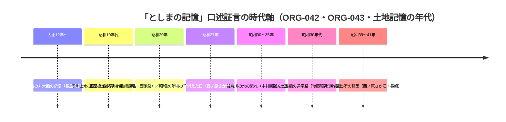

# 2026-11-23（第287回）・「としまの記憶」動画アーカイブの全ID掃引＝千川上水口述証言群（昭和27年消滅・桜並木・語り部活動）と谷端川・霜田橋・どんどん橋・水道端の新規収録

- 実行日: 2026-11-23（月）・第287回定期調査。前回: 第286回（最終HEAD 088f12d6・INDEX 1,692 items〔GOV-557〜559・ORG-040/041・BLOG-306・BOOK-285〜288収録〕）。本回はpush前に最新main再取得（list_commits）で並走を確認（HEAD 088f12d6のまま・並走なし）してから反映した。第286回ノートの次回課題①（環七調節池その2・開札2026-12-02）はまだ未来のため順送り（**第288回最優先**）。その他の申し送り課題は後段のとおり。
- **本回の主眼〔ORG-042・ORG-043新規〕**: [ORG-007](../sources/org/ORG-007.md)（谷端川編）・[ORG-016](../sources/org/ORG-016.md)（水窪川コース）・[ORG-017](../sources/org/ORG-017.md)（弦巻川編）で知るNPO法人「としまの記憶」をつなぐ会の動画アーカイブ（movie.toshima-kioku.jp）について、**ツアー動画だけでなく2012〜2017年撮影の個別口述証言動画（アーカイブID=2012xxx〜2017xxx）が数値IDで100本規模で並列公開されていることに着目し、存在が既知だった2012シリーズ80本に加え2013・2014・2015・2016・2017の各シリーズ（各〜80件）を含む400件の取得・掃引を実施**（うち実在259件・404は141件）。**サイト内検索（`/?s=千川`＝19件・`/?s=谷端川`＝4件）で掃引漏れチェックを行い、千川上水関係10本・谷端川・橋関係5本を2件のソースファイルに集約収録**（いずれも**公開ページの文言確認のみで動画本体は未判読**・human視聴待ち）。第283回で「間接的のため未資料化」とした[清戸道ツアー（2025.9.27）](https://movie.toshima-kioku.jp/archives/toshima-kodo-kiyoto/)は、コース文言に「**籾山牧場跡（南長崎6丁目）➡千川上水➡西原不動**」があることを直接確認したため本回でORG-042に収録した。
- **成果1〔ORG-042新規・千川上水口述証言群〕**: ①**「昭和27年・千川が消えた日」**（西ノ原さか江・千川・2012撮影）＝「嘗て、**千川上水が流れていた千川通り**。その**川の暗渠化**に伴った街の変化について、実際にその通りを歩き当時を振り返る」＝**豊島区千川区間の千川通りの消滅を昭和27年とする口述位相**〔暗渠化年次の対校表に豊島区側の口述を加える新データ点。着手25年説〔[GOV-072](../sources/gov/GOV-072.md)〕・27年3月着手説〔[BLOG-113](../sources/blogs/BLOG-113.md)〕・武蔵学園付近の1959-60年〔[ORG-019](../sources/org/ORG-019.md)〕と並置し断定しない〕。②**「昭和10年代の千川の流れ」**（海保洋一・要町）・**「水の無い千川上水を歩く」**（海保洋一＋坂本幹夫・要町・いずれも2012撮影）＝要町区間の実水流（戦前）と暗渠化後の散策の口述。③**「千川上水のうつろい」**（田島晴一・千早町・2013撮影）＝「**地元で言われている**千川上水のいわれ」＝地元伝承の2013年時点の記録で、語り手の田島晴一は千早町の旧家（分家7代目を自称・2013005）で千早・要町側の土地記憶の保持者。④**「千川に語り部活動を立ち上げる」**（高木継夫・千早・2014撮影）＝**千川の語り部活動の2014年時点の存在と小学校巡回の当事者口述**〔千川語り部活動の口述側初記録〕。⑤**「千川彫刻公園となった私の生家」**（伊藤縫子・2014撮影＝[GOV-117](../sources/gov/GOV-117.md)の千川彫刻公園の生家側の記憶）・**「千川に建っていた私の家」／「昭和20年頃の千川の暮らし」**（内田安茂・79歳・1936年生まれ・千川・2015撮影2本＝**第286回時に未特定だった『昭和20年頃の千川の暮らし』の個別URLを2015047と特定**し、2015046と対で収録）＝千川地区（町名としての「千川」）の戦前〜戦後の生活史・井戸の口述。⑥**「桜が咲き乱れる千川上水」**（小川清・74歳・**長崎**・2016撮影）＝豊島区長崎区間での千川堤の桜並木記憶〔[BOOK-180](../sources/books/BOOK-180.md)（1918年）・[BOOK-153](../sources/books/BOOK-153.md)の桜堤系の昭和戦後期側の口述位相〕。⑦**「立教大の提灯行列が行く」**（西ノ原さか江・長崎・2012撮影）＝「**長崎6丁目にあった水道端派出所が建物ごと移築された**」＝水道端の口述（後掲の対照表新行へ）。⑧[清戸道ツアー]のコース文言＝南長崎6丁目の千川上水通過点（2025年時点）。
- **成果2〔ORG-043新規・谷端川・橋の記憶口述証言群〕**: ①**「川のない霜田橋」**（岩崎康弘・77歳・西池袋・昭和20年・2012撮影）＝「現在は暗渠となっているが、**椎名町には谷端川が流れ、それに架かる霜田橋があった**」＝**椎名町の谷端川・霜田橋の実在の口述witness**〔霜田橋の位置と「霜田＝下田（検地用語）由来」は[BLOG-153](../sources/blogs/BLOG-153.md)既収録で、住民記憶側の独立witnessを追加。対照表の霜田橋系の解釈を強める〕。②**「谷端川の水の流れ」**（中村勝則・70歳・**北池袋**・**昭和30〜35年**・2017撮影）＝「今は暗渠となった谷端川。**その昔の水の流れを滔々と語る**」＝北池袋区間で昭和30〜35年頃に水が流れていた記憶〔全体暗渠化1964年説〔[BOOK-001](../sources/books/BOOK-001.md)〕と矛盾しない水流記憶の下限定点〕。③**「北池袋の北映座からどんどん橋を渡った」**（後藤昭司・66歳・池袋本町・昭和30年代・2015撮影）＝「**歩くとどんどん鳴る橋（どんどん橋）**」＝**北池袋〜池袋本町界隈の橋名「どんどん橋」の口述〔repo初出。谷端川に架かる橋の可能性が高いが、ページ文言に川名はなく、同定は動画判読まで保留〕**。④**「池袋にあった成蹊学園」**（長島花樹・97歳・西池袋・**大正12年〜**・2012撮影・立教大学放送研究会）＝「池袋西口の成蹊小学校。**丸木橋を渡る時に川に落ちた**」＝大正期の成蹊小学校界隈の川の口述〔成蹊学園側で谷端川を「**十町川**」と呼んだ[BOOK-029](../sources/books/BOOK-029.md)・[MAP-033](../sources/maps/MAP-033.md)と同一の川への接続候補。川名の同定は動画判読までしない〕。⑤**「池袋と粟島神社」**（星川葭夫・2013撮影）＝ページに説明文言がなくサイト内検索「谷端川」でヒットするのみ＝**粟島神社（谷端川水源）関連証言動画の存在のみ記録**。
- **口述証言の時代軸（Mermaid・説明文言に基づく。動画判読による確定ではない）**:

- **対照表への反映（3行新設）**: ①**水道端（豊島区長崎・長崎6丁目）**＝2012030の「長崎6丁目にあった水道端派出所」口述＋清戸道ツアーの「南長崎6丁目の千川上水」コース文言（重なる地理的条件）を、関口（文政10年宅地用例）・滝野川・板橋区大谷口の各水道端と対照化（「水道」の対象は断定しない）。②**千川通り（豊島区千川付近・口述証言での用例）**＝2012017「昭和27年・千川が消えた日」の「嘗て、千川上水が流れていた千川通り」〔武蔵学園前の千川通り（[ORG-022](../sources/org/ORG-022.md)）とは別区間として新設〕。③**どんどん橋（北池袋）**＝2015028の橋名口述〔田無の「ドンドン川」（第262回新設）とは別系統〕。
- **手法の所見（第287回・掃引方式の記録）**: ①「としまの記憶」動画アーカイブの個別証言動画は`https://movie.toshima-kioku.jp/archives/<seriesID>/`形式の数値ID（2012〜2017シリーズ・各シリーズ実在数は数十件）で、**シリーズ番号の連続掃引（curl）＋本文抽出（title・語り手・現在の地名・時代・要旨）で水系キーワード（川・水・橋・池・谷・湧）の証言を全数洗い出せる**＝第288回以降も未掃引の角度（「橋」タグ・地図検索・語り手別一覧・2013〜2017シリーズの説明文言欠落分・本文空ページの再確認）と、**動画本体の判読（YouTube埋め込み等・human視聴）**が次の層。②2012・2015シリーズとも2012/2015+100以上のIDは404（各シリーズの収蔵は2桁）・2018以降のシリーズは存在しない。③ページの年齢・生年・居住年数の表示は内部矛盾（西ノ原さか江=60歳/生年1926等）を含むため**原文どおり記録し、考察には使わない**（ORG-042に明記）。
- **陰性・見送り（本回・記録のみ）**:
  - **監視系定点**（並行実施・すべて変化なし）: 都公報18674〜18677=404（新号なし・最新18673のまま）・kanzyou7 WHAT'S NEW=11/20定期更新のみ・tokopan.seesaa 521805591=Wayback CDX空（未収蔵継続）・sirakigi.com=000・daijo.shukutoku=000（DNS不通）・GOV-000028099系=jina 401（bad IP reputation）・kandagaw_158=403（WAF既知）・**NDL SRU横断＝谷端川31・弦巻川2・水窪川9・千川上水117＝第285回と同数で新着なし**。
  - **見送り判明済み（再確認）**: 産経環七記事=GOV-149第92回追記済・FNN 1142045=GOV-149系既知・建設通信1307376=GOV-148同一・FreedomTrain 58046=BLOG-298既収録・shigeyukiブログ（気になる生活ナビ）=一般まとめnoise・Made in としま展=水路無関係（第276回記録済み）・『失われた川を歩く 改訂版』=BOOK-001既収録・wanderxwonder=BLOG-054既収録。
  - **サイト内検索のみでヒットした周辺動画**（千早保育園・千早の戦後・要町での城北大空襲・千川の健康相談員など）＝川の文言がページになく地名由来のヒット＝採録を見送り（ORG-042の「未収録の周辺動画」節に明記）。
- **push構成（第287回）**: ①push_filesで小ファイル群（ORG-042・ORG-043・対照表3行追記・本ノート）→②INDEX再生成（1,692→**1,694 items想定**）を別コミット→③`.287-bullet.txt`+`insert-bullet-287.yml`（v2パターン: anchor=「- **第286回:」行・pathsにworkflow自体を含む・挿入後にヘルパー2ファイルを同一コミットで削除）をpush→Actions実行でREADME（2.6MB超）へbullet挿入→list_commits SHA照合→SHA固定のapi.github.com tarball＋diff・md5で検証〔READMEのpush_files直接投入は絶対にしない〕。push前に簡体字・文字化け掃引grepを実施済み。
- **次回（第288回）課題**: ①**開札2026-12-02（環七調節池広域整備検討その2〔[GOV-148](../sources/gov/GOV-148.md)〕）の入札結果確認＝開札日後の最初の実行で最優先（第259回から順送り）**②「としまの記憶」動画本体の判読（2012017・2012077・2017024・2015028・2012058優先＝暗渠化年次・霜田橋の構造・谷端川の水量・どんどん橋の川・成蹊の川名の発話確認）＝human視聴待ち③ORG-042/043の関連動画のinternal整合（2013006「地元で言われている千川上水のいわれ」の内容＝動画判読）④武蔵野市の冊子PDF（21.2MB）・GOV-543の23枚頁画像・経営計画2026画像PDF＝human目視待ち（順送り）⑤GOV-546神田川中流部の公式ページ・調達公告の特定（順送り）⑥BOOK-287『戦時下の武蔵野. 1』続巻確認・BOOK-286/288実物確認・青木邦弘回想実物＝human確認待ち⑦tokopan.seesaa 521805591のWayback収蔵監視継続⑧都公報12月分・GOV-000028099・sirakigi・daijo（senkawa2026）の再試行⑨NDL SRU差分監視（新規書誌）の継続⑩「としまの記憶」のテーマ特集・地図から探す・語り手別一覧の未掃引角度での再掃引。**この定期タスクは更新可否にかかわらず継続（停止しない）**。
