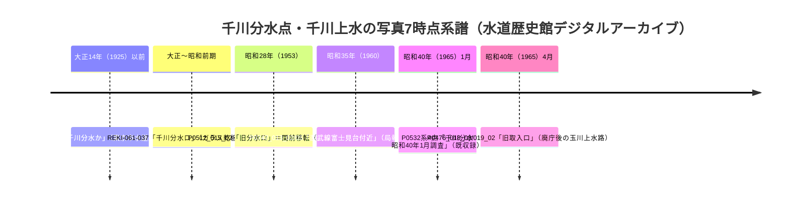

# 2026-11-24（第295回）・水道歴史館デジタルアーカイブ掃引で千川系8点（『上水記』第8巻＋分水点写真7点・7時点系譜）を新規収録

## 概要

- 東京都水道歴史館デジタルアーカイブ（ro-da.jp/suidorekishida）のコンテンツ検索を「千川」等で体系的に掃引し、repo未収録の8点（写真7点・古記録1点）を [GOV-574](sources/gov/GOV-574.md) として新規収録した。
- 最大の発見: ①**P0747_013_02/05「西武線富士見台付近の千川上水」（1960年5・7月・2026年11月15日公開の新着）**＝西武線交差区間を都水道局自身が1960年に撮影した公式写真2点（裏面注記「局報六十三号掲載／水道昔と今」＝機関誌掲載記録）。②**K0008『上水記』第8巻（石野広通・寛政3年1791）**＝享保7年（1722）廃止の青山・三田・千川・亀有（本所）四上水の概説を含む幕府編纂記録で、46ページの全文画像が2021年から公開済み。③分水点写真が**大正14年以前→大正〜昭和前期（乾板）→1953（旧分水口・関前移転前年）→1960（富士見台付近）→1965（廃庁後の旧取入口2枚）**の7時点で揃う系譜。

## メソッド: ro-da新着の取得レシピ（再現用）

1. コンテンツ検索: `GET https://www.ro-da.jp/suidorekishida/content?q=<URLエンコード語>`（Edge UA・`/content/search`は空フォームを返すので直接q付きGET）。cross検索（`/cross?q=`）はbooks対象でcontentを含まないため、両方を叩く。
2. 詳細頁: `GET /suidorekishida/content/detail/<資料ID>`（Edge UA・40秒以内で応答）。項目は「資料ID／種別詳細／タイトル／シリーズ・アルバムタイトル／大きさ／制作者／制作年月日／地域・施設名／解説／キーワード／備考／公開日」。備考に裏面注記の転記が残る。HTMLは数値文字参照なので要アンエスケープ。
3. 「NEW」バッジ＝最近の追加資料。今回のP0747系2点は公開日2026年11月15日で、2026年3/6/9・11月の「デジタルアーカイブの資料追加」の定期運用の産物。

## 新規source

- **GOV-574**: 8点の詳細。
    - **写真7点**: P0512_016_04「千川分水か」（大正14年〔1925〕以前か・東京市水道局・裏面「給水／21」）・REKI-061-037「千川分水口」（ガラス乾板・大正〜昭和前期・原タイトル「玉川上水路千川分水口」・「190」）・P0512_015_02「千川分水旧分水口」（**1953**・裏面「総務部庶務課（撮影場所：千川上水分岐点／撮影年月日：28年）」印＝**1954年関前移転（BLOG-113）の前年の旧分水口**）・P0747_013_02/05「西武線富士見台付近の千川上水」（**1960年7月／5月**・練馬区・局報63号「水道昔と今」掲載）・P0476_018_03/019_02「千川分水旧取入口」（**1965年4月**・シリーズ「昭和四十年四月 廃庁後の玉川上水路」・西東京市）。
    - **K0008『上水記』第8巻**: 寛政3年（1791）6月・幕府普請方上水方（石野広通）・**享保7年（1722）廃止の青山・三田・千川・亀有（本所）四上水の概説**（館解説）・46ページ全文画像公開（2021-08-04）。repoの享保7年飲用廃止史観に対する**幕府側編纂記録の原典**を、これまで所在未記録のまま素通りしていた。
    - **乾板の系列**: REKI-061-037の「190」と既収録REKI-039-015（GOV-064・1925年）の「200」＝近似番号の別乾板で、REKI-061／REKI-039番台に分水点のさらなる未公開乾板がないかの走査を次回課題に。
- **位置づけ（Mermaid・7時点系譜）**:

## 陰性（体系的・記録に値するもの）

- 水道歴史館デジタルアーカイブcontent検索: **「谷端川」「弦巻」「水窪」「雑司」「滝野川」「六義園」=0件**。コンテンツは千川系11点のみで、四河川のうち3河川は同館デジタルアーカイブに写真・記録なし〔実物収蔵の有無は別途確認要〕。
- 「千川」books横断=20件（既収録中心。未収録書誌は bookstore で個別判断したが今回は資料化せず）。
- 朝日新聞2026-11-14「暗渠の魅力」本田創インタビュー＝谷田川（田端）のみで四河川言及なし（既知の外縁と同型・見送り）。

## 監視系・アクセス不能（次回への申し送り）

- **東京都公文書館（archives.metro.tokyo.lg.jp）= 本実行環境から403遮断**（WAF日変動と推定）。第294回のクロス検索POSTレシピは今回不能。**千川上水109件の残り約70件詳細・「中新井」685件の水路系絞り込みは次回に順送り**。
- **NDL SRU**: `anywhere="谷端川"`=52件を1回確認したのみで以降**429持続**（sleep 90〜110秒でも再発）。anywhere横断（谷端川・弦巻川・水窪川・千川上水の4語×件数確認）は次回、1クエリ＋sleep90秒刻みで。
- 国立公文書館digital.archives.go.jp=接続不能・CiNii=202チャレンジ・**Internet Archive=「Temporarily Offline」再発**・kensetsu（000060776/000028099）=403・nabunken=429・都公報18674〜18678=404（新号なし）・kanzyou7=不変。
- **toshima-mirai.or.jp（としま案内人・千川上水まち歩き）=接続タイムアウト**。curl --retry付きで叩いた結果、2度の環境リセット（>120秒のハング）を誘発した。**次回は --max-time 60未満・retryなし・1コマンド1fetchを厳守する**（本メモは技術的警告として記録）。
- 水道歴史館: 来館100万人突破（2026-11-16・産経）は川情報なし。新着図書一覧PDF（newlist_202610.pdf・358KB・CIDフォントで本文未解読=human目視待ち）。「デジタルアーカイブの資料追加（2026年3/6/9月＋今回確認の11月分）」の定期運用を監視継続。

## 次回（第296回）課題

1. **開札2026-12-02環七調節池その2の入札結果確認**（最優先・第259回から順送り）。
2. 都公文書館403回避の再試行（第294回POSTレシピ・千川上水残り約70件詳細・中新井685件の水路系絞り込み・601.A8.14/625.C4.26のMF判読は館内）。
3. **K0008『上水記』第8巻の千川部分46ページ画像判読（human目視・最優先の一つ）**: 享保7年四上水廃止の幕府側文言の全文収録。
4. P0747/P0512/P0476/REKI-061-037の画像判読（human目視）＋REKI-061／REKI-039番台の乾板走査。
5. 局報第63号「水道昔と今」千川上水回の本文取得（局報の所在・デジタル化状況から）。
6. NDL SRU anywhere横断（sleep90秒・1クエリ）。
7. toshima-mirai再試行（--max-time 60未満・retryなし）。
8. newlist_202610.pdf の目視。
