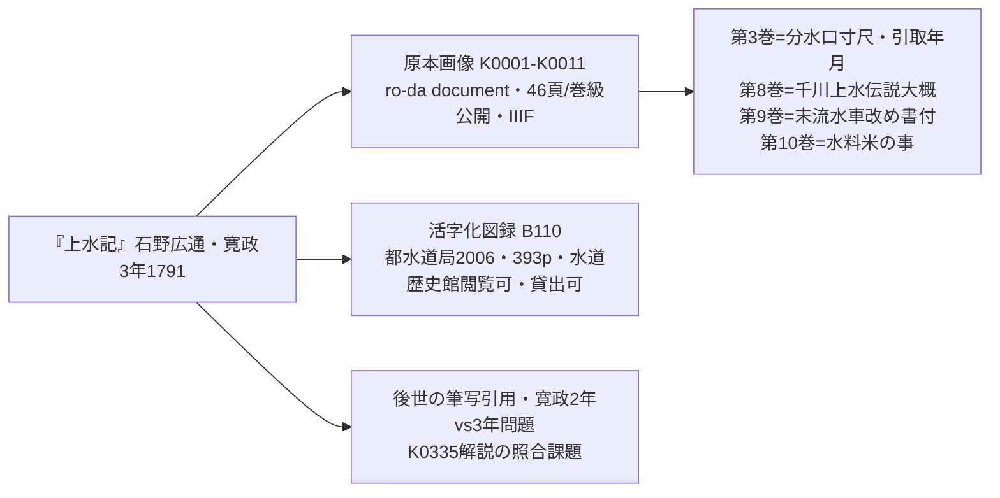

# 2026-11-24（第296回）・ro-da document（古文書）セクション掃引で千川系史料4点（『上水記』全巻所在＋昭和9年分水調・大正12年分水流域調書・明治44年水料原簿）と角田清美2023紀要論文・「水道局報」復刻版を新規収録

## 概要

- 東京都水道歴史館デジタルアーカイブ（ro-da.jp/suidorekishida）の**document（古文書・古記録）セクション（ジャンル1004-1010・第295回まで未掃引）を発見・掃引**し、content検索に引っかからない千川系史料を新規収録した: ①**K0335「昭和九年一月調 玉川上水分水調」**（東京市水道局拡張課計画掛・1934年1月・152頁画像公開）＝『東京市史稿上水編』から抽出した16分水の調書で千川分水の由来・寛政期情報・明治3年分水口改正後の状況を筆写。②**K0337「玉川上水所属分水流域第一次調書」**（東京市水道拡張課臨時調査掛・大正12年1923年2-6月・41頁）＝21分水の田地反別・灌漑水量・水車数・飲用人口・使用状況の調書。③**K0334「明治四十四年十二月 神田玉川上水水料徴収原簿」**（東京市水道課計算掛・1911年・111頁）。④**『上水記』全巻（K0001〜K0011・K0271/72外箱）の所在一括**＝第3巻に「分水口寸尺・引取り始めの年月・分水口絵図」、第9巻に「末流水車改め書付」、第10巻に「水料米の事」の記載候補。→ [GOV-576](sources/gov/GOV-576.md)
- 書籍系: **B110『上水記』（図録・都水道局2006・393p・貸出可）＝『上水記』の活字化図録**（[BOOK-289](sources/books/BOOK-289.md)）・**B049清水龍光『水 江戸・東京 水の記録』**（1999・キーワード千川上水/神田川）（[BOOK-290](sources/books/BOOK-290.md)）・**B042-37羽村市郷土博物館紀要第37号**（2023・**角田清美「千川上水の歴史と水利用」**・CiNii [crid/1520577906502268800](https://cir.nii.ac.jp/crid/1520577906502268800)・NDL書誌032861570を特定）（[BOOK-291](sources/books/BOOK-291.md)）・**A258竹内混凝土工場月報第拾参号**（1930年1月・板橋・キーワード「千川上水」）（[BOOK-292](sources/books/BOOK-292.md)）。
- **第295回課題④（局報の所在）への回答**: 都水道局広報誌「**水道局報**」が**図書出版かなえから電子書籍復刻**されている（2023年11月・ISBN978-4-86759-432-2・**1955年5月号〜1959年6月号収録**・目次例に「神田上水路、六郷用水路建設局の為管決定」「汚水を還元して工業用水に」「淀橋浄水場を移転」等）（[BOOK-293](sources/books/BOOK-293.md)）。
- [GOV-574](sources/gov/GOV-574.md)追記: ①**REKI番台（genre 3007=364項目・3008=217項目）全掃引の陰性確定**＝千川系乾板・紙焼は既知のREKI-003-008・REKI-039-015・REKI-061-037のみで追加なし。②**K0008のIIIF画像アクセス経路**（`api.ro-da.jp/v2/suidorekishida/SRDocument/K0008/contents/<hash>.jp2/info.json`・46頁）の所在記録。
- [PAP-025](sources/papers/PAP-025.md)追記: B243（年報1997年度・58,58p・貸出不可）のro-da図書目録個別レコード確認。

## メソッド: ro-da documentセクション（再現用）

1. document一覧: `GET https://www.ro-da.jp/suidorekishida/document/list?genre=<1004〜1010>`（**ro-daはwww必須・apexはDNS Aレコードなし**）。content検索（`/content?q=`）はdocumentを含まない。
2. 詳細頁: `GET /suidorekishida/document/detail/<資料ID>`（K番号）・図書は `/book/detail/B<A>番号`。目録欄は「資料ID／種別／タイトル／シリーズ／制作者／制作年月日／解説／キーワード／備考／公開日」。
3. **「千川」document系掃引の意義**: 第295回の18点（content系）に含まれない行政調書類（分水調・水料原簿）がdocumentにある。絵図・平面図（K0268等）はcontent側。両方叩くのが同館の完全掃引の条件。

## 新規source

- **GOV-576**: documentセクション千川系3点＋『上水記』全巻。
    - **K0335（1934年分水調）の意義**: 千川分水の情報を『東京市史稿』経由で1934年に整理した**暗渠化・下水道計画期の行政側の中間史料**。目録解説が『上水記』記載を「寛政2年」と記す点はK0008解説「寛政3年」と1年ずれ（本文干支の確認課題）。
    - **K0337（1923年調書）の意義**: 大正12年2-6月＝**関東大震災の年の分水実態ベースライン**（21分水の灌漑水量・水車数・飲用人口）。「第一次」→第二次以続調書の所在は未確認。
    - **K0334（1911年水料原簿）の意義**: 神田・玉川両上水の**1901年市内給水廃止後に残った分水利用者・水料の原簿**＝千川用水の明治後期の負担・利用実態データ候補。
- **『上水記』の3層アクセス体制が完成〔観察〕**:

- **BOOK-291（角田清美2023）**: repo完全未収録だった2023年の千川上水研究論文の書誌を確定（CiNiiレコード・NDL書誌ID・本文PDFなし・水道歴史館貸出不可・羽村市ルートでの入手が次回課題）。羽村堰の市の博物館紀要が千川分水の研究を掲載する点も、[GOV-574](sources/gov/GOV-574.md)の羽村堰・旧取水口写真群と同じ機関の千川関心として記録価値がある。
- **BOOK-293（水道局報復刻）**: 局報63号（1960年代前半・GOV-574④⑤の裏面注記）は**復刻範囲（1955-59）より後**であることに注意。ただし「神田上水路」の近代的呼称の用例・「汚水を還元して工業用水に」という用途転換言説を含む。

## 陰性（体系的・記録に値するもの）

- **NDL SRU anywhere横断（レート制限下・部分実施）**: ①**弦巻川＝10件・すべて既収録**（としま案内人イベント頁・弦巻川講演会2000・紙芝居「弦巻川がきえちゃったよ」・東京暗渠散歩・豊島区民話・としまの文化財第6集・雑司が谷界わい講演会プレス等＝GOV-003/GOV-104/BOOK-037/ORG-017/GOV-498系）で**新規書誌なし＝陰性確定**。②**千川上水＝223件のうち先頭150件を掃引しすべて既収録**（試験通水水質調査GOV-481・上水記図録・文京展図録BOOK-019・東大文書館GOV-099・小川家文書GOV-100・須田家文書GOV-105・精進ヶ池へBOOK-225・クロヒョウPAP-084・大松・加瀬・千川上水展・自然環境復元の試みPAP-086・田沼実記BOOK-178等。残り73件〔startRecord=151〜〕は429のため次回に順送り）。③**水窪川・谷端川のanywhere横断は429持続で未実施**（次回課題）。
- **kankeijinko.jp LOST JAPANシリーズ全回掃引**（[BLOG-311](sources/blogs/BLOG-311.md)宇田川#06の他回）: #01秋葉神社・#03日比谷神社・#04國領神社（調布）・#05徳山村（ダム湖）・#07巨椋池（京都）・#08夕張鹿島・#09軍艦島・#10（#08〜10のいずれか）・#11川原湯（八ッ場ダム）＝**都内の川を扱う回は#06宇田川のみで、水窪川・弦巻川・谷端川・千川系の回は存在しない**（陰性確定）。#02は未特定だが神社移転シリーズ（「御茶ノ水では社殿が移ったあとに、一本の木が残った」叙事）で川ではない可能性が高い。
- **としま案内人2603231006（2026年6月6日弦巻川イベント頁）**: 第23回以来のopen_url遮断を**curlのUA付き直接取得で突破**し本文全文を確認したが、内容（鬼子母神前集合・護国寺仁王門解散・10-12時・雨天7日順延・定員20名・300円）は**README既述と同一**で新事実なし〔重複確認のみ〕。2507220957（2025年回）もREADME・docs既記録のまま。
- **CiNii books**: 「東京都水道局報」の書誌なし（下水道局報は3レコードあり）。水道局報のCiNii側の誌名書誌は存在しない＝複刻版（かなえ）が唯一の商業入手ルート。
- 朝日・産経・都公報オンライン（WAF）・kanzyou7・tokopan/kensetsu: 今回も変化なし（第295回と同状況）。

## アクセス不能・技術メモ

- **NDL SRU 429の性格**: 「同時アクセス数の上限」（共有IPの飽和と推定）。sleep175〜185秒で成功する時間帯と、sleep240秒でも失敗する時間帯がある。**1コマンド1クエリ・sleep185秒・maximumRecords=50・recordPacking指定なし**を再試行の基準レシピとする（`recordPacking=raw`はillegal valueで弾かれる）。
- **CiNii opensearch（回避レシピ）**: crid詳細ページはWAFで0バイト応答となるが、`https://cir.nii.ac.jp/opensearch/articles?q=<語>&format=json` は正常応答。**NDL書誌IDが dc:identifier [@type=cir:NDL_BIB_ID] で取得できる**（角田論文=032861570をこの経路で特定）。NDL直接が429のときの書誌迂回ルート。
- **としまみらい（toshima-mirai.or.jp）**: 第295回の技術警告（--max-time 60未満・retryなし・1fetch）を遵守して再試行したが、**--max-time 50で rc=28（タイムアウト）＝接続不能が継続**。環境リセットは発生せず・次回も同レシピで。
- ro-daはwww必須（apex=DNSなし・`www.ro-da.jp`=20.46.184.123）。東京都公文書館は今回も全遮断（archives.metro.tokyo.lg.jp=Aレコード不在）。
- **compactionメモの訂正**: echo-lab深田2013紀要42号のPDFパス・論題は[PAP-027](sources/papers/PAP-027.md)の url 欄・本文全文（Wayback取得済み）として完全記録済みで、PAP-026（甲田の谷端川論文）ではない。追記不要と確定。

## INDEX・repo反映

- 新規6件（GOV-576・BOOK-289〜293）＋GOV-574追記＋PAP-025追記＝INDEX 1,718→**1,724 items**。
- README bullet: 第296回分をワークフローで挿入（第295回レシピ）。

## 次回（第297回）課題

1. **NDL anywhere横断の続き**: 千川上水残り73件（startRecord=151〜）・**水窪川・谷端川**（未実施）・「雑司ヶ谷」・「千川」（単独）等。429時間帯の回避（sleep185秒レシピ）。
2. **『上水記』判読群（human目視・最優先の一つ）**: ①第8巻K0008「千川上水伝説大概」の頁特定と全文収録（IIIF経路46頁）。②第3巻K0003の分水口寸尺・引取年月の千川条。③B110図録の館内閲覧（活字化で千川条の所在頁特定）。
3. **K0334/K0335/K0337の千川部分判読**（human目視）: 分水調の千川条・水料原簿の千川分水頁・21分水中の千川の有無。
4. **角田清美論文の入手**: 羽村市立図書館・羽村市郷土博物館（館内閲覧・市販）・水道歴史館（貸出不可=館内のみ）のいずれかで、千川上水の個別記述の確認。
5. 都公文書館再試行（千川上水残り約70件詳細・中新井685件）。
6. 開札2026-12-02環七調節池その2の入札結果確認（順送り・まだ未来日）。
7. 水道局報1955-59（BOOK-293復刻・または図書館の紙本）の千川言及の確認。
8. newlist_202610.pdf（CIDフォント・human目視待ち）の目視・継続課題のフォロー。
