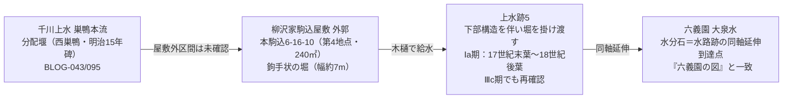

# 2026年11月24日（第298回）・柳沢家駒込屋敷第4地点の上水跡（千川上水→六義園給水の考古学的一次裏付け）・中新井村誌の所在確定・高阪微細地誌シリーズ紀要版の追加調査

## 目的・方法

定期調査（第298回実行）。地形・旧河道・暗渠・下水道・湧水・橋・池・用水・灌漑・地名・土地利用・古地図・地籍・都市計画・河川史・地域史・写真資料・学術論文・公的アーカイブの各角度で新規情報を探索し、既存収録との重複を照合したうえで価値ある情報のみ登録した。

## 新規登録

1. [PAP-109](../sources/papers/PAP-109.md)：文京区教育委員会『東京都文京区 柳沢家駒込屋敷（六義館・六義園）跡 第4地点』（谷川章雄ほか12名・2020-12-25刊・B-178・NCID BC05265190・NDL〔JP〕23507540）。**千川上水を給水源とする上水跡5（下部構造を伴い幅約7mの堀を掛け渡す・木樋で大泉水へ給水・上水跡の同軸延伸が大泉水の水分石に到達）と、六義園で初確認という外郭を廻る鉤手状の堀**〔確認: 全国遺跡報告総覧レコード91748の遺構欄・要約本文・2026-11-24取得〕。『六義園の図』と発掘結果の一致、Ⅰa期（17世紀末葉〜18世紀後葉）構築・7期変遷の提示、『宴遊日記』との照合も要約本文に含まれる。**六義園給水（BLOG-043・PAP-017で文献レベルだった経路知見）の発掘一次裏付け**として本repo初出。所在地＝本駒込6-16-10、調査2019-09-30〜12-04・240㎡。本文PDFの総覧登載なし＝本文・図版は未閲覧〔所在のみ〕。

2. [BOOK-297](../sources/books/BOOK-297.md)：東京府北豊島郡中新井村『市郡合併紀念 中新井村誌』（内田喜太郎編・**1933**・非売品）。千川上水の組合・分水村（上新街・下新街・北新井の3樋口＝GOV-005等で既知）たる中新井村が、1932年の東京市郡合併直後に遺した**公式村誌**〔確認: NDL Search のdcndl書誌5レコード・国立国会図書館〔NDL書誌ID 000000766073〕・東京都立中央図書館〔東京都内自治体史OPAC item 24594〕の所在・2026-11-24〕。デジタル副本なし・本文未閲覧〔所在のみ〕。用水・樋口・村政記録の一次候補で、NDL個別書誌詳細頁は429で未取得。

3. [PAP-110](../sources/papers/PAP-110.md)：高阪宏行「デジタル微細地誌の一つの試論 -- 東京都豊島区大塚を事例として」（日本大学文理学部情報科学研究所『年次研究報告書』2009・NAID 40017072768）〔確認: CiNii Research 書誌〕。[PAP-108](../sources/papers/PAP-108.md)（第297回登録の2015年日本地理学会発表要旨・第三事例＝谷端川〔大塚〕）に先行する**シリーズ起点論文**の所在記録〔所在のみ〕。

4. [PAP-111](../sources/papers/PAP-111.md)：高阪宏行「WebGIS上での微細地誌に関する動画配信 : 東京都豊島区大塚を事例として」（同誌**2014**・NAID 40020384325）〔確認: CiNii Research 書誌〕。**PAP-108の発表抄録（1頁）と同題の年次研究報告書掲載版**。紀要論文としての詳細版が存在する可能性が書誌的に確定した〔本文未取得・対応は要確認〕。

## 柳沢家第4地点の位置づけ〔観察〕

千川上水から六義園大泉水への給水は、これまで空気弁蓋（巣鴨側「流路上」の観察＝BLOG-043）と行政記録（千川上水解散期＝PAP-017）で経路を推定してきた。第4地点の発掘は屋敷内部の**給水末端**（上水跡5・堀への掛渡し・同軸延伸が水分石に到達）を押さえたもので、経路の終端側が物理遺構で実証された。一方、屋敷外区間（本流〜屋敷敷地）の遺構は本次調査範囲外で、接続の考古学的確認は今後の課題。

（第298回・図: 千川上水→六義園大泉水給水の、既存知見と今回の発掘一次記録の接続関係。屋敷外区間の遺構確認が次の空白。）

## 重複回避の記録（既収録と判明したもの）

- **としまひすとりぃ「わが街ひすとりぃ 第10回 千川 現地ロケ編」全文テキスト（mp00001010・ht420100・矢尾一枝・島功・平成31年2月12日収録）＝[GOV-129](../sources/gov/GOV-129.md)として完全収録済み**（境窪証言〔田島勝司〕・千川彫刻公園＝中野素昂宅跡・アトリエ群の記述も含む）。本日は全文テキスト・目録詳細を再取得して照合したがGOV新規採番は見送り。姉妹編インタビュー編（mp00001020）もGOV-129追記〔第85回〕で既知。
- **NDL SRU 千川上水223件の掃引完了（startRecord 151〜223・残り73件）＝新規0件**。検出は全て既出の再検出: 亀岡2017里川→[PAP-083](../sources/papers/PAP-083.md)／明治10年代再興→[PAP-017](../sources/papers/PAP-017.md)／Sippel 2017→[PAP-089](../sources/papers/PAP-089.md)／千川上水分水レポート→[PAP-068](../sources/papers/PAP-068.md)／練馬の水系→[BOOK-082](../sources/books/BOOK-082.md)／小川家文書3点→[GOV-100](../sources/gov/GOV-100.md)の周辺／日本水紀行・東京見て歩き→第235回評価済み見送り。

## アクセス不能・未確認（次回再試行）

- **東京都公文書館（archives.metro.tokyo.lg.jp）＝403遮断が継続**（第294回のPOSTレシピも本日不通・WAF日変動）。千川上水残り約70件詳細・中新井（練馬区豊玉）関連685件は順送り。
- 東京都公報（kanpou）18675〜18700番＝404継続（既往どおり）。
- **NDL 関連の日変動制限**: NDL Search 個別書誌詳細頁＝429（中新井村誌の頁数・奥付は未取得）、nakunken＝429（柳沢家第4地点は本日取得済）、CiNii crid 個別レコード頁＝0バイト空応答（PAP-110/111の fullTextURL の有無は未検証）。
- 武蔵大学リポジトリ（repository.musashi.ac.jp）＝DNS 不通が継続（Wayback 20230328 での目録取得は可）。
- 柳沢家報告書の本文PDF（総覧に0件）・中新井村誌のデジタル副本（archive.org/Google Books陰性）＝物理的に未所在。

## 次回以降の課題

1. **柳沢家駒込屋敷 第1〜3地点の報告書レコード探索**（総覧で「柳沢家駒込屋敷」横断検索・上水関連記述の有無）。
2. 中新井村誌の NDL 個別書誌詳細（record 頁は429明け）・都立中央図書館での現物確認ルート（複写・閲覧）検討。
3. CiNii crid 頁の再取得（PAP-110/111 fullTextURL 有無）。
4. **開札2026-12-02**: 建設通信新聞の公告報道のとおり「調節池の広域的な整備に向けた検討委託（その2）」「境川中流部における調節池基礎調査委託」の2件が12月2日開札（2026-11-10公告・[GOV-546](../sources/gov/GOV-546.md)・[GOV-148](../sources/gov/GOV-148.md)文脈）。結果報道のフォロー。
5. 都公文書館403の再試行（千川上水約70件・中新井685件）。
6. としま案内人の冬ウォーク新着・水道歴史館の新着展示の確認。
7. human確認待ちの既存未消化: 『上水記』K0008画像判読・武蔵アルバムOCR・開示PDF8点・[ORG-044](../sources/org/ORG-044.md)動画。
8. kanzyou7 topics・谷端川緑道ページ等の定期監視（本日変化なし）。

## 位置づけの再確認

本調査は定期実行の継続タスクであり、今回の反映の有無にかかわらず次回以降も調査を継続する。
