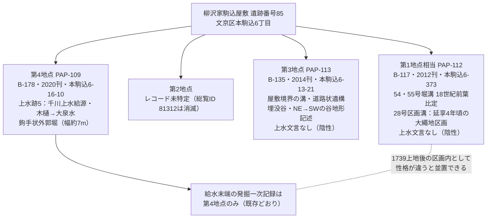

# 2026年11月24日（第299回）・柳沢家駒込屋敷第1・第3地点レコードの詳細取得（上水文言の陰性）・中新井村誌デジタル画像公開の発見・高阪微細地誌シリーズの書誌確定

## 目的・方法

定期調査（第299回実行）。第298回の課題（柳沢家駒込屋敷第1〜3地点レコード探索・中新井村誌のデジタル副本・高阪論文の本文入手可否）を解消し、地形・旧河道・暗渠・下水道・湧水・橋・池・用水・灌漑・地名・土地利用・古地図・地籍・都市計画・河川史・地域史・写真資料・学術論文・公的アーカイブの各角度で新規情報を探索した。全国遺跡報告総覧は検索APIが「アクセス集中」状態のため、既知レコードIDの直接取得で回避するレシピで第1・3地点を取得した。

## 新規登録

1. [PAP-112](../sources/papers/PAP-112.md)：大成エンジニアリング『柳沢家駒込屋敷（六義館・六義園）跡』（**B-117**・池田悦夫・小林貴郎・パリノ・サーヴェイ・鈴木伸哉・丸紅株式会社発行・2012-12-28・NCID BB18778816・NDL〔JP〕22582261・総覧レコード88646）。シリーズ番号が最小・発行年が最も早い（調査期間2011年11月〜2012年12月・本駒込6-373番地・190㎡）ことから第1回調査〔第1地点〕に相当すると解される〔書誌レベルの観察〕。**遺構＝溝跡3・地下室4・土坑19・植栽痕22・柱穴10・小穴14・礎石5・地業址2・遺物総数7,538点**。要約文言＝前田家下屋敷→元禄8（1695）柳沢吉保45,862坪拝領→元文4（1739）南東側上地・田安宗武拝領→「御駕籠之者大繩地」→幕末以後岩崎弥太郎購入。**54・55号堀溝（18世紀前葉比定＝前田家/柳沢家所産推定）・28号区画溝（延享4年頃の大繩地区画溝推定）**。**上水関連文言なし（陰性）**。本文PDFなし〔所在のみ〕。

2. [PAP-113](../sources/papers/PAP-113.md)：大成エンジニアリング『柳沢家駒込屋敷（六義館・六義園）跡第3地点』（**B-135**・池田悦夫・蒲明男・中村友一・パリノ・サーヴェイ・東急不動産発行・2014-08-31・NCID BB2091060X・総覧レコード48073・総覧抄録91937）。所在地＝本駒込6-13-21・調査20130620-20130817・200㎡。**江戸期遺構＝土坑12・溝8・道路5・瓦溜1・植栽痕11**。要約文言＝『寛永江戸全図』の鳥居淡路下屋敷→明暦大火後前田家中屋敷→天和3（1683）上地→元禄8（1695）六義園作庭→元文4（1739）南側二万坪上地・田安家拝領→延享4（1747）上地→御駕籠之者大繩地という屋敷変遷＋**「屋敷境界の溝やそれに伴う道路状遺構が複数基検出」**（境界系遺構の核心文言）＋**「細かい支谷が入り組んだ地形・所々の埋没谷・北東から南西に傾斜する谷地形上に立地」＝本郷台地東端の微地形を記す発掘側一次記述**（PAP-107春日町東遺跡の「谷端川沖積低地」文言と並ぶ地形記録群に追加）。**上水関連文言なし（陰性）**。本文PDFなし〔所在のみ〕。

## 追記

3. [BOOK-297](../sources/books/BOOK-297.md)（中新井村誌）へ**デジタル副本の大発見を追記**：**東京都立図書館デジタルアーカイブ（TOKYOアーカイブ）で『市郡合併紀念中新井村誌』の画像が公開中**〔確認: 2026-11-24〕。出版1933.7・**163p**・20cm・資料コード1128250351・請求記号T/44・20/3045/・**画像の使用条件＝パブリックドメイン**〔tilcod=0000000009-00006028〕。第298回の「デジタル副本なし」記載を訂正。NDL Search総合書誌（R100000001-I13111102407045）のseeAlsoからこのTOKYOアーカイブ詳細ページと都立図書館OPAC（bibid=1102407045）に連結、NDL書誌〔000000766073・JPNO 47012448〕のseeAlsoにNDLデジタルコレクション pid/1242393（頁本体は取得不能・公開範囲は未確認）、CiNii Research書誌〔crid/1971430859845727682・BA30822046・折り込図1枚〕も同定。本文判読はhuman目視待ち（用水・樋口・村政章の内容評価は判読後）。

4. [PAP-110](../sources/papers/PAP-110.md)（高阪宏行2009試論）へ追記：NDL書誌R000000004-I10645615の連結・CiNii上に**fullTextURLなし（本文公開なし）の再確認**（第298回の0バイト応答未検証を解消）・掲載誌の統一書誌〔CiNii 雑誌NCID AA11611861「年次研究報告書」・2002.2-・1号=2001年度〕を確認。

5. [PAP-111](../sources/papers/PAP-111.md)（高阪宏行2014紀要版）へ追記：NDL書誌R000000004-I026223956の連結・fullTextURLなし確認に加え、**researchmap〔高阪宏行 read0027937〕の業績リストで掲載＝情報科学研究所年次研究報告書15号・pp.47-57・刊行2015-02-20と確定**〔確認: researchmapは2026-11-24時点でNot FoundのためWayback Machineスナップショット（2025-11-25取得）で該当文言を確認〕＝PAP-108（2015-04-13公開の発表要旨）に先行する**11頁の紀要本文**の存在が固まった。同リストの16号（2016-02-28）は関根智子・古川翔一・高阪宏行「河川の集水域と神話の伝承：出雲のヤマヤノオロチ神話を事例として」（pp.1-9）で、**大塚微細地誌シリーズの続編とは解されない内容と判定**（断定は留保）＝シリーズは15号で途切れている可能性。

## 柳沢家駒込屋敷シリーズの現状整理〔観察〕

（第299回・図: 第4地点レコード91748の「4回目の調査にあたる」文言で第2回調査の存在は知られるが、第2地点の単独レコードは今回も特定できず。4地点のうち上水系の物理遺構を伝えるのは第4地点のみ、境界系遺構は第1・3・4地点で並行して確認されている。）

[第298回ノート](2026-11-24（第298回）・柳沢家駒込屋敷第4地点の上水跡・中新井村誌の所在確定・高阪微細地誌シリーズ紀要版の追加調査.md)課題①（第1〜3地点レコード探索）は第1・3地点で解消、第2地点のみ未解決として残る。また第298回の屋敷変遷年表（1695拝領・1739上地・1747大繩地）は第1・3地点の要約でも同一構造で再確認され、3レコード相互の整合がとれた〔元文4年上地の表現差（南東側一帯/南側二万坪）は区画単位比定の本文確認課題〕。

## スコープ外・重複回避の記録（既収録と判明したもの・言及なし）

- **朝日新聞「不自然に曲がった道、細長い緑道 街の歴史が見える『暗渠』の魅力」（2026-11-14・楽問のススメ・本田創さんインタビュー）**＝暗渠一般論の記事で、題材は**谷田川（田端）**。四河川・千川上水への言及なし（有料記事部分は未読だが見出し・公開部分・関連リストに該当なし）＝スコープ外として見送り。
- **note（動坂のソフト屋）「谷田川（藍染川）を歩く」（2026-10-06）**＝染井の長池跡〜霜降銀座・中里用水ガード・慈眼寺の不染橋親柱など隣接川・谷田川の散歩記。本文21,460字を走査し「谷端川」「弦巻川」「水窪川」「千川」の文字は0件＝**谷田川（藍染川）は本repoの対象四河川・千川上水のスコープ外**として見送り（中里用水ガードの欄干状構造物の用途未確定記述は残る興味材料だが、当repoの水系対象の外側）。
- **朝日新聞「渋谷区民も知らない？奥渋ならぬ『北渋』とは」（2022-10-18・有料）**＝玉川上水の記憶を含む記事だが、弦巻川への言及は見出し・公開部分になし（2022年記事で既知情報域）＝見送り。
- **Samsung Members「水窪川 最終地点へ」（MASAほくりく・2026-10-06投稿・ギャラリー写真3点＋キャプション）**＝「線路の下を通ります」「国道8号線の下を通ります」「最後は柳橋川に合流します」のキャプション付き写真投稿〔確認: r.jina.ai経由で本文・投稿日時取得・2026-11-24〕。**同名異川である可能性が高い**＝国道8号は新潟〜京都を走る幹線で文京区・豊島区を通らないこと・投稿者名（ほくりく）と同シリーズ（源内川・馬渡川・中島用水の各「最終地点へ」＝北陸・上越系の川）から、この水窪川は北陸側の同名川（同一特定は本文の所在記述なし・不能）と判断＝**当repoの水窪川とは別川としてスコープ外**。写真1点（住宅地のコンクリート水路）を画像解析で確認したが地名特定の手がかりなし。今後の同名検索で引っかかった際の識別メモとして記録。

## アクセス不能・未確認（次回再試行）

- **東京都公文書館（archives.metro.tokyo.lg.jp）＝403遮断が継続**（第294回POSTレシピも不通）。千川上水残り約70件・中新井685件は順送り。
- 都公報18675/18676号＝403/404で新号未確認（18673号が実質最新のまま）。
- **NDL系の日変動制限**: NDL Search 個別書誌詳細頁＝429多発（中新井村誌のNDLデジタルコレクションpid/1242393頁は直接取得不能・IIIF照合不成立）、opensearchは30秒以上の間隔で断続的に取得可。
- **全国遺跡報告総覧（sitereports / nabunken）＝検索系エンドポイント・一覧頁は全て「アクセス集中」**だが、**個別レコードID（/91748・/88646・/48073等）の直接アクセスは稼働**＝「検索を使わず既知ID直打ち」というレシピを今回確立（間欠的な403は20〜45秒の再試行で回復）。総覧ID 81312（第2地点候補）は「ページがありません」で消滅（Wayback CDXにも2022-08-08のリダイレクトのみ）＝**第2地点のレコード実体は総覧上でIDレベルの特定に至らず**。
- **大成エンジニアリング case-595（第4地点業務委託紹介ページ）＝404削除済み**（第2地点同様の消滅系。同社サイトのWG実績頁に柳沢家シリーズの他ページが残るかは未掃引）。
- **春日町東遺跡の2022年期（第2期）後続報告書＝総覧にはまだ未登載**（検索系不通のため直接確認はできないが、PAP-107第297回登録後の追加レコードは確認できず＝陰性として記録）。
- researchmap.jp/read0027937（高阪宏行）＝Not Found（2026-11-24）。Waybackスナップショットで代替確認済み。アカウント削除・移転のいずれかは不明。
- ORG-045（戸田・西松JV）WHAT'S NEW・アスベスト測定結果＝不変（2026-07-22・測定結果は令和8年10月分まで。R8.11分は未掲載）。
- kanzyou7 WHAT'S NEW＝不変（11/20週間工程表・11/24現場見学会=GOV-156既知）。
- **水道歴史館デジタルアーカイブ（ro-da）＝第295/296回の11月15日新着バッチ以降の追加なし**〔確認: 2026-11-24〕。トップ頁の「更新しました」最新は2026.06.30（近代水道写真館125点追加）、「千川」content検索は既知18資料ID（GOV-574/575の記録どおり・新規0件）、「谷端川」「水窪川」「弦巻川」のcontent検索は0件＝第295回の体系的陰性と不変。
- tokopan.seesaa.net article/521805591＝Wayback CDX依然空（未収蔵）。
- **r.jina.aiが一部URLで稼働**（第293回は401 blockedだったが、本日はSamsung Community頁の本文取得に成功・2026-11-24）＝ボット対策ページの代替取得レーンとして再評価の価値あり。

## 次回以降の課題

1. **柳沢家駒込屋敷 第2地点レコードの特定**（総覧検索が回復した時点で「柳沢家駒込屋敷」横断を再実行・B-1XXのID走査も候補）。
2. **中新井村誌（BOOK-297）本文画像のhuman判読**＝TOKYOアーカイブで公開中・千川上水分水・中新井村の章立て確認。都水道歴史館・NDL pid/1242393の再取得。
3. 高阪宏行論文（PAP-110/111）の本文取得ルート（日大文理学部情報科学研究所・機関リポジトリ・図書館個号）探索。CiNii fullTextURLなし確定済み。
4. **開札2026-12-02**: 環七調節池広域整備検討その2・境川中流部調節池基礎調査の入札結果フォロー〔第288回から順送り〕。次回実行は12/2以降最初の定期実行で最優先確認。
5. 都公文書館403の再試行（千川上水約70件・中新井685件）・都公報新号。
6. nabunken検索系回復時の再掃引（春日町東2022後続報告・柳沢家第2地点）。
7. human確認待ちの既存未消化: 『上水記』K0008画像判読・武蔵大学アルバOCR・開示PDF8点・ORG-044動画。含め今回追加のTOKYOアーカイブ中新井村誌画像。
8. 監視系の定期確認（ORG-045 R8.11分測定結果・kanzyou7・としま案内人冬ウォーク・水道歴史館新着）。

## 位置づけの再確認

本調査は定期実行の継続タスクであり、今回の反映の有無にかかわらず次回以降も調査を継続する。
