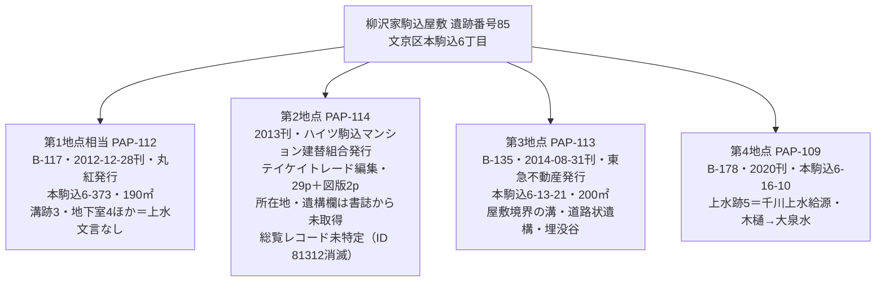

# 2026年11月24日（第300回）・柳沢家駒込屋敷第2地点報告書の書誌特定・都公報11月増刊分の完走・環七地下河川サイホン報道の帰属確認

## 目的・方法

定期調査（第300回実行）。第299回の課題（柳沢家駒込屋敷第2地点の書誌特定・都公報増刊分の走査・nikkeibp Active環七系列の帰属確認）を解消し、地形・旧河道・暗渠・下水道・湧水・橋・池・用地・灌漑・地名・土地利用・古地図・地籍・都市計画・河川史・地域史・写真資料・学術論文・公的アーカイブの各角度で新規情報を探索した。資料取得はopen_url（一次取得）とr.jina.aiプロキシ（PDF本文抽出）の2レーン。repo反映は第298/299回確立の自己削除型GitHub Actionsワークフロー（README冒頭bullet＋INDEX行挿入）によった。

## 新規登録

1. [PAP-114](../sources/papers/PAP-114.md)：テイケイトレード株式会社埋蔵文化財事業部編集『柳沢家駒込屋敷(六義館・六義園)跡第2地点 : ハイツ駒込マンション建替事業に伴う埋蔵文化財発掘調査報告書 : 東京都文京区』（**ハイツ駒込マンション建替組合発行・2013年・NCID BB13461197**・29p＋図版2p・30cm・CiNii ownerCount14＝東北大学・筑波大学・京都大学（文学研究科）・山口大学・九州大学・東京都立大学・明治大学・同志社大学・立命館大学・大手前大学・奈良大学・別府大学・国立歴史民俗博物館など14機関所蔵）〔確認: CiNii Booksの書誌JSONエンドポイント（ncid/BB13461197.json）を直接取得・2026-11-24〕。

### 柳沢家駒込屋敷シリーズ4地点の書誌確定〔観察〕

第299回の未解決課題①（第2地点の書誌特定）を解消＝**第1〜4地点の受託者・発行者・刊行年が全て揃った**（第2地点のシリーズ番号のみ未特定）。

- **発行主体の類型**: 第1地点＝丸紅（分譲マンション開発）・第2地点＝**建替組合（既存マンション）**・第3地点＝東急不動産＝再開発・建替負担による発掘という系列の調査資金枠組み〔観察〕。体裁は第2地点（29p＋図版2p）がシリーズ内で最も薄い。
- 所在地（地番）・調査期間・面積・遺構欄はCiNii書誌に含まれず未取得。上水・水文文言は本文未見のため記載しない。

## 帰属確認・重複回避

2. **GOV-291（環七地下河川計画検討委員会）の帰属確認**: nikkei系環七30km地下河川報道を再掃引した結果、①nikkeibp Active「東京・環七地下に長さ30kmの巨大河川、荒川放水路以来の大事業具体化へ」（2026-05-06）＝URLの081800344は**GOV-291本文にxtech転載URLとして既収録**、②「東京・環七地下の巨大河川、ポンプ使わずサイホン方式で東京湾へ放流」（2026-11-04）＝**xtech 18/00110/00529としてGOV-291既収録**（放流方式の検討節に本文抜粋つき）＝いずれも新規登録不要〔確認: GOV-291.md全文読み込み・2026-11-24〕。③日経クロステック「怖い都市型水害」特集（ncr/18/00274・2026-11-20）＝千葉豪雨主体で四河川文言なし、サブ記事「排水強化進む都市、東京は地下河川」（102800002）＝GOV-291・レジリエンス債系の既知域＝見送り。

3. **都公報11月分の完走**: トップ頁に定刊18674号（11-24発行）＋増刊90・91・92号。定刊18674号は第291回でAES復号・全陰性確認済み。増刊3本をr.jina.ai経由で本文抽出＝**増刊90号＝都立病院機構財務諸表・増刊91号＝公立大学法人（東京都）財務諸表・増刊92号＝12月1日の都議会定例会招集告示（1147号）のみ＝四河川文言全陰性**。増刊PDFのURL様式＝files/koho/y2026/&lt;year&gt;_&lt;n&gt;.pdf〔レシピ〕。11月の未走査分なし。

## 監視と陰性

- kanzyou7 WHAT'S NEW＝11/20定期更新（軽微な例行事項）のみ、お知らせ＝11/24現場見学会（GOV-156既知）＝不変。
- 都公文書館（archives.metro.tokyo.lg.jp）＝open_urlも遮断・r.jina.ai経由でもDNS解決不能（EAI_AGAIN）＝403/遮断継続。
- tokopan.seesaa.net article/521805591＝Wayback available API空（未収蔵継続）。
- researchmap.jp/read0027937（高阪宏行）＝403/Not Found継続（braveインデックスにキャッシュ残存）。
- 東京都立図書館デジタルアーカイブ（TOKYOアーカイブ）の中新井村誌詳細頁（tilcod=0000000009-00006028）＝99画面（163p）を確認、内容は第299回記載（デジタル画像公開・パブリックドメイン）どおりで追加情報なし〔human判読は次回以降〕。
- 高阪宏行論文（PAP-110/111）の本文: 日本大学文理学部情報科学研究所サイト（chs.nihon-u.ac.jp/research/information-science/）に年次研究報告書の公開ページなし＝本文入手ルートは図書館個号依存のまま。
- unified_search掃引（recency14日・谷端川・弦巻川・水窪川・千川）＝全noise（阪神の谷端選手・Stroly池袋＝既知二次・静岡の水窪川＝同名異川）。国土交通省R8.11.10「都市型水害対策とりまとめ」＝都固有文言なし。
- 追加掃引の見送り: 朝日「楽問のススメ」暗渠記事（2026-11-14）＝repo既収録・有料で谷田川主体＝スコープ外。東京新聞「マニアが見つけた『蓋をされた川』」（桃園川・髙山英男）＝repo既収録確認。くるまニュース「外環の2」石神井台2期事業化（大泉JCT〜千川通り間・2026-10-26）＝外環はrepo既収録文言があり増田 necessary? 道路計画自体は水系の新情報なし＝見送り〔千川通りを由来とする道路名の言及のみ〕。

## アクセス不能・レシピのメモ

- リモート実行環境の昇格（Koyeb sandbox）は今回も作成失敗＝軽量環境で継続（curl・python・node不可）。PDF本文抽出はr.jina.aiプロキシで回避可能（都公報増刊3本で実績）。
- CiNii Booksの書誌JSONエンドポイント（https://ci.nii.ac.jp/ncid/&lt;NCID&gt;.json）＝参考文献リスト化されていない発掘報告書でも書誌構成・所蔵機関一覧を機械取得でき有効。

## 次回以降の課題

1. **開札2026-12-02: 環七調節池広域整備検討その2（GOV-148系）・境川中流部調節池基礎調査の入札結果**〔第288回から順送り〕＝12/2以降最初の定期実行で最優先。
2. 柳沢家第2地点の総覧レコード特定（検索系回復時）・シリーズ番号（B-1XX）の確定・ハイツ駒込マンションの地番特定（地図・区資料との照合）。
3. 中新井村誌（BOOK-297）本文画像のhuman判読（TOKYOアーカイブ99画面・千川上水分水・村政の章立て確認）。
4. 高阪宏行論文（PAP-110/111）本文の取得（日大文理学部図書館の個号依頼）。
5. 都公文書館403の再試行（千川上水約70件・中新井685件）・都公報次号・ORG-045（R8.11分測定結果）・としま案内人の冬ウォーク・水道歴史館（ro-da）新着・第3回環七地下河川委員会の定期監視。
6. human確認待ちの既存未消化（『上水記』K0008画像判読・武蔵大学アルバOCR・開示PDF8点・ORG-044動画）は引き続き順送り。

## 位置づけの再確認

本調査は定期実行の継続タスクであり、今回の反映の有無にかかわらず次回以降も調査を継続する。
