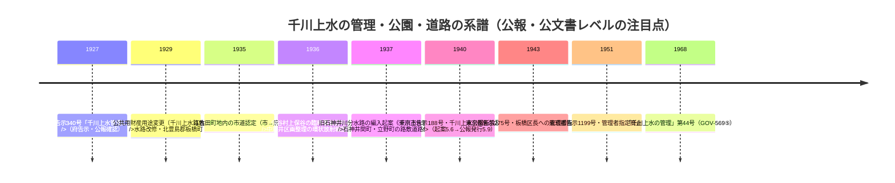

# 2026-11-24（第307回）・都公文書館アクセス復旧で千川上水109件・谷端川26件・水窪40件の掃引完結・管理者指定の系譜と谷端川受益者負担告示群の収録・樋線図四河川水源域の全既収録確認

## 概要

東京都公文書館情報検索システムの障害（第304回以降続いていたwww形式のDNS不調）が解消し、`https://www.archives.metro.tokyo.lg.jp/`（www形式）が復旧した。第294回に確立したクロス検索のGET→POSTレシピで、**「千川上水」109件の件名抽出と詳細66件・「谷端川」26件の全走査（残り9件の公報詳細を含む）・「水窪」40件の全走査**を1回の実行で完結した。新規収録は [GOV-579](../sources/gov/GOV-579.md)・[GOV-580](../sources/gov/GOV-580.md)・[GOV-581](../sources/gov/GOV-581.md) の3件（総数1774→1777）。

## 今回の主要な成果

1. **千川上水の管理者指定の系譜が公報レベルで確定（[GOV-579](../sources/gov/GOV-579.md)②③）**: 東京都公報・告示第275号（1943.9.21）「千川上水管理者指定（板橋區長）」（公報件名番号K0100784）→告示第1199号（1951.11.6）「千川上水管理者指定廃止」（K0115720）。**約8年2か月の区長指定の始まりと終わりがそれぞれ一次の公報記録で確認できた**（いずれもrepo初出）。これにより、1927年警視庁東京府告示340号「千川上水管理に関する件」（K0074515・repo初出）→1937年「《千川上水管理者》」による旧石神井川分水路編入起案（[GOV-572](../sources/gov/GOV-572.md)昭和前期⑤）→1943指定→1951廃止→1968「千川上水の管理・第44号」（[GOV-569](../sources/gov/GOV-569.md)⑤）という管理史の柱が通った（下図参照）。管理者指定の対象区間・廃止事由はいずれも本文未見。
2. **東京市告示第188号（1940・千川上水公園）の公報版**: 東京市公報1940.5.9「千川上水公園新設及開園」（K0047576）＝[GOV-569](../sources/gov/GOV-569.md)④（起案1940.5.6）と同一告示の公告版。公告日（発行5月9日）と「新設及開園」の文言が確定。
3. **内田祥三関係資料の1942年委員会資料（[GOV-579](../sources/gov/GOV-579.md)⑤・資料ID000350288・請求番号Ｕ５１９．８－とち－６６１）**: 昭和17年3月17日の都市計画東京地方委員会〔関係資料〕の内容注記3に「東京都市計画（保健防火道路）**第３号路線（千川上水線）計画平面図** 青焼1枚 縮尺1:10,000 26×115㎝」（議第299号）が含まれる。「保健防火道路」文言はrepo grep 0件の初出候補で、[GOV-178](../sources/gov/GOV-178.md)（1941.12.24・千川上水線沿岸緑地道路計画）の3か月後の資料。同じ議第303号には「第４条ニ依る負担区画図（**谷田川ノ部**）1:3,000」も含まれる。
4. **明治期千川水道実務43件（[GOV-580](../sources/gov/GOV-580.md)＝[GOV-572](../sources/gov/GOV-572.md)制限③の完全解消）**: 千川水道会社篇ではない府実務断面。1881地券交付・1881滝野川村畑持主の「開設」指示伺・1882本所区真砂町への引用（配水東端候補）・1882駒込東片町〜湯島切通の樋桝伏渡跡道路修繕・1883鈔紙部減量の立会検査（分配堰碑の1883年減量文言〔BLOG-094〕と整合）・1883黴毒病院の道路埋樋跡督促・1883取締禁例改正の警視庁照会・1885統計院の統計材料照会・1886巣鴨村の地種組替8か所（字新田外6・図面1葉添）・1888引用井3願（山中サノ・帝国大学〔GOV-099と対になる府側の詳細〕・二橋元長）・1890出桝敷借地料の府会2回諮問・1887/1891消防分署構内の樋・1894-98引入口差蓋修繕願 ほか。
5. **谷端川受益者負担告示群（[GOV-581](../sources/gov/GOV-581.md)）＋西巣鴨負担区（1938.12.10・東京市告示678・K0044986）**: 警視庁東京府公報の告示321・府令33・告示768（神田上水第1負担区）・告示802・告示328公告版（1937.4.29＝[GOV-568](../sources/gov/GOV-568.md)④の公告日確定）・告示431・告示449（第2負担区）・府令5と、東京市公報告示678「**西巣鴨町下水道谷端川排水区、音羽、谷田川排水区を西巣鴨負担区とし決定**」。**「谷端川・音羽・谷田川の3排水区がひとつの西巣鴨負担区に束ねられていた」1938年の一次文言**（1930年審議〔GOV-162/GOV-200〕の8年後の決定公告）。これで「谷端川」26件の掃引が完結した。
6. **MAP-060（千川上水路図）の江戸明治期史料側の該当レコード確認**（詳細は下記・追記候補）: 資料ID000100783（cls=collection_01・江戸明治期史料）＝請求番号ＺＨ－４４５「千川上水路図」・1枚・**写図**・シリーズ＝江戸図・江戸関係図（地図）＞陸地測量部地図類＞水道河川橋梁・大整理番号6364・配架220B100-020203・公開・複写可（原本電子コピー不可・撮影可）。第306回のINDEX行追記（陸地測量部地図類系列・同一性は未照合〔2026-11-24追記〕）と一致する系列で、**詳細頁に「写図」の書誌事項・大整理番号が加算された**。MAP-060.md本文への追記は次回。

## 千川上水の管理・管理者指定の年表〔観察〕

## 今回の陰性・スコープ外の確認

- **「水窪」40件の全走査**: 大森区清水窪尋常小学校（荏原郡馬込町清水窪＝現・大田区）の増築・補助金群、八王子・碑衾（現・世田谷区）の国有地籍群など、**水窪川（雑司ヶ谷〜音羽側）に関係するのはGOV-573の1918官民有地交換のみで、その他は全て同名異地域**。「水窪川」表記は0件のまま。なお資料ID000100315系でGOV-573と同一内容の別レコードが確認済み（[GOV-573](../sources/gov/GOV-573.md)本文に二重登録として記録済み）。
- **「弦巻川」2件**: いずれも東京府志料（GAZ-186既収録）で、新規なし。
- **ro-da樋線図の採否判断の完了**: 第1種K0070-77・第3種天地人K0088-114・第4種K0115-126の全件を目録照合し、**四河川水源域（小石川区間）の該当図葉はK0073=MAP-069・K0093=MAP-068・K0103=MAP-067・K0110=MAP-210・K0123=MAP-211・K0124=MAP-212の6点で全て第306回までに既収録**（残余は玉川・神田下流系でスコープ外）＝第306回の収録方針の空白が埋まった。「中新井」「谷端川」系の樋線図への影響なし。
- **監視系**: 都公報は18674号（2026-11-24発行）が最新のまま（トップ頁18665〜74の見え方を再確認、base URL=`https://www.tokyoto-koho.metro.tokyo.lg.jp/`）・開札2026-12-02分の入札結果はまだ公表されておらず次回最優先・公益財団法人中部圏社会経済研究所（kanzyou7）は接続不能（000）継続・国文研（nabunken）は429継続・Internet Archiveは「Temporarily Offline」が当面続く・unified_searchの45日掃引は本事題に新しい要素なし。

## 技術メモ

- **都公文書館の復旧**: www.archives形式のURLが復旧（200）。検索POSTのレシピ（cookie jar・Edge UA・`/list`への`cls=cross&pn=N&c12_f=<語>&c12_l=1&c12_a=1&order=1&sort=1&dispnum=100&ANDOR=0`＋`chkCls=collection_*`の個別送信）は第294回のものがそのまま使えた。詳細頁の`th/td`のペアは行ごとにHTML上で分割されているため、`sed 's/></>\n</g'`で展開後にpasteで再構成するのが安定。
- **公報_件名のK番号体系**: 警視庁東京府公報（K0087〜K0092帯）と東京市公報（K004〜K0046帯）と東京都公報（K0100〜K0116帯）が同じcollection_09で引ける。告示・府令の番号は詳細頁の「内容注記」欄（`公報名：…／条例・規則等：…／番号：NNN`）から取得できる。
- **周辺の目的の目録の探り方**: collection_04の府市文書の詳細頁は、「収録先の名称」「収録先の請求番号」「検索手段」が揃っていれば、同じ収録先の周辺コマ（（収録先簿冊のMFコマ範囲））に千川関連の隣接件名が潜む確度が高い（回議録・往復録・丙号達系は全件掃引をしていない簿冊も多い）。

## 次回以降の課題

1. **MF判読の実現可能性の見極め**: 千川水道会社簿冊（601.A8.14・625.C4.26）と樋桝伏渡跡（999455）・出桝（384324/385082）・消防分署（520372/466310）あたりは府実務文書の簿冊のため、MF閲覧（複製物）の可否を相談窓口で確認する。都公文書館の利用条件は原本・複製物で異なり、マイクロフィルム閲覧（館内）が原則で原本は電子コピー不可・撮影可。
2. **MAP-060.mdの追記（000100783の書誌事項）**と、重複レコード側の整理。
3. **開札2026-12-02分（暗渠部管理系入札）の結果公表の確認**を最優先に。
4. **「中新井」685件の絞り込み走査**（千川上水・環七・区画整理の交点）。
5. 601.A8.14/625.C4.26のMF判読（館内限定）は前回に引き続き積み課題。

