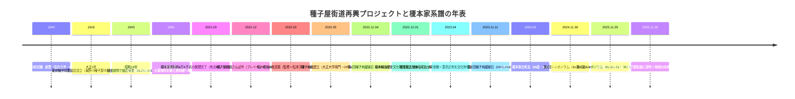

# 2026-11-25（第310回）・種子屋街道シンポジウム既往回の書誌特定と種子地蔵・種子屋三家由来説の新規収録

## 概要

第308回で収録した[GOV-583](../sources/gov/GOV-583.md)（第3回種子屋街道シンポジウム・2026-11-28開催予定の豊島区プレス）を起点に、**既往2回分のシンポジウムの書誌を特定**し、種子屋街道再興プロジェクト関連の資料を掃引した。新規収録は**7件**（BLOG-315〜317・ORG-046〜049、総数1,788→1,795）。**「三軒家」の地名由来説（種子屋元祖三家説）・東京種子同業組合（大正5年設立→昭和18年解散）・榎本家資料6万4千点整理の年次・種子地蔵（2022年5月建立）**がいずれもrepo初出。

## 新規登録（7件）

| ID | 資料 | 一言 |
|---|---|---|
| [BLOG-315](../sources/blogs/BLOG-315.md) | 大竹道茂「江戸東京野菜通信」（2024-12-04） | R6.11.30第1回シンポ参加記。五代目榎本泰吉の死去（2024年2月・96歳）・カネト商報の品種名・屋根保存修理の観察・渡邊正好の係 |
| [BLOG-316](../sources/blogs/BLOG-316.md) | 成島哲子「種子(たね)屋街道」（takitan・2025-04-18・初出＝「月虹」2025年6月終刊号） | 元祖三家＝「三軒家」由来説・東京種子同業組合大正5年設立→昭和18年解散・6万4千点整理→財団設立（R4.12.1）の全系譜 |
| [BLOG-317](../sources/blogs/BLOG-317.md) | NPOいけぶくろねっと告知（2026-11-04投稿） | 第2回シンポ＝R7.11.29説の根拠。報告者名簿と区広報r0711/2511131356・文化財頁2305161242のURL群 |
| [ORG-046](../sources/org/ORG-046.md) | 大正大学プレスリリース（2022-03-31） | 看板5枚設置（監修＝松本洋幸）・観光庁実証事業・種苗資源保護事業の事業名 |
| [ORG-047](../sources/org/ORG-047.md) | 地域構想研究所レポート 齋藤知明（2022-11-01） | 種子地蔵＝2022年5月・南門建立（新造構築物）。第1回縁日2022-11-04 |
| [ORG-048](../sources/org/ORG-048.md) | 同レポート 齋藤知明（2024-04-01） | さんぽ市＝2021-12プレイベントの年次確定。第2回縁日2023-11-11・LocatoneサウンドAR |
| [ORG-049](../sources/org/ORG-049.md) | ＪＡ東京中央会「旧中山道はタネ屋街道」（©2018） | 明治中期問屋9戸・小売20戸・約6km。寛永20年（1643）諏訪の種行商の由緒文言（店名併記は時代考証的疑義） |

## シンポジウム回次の整理と種子屋街道再興の系譜〔観察〕

- **第1回＝R6.11.30（2024）**「種子屋街道の歴史を今に伝える〜榎本家店舗兼住宅の承継と未来への種まき〜」（[BLOG-315](../sources/blogs/BLOG-315.md)+[BLOG-316](../sources/blogs/BLOG-316.md)の参加記×2）→**第2回＝R7.11.29（2025）説**「…地域に根差した種子屋の役割〜これまでとこれから〜」（[BLOG-317](../sources/blogs/BLOG-317.md)告知＋豊島区広報R7.11.13 URL〔区HP本文は現在取得不能〕）→**第3回＝R8.11.28（2026）**「種子屋街道に芽吹く地域の未来」（[GOV-583](../sources/gov/GOV-583.md)・3日後に開催）。
- 命名主体は大正大学「よみがえれ『種子屋街道』」プロジェクト（[BLOG-316](../sources/blogs/BLOG-316.md)の「命名したのもこのプロジェクトと聞く」は聞き書き級）。
- 大正教授の表記対立: PR TIMES（古田尚也）×いけぶくろねっと（吉田尚也）〔断定せず〕。榎本家五代目の娘・加藤氏の表記対立: 「佑子」（BLOG-315）×「祐子」（GOV-583）〔同断定せず〕。

※上図の年次のうち、組合設立・解散・整理完了・寄贈の各年次はいずれも随想・参加記側の文言であって行政一次記録の裏付けはまだない（各source fileの制限欄参照）。

## repo外で今回確認した周辺情報（収録見送り・記録のみ）

- 毎日新聞PR（mainichi.jp/pr2）：豊島区立郷土資料館「江戸・東京の特産物と種子屋」収蔵資料展（2026-7/18〜9/23・約200点・横山恵美学芸員コメント）＝[GOV-583](../sources/gov/GOV-583.md)の枝葉（展示は既に終了）。水系文言なし。必要時に再取得。
- zaikei（3726903）＝大塚駅南口再開発系の枝葉で[第272回]既収録群と重複。

## 監視系・アクセス不能の記録（2026-11-25時点）

- **ro-da API全4コレクション**: 計8,294件不変・最新公開2026-11-15のまま＝新着なし。
- **都公文書館**: 本環境から403（Edge UA＋cookieレシピでも不可）＝「中新井」残り約70件の絞り込みは順送り。
- **Internet Archive**: 一時オフライン（Temporarily Offline）＝Wayback依存課題（PAP-029深田1991紀要20号の本文格上げ・R7区広報2511131356・榎本家文化財頁2305161242）は復旧後に回送。
- **豊島区公式（city.toshima.lg.jp）**: DNS不通（[BLOG-317](../sources/blogs/BLOG-317.md)の区頁2件はURLのみ記録）。
- **edoyasai.sblo.jp**: SSL検証エラー→`curl -k`（証明書検証無効）またはpython ssl CERT_NONEで取得可能。頁はShift_JIS。
- **echo-lab（深田PDF）**: DNS不調・open_urlも遮断（PAP-027は第30回でWayback全文取得済みのため実害なし）。
- **nabunken**: DNS不通継続（PAP-122文化財研究紀要のオンライン全文の発掘は回送）。
- **NDL SRU**: 今回429応答（次回再試行）。
- **kanzyou7 WHAT'S NEW**: 2026/11/24で不変。**都公報第18676号**: 404（初走査は次回以降・AESV3復号レーンの再現手順は[第309回ノート](2026-11-25（第309回）・都公報18675号AESV3復号と全文走査・村上泰賢コラム滝野川大砲製造所シリーズの新規収録.md)§4に保存済み）。
- **kensetsunews検索**: 会員登録必須で利用不可（個別記事頁は直接取得可）。
- **jasta.or.jp**: SSL遮断（R6シンポ案内頁は不要と判断、edoyasai/takitan参加記で代替済み）。
- wheatbaku（exblog）幕末大砲製造所シリーズの未確認頁（⑧等）＝[BLOG-127](../sources/blogs/BLOG-127.md)と同シリーズのため、新規文言の有無の確認のみ次回回送。

## 技術メモ

- 今回の7件はいずれも通常のcurl/ブラウザ系取得で本文全文を確保（edoyasaiのみ上記SSL注意・JA東京中央会頁は通常取得・chikouken 2頁はpublished_timeのog属性で日付確定・takitanはcanonical URL＝パーセントエンコード形式）。
- 採番はpush直前にINDEX実装の実測で確認（blogs 313→316、org 45→49、総数1788→1795）。
- push構成: ①新規7source+本ノート→②ヘルパー3点（.310-bullet.txt・.310-insert.py・.github/workflows/insert-310.yml）→Actions botがINDEX行挿入（BLOG-314後・ORG-045後）＋見出し計数＋総数更新＋README 77行目へのbullet挿入＋ヘルパー自己削除。

## 次回以降の課題

1. **開札2026-12-02（環七調節池広域整備検討その2＝[GOV-148](../sources/gov/GOV-148.md)）の結果公表の確認**＝最優先（実行日が12/2以降の場合）。12-16（[GOV-582](../sources/gov/GOV-582.md)）も未公表を継続監視。
2. **第3回シンポジウム（2026-11-28）開催後の資料**（配布資料・報告要旨の公開有無）＝12月上旬に見込み。
3. **IA復旧後**: PAP-029本文格上げ・R7区広報2511131356・榎本家文化財頁2305161242・都公文書館403の離脱確認。
4. **都公報第18676号**: 発行後のAESV3全文走査（第309回ノート§4のレーンで即時対応可）。
5. NDL SRU 429の再試行・nabunken（PAP-122全文）・北区史通史編「千川上水見廻取締方」章本文・[BOOK-313](../sources/books/BOOK-313.md)〜[BOOK-318](../sources/books/BOOK-318.md)現物確認の順送り。
6. Locatone「くノ一戦隊」音声ガイドの配信現況確認（[ORG-048](../sources/org/ORG-048.md)）。
