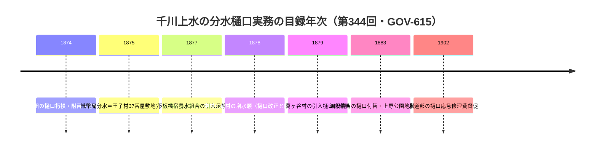

# 第344回（2026-11-26）・都公文書館「養水」「樋口」「白山御殿」掃引完結で分水樋口実務8件（GOV-615）・寛永江戸庄図第4シートと木版無彩版の所在特定（MAP-058追記）

## 1. 実行概要

- HEAD再照合: 開始時点で `01c671f1`（第343回bot）＝並走なしを確認し第344回として採番。
- 本回の成果: ①都公文書館クロス検索の「養水」（98件）・「樋口」（全16頁・約1,543件・頁送り完結）・「白山御殿」（170件・2頁）掃引で千川系8件の目録詳細確認 → [GOV-615](../sources/gov/GOV-615.md)。②TOAで寛永9年江戸庄図の第4シート42417（複製色刷・A13-3系）と木版無彩小型版54531（A13-1カ）の詳細頁・ajaxコマ数確認 → MAP-058追記。③「白山御殿」は水路文言なしの陰性確認。
- 総数1879→1880・行政612→613。

## 2. GOV-615の内容（千川系8件・いずれも目録レベル・本文未見）

| pkey | 件名要約 | 年 | 簿冊・請求番号 |
|---|---|---|---|
| 819071 | 上保谷新田地先千川田用水分水樋口朽損・附替（元樋口跡塞方）・熊谷県管下 | 1874 | 606.B5.06・府明Ⅱ明07-067・コマ0006-0766 |
| 330166 | 下板橋宿養水組合村々引入方示談相整 | 1877 | 608.B4.02・府明Ⅱ明10-044・コマ0006-0794 |
| 689285 | 中村他16村 千川田養水不足に付増水願 | 1878 | 609.B7.07・府明Ⅱ明11-053・コマ0006-0854 |
| 699054 | 千川宿葛ヶ谷村田養水引入樋口修繕願（総代名倉甚右衛門） | 1879 | 610.C4.07・府明Ⅱ明12-054・コマ0006-0670 |
| 714019〜714022 | 渡坂清吉引用の分水樋口付替（千川水道会社・博物局・上野公園地掛り樋線） | 1883 | 613.B5.06・府明Ⅱ明16-058・コマ0006-0582 |
| 715278 | 博物局の上野公園地引用の千川上水樋口取付通知・立会 | 1883 | 613.A6.08・府明Ⅱ明16-026・コマ0006-0319 |
| 822393 | 紙幣局用水分水＝王子村地内37番屋敷地先の回答（府→紙幣寮） | 1875 | 601.A8.14（第139号）・市明Ⅰ明18-001・コマ0006-0500 |
| 305978 | 分水樋口応急修理費支払方督促（水道部・神田千川上水簿冊） | 1902 | 625.C4.26・市明Ⅰ明35-010・コマ0295-0561 |

新出文言・人名: 「元樋口跡塞方」「千川宿」「熊谷県管下」（819071/699054）・「渡坂清吉」「名倉甚右衛門」（樋口付替・修繕の実務者）。

## 3. MAP-058追記（寛永9年江戸庄図のシート完結）

- **42417**: 複製色刷・89.2×124.7cm・A13-3/東A13-003・4300037580・1コマzoom約1.9MB〔ajax〕＝第343回の3シートに続く第4シート（A13-3系の別請求）。
- **54531**: 木版無彩・39.0×54.0cm・A13-1カ/東A13-001カ・4300037561・1コマzoom約1.1MB〔ajax〕＝小型無彩版で東京誌料所蔵は4系統6シートが出揃った。
- 48527/48529（寛永江戸庄図）は詳細頁500が継続（再試行2回）＝次回回送。

## 4. 重複確認・見送り

- 481565（千川養水流末架渡橋銘呼名）＝[GOV-608](../sources/gov/GOV-608.md)既収録。380247（千川水道樋口伏換却下・本橋勝右衛門）＝[GOV-588](../sources/gov/GOV-588.md)③既収録。715262＝第313回ノート（GOV-588 dedupe監査）既知。822368・686329・687746・687750・1018961＝[GOV-587](../sources/gov/GOV-587.md)既収録。
- 1044186「板橋宿根村水堰取調」（1885・荏原郡田用水簿冊）＝添付が瀬田村・和泉村等の玉川上水系で千川系の可能性低い〔推定〕＝見送り（ノート記録のみ）。
- 551822/551826/551835（石神井川養水以南の戸数取調）＝石神井川側でスコープ外。三田養水・六郷領養水群も水系外。
- 「樋口」掃引の地名同人名（樋口裕一・樋口鼎等）は人名で水路無関係〔陰性〕。

## 5. 監視系（第344回観測）

- 都公報第18677号=404（11/27発行前）＝**第345回第一走査（AESV3レシピは第309回ノート§4.1から再構築）**。
- metro.tokyo.lg.jp系の403は本回は未再試行（18677.pdfのみ404確認・発行前の可能性が高く403との区別に注意）。
- **開札2026-12-02（GOV-148環七調節池広域整備検討その2）・12-16（GOV-582環七地下河川基本検討）＝開札後最初の実行で最優先（第272回から順送り）**。
- 都公文書館: 第337〜343回の403が解消し全面200復旧〔確認〕（GETレシピ・sleep挿入で16頁の頁送りも安定・throttle発火なし）。
- TOA: 「湧水」500再試行で再び500（継続）。48527/48529詳細頁500継続。川名系エラー頁・地名系200の構図不変。ajax画像リストAPI（POST /da/ajax/image・data: start=0&tilcod=…&page=1）はsleep 8秒で安定動作。
- jpsearch 4語不変（千川上水132・谷端川45・弦巻川7・水窪川70）。kanzyou7=000（変動型）。NDL SRU応答なし（次回再試行）。『生活と文化』第34号・wanjin entry-671=404不変。
- 「養水」「樋口」「白山御殿」の次の掃引候補: 「樋」単独・「圦」「堀留」「水車」（千川筋は文化4年以降不許可系の文書群が濃い）。

## 6. 技術メモ

- 都公文書館の頁送りは `&pn=N`（c12_fはURLエンコード・chkCls個別パラメータ繰り返し）。1リクエスト毎sleep 5〜12秒で16頁連続もthrottleなし（第337回の「大量取得後403」は頁内リンクの大量同時取得が原因の可能性）。
- 掃引結果の抽出は `detail?cls=collection_04&pkey=N` の `<th>/<td>` 対（公開件名・文書年度・収録先簿冊の資料ID・請求番号・MF・コマ）。一覧頁は `【資料名称】…【収録先の名称】` 形式。
- TOA ajax画像APIの正しい形式は `POST /da/ajax/image`（form: start=0&tilcod=<tilcod>&page=1）で `{"size":…,"total":…,"zoomImageSizeList":[…]}` が返る（第344回実測）。GET /da/image/list は404。

## 7. 採番現況・READMEメタ

- 使用済み最大＝**GOV-615**。次回新規は **GOV-616・BLOG-322・BOOK-336・ORG-051・PAP-123・GAZ-198・MAP-242・LOST-006** から（push前にINDEX.md実測再確認が約束）。
- READMEの第344回bulletは `- **第343回:` 行（110行目・push前に再確認）の直後にヘルパーで挿入。

## 8. 次回（第345回）課題（優先順）

1. **都公報第18677号（11/27発行済みのはず）の初走査＝第一走査**（AESV3レシピは第309回ノート§4.1から再構築）。
2. **開札2026-12-02（GOV-148）の入札結果確認＝開札後最初の実行で最優先**（12-16 GOV-582もkensetsunews.com等で）。
3. TOA 48527/48529詳細頁の再試行（500が続く場合はWayback）。「湧水」「練馬」500の継続監視。
4. 都公文書館「樋」「圦」「堀留」「水車」掃引（sleep挿入・GETレシピ）。
5. human判読系（GOV-615の8件本文〔MF〕・MAP-058の6シートzoom・GOV-609橋梁明細書・BOOK-334西巣鴨町誌・MAP-233高田町全圖等＝ユーザーPC到達不可のためデスクトップ環境時に回送）。
6. 監視系（ro-da 12月下旬四半期新着・『生活と文化』第35号・NDL SRU再試行・kanzyou7）。

**この定期タスクは更新可否にかかわらず継続（停止しない）。**
