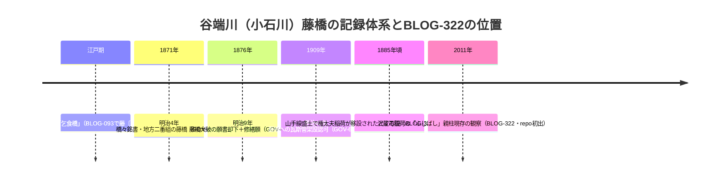

# 第349回（2026-11-26）・暗渠ハンター神田川水系カテゴリの全面掃引＝藤橋親柱現存・葛が谷分水・弁天分水等の新規5 source

## 1. 概要

- 第348回bot（f6fccc97）からの継続。push前HEAD再照合で並走なしを確認。
- 都公文書館（403）・都公報18677（metro.tokyo.lg.jp 403）・TOA川名系キーワード（「湧水」「練馬」「要町」500）・48527/48529詳細頁（500・Wayback未収蔵）・ro-da（apexがDNS不通・wwwはスタブでdisp(SrBookList)404）・kanzyou7・nabunken・photo-archive.jpは本回も不通。**このため本回は第27回以来となる「暗渠ハンター（lotus62ankyo.blog.jp ミラー）のカテゴリ別全面掃引」を主軸に実施**し、新規5 source（BLOG-322〜326・総数1,884→1,889・ブログ320→325）を検出した。

## 2. 掃引の方法と完全性

- blog.jpミラーのカテゴリアーカイブ（`/archives/cat_XXXXXX.html?p=N`・1頁あたり記事約5〜10件・各頁6〜8秒sleep）を頁送りで全取得し、各頁埋め込みの `ld_blog_vars.articles.push({permalink, title})` から（記事ID, タイトル）対を抽出した。
- **「2055：神田川水系」（cat_189272・75記事・p1〜16完結）**: repo既収録27 URLと照合し、四河川関連の未収録候補を本文取得して確認。
- **「2060：用水・上水など水路系」（cat_189269・79記事・p1〜17完結）**: 葛飾マナイタ放浪記・玉川上水・小岩用水等で、**四河川関連記事0件＝陰性を完結確認**（第344回の「樋」「圦」「堀留」「水車」掃引と同型の包括陰性記録）。
- 技術メモ: ①`grep -o 'archives/[0-9]*\.html'`ではサイドバー常設リンク（直近5件）が混入するため ld_blog_vars 抽出が正規手段。②`sort -u`（辞書順）と`sort -un`（数値順）を混在させるとcommが黙って破綻する（全件「新規」に見える）＝両側とも`sort -u`で統一。

## 3. 新規収録の内容（BLOG-322〜326）

1. **BLOG-322（2011-10-31・7712039）「小石川の「おあな」と南大塚の「藤橋」」**: **沢蔵司稲荷（文京区小石川3丁目）に谷端川（小石川）の藤橋の親柱（「ふじばし」平仮名彫り）が現存するという2011年観察記録＝repo初出**。権太夫稲荷（南大塚1-60）の山手線盛土移設説・火消六番組説を二次転記。GOV-606/607の府側藤橋実務群（1876大破・1909瓦斯管架設）・GAZ-197/048・BLOG-093（乞食橋＝藤橋）と、遺構側の観察が初めて接続した。**橋梁史の最重要新資料**。スリバチ状の「おあな」霊窟（枯れた池跡2か所・淵の排水水路）も観察記録。
2. **BLOG-323（2012-03-29・7712070）葛が谷分水の全流路踏査**: 千川上水左折点を直進し清戸道へ（GOV-005の南長崎6丁目曲折点と対応）。**名倉水車（絹糸撚り・repo grep新出の水車名）**・**弁天池の雨乞い神事（池の底掃除・白砂）＝水利習俗記録repo初出**。『ふるさとは西落合』2001・『同 三』2003（西落合まちづくりの会）・『長崎村物語』1996（豊島区郷土資料館）のrepo未収録書誌3点を特定。
3. **BLOG-324（2012-09-19/26・7712109+7712110・2回を1 source集約）**: ①濯川の学内現況＋**『建築文化』496号（1988-02）「武蔵学園濯川蘇生計画」（内田祥哉）＝repo未収録書誌の新規特定**・千川上水と羽沢支流（石神井川水系）を結ぶ水路の痕跡〔著者自身が想像と明記＝仮説〕。②弁天分水（＝BLOG-320の第2中新井分水）の全流路＋市杵島神社（弁天祠・池・橋の遺構の一説）＋「豊玉中川（仮）」（湧水源の単独川・環七とよきた緑地が湧水地候補〔推定〕）＋2012年時点の直径2m超雨水貯水管工事の観察。
4. **BLOG-325（2012-10-03・7712111）愛心幼稚園支流（谷端川）の上流端西方延長**: BLOG-057の水源比定（山手通り内側の窪地）を、コメント欄の指摘で山手通り西側へ延長し「かねまつ」前の公園まで確認。「**谷端川の支流沿いには『水源＝公園』という箇所もいくつかある**」の傾向指摘。中落合3-2-16の苔の暗渠道（支流への合流推定）。
5. **BLOG-326（2020-07-12・23979528）中丸川上流端の2020年現況**: 板橋二中北側に開渠が現れる（1ブロックで暗渠化）＝BLOG-105（水徒然2013）の約7年後の確認。**中丸川そばの水神社＝平成19年に祀り直したとの境内記録〔repo初出〕**。中丸川の千川上水接続群（BLOG-081/088・GOV-615）の現況裏付け。

## 4. 陰性・見送り・監視系（第349回観測）

- **神田川水系カテゴリの他の未収録記事は四河川スコープ外**（妙正寺川・桃園川・井草川・神田川支流・仙川・目黒川系等）で見送り。**「用水・上水など水路系」カテゴリは四河川関連0件で掃引完結〔陰性〕**。
- 監視系: jpsearch 4語不変（千川上水132・谷端川45・弦巻川7・水窪川70）。NDL SRU 429（レート制限・次回再試行）。wanjin FC2最新=entry-670（entry-671以降404・新規投稿なし）。都公報第18677号=403（11/27発行前）＝**第350回第一走査（AESV3レシピは第337回ノート§2の6修正点から再構築）**。**開札2026-12-02（GOV-148）・12-16（GOV-582）は開札後最初の実行で最優先**。TOA「高田」「目白」「神田」「王子」は200で掃引したが、浮世絵・電話帳・近衛邸図面群等で四河川関連の新規sourceなし〔陰性〕。kanzyou7・ro-da・nabunken・photo-archive.jpは不通。
- **第346回ノートの半角スラッシュ誤パス問題はgitバイナリ不在のため本回も未修正**（git環境時に全角スラッシュ版再push＋誤パス側削除＋README bulletリンク書換）。

## 5. Mermaid: 藤橋の記録群の接続（BLOG-322の位置づけ）

## 6. 次回（第350回）課題（優先順）

1. **開札2026-12-02（GOV-148）の入札結果確認＝開札後最初の実行で最優先**（12-16 GOV-582もkensetsunews.com等）。
2. **都公報第18677号の初走査＝第一走査**（metro.tokyo.lg.jp 403の解除/別ルート・AESV3レシピは第337回ノート§2の6修正点から再構築〔encrypt・AES-256-CBC IV=0・file key直接・元CID・last-wins・hex4桁〕）。
3. 都公文書館403の再試行→「水車要録」簿冊残り・橋々銘書残差仕分け（第337回ノート§1GETレシピ・chkCls個別パラメータ繰り返し必須・sleep挿入）。
4. **BLOG-322の現地確認課題: 沢蔵司稲荷の藤橋親柱の採録（銘・形式・「ふじばし」彫刻）と権太夫稲荷（南大塚1-60）の対応確認**＝human確認待ち（ユーザーPC到達不可のためデスクトップ環境時に回送）。
5. BLOG-323の『ふるさとは西落合』2001/2003・『長崎村物語』1996・BLOG-324の『建築文化』496号の所在確認（NDL・区立図書館）。
6. TOA「湧水」「練馬」「要町」500の継続監視・48527/48529詳細頁再試行・NDL SRU再試行。
7. ro-da 12月下旬四半期新着（DNS/スタブ問題の継続監視）・『生活と文化』第35号・第346回ノートパス修正（git環境時）。

**この定期タスクは更新可否にかかわらず継続（停止しない）。**
