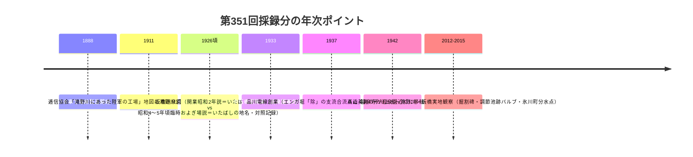

# 第351回（2026-11-26）

第350回bot（HEAD=3607c199）からの継続。push前HEAD再照合で並走なしを確認の上、**暗渠ハンター（lotus62ankyo.blog.jpミラー）の「2056：石神井川水系」カテゴリ（25記事・p1〜5完結）の全面掃引**を主軸に実施し、四河川関連の未収録9 source（BLOG-327〜335）を新規採録した。

## 1. 掃引の方法

- blog.jpミラーのカテゴリアーカイブ `https://lotus62ankyo.blog.jp/archives/cat_189276.html?p=N`（p1〜5・sleep 6〜8秒）を全取得し、各頁埋め込みの `ld_blog_vars.articles.push({...})` から（permalink, title）対を抽出（**キーはシングルクォート+空白入り（`permalink : '...'`）で、第349回の二重引用符パターンと異なる点に注意**）。25記事中7712079（エンガ堀横・旭丘支流＝BLOG-126）のみ既収録と判明。
- 四河川関連の本文候補14記事を本文取得し、うち9 source分を資料化。北耕地川・桜台早宮支流・貫井川等の純石神井川支流記事はスコープ外として見送り。

## 2. 新規採録9 sourceの要点

### BLOG-330（滝野川3丁目支流2本）＝本回の最重要

千川上水（板橋駅〜西巣鴨・滝野川）の実地踏査で、①**「掘割」交差点の小碑で二手に分かれる分配点**（六義園ルート＋王子製紙工場ルート）の現地観察＝BLOG-095（分配堰碑）・BLOG-113（明治4年境橋上流分水口変更）の観察側補強、②**「千川上水調節池跡」案内板と明治期の六義園方面水の調節バルブ健在**＝GOV-065（沈殿池・水量調節給水）・BLOG-053の現地裏付け（**バルブ健在はrepo初出の観察**）、③都電西ヶ原4丁目の直角曲折・中山道交差以東の谷頭。④石神井川「滝野川3丁目支流」の石積み護岸残存・紅葉橋下流合流、⑤『北区の歴史 はじめの一歩 滝野川西地区編』p33の陸軍工場地図（1911・逓信協会）に水路描画、⑥郷土史研究誌**『滝野川』第7号**（repo初出書誌）に滝野川第三小付近の川の記載。

### 田柄川系の整理（BLOG-327/328/331/332）

- **田柄川（自然河川・光が丘起源）と田柄用水（明治初期・田無用水〔玉川上水系〕から分水・田無駅そば起点）の系統整理文言**（BLOG-327/328）。**BLOG-118「千川上水から田柄川を引いた説〔伝聞〕」に対する弱める根拠候補**（千川上水は用水系統に現れない）。
- **「あげ堀＝田柄川呼称の混同問題」の明示文言**（BLOG-331）: 石神井川左岸のあげ堀（桜台安養院裏に現存）は田柄川と交差し、「地図によっては堂々と『田柄川』と書かれる」が『いたばしの河川』（文化財シリーズ第52集・S61年）は両者を区分＝**田柄川水源伝承の多義性（揚げ堀〔石神井川取水〕/田柄用水〔田無〕/千川導水説〔伝聞〕）が並立する構造**を初めて文章レベルで整理できた〔推定を含む・断定しない〕。
- 田柄川下流3支流（北町都営住宅・平和台・氷川台）の読図＝千川上水中流域と近接する谷系統（BLOG-328）。上板橋の子育て地蔵→田柄川「どぶ川」・茂呂山下の揚げ堀・湿気味橋（BLOG-332）。

### エンガ堀（BLOG-329）・氷川町支流（BLOG-333）＝千川上水→石神井川系接続の補強

- **「千川上水の分流を受けた練馬区旭丘と豊島区南長崎の境から流れてくる支流」（「乗」の支流）の明示文言**・浅間神社裏の湧水池（「除」の支流の水源）・能満寺前のはしご式開渠（本田創情報・2013年補記）・品川電線（1937創業）の水車仮説（断定せず）。
- **石神井川氷川町支流＝「千川上水からの分水が谷を伝って降りていく」水路の分岐点の実地観察**＝BLOG-104「氷川町の水路分水口」の観察側独立裏付け。板橋競馬場の起伏トラック（『創立50周年 中板橋のあゆみ』・repo初出書誌）。

### 湧水系（BLOG-334/335）

- 市杵島神社（豊玉中）の池＝湧水源の特定〔観察〕＝BLOG-324「豊玉中川（仮）」・弁天祠記録の補強（BLOG-334）。
- 羽沢支流の谷が環七内側（千川上水側）に延長しない可能性＝**BLOG-324「千川上水と羽沢支流を結ぶ水路」仮説への限定条件データ**（BLOG-335・断定せず）。

## 3. 時系列整理（本回分の新出年代・定点）

## 4. 陰性・見送り・監視系（第351回観測）

- **都公報第18677号**: metro.tokyo.lg.jp 403継続（Waybackはトップ頁のみで公報頁未収蔵）＝**第352回第一走査回送**（AESV3レシピは第337回ノート§2の6修正点から再構築）。
- **開札2026-12-02（GOV-148）・12-16（GOV-582）は開札後最初の実行で最優先**（kensetsunews.comの検索は本回時点で該当なし＝開札前のため当然）。
- **都公文書館**: 全面403継続（cookie jarでも不可）＝「樋」「圦」「堀留」「水車」の追加掃引は回送。
- TOA: 「湧水」「練馬」「要町」500・48527/48529詳細頁500継続（Wayback未収蔵を再確認）。
- jpsearch 4語不変（千川上水132・谷端川45・弦巻川7・水窪川70）。NDL SRU復旧（title=千川上水照合は次回）・『長崎村物語』5レコード確認（第350回のBOOK-336と整合・『続・長崎村物語』の単行書誌はNDLになし＝本文所在は未確認のまま）。
- ro-da: apex DNS不通・wwwはスタブ頁（四半期新着は回送）。wanjin entry-673=302（新規投稿なし）・kanzyou7=200復帰・nabunken SSL期限切れ継続・photo-archive不通・sitereports DNS不通（article/5023は回送）。
- 『いたばしの河川』の系列書誌（文化財シリーズ第52集・第56集『写真は語る』）と『いたばしの地名』『北区の歴史 はじめの一歩 滝野川西地区編』『滝野川』第7号『創立50周年 中板橋のあゆみ』『近代日本の伸銅業』『地形を楽しむ東京「暗渠」散歩』は本回はブログ経由の二次記録段階＝直接確認が次の一手。

## 5. 採番現況（第351回終了時点）

- INDEX 1,901件＝地図241・地誌197・書籍336・論文121・行政617・ブログ334・企業50・消失5。使用済み最大＝**BLOG-335**。
- 次回新規は**GOV-620・BLOG-336・BOOK-338・ORG-051・PAP-124・GAZ-198・MAP-242・LOST-006**から（push前にINDEX.md実測再確認が約束）。

## 6. README bullet挿入メタ（第352回用）

- 次回は`- **第351回:`行の直後に挿入。INDEXは新規source登録時のみ。

## 7. 次回（第352回）課題（優先順）

①**開札2026-12-02（GOV-148環七調節池広域整備検討その2）の入札結果確認＝開札後最初の実行で最優先**（12-16 GOV-582もkensetsunews.com等）。②**都公報第18677号（11/27発行）の初走査**（AESV3レシピは第337回ノート§2から再構築）。③都公文書館403再試行→「樋」「圦」「堀留」「水車」掃引（第337回ノート§1GETレシピ・sleep挿入）。④本回二次書誌の直接確認（『北区の歴史 はじめの一歩 滝野川西地区編』・『滝野川』第7号・『いたばしの河川』第52/56集該当頁・『中板橋のあゆみ』・本田創『地形を楽しむ東京「暗渠」散歩』のエンガ堀・田柄川章）。⑤暗渠ハンターの残カテゴリ（「2080：暗渠・川筋で拾ったかけら」94記事等）の掃引継続と「板橋湧水跡めぐり」第1回・第3回（志村地区）の取得。⑥TOA 48527/48529・「湧水」「練馬」「要町」500再試行。⑦やとじぃ（平田英二）webの所在確認・練馬区の田柄川/田柄用水公式解説ページの資料化。⑧監視系（ro-da四半期新着・NDL SRU千川上水title照合・『生活と文化』第35号・nabunken・photo-archive.jp）。⑨human判読系（BLOG-330の滝野川3丁目支流護岸の現地採録・調節池バルブの写真確認等＝**ユーザーPC到達不可（scheduled task実行）のためデスクトップ環境時に回送**）。**この定期タスクは更新可否にかかわらず継続（停止しない）**。

## 8. 作業ファイル

/home/user/work351/（lab/=カテゴリ掃引HTML・本文取得分・repo展開〔HEAD 3607c199〕・out/=push原稿〔BLOG-327〜335・INDEX・本ノート〕・次回実行で消えて可）。
